# YannicKilcher【中英⚡AI经典论文领读(全203篇)(上)｜Papers Explained】 p33 P39 弗朗索瓦·肖莱的《论智能的衡量》第四部分：ARC挑战赛（论文解析） [BV1o3xLznExj_p33]

Hi there and welcome to the last part of on the measure of intelligence by Fosoa Chalet this last part concerns the Arc challenge that Chalet has proposed or the Arc dataset。

 which stands for the abstraction and reasoning corpus。

 and we're just quickly going over the dataset， look how it's built and discuss what kind of solutions might be relevant right here。

So if you haven't seen the last videos in this series， this is the last one of a series。

 you might not exactly know what's going on。 but I think you can。

 you can keep up pretty well because this part is fairly independent of the other parts。

 and it's just cool to think about， even if you haven't seen the other ones。

 I encourage you to go see the other ones。 but it's not necessary。

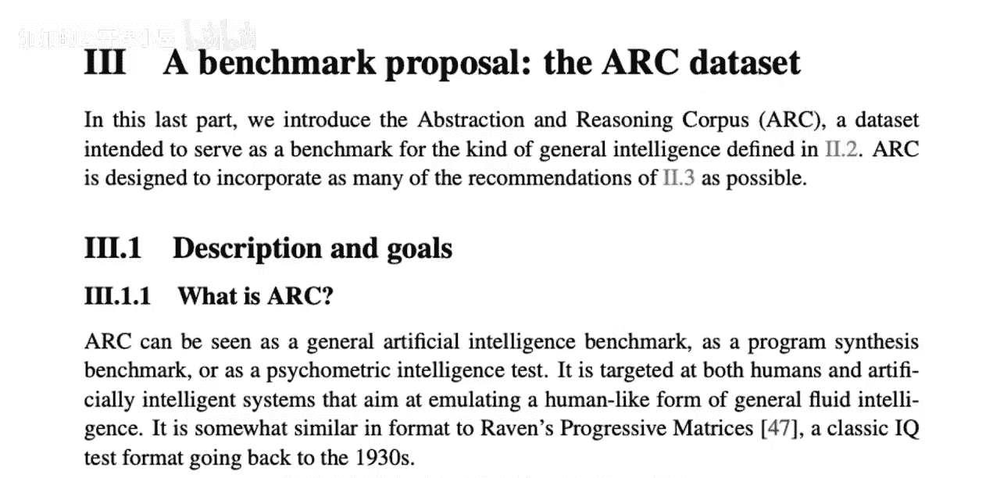

Okay。Let's jump in。 So the arc is a challenge currently running a kle challenge， but in essence。

 it is a dataset set。 And let me just jump into one of the tasks of the dataset。

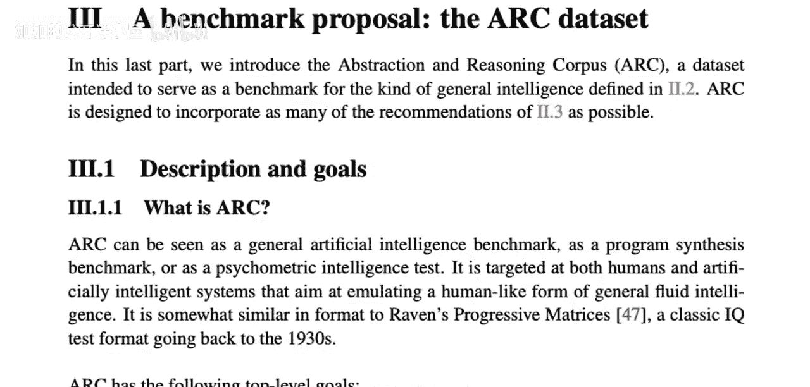

So in this data set， you always have the task in the following form。

 so you always have multiple input examples like this or。

Sa these are called the training examples and then you have a test example in this case you have three training example of one test example。

 so an entire， if you think of this in a machine learning way， this entire thing here。Is your X。

 And this thing here is your Y。 Okay， so the label is going to be the output of the last example that you。

 you don't know that。Now， in in the， course， in the training data set， you do。 But in the test。

 you don't。 So each one of these， as I said， is， is。

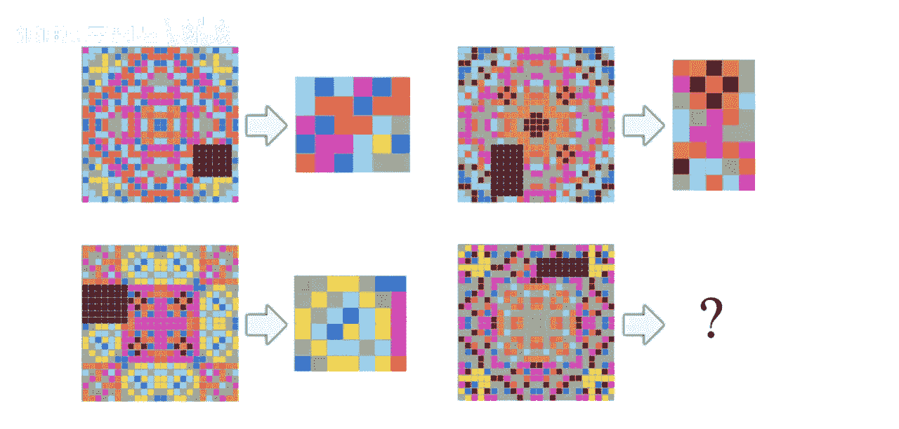

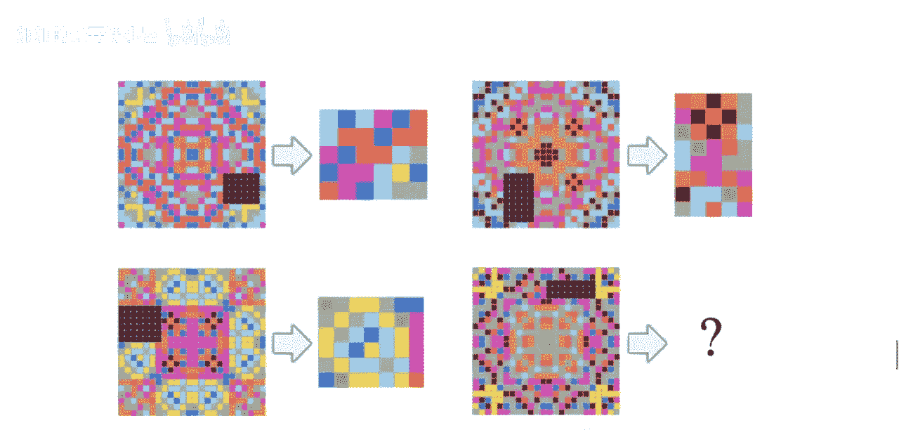

Is demonstrated。 These are the demonstration examples。

 And then you're supposed to sort of learn the regularity out of the demonstration examples。

 And then on this test example， you are supposed to apply this regularity that you learned。

 So in here， a human can fairly accurately see that there are these black squares in each image。

 And that in the training samples， the output will always sort of exactly match into the place of these black squares。

 As you can see， this is like a high rectangle， it goes here。

 it has the same amount of tiles and so on。 And you can also see that whatever colorss are in here。

 sort of。

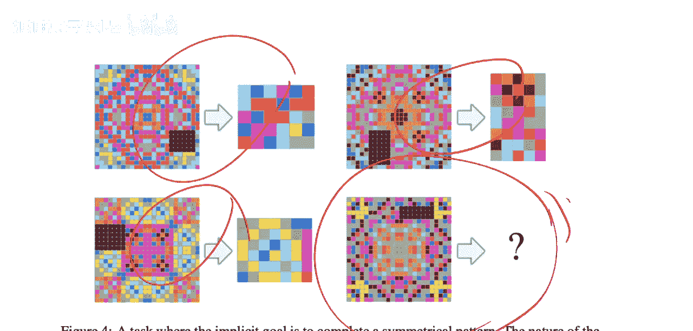

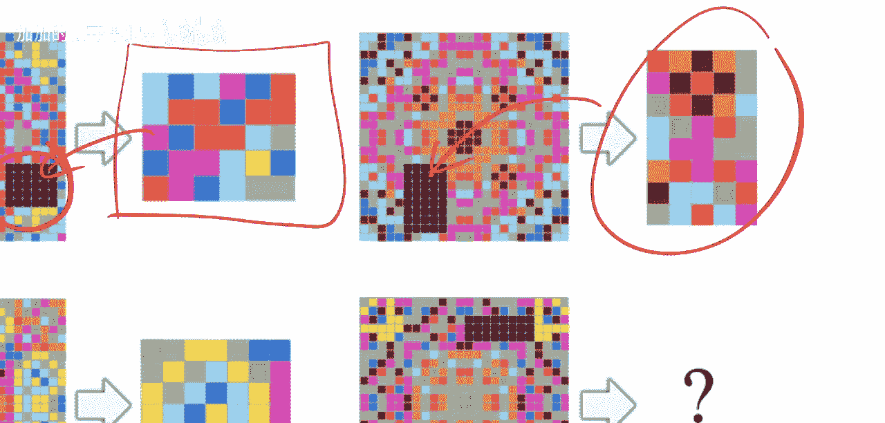

Orre the continuation of a symmetric pattern。 So here， this is exactly the same as up here， but。

 you know， flipped or turned by。180 degrees。So there is a notion of symmetry right here。

 so technically one could compute this one would say， oh。

 that's probably going to be the three rows and this bunch of things and it's probably going to be the same as this one down here but just flipped on its head。

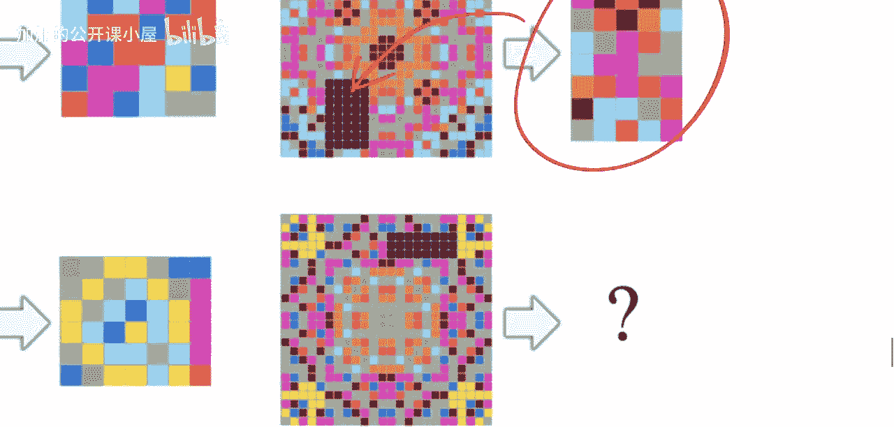

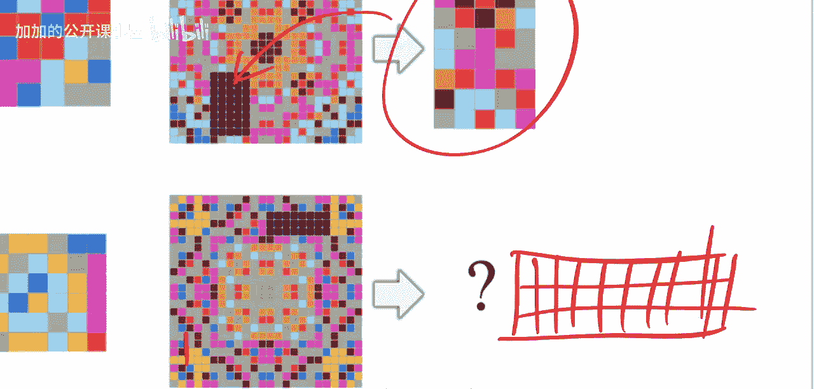

So as a human you get this even without a description。

 you realize like oh this is like a regular pattern， it's symmetric。

 there's a hole in it and apparently the thing here always fills the hole。

 I can see that you know three examples are enough for me to confirm that that's what's going on and I see the whole here so I'm going to do the same thing。

So you can already see how these things are constructed in every， this is not the only task。

 by the way， this is just  one task。 Okay， there are 1000 tasks in this data set of this sort of nature。

 Now， there are not always three demonstration examples， I believe there can be more or less。

 But what's always the case is， they always each of these training examples consists of these demonstration examples and this test example。

 Each of the demonstration examples consists of an input grid and an output grid。

 The input grid and output grid， they can be anywhere from one by one to 30 by 30。

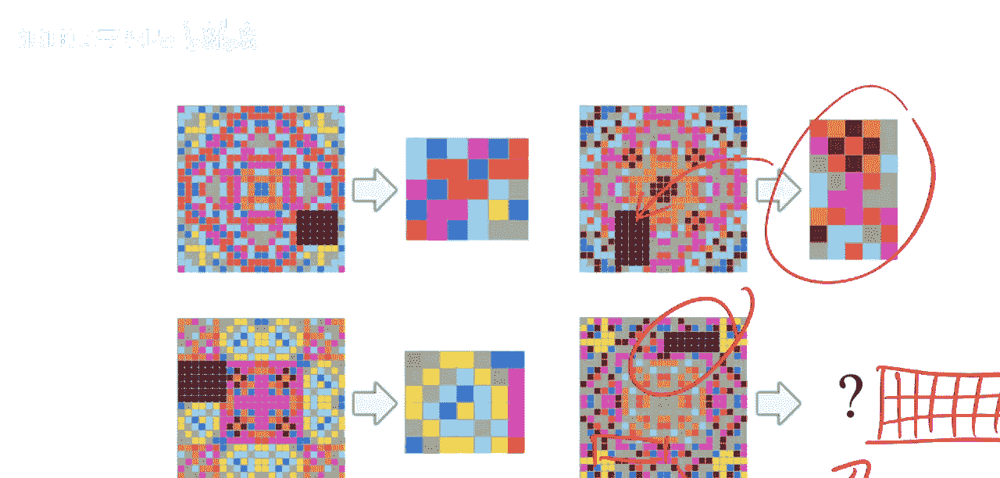

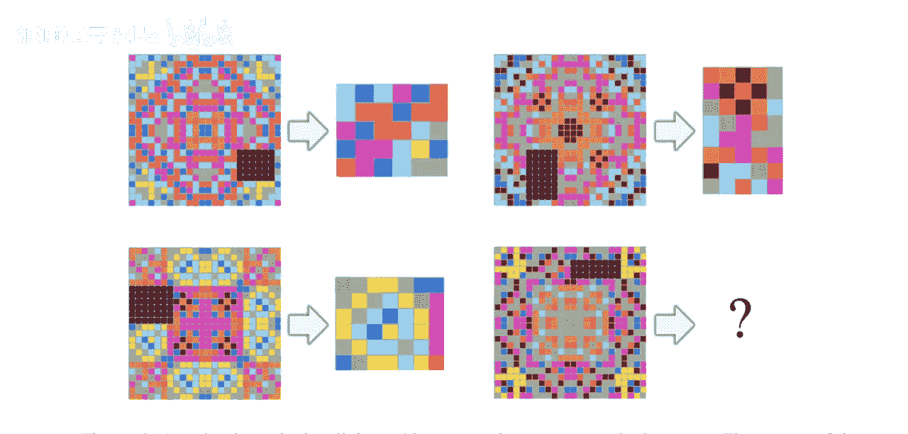

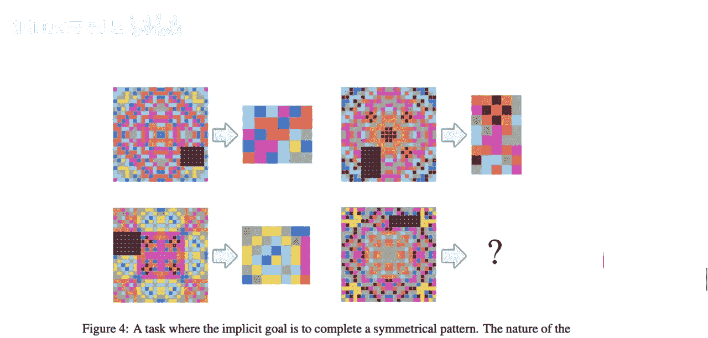

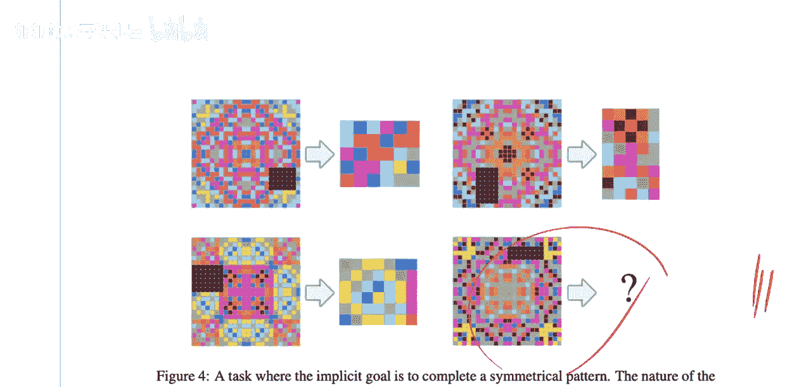

Okay， anywhere in between that。And the colors here。

 I believe there are nine different colors that can go that are just encoded by nine different numbers。

 but there are nine different colors that these things can have。 You can see black， blue， orange。

 red， dark， blue， and so on。And the output grid exactly the same。Now in this test example。

You can only see the input grid。 You cannot see the output grids。

 And that means you don't even know how large it should be。 You can see right here。

 they're not all the same size。 the output grids。 In fact。

 not even the input grids have to be always the same size。

 but you have to now come up with an output grid。 You have to first decide how big it is。

 And we' here we've determined since the whole has three rows。

 we're probably going to make three rows， and it has like 7 columns。

 We're probably going to make 7 columns。

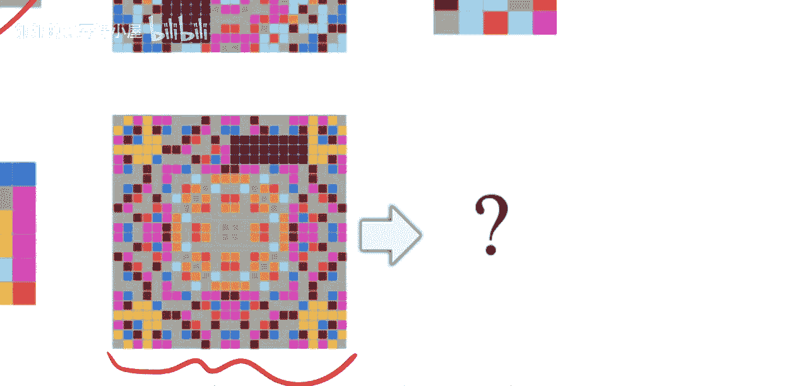

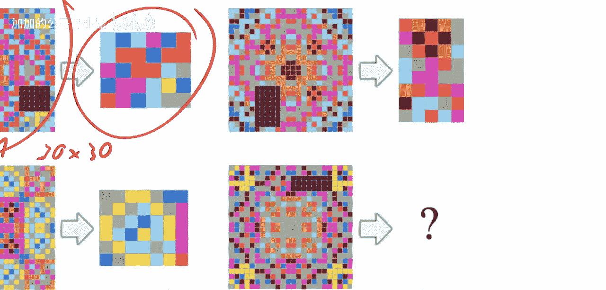

And。That's the sort of thing you have to do。 And then not only do you have to decide how big it is。

 you now have to decide in each cell， what color you put in。

 And only if this thing exactly matches the train or the test label。 you get a， you get a point。

 Otherwise， you get no point， okay。

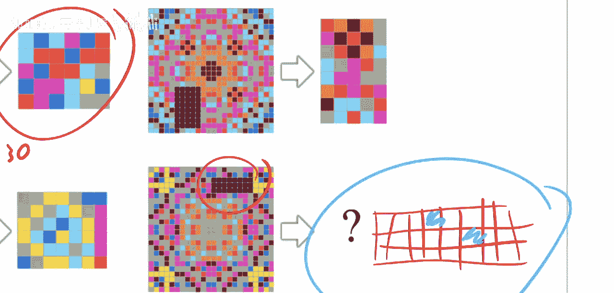

So in the training task， there are， I believe， 400 of these tasks and then there are 400 more as test split。

 but these are still public and then there are 200 that are secret。

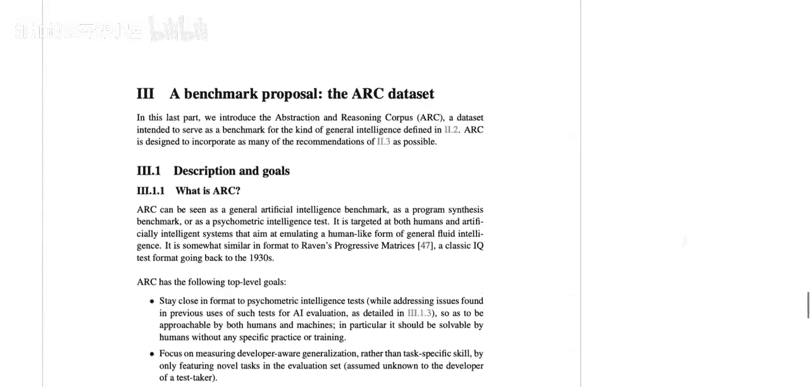

Now， I guess part of this kle challenge。Yes， the training set features 400 tasks。

 while the evaluation set features 600 tasks。The evaluation set is further split into a public evaluation set of 400 tasks and a private evaluation set of 200 tasks。

 All tasks are unique and the set of tasks and the set of training tasks are disjoint。

 Sorry of test tasks and training tasks。The task data is available at this。

 as you can see right here。So I really hope that Chilet will keep these 200 tasks as a secret。

 even after the Caggal challengellenge， because it's going to be fun for people that might want to get into this later。

So here are the goals of this data set。 They want to stay close to these psychometric intelligence tests。

 they say in particular it should be solvable by humans without any specific practice or training and probably also without any language instructions so you just be able to set a human in front of it and the human should be able to solve it or。

A large portion of humans should be able to solve it。 right， Ideally。

 this test would also differentiate humans from each other， but。At this point。

 we want to simply assess machines。So they say focus on measuring developer aware generalization rather than task specific skill by only featuring novel tasks in the evaluation set。

 and the novel tasks are unknown to the developer of a test taker， so if I develop a system。

 I don't know what are these 200 tasks that cha keeps hidden。

 I simply submit my code and I'll figure out if my code does well on them。

So they say they want to feature a highly abstract task must be understood by a test taker using very few examples。

 that's what you saw you don't have a big training example to learn that this task is about symmetry and whole filling。

 you only have three。And from three， you need to recognize what's going on and produce the output of the test sample。

 right。U。Quality control for experience by only providing a fixed amount of training data for each task。

 that's what we saw and only featuring tasks that do not lend themselves well to artificially generating new data。

 So it it's not like imagenet where you can go on the Internet and find a whole bunch of images or some NLP tasks where people pretrain on all of Wikipedia and all of the books in the world because they want to understand language better。

 These tasks are supposed to be such that makes no sense for you to go out and try to find more data or find similar data。

 pretrain your model on something。And then lastly， and this refers to the last few chapters we looked at。

 explicitly describe the complete set of priors that it assumes and enable a fair general intelligence comparison between human and machines by only requiring priors to those innate human close to innate human prior knowledge。

 So that means that。Whatever human have， whatever humans have as a prior built into them by。

 let's say， evolution or that most humans have picked up through life。

 Those are the things that you have to explicitly point out。So， and you require that。

And you have to point them out。Sorry， explicitly describe them such that I as a developer of a system can build them into my system。

 such that it's a fair comparison in the last chapters we looked at the fact that a fair intelligence comparison is only fair if two systems that are compared to each other have the same amount of experience and here we control that by only providing a fixed amount of training data。

And also have the same prior knowledge and here we simply do that by listing the human priors that are required for the tasks that we think that humans have。

 and then we enable the developers to explicitly build those into machines。

