# YannicKilcher【中英⚡AI经典论文领读(全203篇)(上)｜Papers Explained】 p34 P40 弗朗索瓦·肖莱的《论智能的衡量》第三部分：数学原理（论文解读） [BV1o3xLznExj_p34]

Hello and welcome to the third part on the measuresure of intelligence by Fosoa Chalet Now this is a multipart series if you haven't seen the first two parts I recommend to watch at least one of them they're somewhat overlapping but we've basically gone over the history of intelligence measurement and the foundations of what a measurement for intelligence for an AI system should look like and today we're going to get into the formal definition of the intelligence that Chalet proposes right here So this sentence here pretty much sums up what kind of what we're interested in。

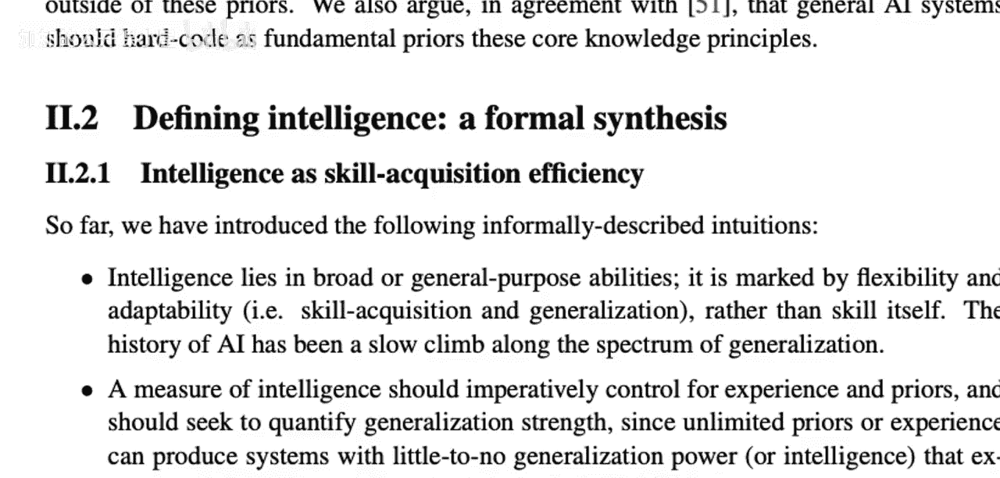

The intelligence of a system is a measure of its skill acquisition efficiency over a scope of tasks with respect to prior experience and generalization difficulty。

 So these are the things that we've established so far basically the intelligence of a system that's the thing we want to measure right is a measure of its skill acquisition efficiency So how fast does it acquire new skills  important here is that we are measuring it over a scope of tasks。

 So it's not arbitrary skills， it is a scope that we define and this is going to be mostly the human scope。

 the tasks， the scope of tasks that humans can solve and are sort of different at。

And what we need to factor in are priors， which is what is already built into a system because that doesn't count as intelligence that's already built in if your ability to solve a problem is already built into you。

 you don't have to use intelligence to solve the problem Second experience if you have had lots and lots and lots of experience at the particular task you're asked to solve you don't have to use intelligence。

 you can simply rely on your experience。And the third is generalization difficulty。

 And that's a property of the task。 So if the task is very difficult to generalize。

 So if it's very difficult， if the task itself is very difficult， then。

Achieving a good score at it should count as having higher intelligence if all other things are equal。

 so this is going to be the basis and today we're going to or we're going to watch surely define these things into a basically into a number that can give us the intelligence of any system with respect to these things。

Okay， so that's the program for today if you like content like this。

 share it out and tell all your friends and leave a like so that YouTube knows that you do like it。

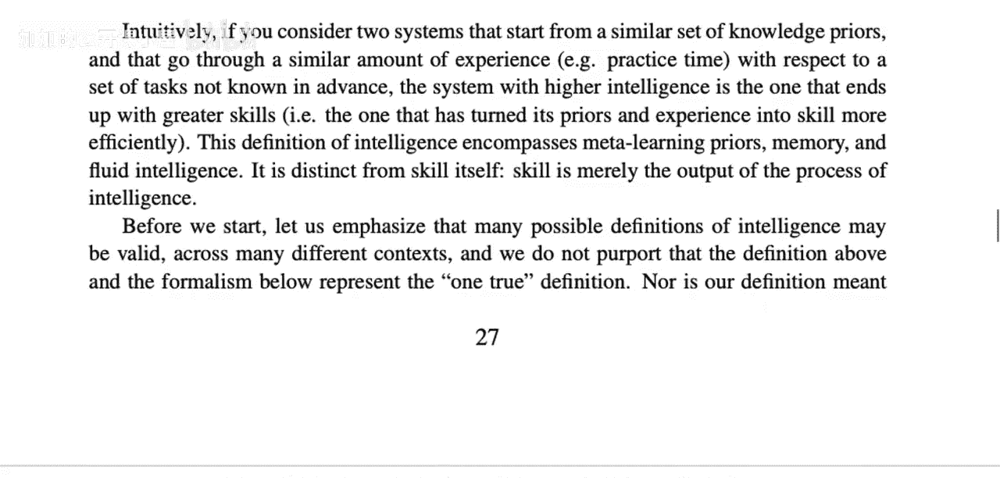

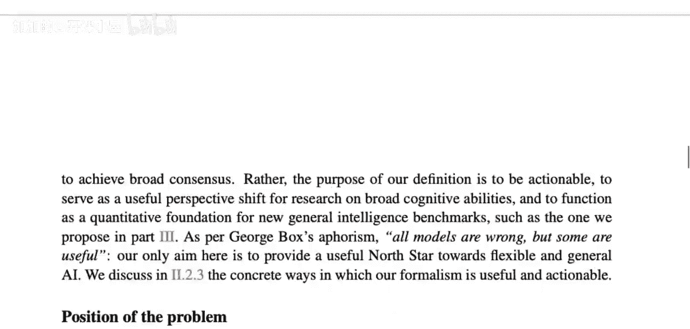

Okay， so the conceptualization of the entire system is like this。 There is a task。

 and we're going to consider a series of tasks， of course。

 But if we just look at one task in our scope， there is the task and the task。

Outputs these situations， which in a machine learning term， these are like your training examples。

 right？And on the other side， there is the intelligent system。 Okay。

 now the intelligent system in a pure machine learning side。

 you would factor this as the task gives the intelligent system a something like a training sample or in reinforcement learning。

 it would be something like an observation and the intelligent system you know。

 gives something back like a response here we have a kind of a in between step。

 The intelligence system doesn't actually give back the response to the situation。

 The intelligence system generates a skill program。

 So the intelligent system will generate a program that can map the situation to a response。

 And that skill program should be able to run on its own。 Okay。

 so in the classic machine learning sense。 if we look at supervised learning， for example。

 the intelligent system would be the。Would be like a rest， resnet。Plus S GD， Okay。

 that is an intelligent system。 And if it is output to is it is able to generate a skill program。

So during training， what happens during training， during training。

 the intelligent system is able to intervene in the skill program at each step so the situation comes in。

And then the skill program does something， but the intelligent system can at any point。

 it can kind of intervene and update the skill program and generate a new skill program for the next step。

There's a situation this skill program gives a response and the task gives feedback in form of a score。

In machine learning terms， this would be your training sample your training sample comes in。

 your neural network gives a response， which are the logs of the classes then the task gives a score to that which in the supervised learning case is the label or the loss function as a feedback to the intelligent system and the intelligent system using SGD would update the skill program for the next step okay so at each step the intelligent system can update the skill program That's why the intelligent system in this case is the architecture of the neural network and the procedure to update the weights。

 not the weights themselves， but the procedure to update the weights and the skill program here。

 those would be the actual weights of the neural network。

Or like the the instantiation of the resnet with these particular weights。 Okay， now at test time。

 we sever this connection right here。 So this， this is now sd at test time。 At some point。

 the training is done。 The task says， okay， now training is done。

AndThen the intelligent system will produce one last skill program， and then this connection is cut。

 and the skill program must by itself answer to these situations。

 It cannot the intelligent system cannot intervene anymore and。In this loop here。

 it situation response， situation response。 This goes over for a number of steps。

 and all the scores during that time are counted and tallied up。 And at the end， you know。

 the higher the score， the better。 So the intelligence system must。

 at this end step produce a skill program that by itself can achieve a high score。Okay。

 so there' is always this training phase first， and then there is the test phase。Now。

 the training phase， these situations that we get in a training phase。

 they are called a curriculum in this in this world。In our world。

 this would be something like a training data set。 But this， this is curriculum。

 It's slightly more intricate， buts just the notion here makes sense， right。

 The intelligence system produces the skill programme， okay。

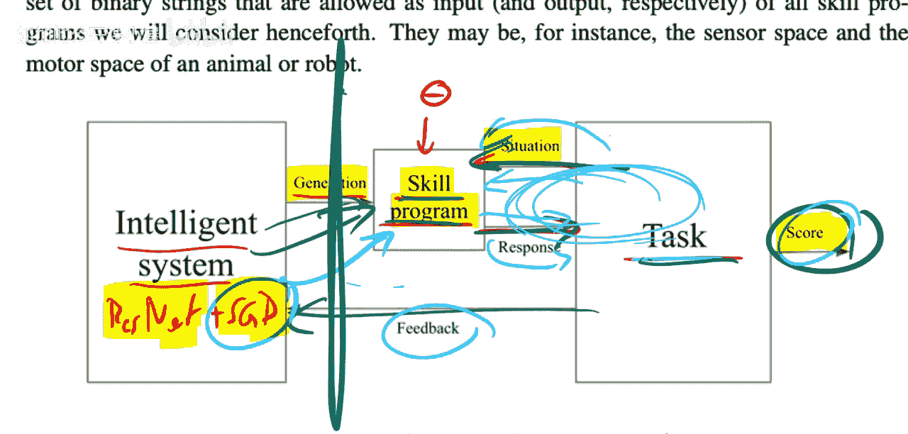

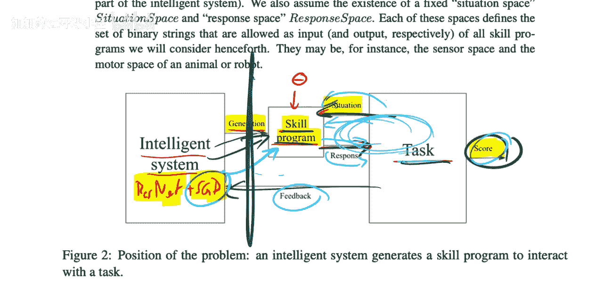

So。

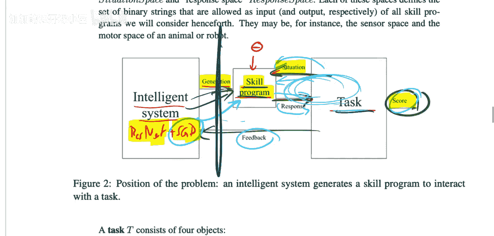

There's a lot of formalisms right here like， okay， the task has a like a situation generator and that maps the task state to a situation so the task can have a state and the skill program can have a state and the intelligence system can have a state。

 and I don't like this is all a bit too formally， you don't really need to understand it。

 except if Fransoislet is watching this。 I think I have found。

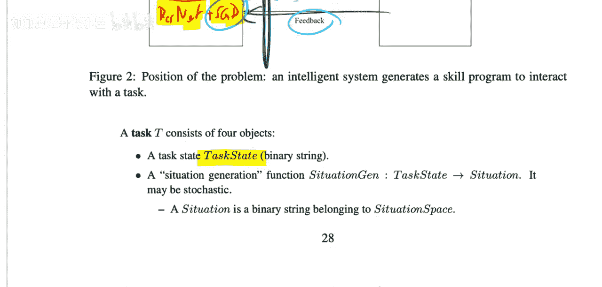

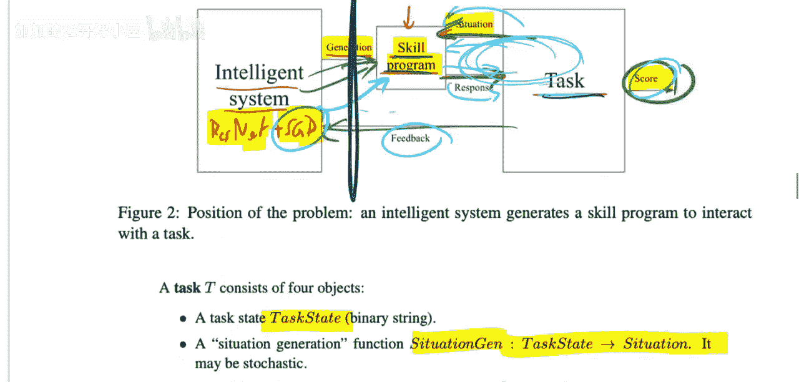

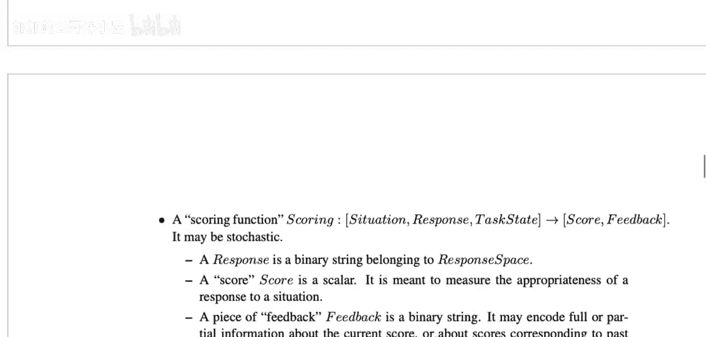

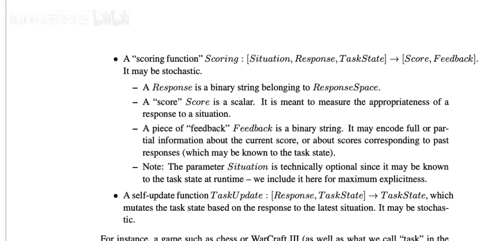

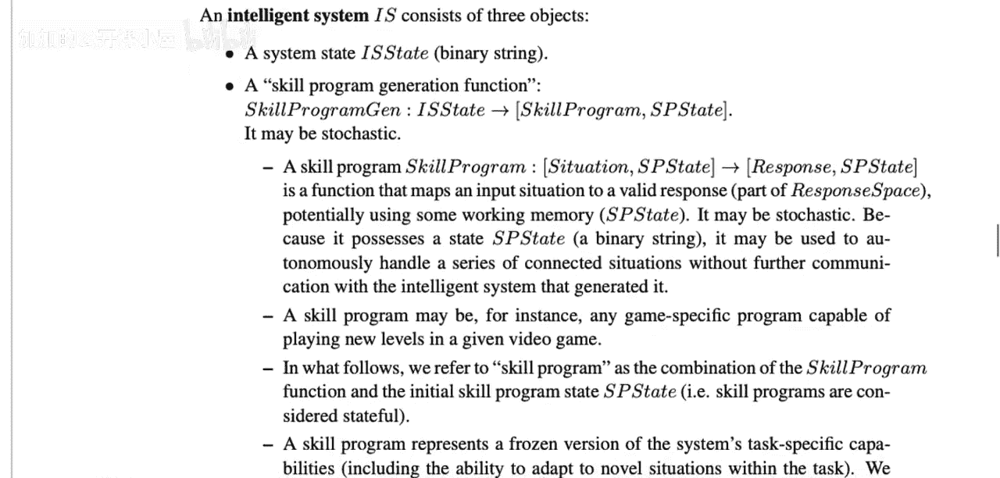

I'm not sure if it's a mistake， but。You say the intelligent system here consists of three objects。

 so it generates the skill program according to its internal state， okay。

 and it generates the skill program and when it learns。

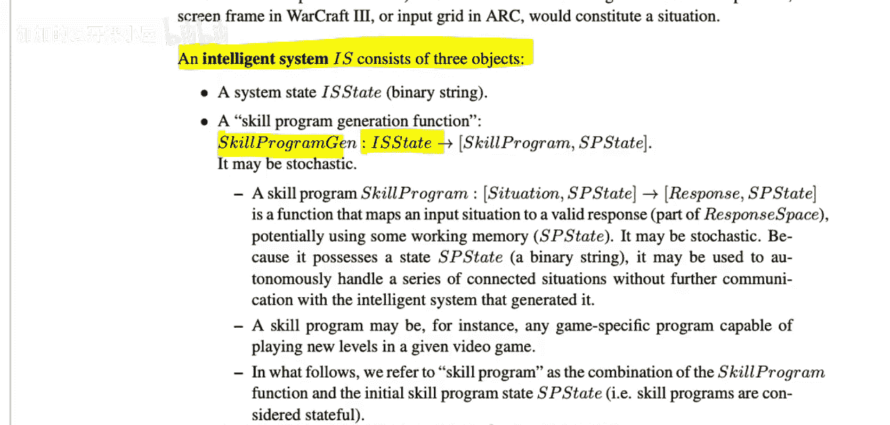

When it learns， it updates the internal state， internal state， according to let me， if I can find it。

Right here。

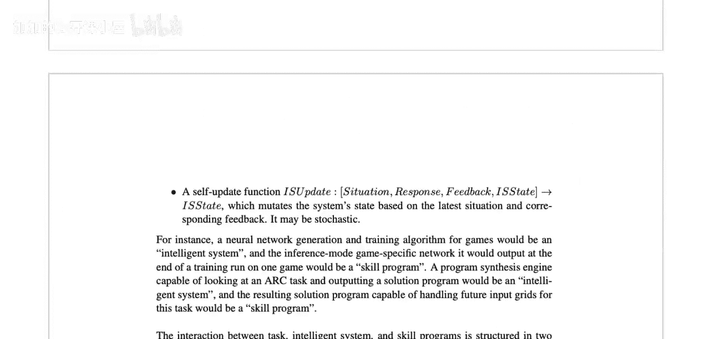

A self updateate function so this is how the intelligent system can update itself so its own state。

 so it takes the internal state of the intelligent system and outputs another internal state and this is the you know where I said the internal the intelligence system at each training step it can observe what happens and basically react accordingly so it takes the situation。

 the response and the feedback and its own internal state as an input。

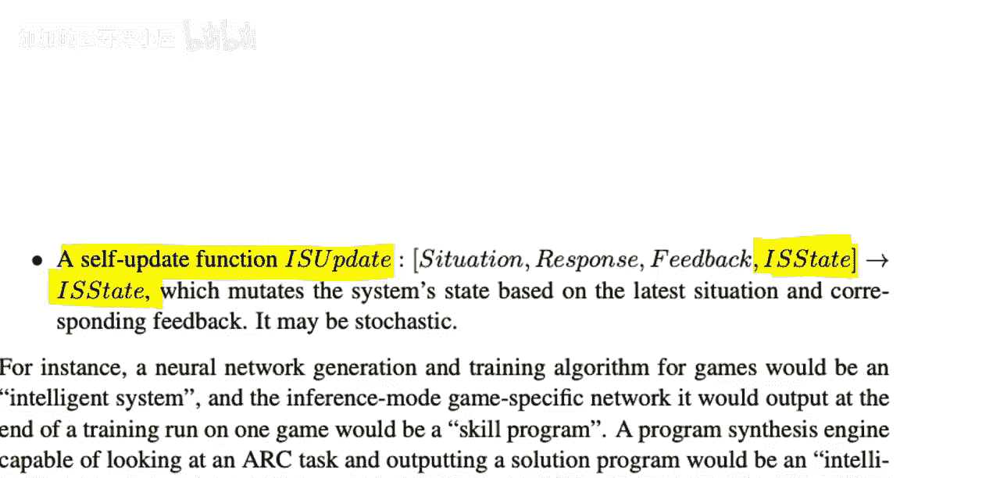

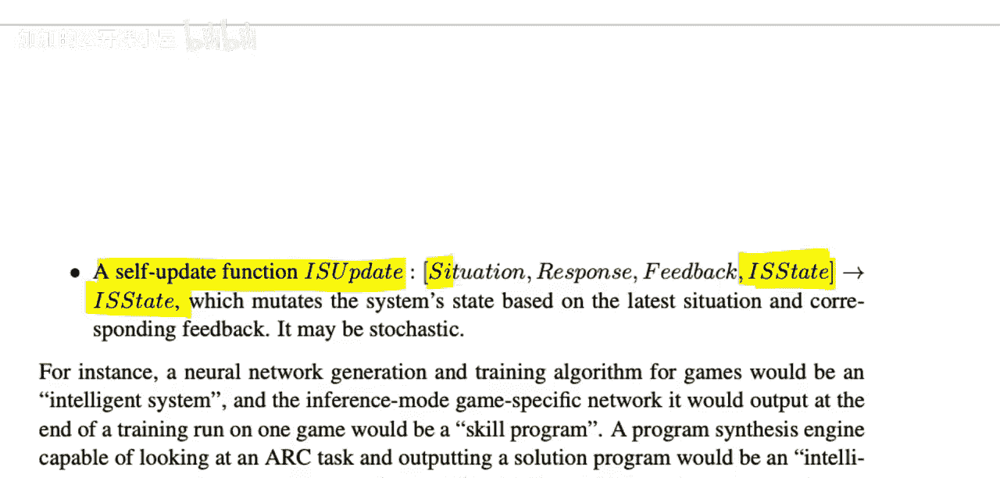

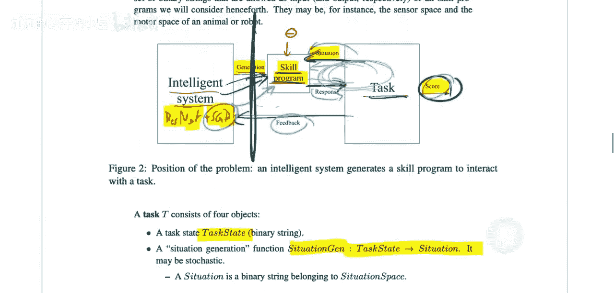

Now， what do we have here， it takes the situation， which would be in our case， the training sample。

 the response or the the logits that the net neural network has produced， the feedback。

 which is the loss and its internal state Now what I argue is basically that it should also get the internal state of the skill program as an input right here。

 because the skill program can have an internal state。

 all of this like the response can be a stochastic procedure of the skill program and I guess it's not necessary because you can sort of infer it。

 but I think the framework would。Be more complete if the internal state of the skill program at that time were part of the intelligence system update procedure just you don't。

 okay， this is not relevant。 this is just me bickering。

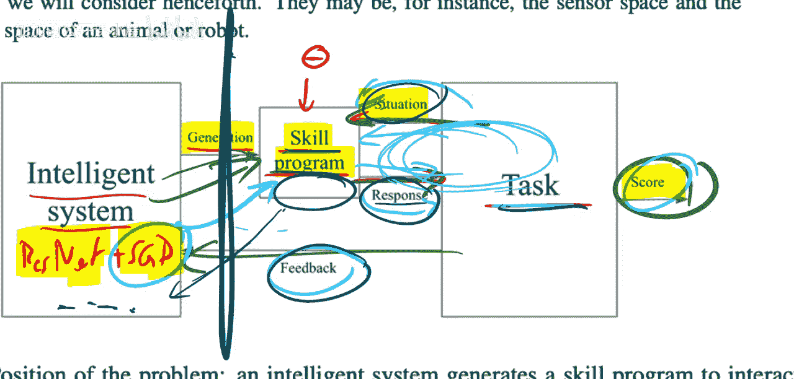

嗯。

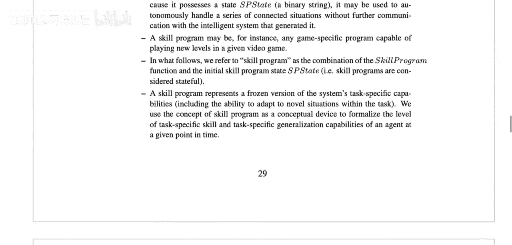

Cool。Let's actually jump all of this。 This is boring。

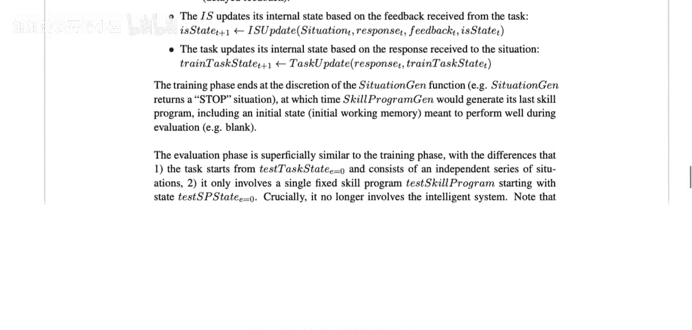

This is very boring。Okay， blah， blah， blah， blah， blah， lots of definitions。

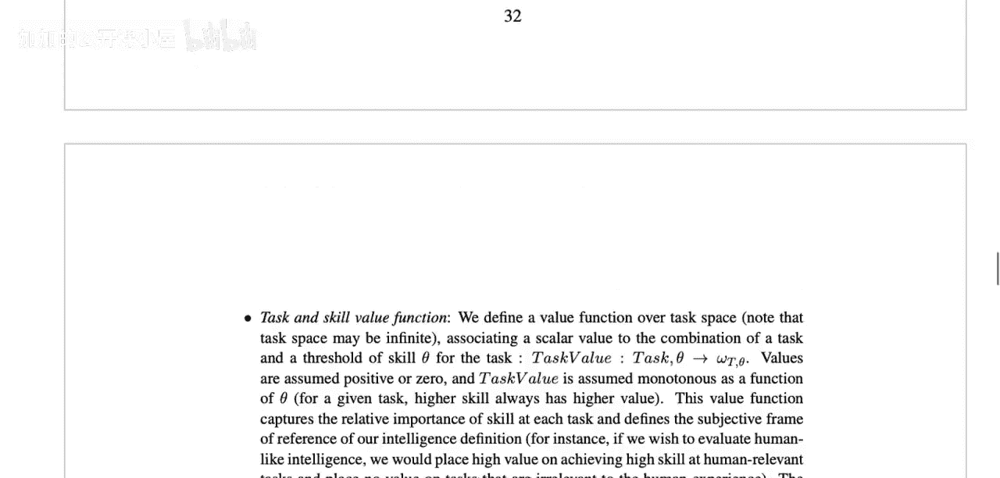

All right。