# YannicKilcher【中英⚡AI经典论文领读(全203篇)(上)｜Papers Explained】 p35 P41 PCGRL：通过强化学习进行程序化内容生成（论文详解） [BV1o3xLznExj_p35]

Hi there。 Have you ever wondered how video game levels are made。 Yeah， me neither。

 But this paper has。 And in this paper， you can see a reinforcement learning agent that has learned how to make video game levels in various ways。

 So this is implemented for this game here， where the goal is simply to make the longest maze。

 This game here is an adaptation to the legend of Zelda， where you have to get a key to the door。😊。

And this game here is called Sobocon， where you have to put all of the crates onto the green squares in order to solve it。

 so it's a puzzle game。Allright， and this is done via reinforcement learning。

So the paper we're going to look at is called PC GRL procedural content generation via reinforcement learning by Ahmed Khalifa。

 Philip Boontroer， Sam Earlli and Yulion Togaliaos。 Now this paper is basically just a fun paper。

 and I feel and it shows how to frame a problem in terms of reinforcement learning and then how to solve it。

 It's pretty straightforward fairly short and I you know， the codes available and all。 so。

You can go check it out yourself。

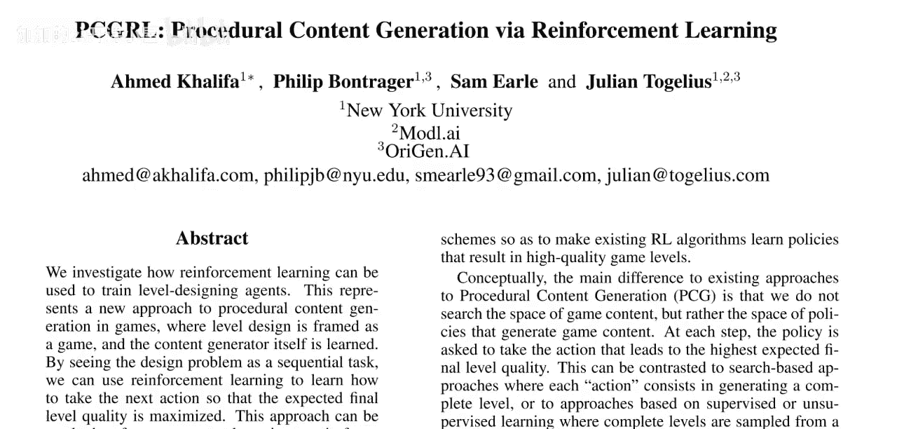

They say we investigate how reinforcement learning can be used to train level designing agents。

 okay so usually usually you we do reinforcement learning for playing games themselves and now we use reinforcement learning to train an agent that can design a level。

 so we don't design the level itself straightforward。

 we design the agent that designs the level and what's the advantage here， the advantages， of course。

 the agent could then potentially generate multiple different levels once we have trained it。

I say this represents a new approach to procedural content generation in games where level design is framed as a game itself。

 so the design of the level is now the game。And the content generator itself is learned by seeing the design problem as a sequential task。

 we can use reinforcement learning to learn how to take the next action so that the expected final level quality is maximized。

This approach can be used when few or no examples exist to train from。

 and the train generator is very， very fast。 Okay， so this is the outset of the of the problem formulation。

 Now， we're going to go through the steps you have to do in order to make this work。

 there are a few things that I think this paper does quite well。 And。Yeah。

 so the first thing is you actually have to frame the problem in terms of reinforcement learning。

 So what is reinforcement learning is pretty simple in reinforcement learning。

 you have this agent environment split。 Okay， so at each step。

 the environment is going to send the agent an observation。

 So the environment is going to send an observation to the agent and the agent needs to take an action in response to that。

Now， something happens in here。 We don't。 We don't worry about that。

 And the environment is going to send the next observation， okay。

That is a result from taking this action， and it is also going to send the reward。For this action。

 So at each step， the agent gets an observation and a reward for the last action it took。

 and it has the output the next action。 Now， the environment， of course， has to somehow decide。

 How do I represent the observation， This is the representation。

 How do I transform one observation to the next observation， given an action。 Okay。

 the action comes in and transforms the last state to the next state。

 And then how do I give the reward， How do I calculate the reward。

 So these things are the things you have to decide on the observation space。

The how the reward is calculated， the action space and how an action transforms one representation into the next representation。

 So this is what we're going to look at the different variants。

 We're not going to look at specifically how reinforcement learning is done。

 because once you have an environment like this。

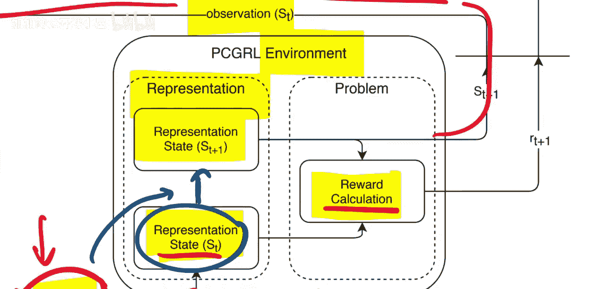

You can just plug it into a standard reinforcement learning algorithm and it will solve it for you。

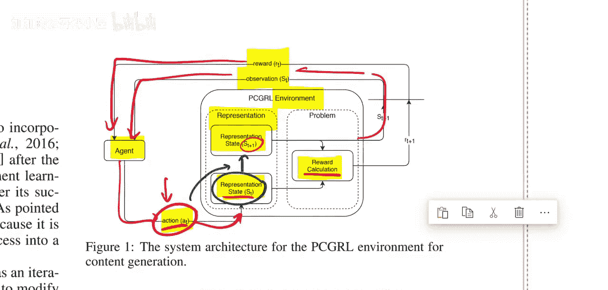

Okay， so that's the power of basically having standardized or representations。

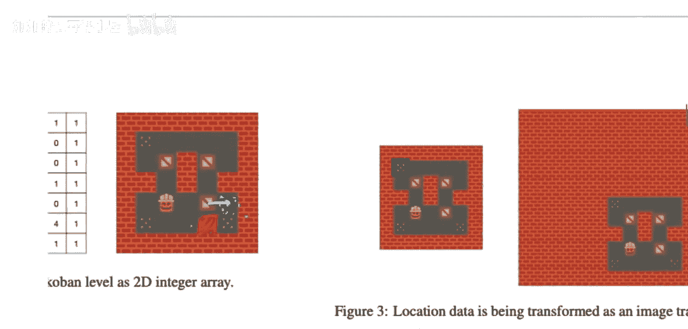

So the observation space of this problem is going to be pretty simple。

 All the games we're dealing with here are in this。 Oh， I already did some drawings are in this。

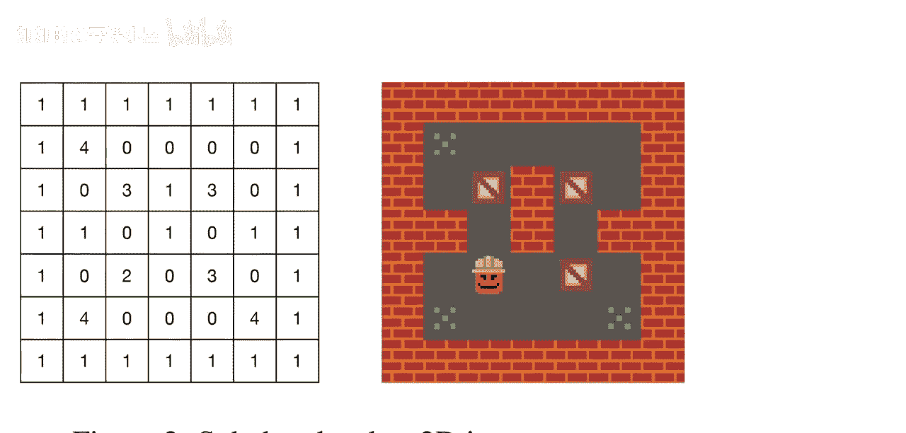

In this framework of this grid world game。 Okay， so you have this， you have this grid。

 this level is subdivided into this grid。 and that naturally corresponds， of course， to a 2D matrix。

Now each point in this matrix has a number and the number describes what type of tile this tile is。

 So as you can see right here， the one is going to be a wall while the0 is going to be empty space3 here is one of these crates and two is the player。

 So you get the point right， each number corresponds to a type of tile。So far so good。

 That's the observation space。 Now， what is the action space。

 What is the what the agent can do at each step， they say the agent can change one of these tiles。

 Okay， so it can change one of these tiles。 Let's say this one right here。

 It can change it to a different one， or you can just leave it。 So this is a wall right now。

 And it makes a problem fairly interesting to have a wall right here in the middle。

 So since we're looking at this tile， we might just want to leave this right there。

 We could also change it， we can actually change it such that to to a two such that there is another player right here。

 right， let me can I even draw this this yellow， isn't。

Such that there is now two player tiles in the game。 So would， of course， be an invalid level。

 and the reinforcement learning agent ultimately should learn to produce valid and good levels。Okay。

 so at each step you can change one tile and of course。

 the goal is to make a better and better and better level over time。

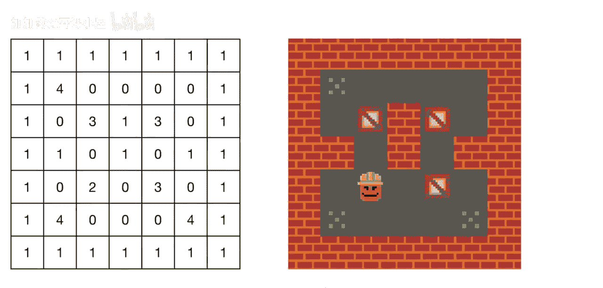

Now how how do you choose which tile to change， That's a thing you have to define。

 and they define three different ways in which the agent can choose which tile to change。

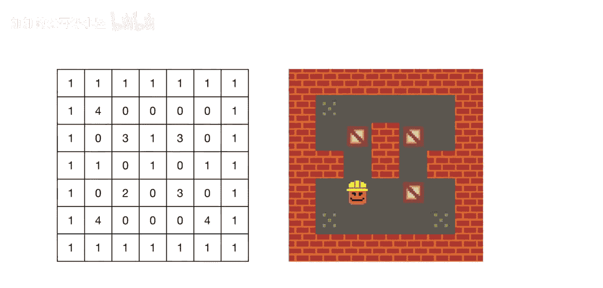

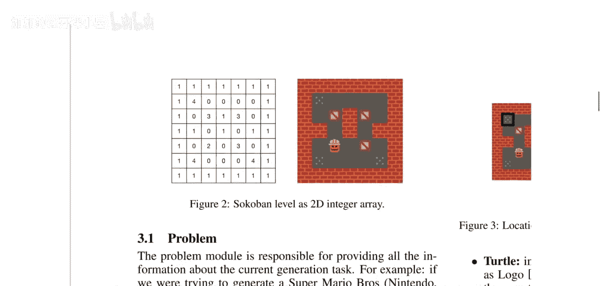

In the narrow formulation， they themselves。 So the environment chooses the frame。

 the the tile to change。 So the environment will say now you can change this tile if you want。

 And then the next step， it will say now you can change this one， if you want。

 Now you can change this one if you want。 Now this is completely random。 Okay。

 how the environment actually， doesn't have to be， but the environment chooses。

 and that is problematic for the agent， because the agent cannot kind of predict which tile it can change next。

 and therefore， it cannot really plan ahead， how it wants to change the level。 It can only make very。

 very local， very greedy choices。 It can be like。

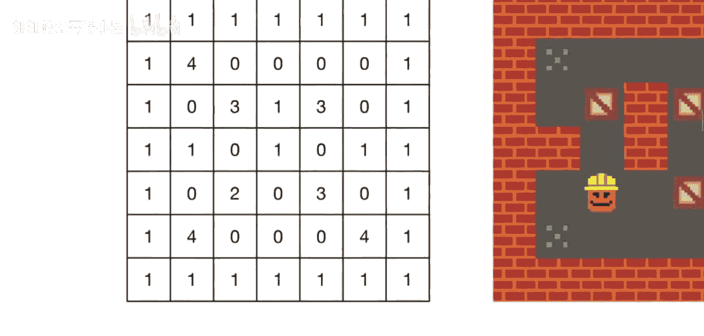

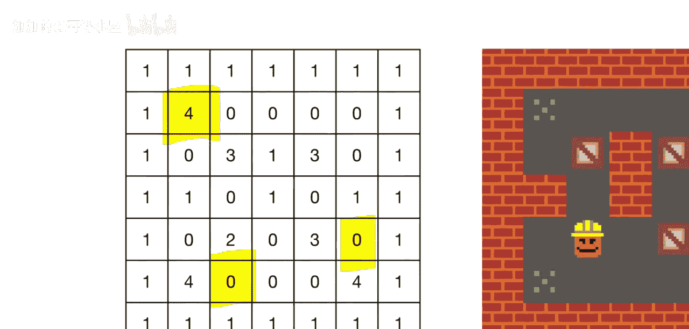

Oh， I'm， I'm， I'm right here。 I might， I might actually build a wall right here。 Yes。

 that seems good， but it can't So an example。

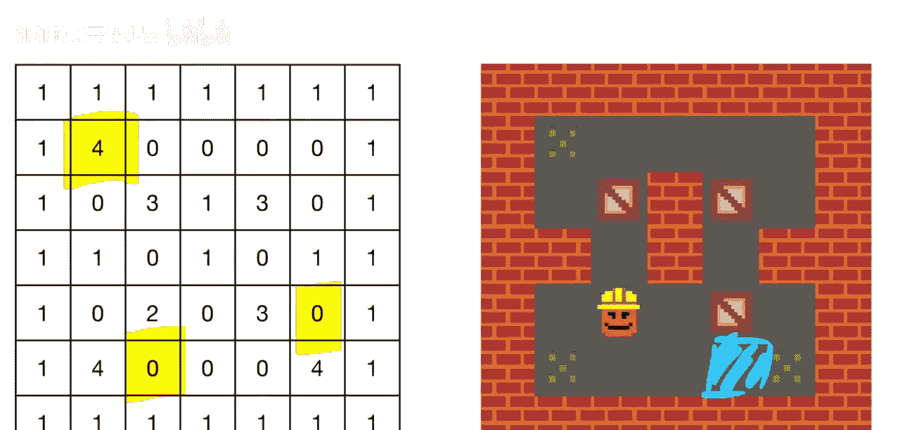

Is maybe you want to make the level more interesting。

 Maybe you think that the crate up here is a bit close to this field here。

 You have to push it onto this field。 And that's fairly easy， right。

 So you just push it like up and then to the left。 Actually。

 it's not that easy because there's the wall right here and you have to go around。Actually。

 you probably have to push this down。 but let's say the level is too easy。

 And you wanna move the move the crate to a bit like， let's say here。In this。

 in this framework where the environment tells you which which。Which tiles to change。

 You can basically。Once you come across this tile， you can delete it。 okay。

 but then you gonna have to wait and wait and wait and wait until at random。

 this style where you want to put it is selected。 and this might actually never happen because the episode might be over and if it never happens。

 you are in an invalid level right So the agent here is basically forced to greedily make the level valid before it can make it interesting。

 and then it can only make it interesting in sort of local ways。

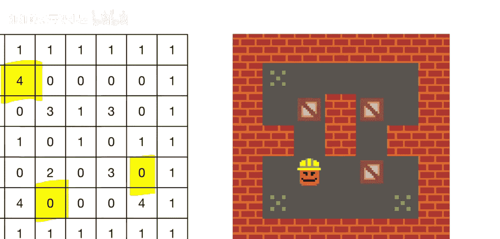

So the second way that the the second formulation here is the turtle formulation。 Now。

 you might know this from the turtle graphics where basically you have this。

 you have this little turtle thing and you can always move it either like， you know。

 down up left or right。 and then you can always put a dot or not put a dot and thereby you can like trace out。

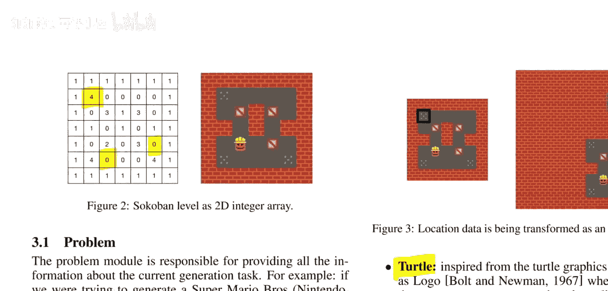

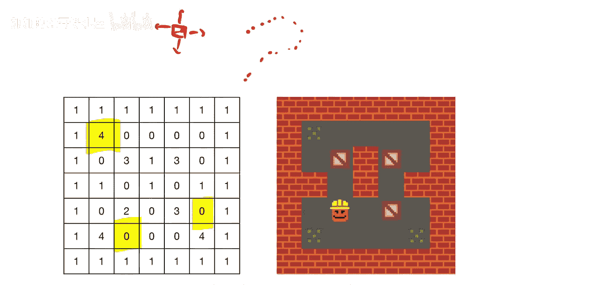

Things， this is like Intro to programming。Same here。 So now the agent is given a starting square。

 and it can choose to change it or not， but it can also choose how to move to the next square。

 So to the right， up， left or down， it can so it can choose。 so it can go along and say， okay。

 and I'm here。 I want to change it to it too。 now I'm here。 I want to change it to a too。

 Now I'm here。

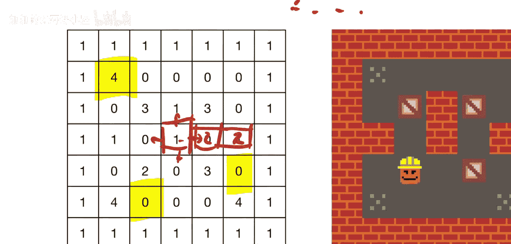

And so on。 So it can basically。Do things like build long walls and things like this。

 So you can plan ahead more。

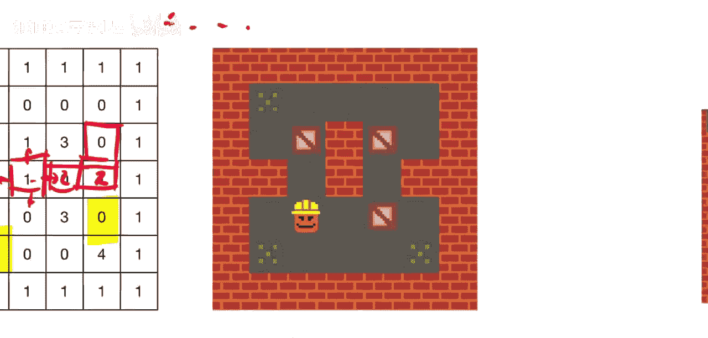