# YannicKilcher【中英⚡AI经典论文领读(全203篇)(上)｜Papers Explained】 p36 P42 深度微分系统稳定性——从示例中学习高级计算（论文解析） [BV1o3xLznExj_p36]

Hi， here's a question for the whiz kids among you。 Is this system here。

Controllable at a point X E with asymptootic control UE。

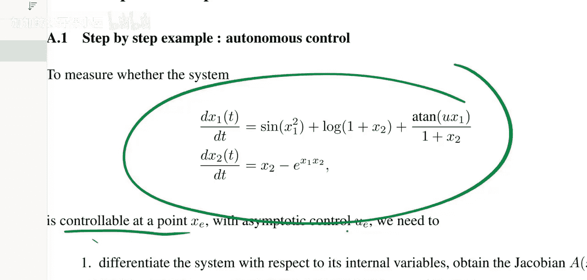

I'll give you 10 seconds。 Okay，10 seconds are over。 So to solve this， it's actually pretty easy。

 All you need to do is first differentiate the system with respect to its internal variables。

 which are the x's to obtain the Jacobian A。 Second step。

 differentiateiate the system with respect to its control variables。

 which are the U variables to obtain the matrix B。 Look， this is a0。 Like， this is not hard。

Then evaluate A and B at the point that you want and the control point that you want pretty easy。

Calculate the controllability matrix， Come on， that's nothing， another zero。And at the end。

 you calculate the rank of the controllability matrix。 Now， if the， if n minus D is 0。

 the system is controllable。 And optionally， if you want， if you feel like it。

 you can output the control feedback matrix as an equation 3， which gives you this here。 Now。

 what's equation 3。

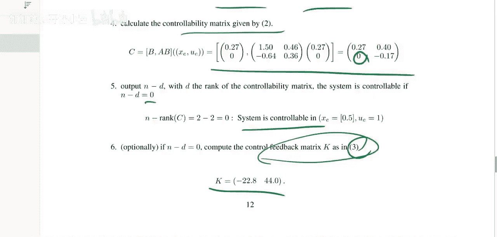

Equation 3 is super， duper simple。

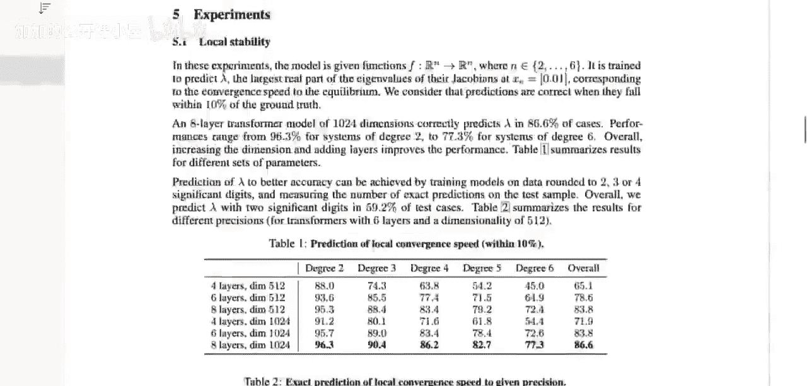

It's just this little sort of integral thing， inverse， matrix， trace。

 transposed exponential function， outer product thing。

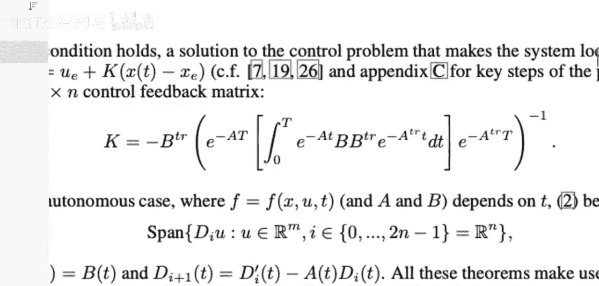

Come on， what's the matter with you？

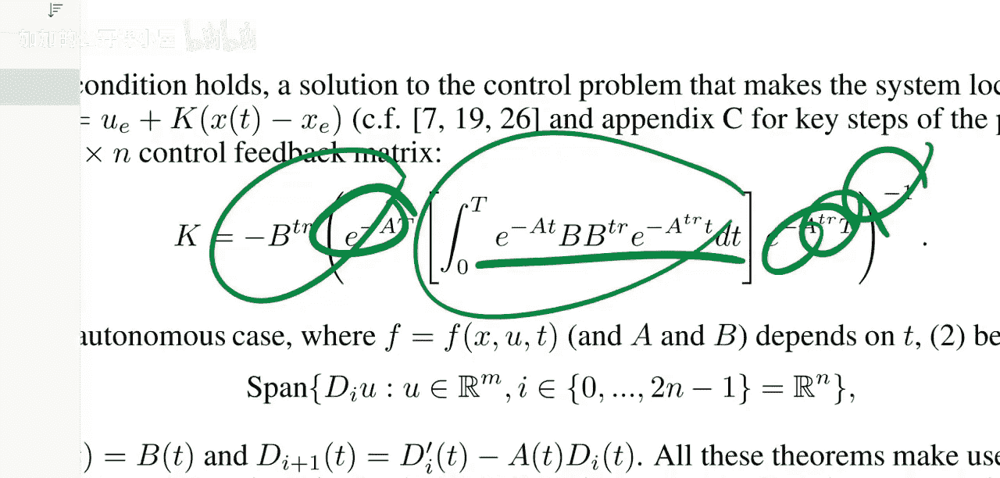

， so if you found you can't do this just on the spot。

 then you are in the same category as most people， but interestingly， apparently。

 according to this paper， a deep learning system can。

 So today we're going to look at deep differential system stability learning advanced computations from examples by Foa Shato。

 Amri Hayat and Jome lumpel of Facebook AI research and E de Poparriek and Ru Rutgers University。😊。

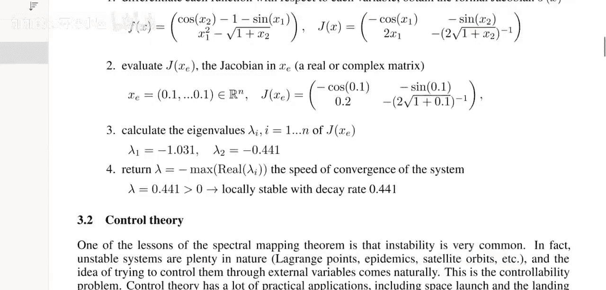

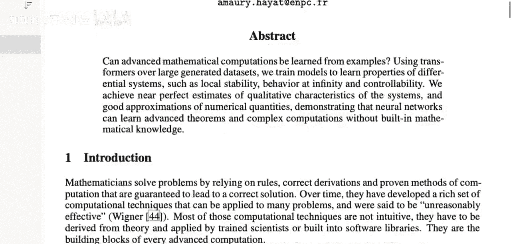

So。At this in this paper， these authors basically propose that you can learn these complex mathematics with a model that has no clue about mathematics。

 In fact， it is a language model， And it can output the solutions， for example。

 whether or not a system is controllable， which are sort of binary solutions。

 but it can also output actual solutions as in numbers or as in the matrices that you would need to obtain from these problems。

 So that's pretty cool。 and it is built upon this other paper called I think some deep learning for symbolic mathematics or something。

 I have made a video on it。 if you search for it and I'll also link it。

In， in the description， and you can go check that out because that's sort of the basis。

 So in this previous paper， I think it was from partially the same authors。

They have investigated language models into integrating functions。 So you have some sort of function。

 you're trying to find the integral and they've tried to do that。 Now they go a lot further。

 So they look at these at these differential systems。

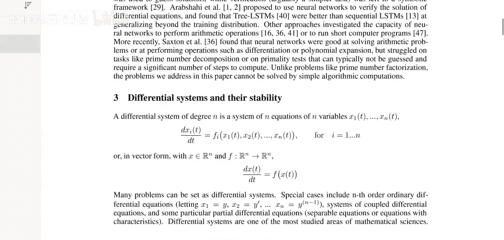

Which are characterized by these differential equations。

 So if you've never seen differential equations， it's basically an equation where the derivation of some variable is characterized by the variable itself。

 So the gradient， if you will or the code in the derivation， according to some input variable here。

 It's most often it's time in physical systems is a function of that variable itself and partially also of other variable。

 So you can have systems of differential equations that all depend on each other。

 and there are a number of questions about these systems。

 These are very relevant in like physics or engineering control theory and so on。

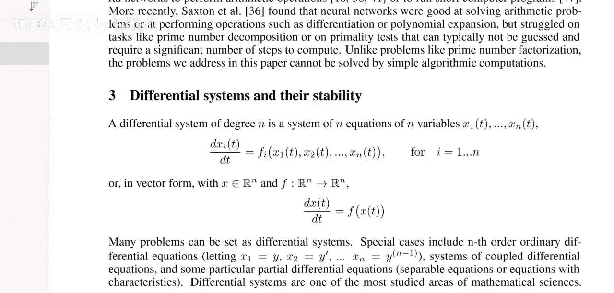

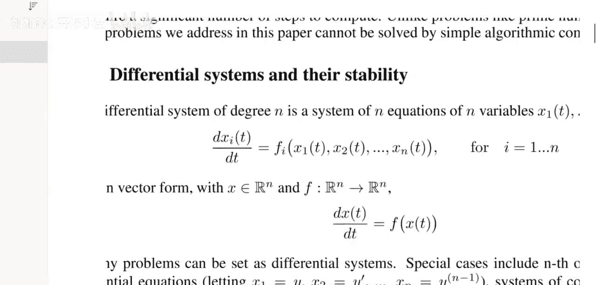

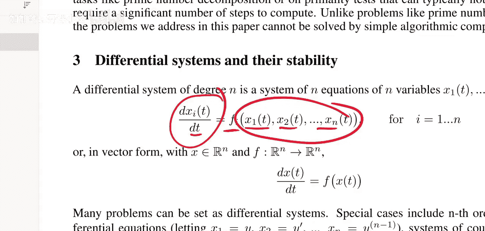

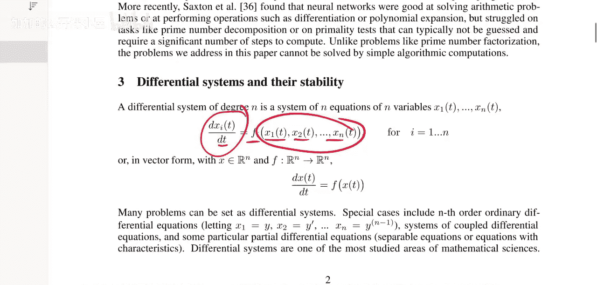

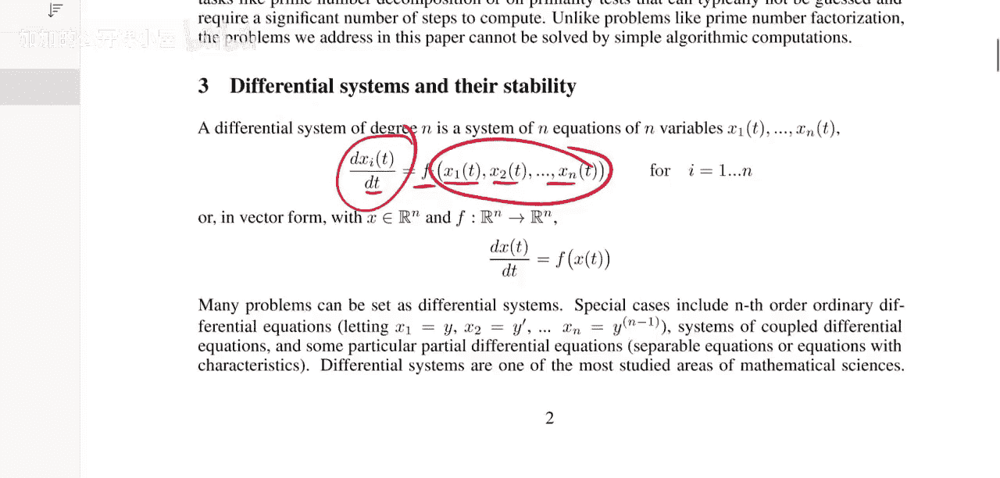

So they investigate different problems that you can solve with these。

They investigate specifically problems where we already know the solutions。

 but the solutions require very complex mathematical manipulation， such as as you've seen。

 calculate the integral of something， take the trace， calculate the rank inverts a matrix。

 So all of these mathematical steps are required to solve these problems。

 if we were to teach them to math students or engineering students。 and this paper basically says。

 if we just input the problem into a big language model。 and。

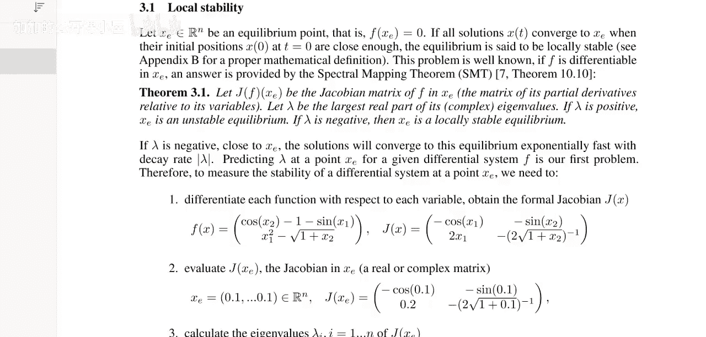

And ask it to output the solution。 It can do it so it basically can learn to do all of these things。

 So that's pretty， pretty surprising because you don't program it to do any math。

 So the first problem they look at is this local stability problem so。

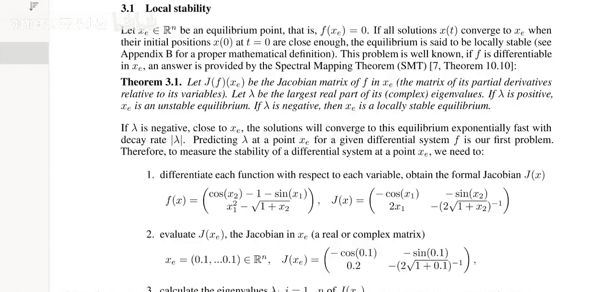

In I don't， I don't really want to go into into much of the actual mathematical problems。

 but we'll look at the first one to just give you an idea of what these sort of problems are。

 So X E is an if X E is an equilibrium point， it means that。All solutions。

 if all solutions converge to X E when their initial positions are close enough。

 the equilibrium point is said to be locally stable this problem is well known if F is differentiable in X E and answers provided by the spectral mapping theorem。

So in that case， you'd have a system。 maybe we can draw one where。

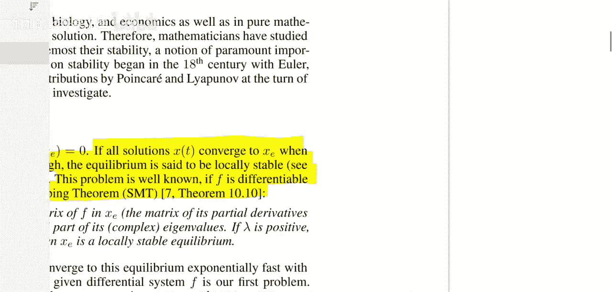

You'd you try to find local points of stability。 So this point here would be maybe a local point of stability if you consider this as sort of an optimization landscape。

 because if you go from here， if you go a little bit away from it。

 you're always sort of pushed back if this。If this is， if the system is gravity， sort sort of。

 So if these differential equations did did。

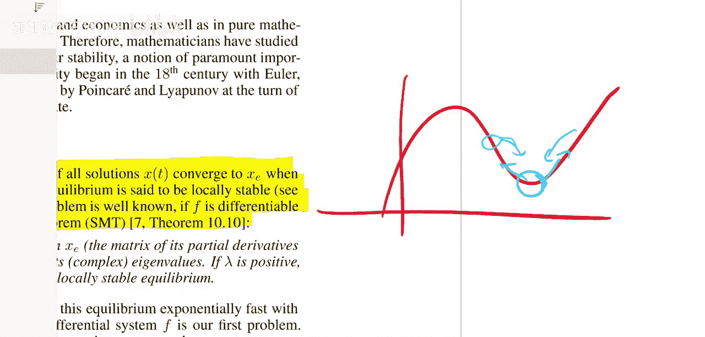

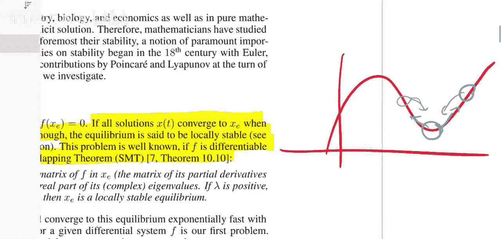

Sort of describe。That the， the height here is the force which with which you' are pulled down。

 Then this thing here would be a local point of stability。 The question is。

 if I give you a system that's described by these differential equations。

 Can you tell me whether or not it is stable at some point。

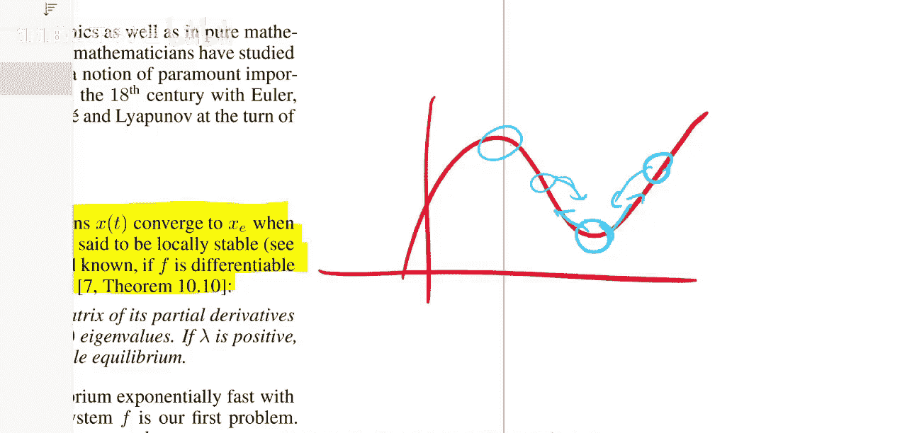

Okay， and there is a spectral mapping theorem， which says if you have the Jacobian matrix of F at this point。

 the matrix of its partial derivatives relative to its variable。

 And if you take lambda to be the largest， real part of its complex eigenvalues。

 if lambda is positive， then this is an unstable equilibrium， if lambda is negative。

 then it's a locally stable equilibrium。 So an unstable equilibrium。

 likewise would be the point here on top， which means that if you're exactly at the point。

 then you stay there， but as soon as you're a little bit off， you drift away from it。

 That would be an unstable equilibrium。

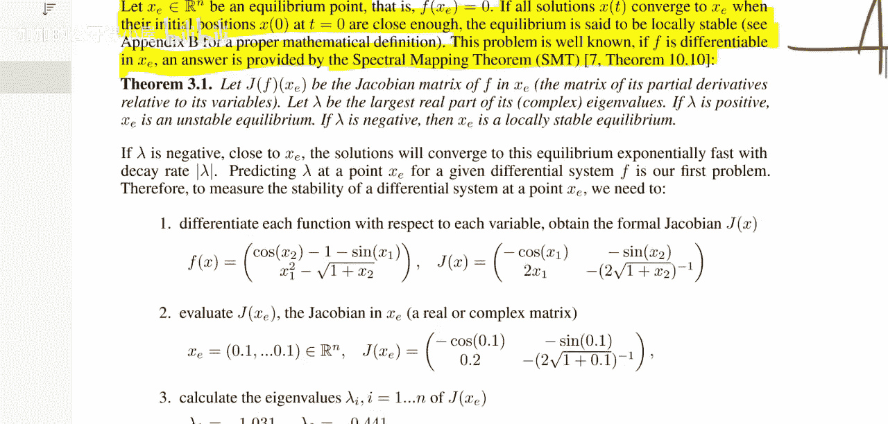

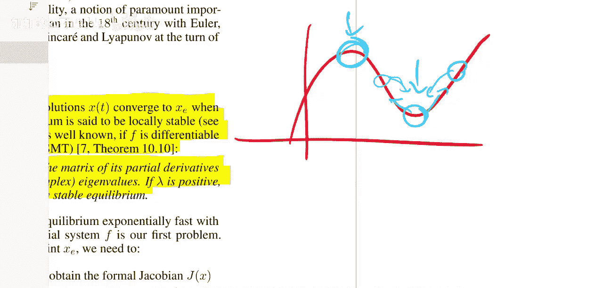

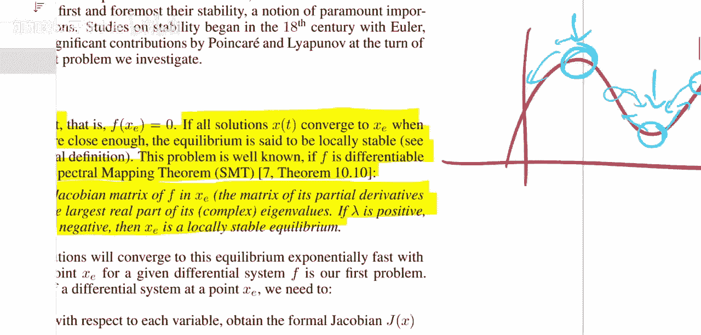

Okay， so there are complex steps involved in deriving this solution。

 Then they list them out here just to show you how complex this is。 This is not meant to teach you。

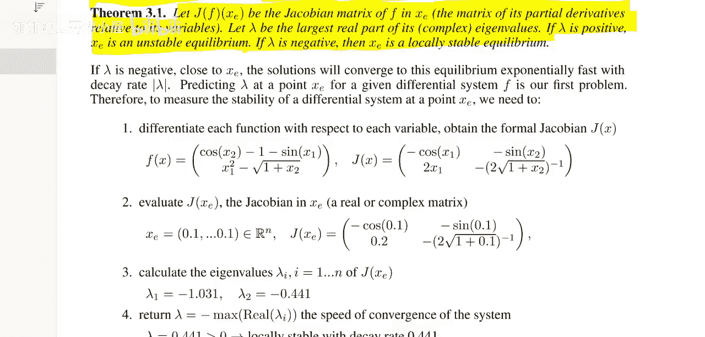

You don't have to like understand or be able to apply this。

 This is simply meant to tell you how complicated it is to arrive at a solution。 So first。

 you need to differentiate each function with respect to each variable and obtain the formal Jacobian。

 So they do this here for this example system， which is this system right here。

This is a system of two equations， two differential equations in two variables。

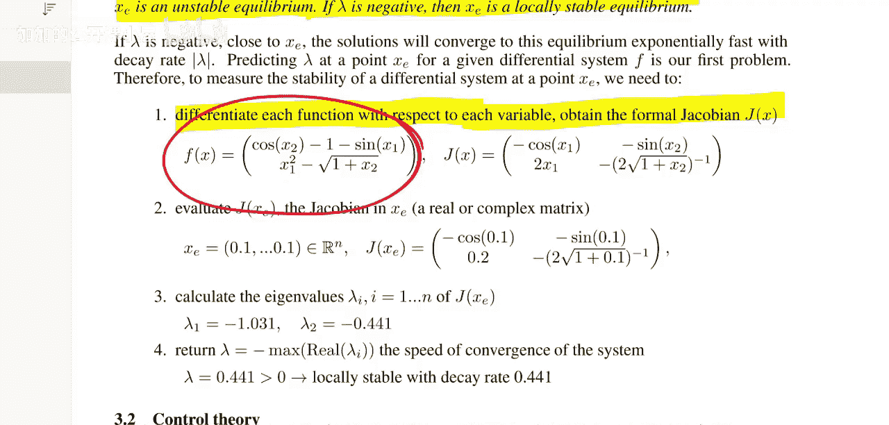

So if you derive the Jacobian that will give you a four entry Jacobian。

 so each one of these is one of the equations derived with respect to one of the variables。

 you can do that right， but it requires fairly complex mathematical knowledge like knowing that the derivative of the sign here is the cosine and knowing that this cosine doesn't matter for this particular entry because it's in x2 and here we derive by x1。

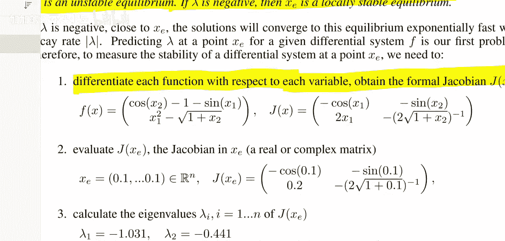

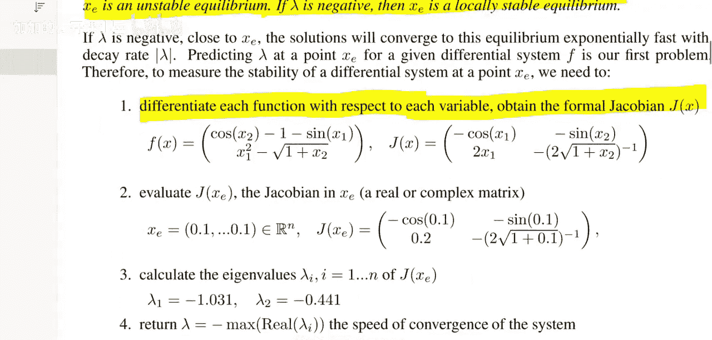

So that's already very challenging。 Second， you need to evaluate the Jacobbian at that point。

 So first you've done it symbolically now you actually need to put in the numbers at the point you're interested in。

 which will give you this thing right here， which is a numerical matrix whereas this was a symbolical matrix。

 then you need to calculate the eigenvalues which is you have several methods of that。

You have several methods of computing the largest diigagonvalue， you could do power method。

 you could do decomposition。ThereThere are numerous ways。

 but none of these is like particularly easy， right？And then lastly。

 you need to return the minus max of the real part。Which is the speed of convergence of the system。

 So not only do you need to be able to tell whether it is stable， which is， if this is negative。

 you also need to be able to say。Or if this is negative， sorry。

You need to be able to say whether it is locally stable or locally unstable。

And since this is larger than zero， it's locally stable。And this would be the decay rate 0。441。

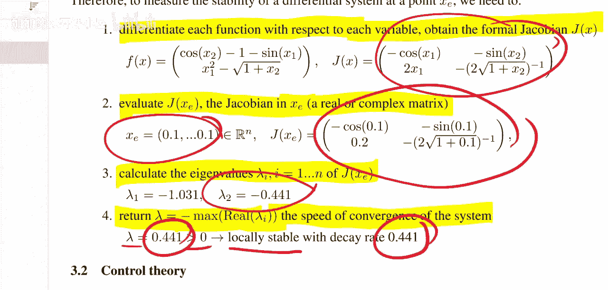

This is what you're asking this model to output。