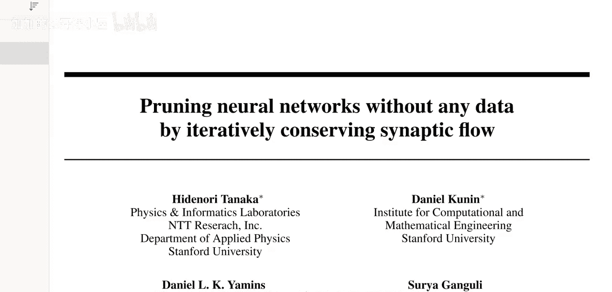
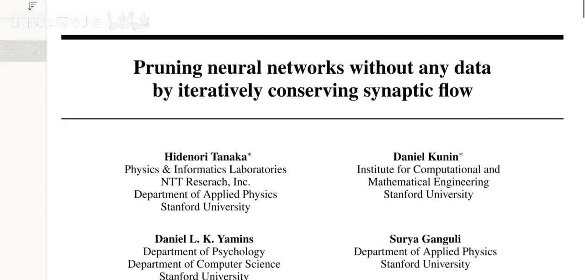
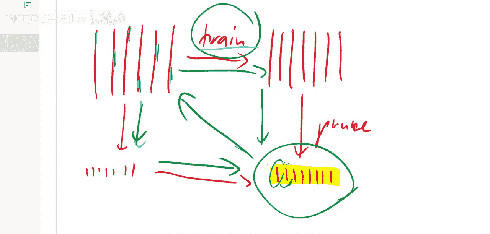
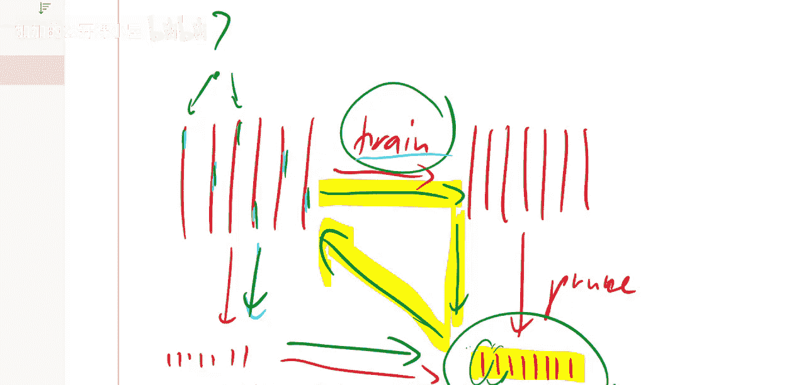
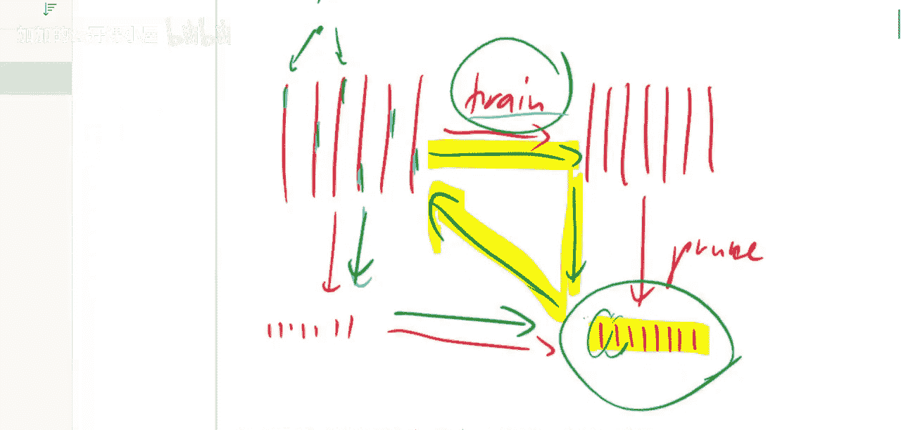
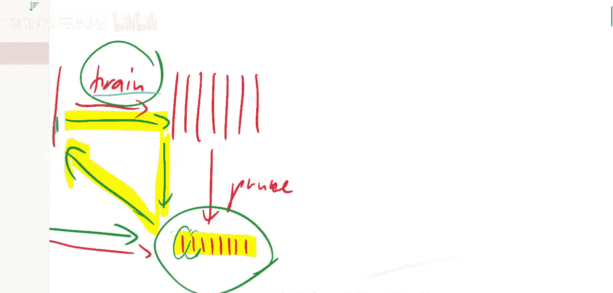
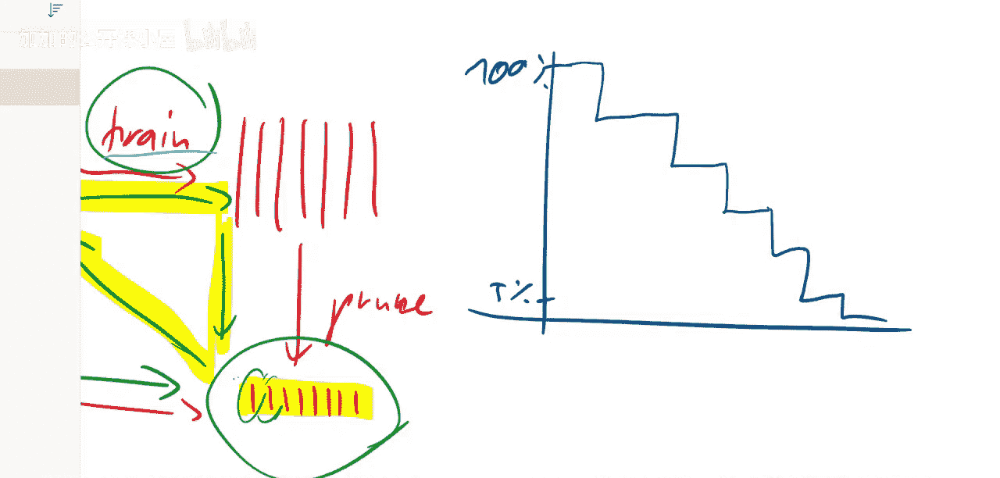
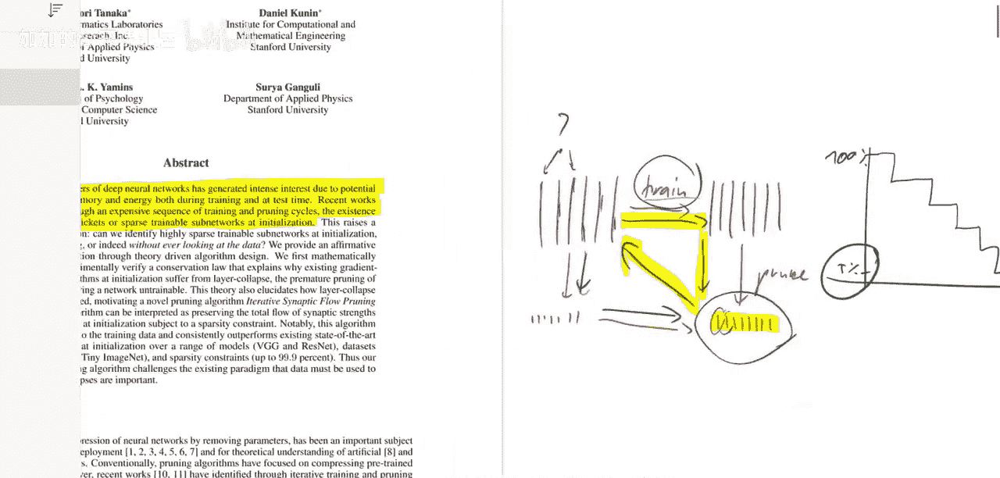
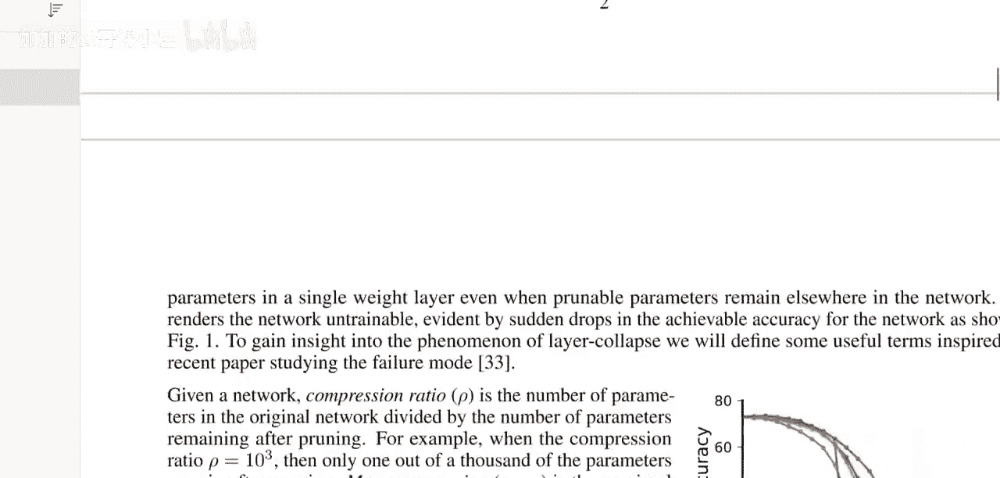
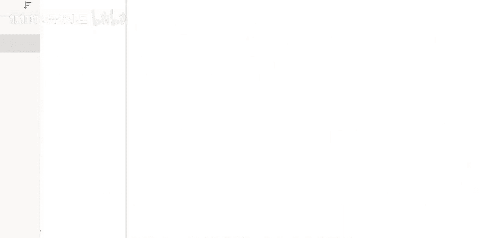

# YannicKilcher【中英⚡AI经典论文领读(全203篇)(上)｜Papers Explained】 p37 P44 SynFlow：通过迭代守恒突触流实现无需数据的神经网络剪枝 [BV1o3xLznExj_p37]

Hi there。 Today， we're looking at pruning neural networks without any data by iteratively conserving synaptic flow by Hiden orittana。

 Daniel Kunin， Daniel L K Yamins and Surya Gguli。 So this paper on a high level does what the lottery ticket hypothesis does。

 but does so without any data it prunes a neural network at the beginning and it does so。

 It's able to do that because it claims that its algorithm avoids this problem called layer collapse。

 and then it based on conserving a quantity they called the synaptic flow。

And we're going to look at this and it's pretty cool algorithm seems to work but pretty well。

 As always， if you want to help out， you can share this video and let me know in the comments what you think of it。

 I do read the comments and I would love to hear from you。😊。

Alright， let's dive in。 So they're saying pruning the parameters of deep neural networks has generated intense interest due to potential savings in time。

 memory and energy， both during training and at test time。

 recent works have identified through an expensive sequence of training and pruning cycles。

 the existence of winning lottery tickets or sparse trainable sub networks at initialization。

 So what is this paper talking about。 if you。If you don't know much about pruning。

 here is kind of a basic overview。 So if you have a neural network that consists of many。

 many layers of neurons。 What you can do that one way of pruning that what what the goal is is to end up with a small neural network that performs well。

 But for now， we have a big neural network that doesn't perform well， it hasn't been trained yet。

 right？ So what you can do is you can first train the neural network。

And then you have a big neural network that performs well， and then you can prune it。Now。

 a lot of times。A lot of the time this， this has been seen as sort of the pruning way。

 You would train the big neural network， and then you would prune it because the other way was not feasible。

 first pruning。And then training was not feasible。 You might， you might ask， okay。

 we might just want to start with a small one。 And yeah， that's correct。

 So what does this first way by you。 This first way is buys you mainly two things。

 So imagine this network right here is much smaller than the original network。 So it is less。

 it uses less storage， So you can potentially， if you want to ship it to like a customer over the internet。

 you maybe be instead of a gigabyte， you only have to transfer few megabytes。 and that's pretty cool。

 The second thing， if you prune in the correct way， you can also make it faster。

 because now there is less weights to multiply with， you can actually make it go faster。

 So pruning is a。😊，Now this combines with techniques called distillation and so on are ways to make the networks smaller and faster。

 so if your customers are， for example， on mobile phones。

 then you can train a big network to a good performance on your big GPU server and then ship it out to a mobile phone once it's small and it will perform fairly well on that mobile phone without a GPU。

So what about this other way？Now， in order to do the other way。

 we would sort of have to have an idea which one of these big networks。

 which subparts of these layers are the good ones， right in order for us to do this first prune and then train。

 The interesting thing is that the paper， the lottery ticket hypothesis。

 I've done a video on this and we've also interview the author on our M street talk podcast。

 This paper has shown that this is， in fact， possible。 a long time。

 people have thought we need the big network in order to train right so sort of the bigness of the network。

 the full connectedness of the network is required for the training dynamics。

 but this paper has shown this is not possible。 you can prune at the very beginning。Now。

 what does it do， It first trains a neural network， like in the in the olden days。

 then it prunes the neural network， and then it remembers which connections of the train neural network it has pruned and then it simply goes back to the beginning of training right here up here and says。

 I now know which connections are important。 And I'm simply going to prune all the other connections other than these ones。

 And then interestingly， if you prune first。And then train that works just as well and can actually work even better。

 The interesting thing here is that， I mean， this is a big， big cycle。

 But the interesting thing that the paper demonstrates is that this is even possible， right？

 People thought it wasn't possible。 And this paper demonstrates if you only knew。

 if you only knew which ones you must retain。 you can prune at the beginning of training。

 the lottery ticket hypothesis paper， though still requires to actually train the full network and then do the pruning。

 like in a classic way in order to find out which ones you need to prune and which ones you don't。

This paper right here takes that idea and says， can we find。

 can we find a pruning algorithm that prunes at the beginning of training yet does not have to train the full network。

 in fact， doesn't look at any of the data。

Okay， and this is are going to be our starting point。 So their story is going to be。

 it's quite an involved story。 And I think the overview is important well as we go through the paper。

 So first， they name this problem called layer collapse。

Now layer collapse is going to be whenever a pruning algorithm removes the entirety of a neural network layer。

 which means that no information can flow anymore， and therefore the network can't train and they claim that this is the main problem why these current pruning algorithms cannot achieve very high pruning ratios so can like very high compression ratios is because they do premature layer collapse they then formulate this maximal critical critical compression axiom that is sort of a guiding principle to build pruning algorithms second。

They show that this quantity called synaptic salliency。

 a general class of gradient based scores for pruning。

 is conserved at every hidden unit layer of a neural network。

So they show that these are conserved and they show this because this is their their argument is going to be。

 First， the argument is layer collapse is a problem。

 The second argument is these things are conserved and the conservation of the synaptic salliency leads to the layer collapse。

And we're going to see how that happens。And then third。

 they say the solution to that is iterative pruning。So they show this at the。

 at the example of iterative magnitude pruning， which we know avoids layer collapse。

 So iterative magnitude pruning is something that happens in this lottery ticket way of， of doing it。

 This lottery ticket way， you can actually。

Do it not in one step， but it tends to work better when you want to go from 100% of your weights to just 5% of your weights。

 It tends to work better if you do it in stages。 So first。

 you go to 90% to 80 to 70 and so on down to your desired thing。 And this iterative procedure。

 they claim。

Is what。Is what circumvents this problem of layer collapse？And then， at last。

They say we prove that a pruning algorithm avoids layer collapse entirely。And satisfies blah， blah。

 blah if it uses iterative positive synaptic salliency scores。

 so they bring it all together and say if an algorithm satisfies our axiom and if the algorithm is an algorithm that uses these saliency scores like this one here。

 and if the algorithm is iterative， then it is not going to be subject to a layer collapse and therefore it is going to be able to compress to a very high compression ratio。

And then they actually do suggest an algorithm， this synaptic， sorry。

 iterative synaptic flow pruning， synflow that does all of this and never looks at any data。Alright。

 this is quite a story。But remember what we're doing first layer collapses a problem second。

 why is layer collapse a problem， it's because of this synaptic salliency conservation， third。

 we can avoid it by doing iterative pruning， and lastly this algorithm does it without looking at data。

Okay， so layer， layer collapse。

Lalayyer collapses a pretty simple phenomenon。 I've already said it If you have a neural network and it has a bunch of layers。

 and let's draw。

