# YannicKilcher【中英⚡AI经典论文领读(全203篇)(上)｜Papers Explained】 p39 P46 TUNIT：重新审视真正的无监督图像到图像转换（论文解析） [BV1o3xLznExj_p39]

Hi there。 Today， we'll look at rethinking the truly unsupervised image to image translation by Kongjue Ba Yong J Choi。

 Yong Jg。Zia Jg Yu and Xongzg Shiim。So in this paper we'll deal with image to image translation in an unsupervised fashion。

 so on a high level they replace the need for domain or really single image label annotations in image to image translation by training a guiding network that is able to sort of do a selfcling of the image domain and therefore that guides the image to image translation instead of the previously needed labels。

I myself don't know too much about image to image translation and style transfer and all of this stuff。

 This has always been kind of a mystery to me and will try to make as much sense as possible out of this paper if you're with me。

 I might not get everything right but I will give my best， of course。As always。

 if you like content like this， consider sharing it out and leaving a like and a comment。

 I do read the comments so I get a good idea of what you have to say about it。😊，Cool。

 so what we're seeing here is an example of image to image translation of like a sort of a style transfer。

 Now what you'll have on the left is a source image now the goal is to translate this source image to a different domain while sort of keeping the features of the image the same and here is sort of I'm always confused because here it's like we keep the pose of the cat the same okay so we sort of keep the same cat。

 but we want to change its its style， which means it's breed in this particular case So on the top you can see that the domain images or they come in these different groups and in fact it's not only those four。

 but the entire data set is split into these different groups and among these different groups you have some sort of。

A shared style now。This shared style is what you would like to transfer to the source image。

 So if you transfer the style of all of these cats right here。

 which all seem to be sort of ginger cats to this instance right here。

 what you'll end up with is a cat okay was ginger before might not be the best example。

 but you you sort of get whatever I mean is that the thing that you transfer is whatever is common among these domain images。

 okay。And that's what I guess， explains why the pose of the cat stays the same because it only it is basically taught to keep the image the same except to transfer whatever is common among the image in the domain class。

 and that's image to image transfer or translation Now， until this paper。

 at least that's what the paper claims， these image to image translation models。

 they required labels and why is that that's because you need to know how to build these domains here at the top to get these different style vectors out or you actually would need label annotations for each image for each single image you would need to know which one you need to know which one of the source corresponds to which one of the target。

 So they have a graphic right here where they explain the sort of different。

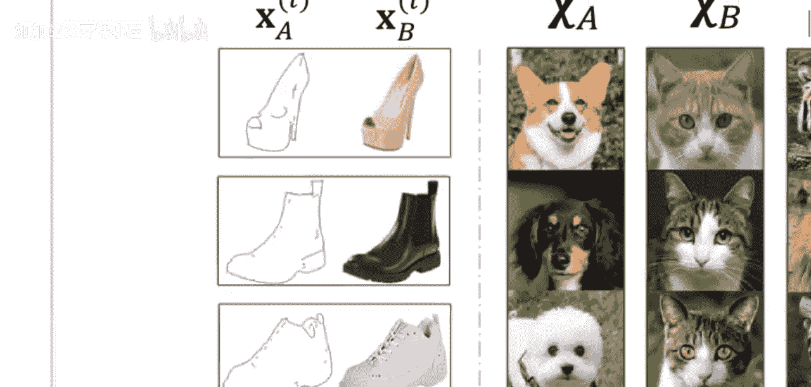

The different stages that image to image translation went through historically。

 So first you'd have to have corresponding images one to one where you'd say， okay。

 here is an example of a sketch of a shoe and here is the corresponding shoe。

 Here is the sketch of another shoe and here is the corresponding shoe and so on。

 and from that you could learn a model that translates from one domain to the other。

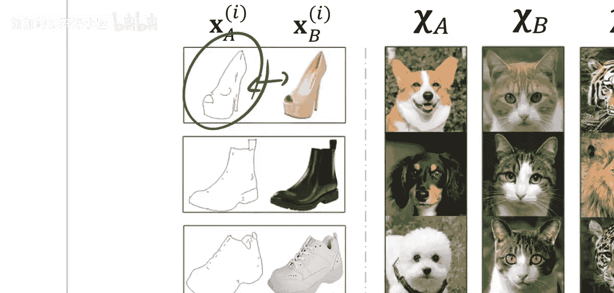

Because you have corresponding image level annotations。

 which image corresponds to which so basically which element of the domain A corresponds to which element in the domain B。

Then the next stage of this was when you only need set level annotations。

 and that's sort of what we looked at if you had supervised labels for domains。

 So what you'll say is that there are three domains， A， B and C。And。Actually。

 let's let's forget C for a moment and just deal with A and B to make it equivalent to the thing on the left。

 Now I just know that these things are instances of class A and these things are instances of class B yet I I don't there is no correspondence right there is no this correspond to this or or something like this So image to image translation is now possible between domains when I just have domain level labels。

But this is still expensive， collecting these labels。

 you know it like collecting labels for a supervised data set。

 a human needs to look at each image and then conclude what sort of domain it is。

Their paper introduces the following where you do not have domains anymore。

 You simply have a data set X。 Now， this data set， your hypothesis is that there are still going to be domains in the data set。

 They can， I guess they can be overlapping or not， but there are still going to be domains。

 You just don't know what they are。 So in this case。

I guess you could differentiate these people into many， many different ways， but in essence。

 you're going to assume that there is some kind of a domain structure you just don't know。What it is。

 But if you knew what it was， then you could simply apply methods from here to the data set and you'd be done。

 Now， their paper shows that if you apply something like a self clustering approach。

 and we've seen these approaches before in the paper about learning to classify images without labels。

If you have techniques like this， you can do like a self clustering approach on this dataset set X right here。

 and then you could learn your image to image translation。 Yeah。

 this paper shows that if you do that， the quality is not as good as if you do both things jointly。

 So what this paper does is it jointly learns to cluster。

 let's say to self label the images and to make to do this image to image translation and by doing the tasks jointly。

 they help each other perform better okay。

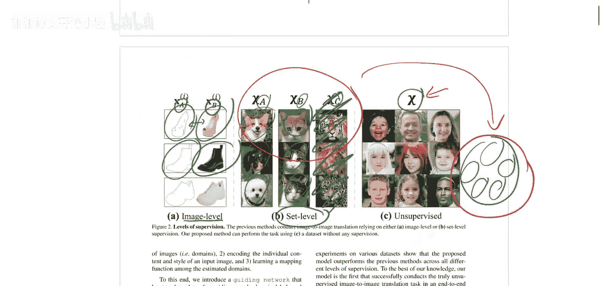

That's the general overview。 So how do they do this。They have three different parts to their model。

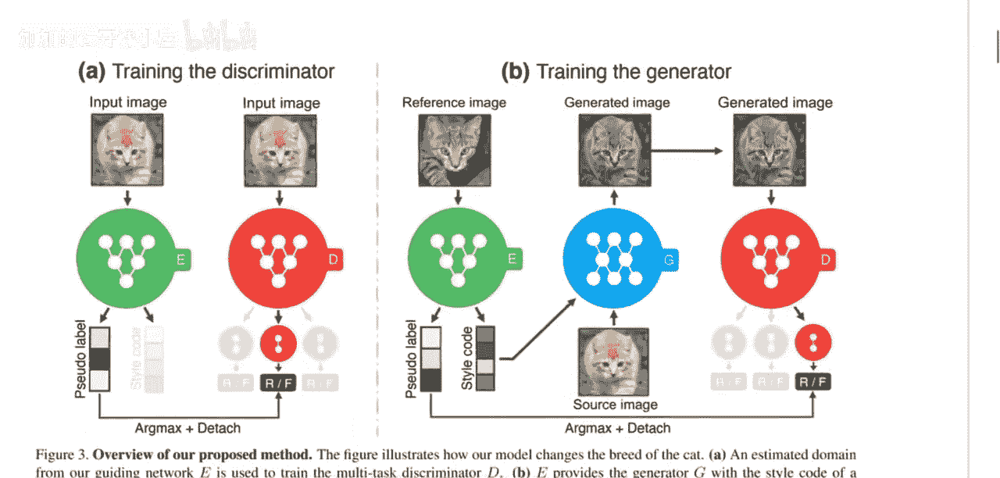

There is the。Encodeder。Or they call this the guiding network。 There is the generator。

 and there is the discriminator。 So the generator and the discriminator。

 they are fairly standardgan generators and discriminators。 So general adversarial network。

 But they have like a bit of some sort of twists。 So you can already see from the from the drawings right here。

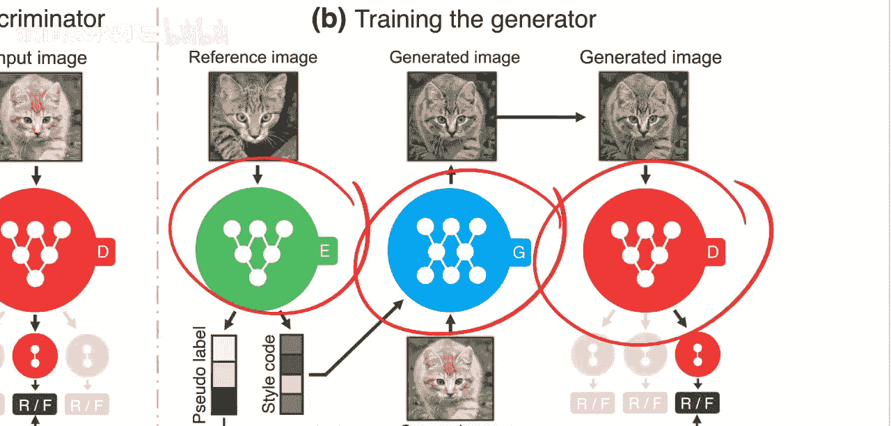

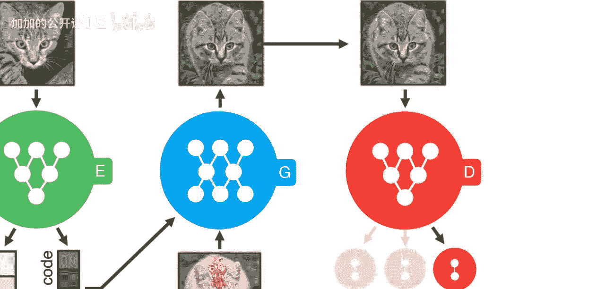

The discriminator is probably the easiest。 The discriminator gets an image right here。

 It doesn't have to be a generated。 It is either a generated image or a real image。

 And it needs to decide。 You can see right here。 This means that the input domain is a vector or an image in this case。

 And the output is a number。 It needs to decide if it's a real or fake。

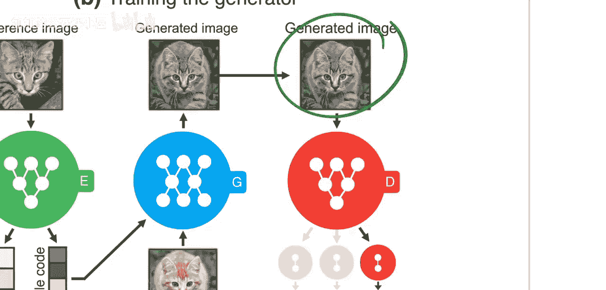

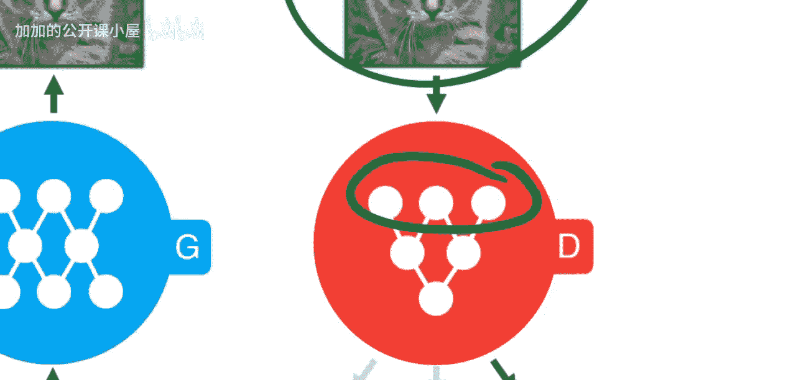

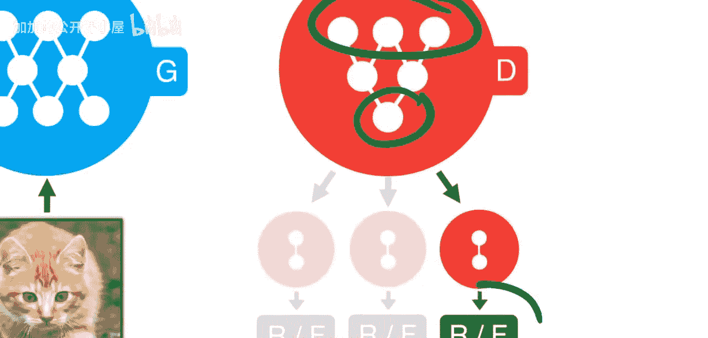

Now， in fact， it's not as easy because you can see there are these multiple heads right here。

 So this whole thing， as I said， is built on this kind of pseudo clustering approach。

 There is this pseudo label that comes out of the left side。 We're going to look at that in a second。

 But in essence， you assume that there are multiple classes。

 multiple domains in the data and the discriminator here has one classification head for each of those classes。

 So from somewhere outside， it will get the information of this is now supposed to be one of those ginger cats as opposed to one of those black and white cats are one of the brown hairired cats。

 No， it's one of the ginger cats。 And then there is a special head on top of the classifier that only classifies fake from real ginger cats which is a different classifier from the other domains。

 So the discriminator its sort of。😊。

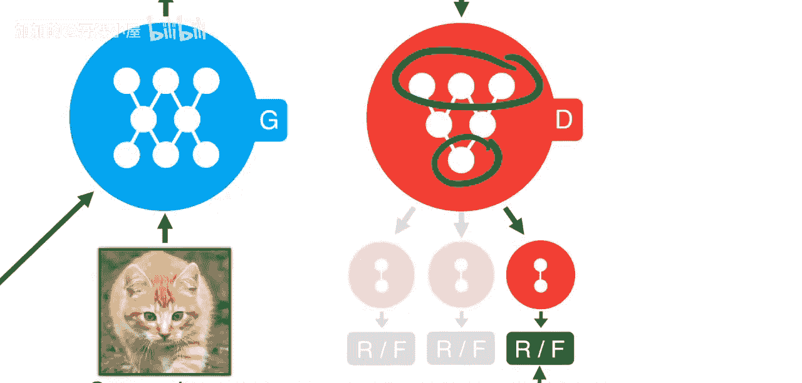

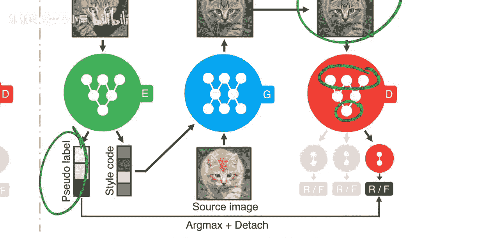

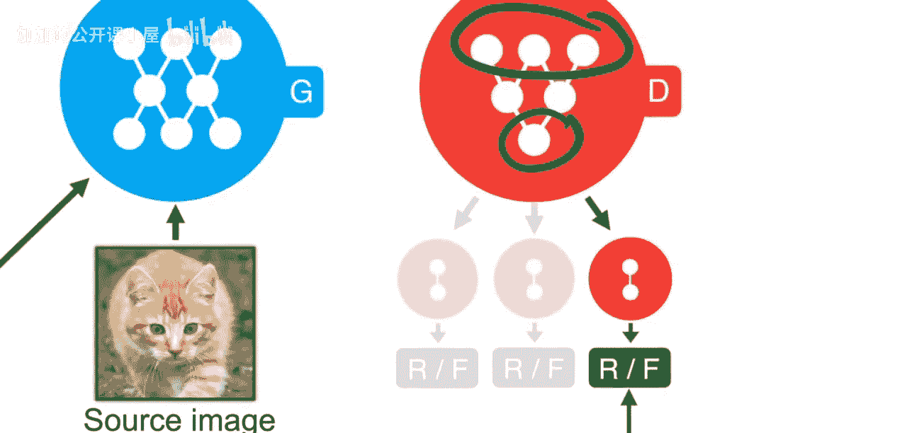

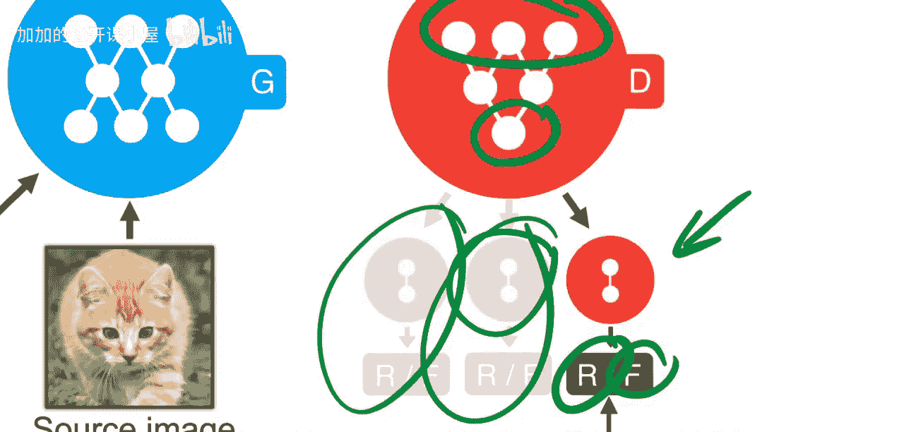

Conditional discriminator， conditioned on a label。

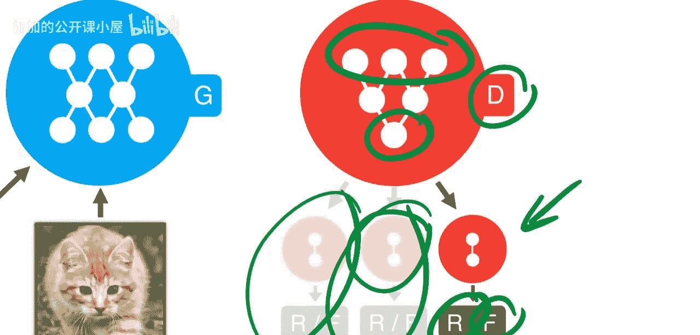

From the discriminator's point of view， it's simply a label condition discriminator discriminating between real and false。

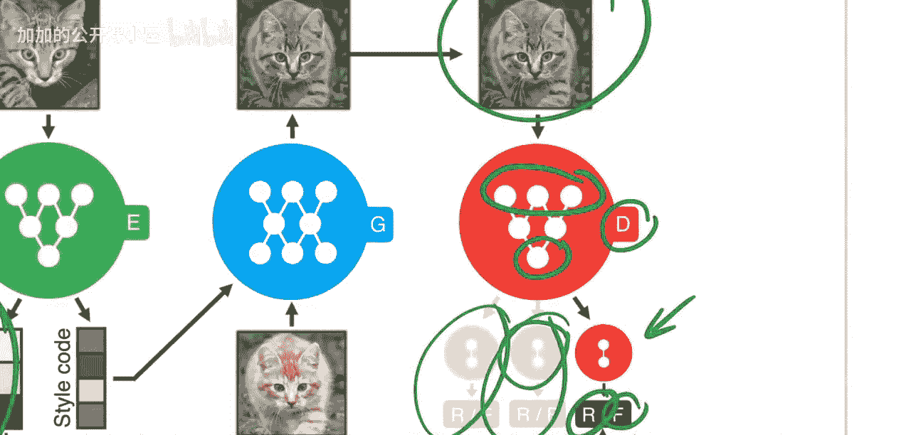

And I think that's， yeah， how you train the discriminator is you would give an image。

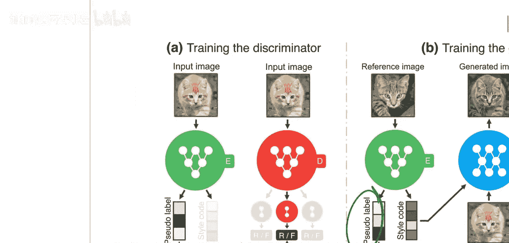

And。You would let this encoder here， this guiding network label the image。

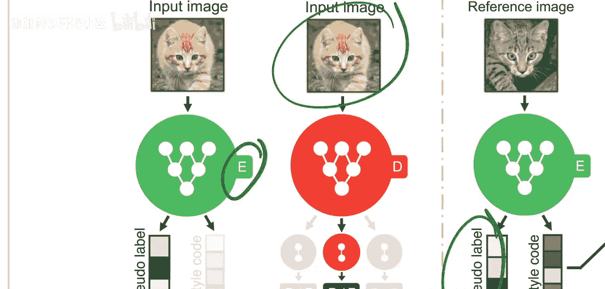

And how we come up with this label again that will look in a second。 but this just gives the label。

 and then you' for that particular label， you'd classify the image into real or false。

Now the fact that there is this shared part right here， of course。

 is you could also think of having one discriminator per class。

 but the shared part gives you some shared features and so on， but it's not necessary。

s not the point is that there is a discriminator per class， it's class conditional。

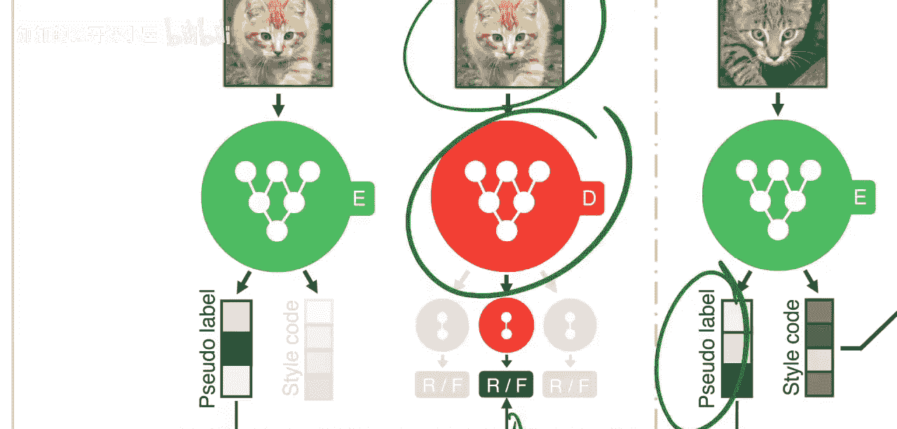

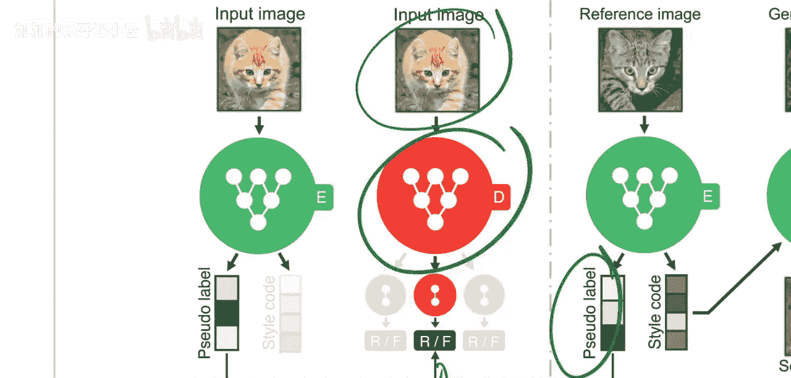

Okay。