# YannicKilcher【中英⚡AI经典论文领读(全203篇)(上)｜Papers Explained】 p41 P49 图像GPT：基于像素的生成式预训练（论文解读） [BV1o3xLznExj_p41]

Okay， I'm sure many of you have already seen this because it was rather widely announced。

 but the open AI team has announced a new model that produces pictures instead of text。

 So as you can see right here on the left， you'll always see like a half a picture。

 And on the right is the ground truth。 So they took this picture。

 They simply cut the bottom half right here。 And then they let the model sort of imagine what they cut away。

 And what it comes up with is pretty cool。 I have to say。 Like， look at the birds like。😊。

This is just awesome。But。The special thing about this isn't that it simply completes pictures。

 The special thing about it is it does it one pixel by pixel。

 So basically it goes at this pixel right here and asks， okay。

 what's that pixel and then what's that pixel and then what's that pixel and so on。

 So it is basically a like a language model， but for pixels in that it goes over the images in order basically like this。

😊，Or like always from left to right， left to right， left to right。

And it has no clue of the spatial relations between the pixels。 It needs to learn that by itself。

 as opposed to a convolutional neural network， which is specifically designed such that if you want to predict this pixel right here then it's specifically designed to say。

 okay， the most important information is probably around that pixel and then some like other important information is around that pixel。

 So CNNNs are built with this in mind， whereas this model right here。

 which is also known as image G isn't doesn't have any of that。

 it simply a transformer model that goes over these pixels one by one and we'll see how that's done。

 there are some more examples right here， particularly cool is the cat and you see that there is the beginning of this little white thing right here。

 which is this card and the completions of。

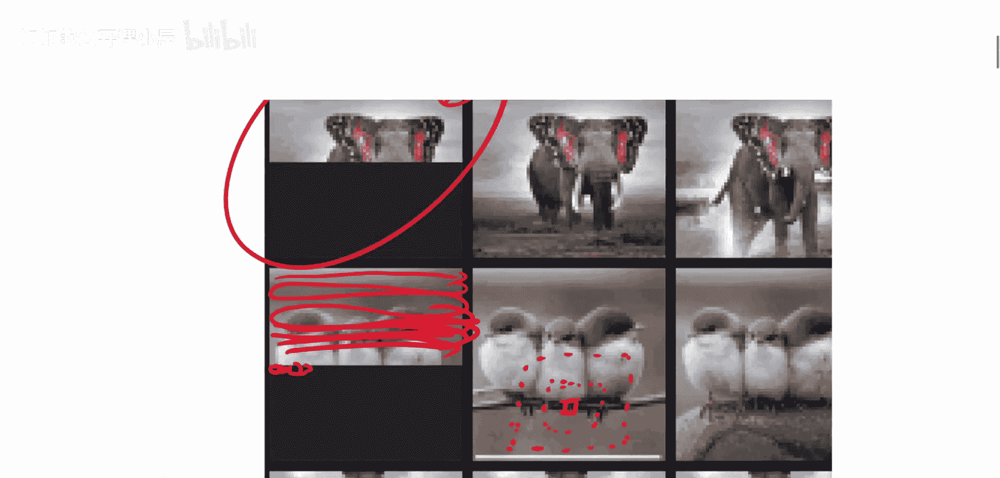

The model。Yes。Very interesting。嗯。The model can of course。

 as a language model can also sample by itself just random images。

 you sample them once through and this is what it comes up with So these are pretty good quality images for a model that just produces one Pel by one Pixel Now this idea of one pixelel by Pel isn't new this has been around before but the investigation here is basically how much can we how far can we push these generative models for pretraining Hi there this is from Postproduct I've realized that I've forgotten to even read the name of the paper So it's called generative pretraining from Ps by Mark Chen Raford Rachild Jeff Wuwa Pro Darriwall David Luan and Iia Suski and since Henry AI Labs has already made a video on this this video is going to be more of。

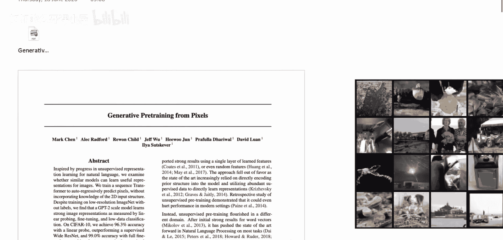

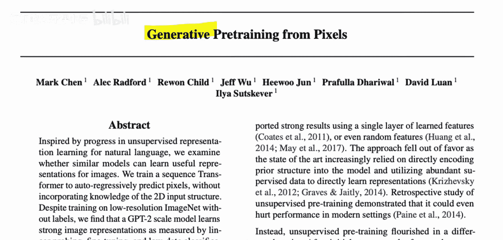

A rumble rant about what I find interesting about the paper and some thoughts about it rather than like a classic explanation。

 I hope you still enjoy that。 So what you saw on the right wasn't even the this isn't the final result。

 the supposed result。 This is simply the pretrain task。 and it's fun to look at it。

 but the actual object objective of the paper is the following。 What if we train， we pretrain。😊。

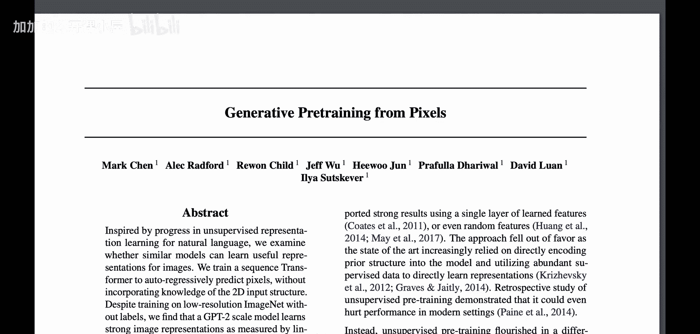

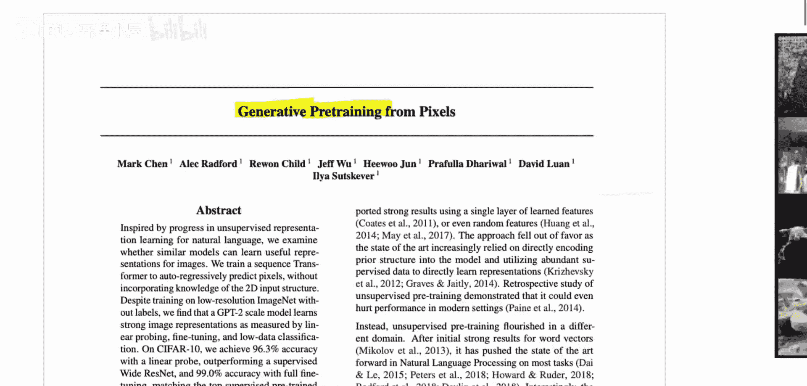

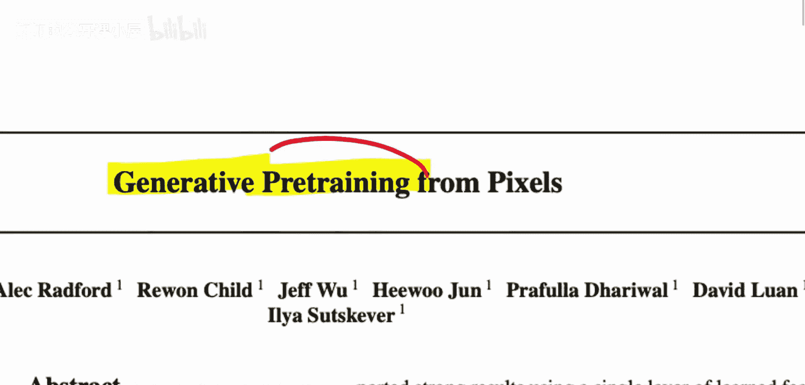

On a large data set to generate what good images。

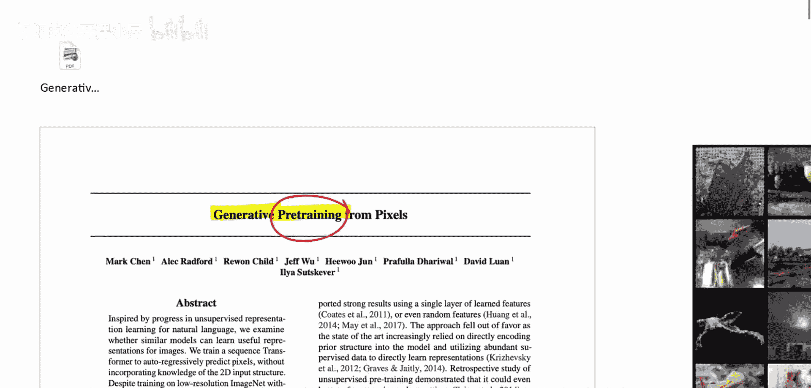

Like these。Or we to complete images like these。And then we fine tune on a classification task。

 and the answer is here， they say on C410， we achieve the 96。

3% accuracy with a linear probe outperforming a supervised the wide ressonnet and then 99% accuracy with full fine tuning。

 matching the top supervised pretrain models。

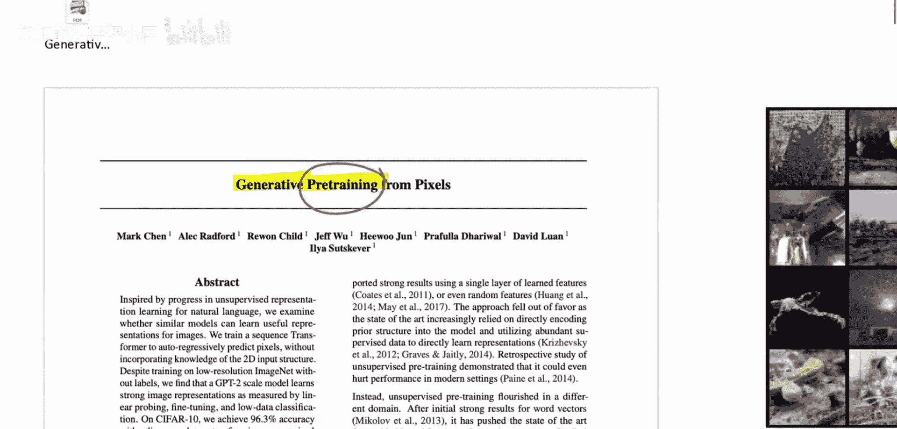

An even larger model trained on a mixture of imagenet and web images is competitive with self supervised benchmarks on imagenet achieving 72 top1 accuracy on a linear probe of our features so。

The goal here is that you have a data set that you want to like train a classifier on。

 So usually you have a dataset set and the dataset set has images。

And you put them through like a convolutional neural network。

 And then you have to classify the image into one of， I don't know how many classes on c4 10。

 that's 10 classes on imagenet it's a00。 And the data set is these images together with these labels。

 Now the idea of pretrain is that you somewhere have a bigger data set that is sort of similar to the small dataset set。

 but。Yeah， it's similar enough such that the network could learn something。

 So what you want to do first is you first want to take the large data。

 train this network right here， and then in a second step finet the network on this smaller dataset and you sort of hope that what you learn from the large dataset right here transfers over a little bit of knowledge。

 you already have a little bit of knowledge and you can make better use of the data that you have right here。

Now， the question is how do you do this pre training and of course。

 this has a long tradition well long for maybe two or three years right now in the language community where people they pretrain these large models like we've just seen G3 or Bert was one of them。

They pretrain these large transformer models on text。

 and then to fine tune them on classification task for text。

 And that's what this paper is doing right here。 They pretrain a transformer， that is。

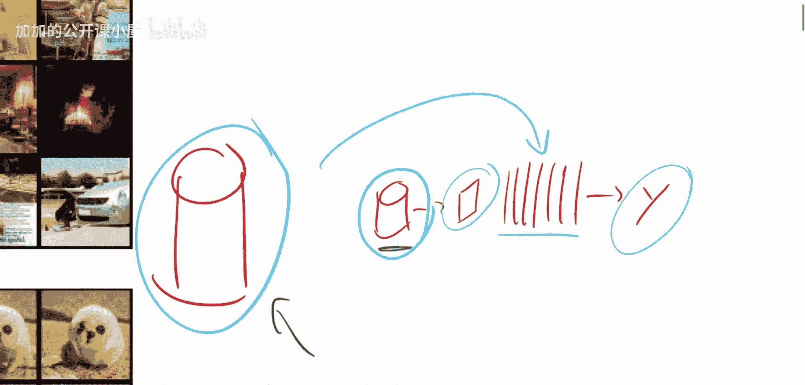

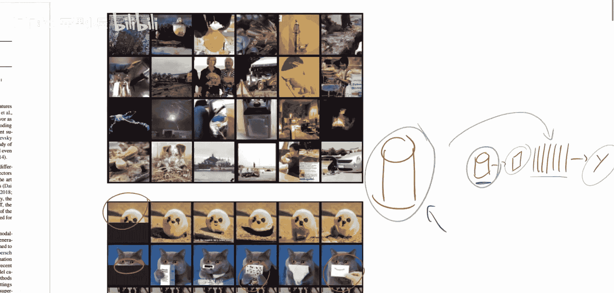

A G2 scale model。They pretrain it on image generation。And then theyd fine tune it or transfer。

 learn it to classification tasks。

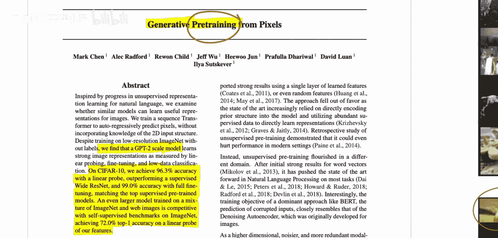

And the point of the paper is to say that like in text data， in text data， we have made pretty good。

 pretty good。Experiences with doing this with pretrain a generative model and then fine tuning on a classification task。

 while so far in images， all we've ever done is with've pretrained these pretrain task usually is a classification task or like a self supervised task with a contrastive loss or something like this。

What they're doing new is degenerative modeling as a pre training。And again。

 this isn't like entirely new， but they show that if you throw a lot of computers at it and lots of data and a big model。

 then that can work equally well to these selfsupervised tasks。 So their model， as I said。

 is pretty pretty simple。 They take an image。 and they unroll the image。 Now。

 and fully unroll image on， let's say imagenet has 224 squared pixels and that times3， right。

 because you have three color channels。 That's too large， even for an open a high supercomputer。

 So what they do is first， they downscale the image。 So they downscale。

 It's not as drastic as here where you just get a three by3 image。

 but they do downscale it to like a 32 by 32 or 64 by 64。 Then they unroll it。

 which simply means they。

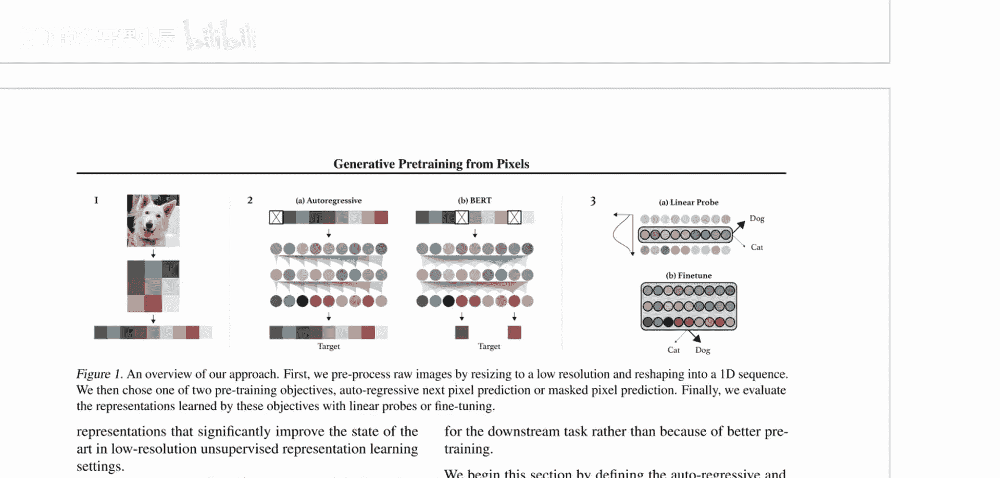

Go through the image like this and make a sequence out of it because their models are naturally made for text sequences。

 They simply put the image into a text sequence。 They further simplify this by reducing the three color channels to a single one。

 So they have their own color representation and basically yeah they reduce the three color channels to one channel that simply indexes the color in their color representation and they say it's still pretty good。

 it's pretty faithful。So ultimately they end up with like a 32 squared length representation of their image。

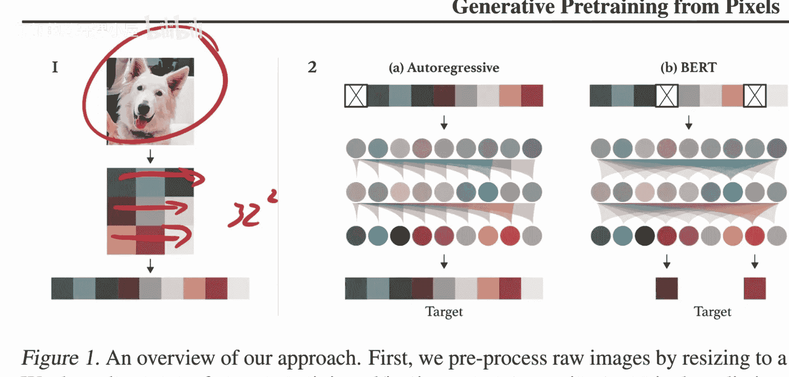

And then they do one of two things。 They either do auto regressive generative pre training。

 which is the sort of G2 style pre training。 And the the idea here is that。

You always want to predict the next pixel of a sequence。 So you can see right here。

 that's the sequence that you are sorry。That's the sequence that you input。

 and you always want to predict what is the next pixel。And in this case， you've see。

 you see that we've already predicted everything here。

 We've already predicted everything up to this red pixel。 So you w to know what's this next pixel。

 this thing right here。 What's this going to be。And the diagram here basically shows you how the attention flows。

 So every position in this transform。

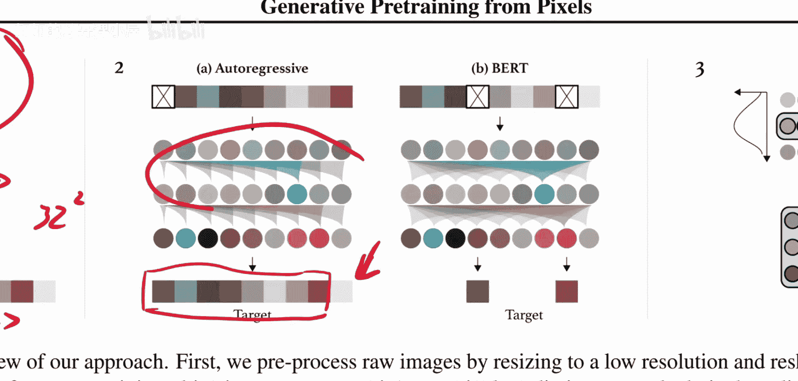