# YannicKilcher【中英⚡AI经典论文领读(全203篇)(上)｜Papers Explained】 p44 P52 RepNet：计算重复次数——野外无类别视频重复计数（论文解读） [BV1o3xLznExj_p44]

Hi there。 Check out these videos on the top。 Each one kind of contains a repeating action。

 So on the left， you see someone doing a jumping jacks in a fairly regular pattern in the middle。

 it gets a bit more difficult because what you see is a tennis ball bouncing and it bounces faster and faster and faster as time goes on On the right。

 you see that there is a short intro sequence before the repeating action。

 the person shoveling the cement is displayed。 So the goal here is to build an AI that can detect that a repeating action is happening And if it detects so that it can count how often this repeating action is happening。

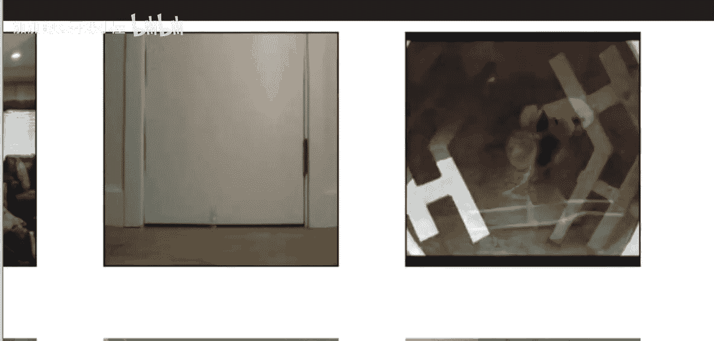

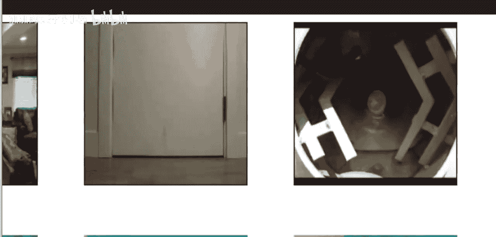

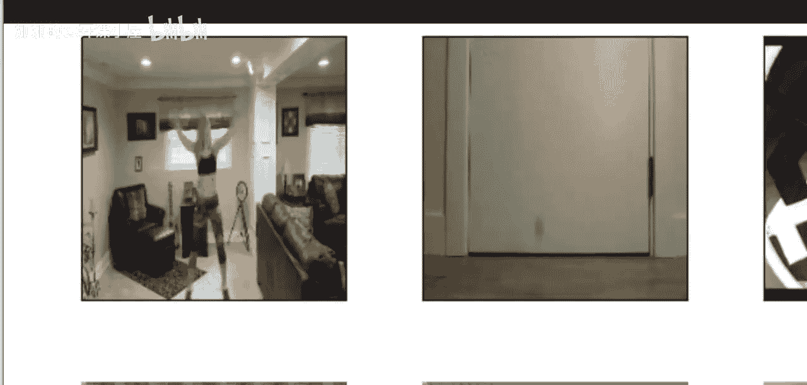

You can already see the difficulties here is not only the recognition itself。

 but the fact that the repeating actions can be different and can breathe different length and cannot always look the same and so on。

 So this paper uses these self， these temporal selfsimarity matrices that you see at the bottom here to achieve this。

 And we're going to explore how that's happening。 So the paper we look at is called counting out time。

 Class agnostic video repetition counting in the wild by debita Dti， Yusof Iar， Jonathan Thompson。

 Pierre Sermonet and Andrew Zeserman of Google Research and Deep mind。So as I already said。

 this paper detects repeating actions and is able to count them and on a high level what they do is they encode the video using convolutional networks then they build these temporal self-simarity matrices between the frames in order to detect the repetitions and they decode that into the predictions using another neural network this is all trained and to end and they also make a new data set for this task so that's the high level if you want to find out how exactly that's done I invite you to stick around because we'll go into the paper if you like content like this don't forget to share it out a leave a like and tell me what you think of the paper in the comments。

 I do read the comments so yeah I'm very happy to read what you all think about it。

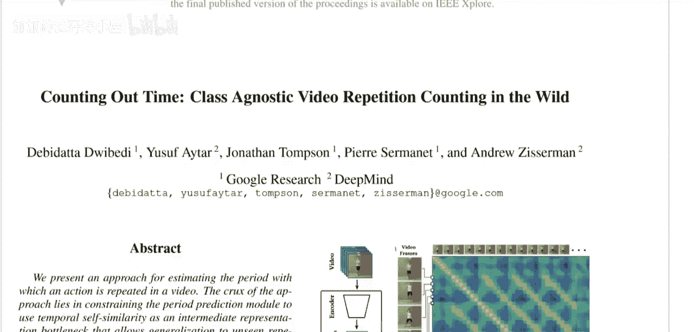

Okay， so as we already said， they say we present an approach for estimating the period with which an action is repeated in a video。

 and that's actually understating what the problem is here， the problem is many， manyfold。

 as you can see on the right here， even if you don't get what this self-sity matrix is yet the outputs that you want are at the bottom。

 So what you want is first of all a per frame periodicity prediction。

So that means that for each frame you want to know。

 is there even a repeating action happening or not in that particular frame you can see here at the beginning at the end of the video there is no repeating action and then in the middle there is a repeating action。

 So that's the first thing you want to know The second thing is this per frame period length prediction。

 So for each frame that is part of a repeating action you want to know what is the period length of that repeating action。

And that can change throughout the video。 So you need it per frame。 And once you have it per frame。

 you can actually count the number of repetitions。 Okay so those are two problems already。

 The third problem that this paper solves is that there is no adequate data to train a model like this。

 It seems， for example， this model right here， this Q U VA data set。 I believe has 100 data points。

 And these are mostly these are meant for testing。 So you would build your system somewhere。

 And then you would test it on those 100 data points。But they claim not even those are， you know。

 large and diverse enough for these systems to be evaluated。

 So they build we also collect a new challenging data called counttics。

 which is 90 times larger than existing data sets， which captures the challenges of repetition counting in real worldor videos。

 And that actually consists of a train and test split。 So you can also train a system using it。

Let's dive into the architecture， I think this paper is a very， very。

 very cool example of even though we're in this deep learning paradigm where you just throw neural networks at a problem it's a very cool example that you can still achieve a lot by smartly constructing this because we used to achieve a lot by smartly constructing features and so on。

 in this case the goal is achieved by smartly constructing the architecture of the neural network itself to give you back a good performance on the particular task right here。

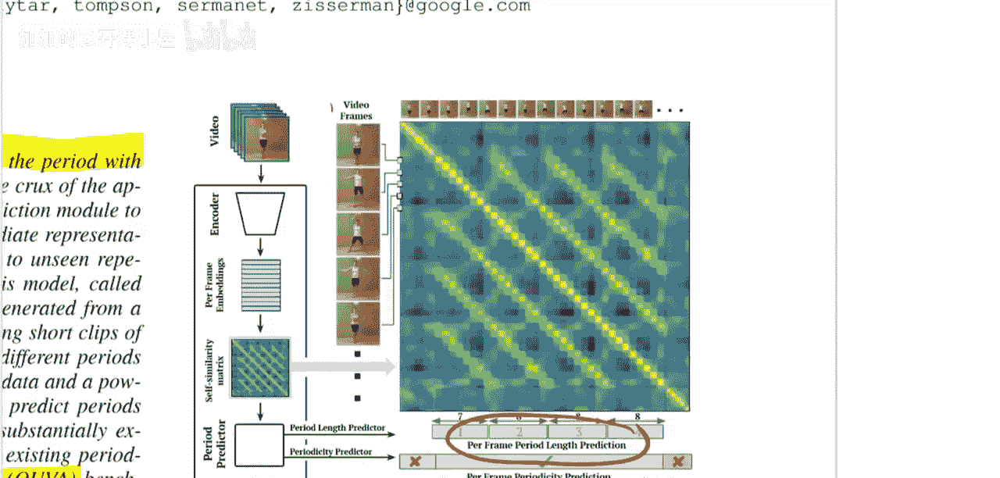

Okay， so if that tablet lets me actually scroll around。Let's go to the architecture。

 So figure two shows the architecture in more detail。

 So we'll go through it from the beginning to the end。 Actually， let's go， let's go to the end。

 So you know what is supposed to happen。 So for each frame in this video。

 what we'll need is a period length and a periodicity。 These are two。

 So the bottom is a binary variable and the top is a， it's actually a number。

 but it is predicted in kind of bin as a classification task doesn't really matter。

 We need two outputs that we can compare with the labels， right。

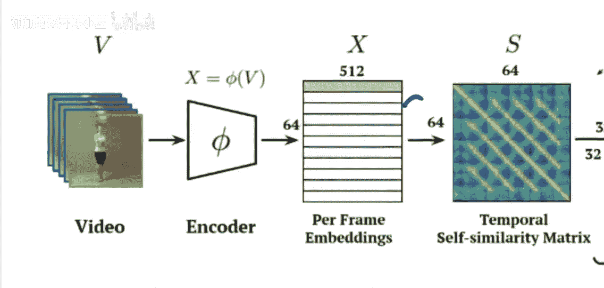

In this case， the videos are of length 64， so there's 64 frames per video。

 and for each of those frames， we want a period length and for each of those frames。

 we want a periodicity binary prediction。And that as I said， we compare with our labels。

 and then we can calculate a loss。 So this is the loss。 The loss is at the end。

 comparing these to labels。 and then everything else is trained using back propagation on that loss。

 Okay So now with that in mind， let's go to the beginning。

 So the video is taken and fed through an encoder in order to produce these per frame embeddings。

 So we want an embedding for each frame。 That means for each of the 64 frames。

 we want to obtain one vector of length 512 that describes that particular frame in terms that the model can understand。

 And we do that using an encoder。 Now， the encoder it has a bunch of parts to it。

 It's not just a blob， as you see right here。

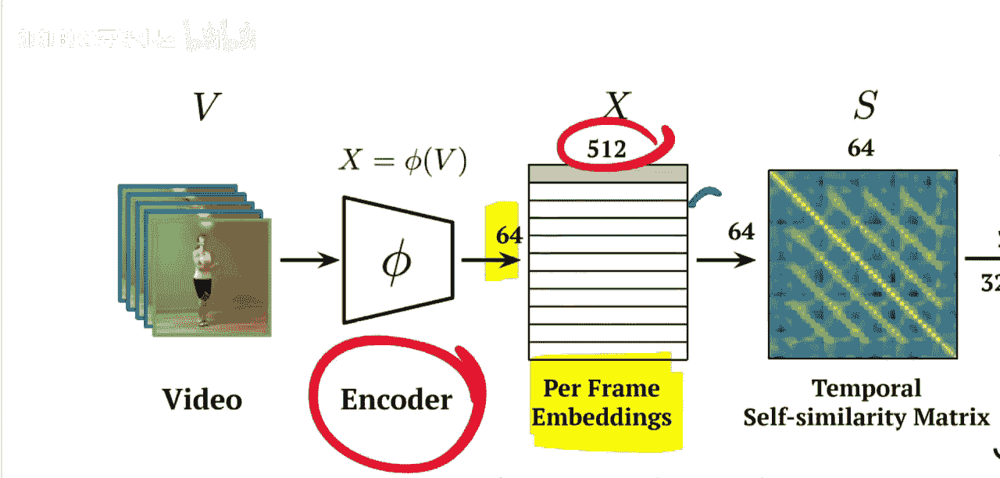

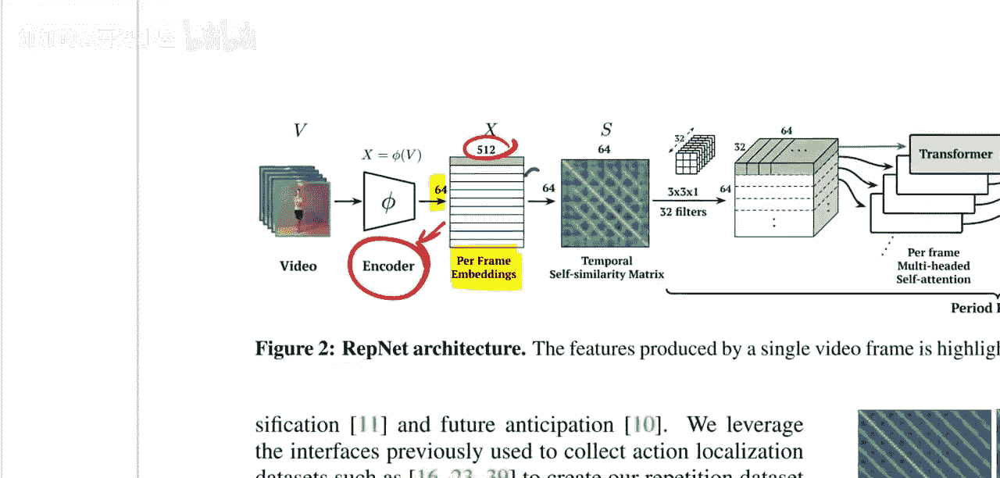

So the encoder consists of three things。 First of all， there's this convolutional feature extractor。

 which is a resnet 50 architecture。 is simply a convolution。

 And you let the convolutional neural network run on each frame independently。

 This is simply a feature extractor from images， right like you know it from any other image processing task。

 But， of course， here we have a video。 So it would be nice if the。😊，It would be nice， if the。

Frames knew something about the other frames， right。

 especially if you think of something like a jumping jack， if you are in this position right here。

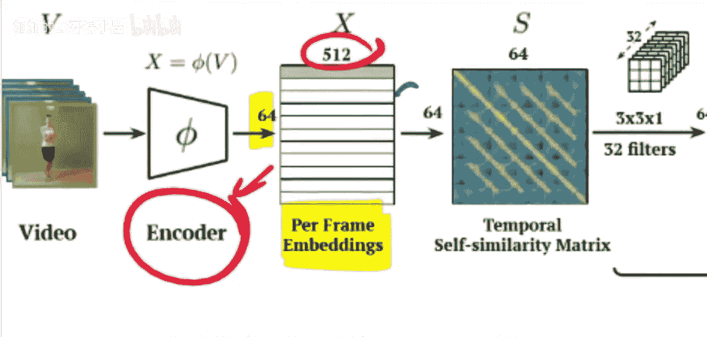

It， it doesn't tell you everything about that video frame。

 if you consider the frame before it and maybe the frame before it is this and maybe the frame after it。

Is that。You can clearly see that the hands or the arms are in an upward motion。

 So the next step of the encoder tries to integrate that temporal information into the embeddings。

 and that is achieved via a 3D convolution。

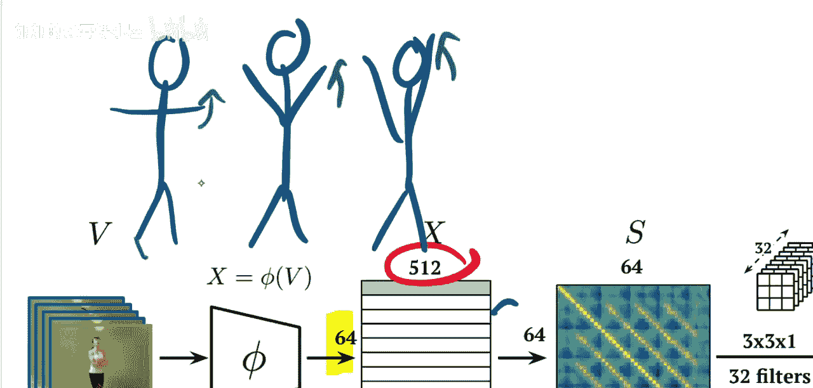

So once， once we process each frame individually， then we feed it into one layer through a layer of 3D convolution to add local temporal information to the per frame features。

 So if you don't know what a 3D convolution is， oh， this already drew。So in a 2D convolution。

 what you want to do is you want to have this filter right here。

 which is a 2D filter for each of the channels and you slide it across the image like this Okay and you can have multiple channels of the input image right here and you can actually do this multiple times which corresponds to multiple output channels of the filters。

 but the actual convolution is happening in two dimensions。

 So the sliding is across the width and the height of the image。In contrast to that。

 if you have a 3D convolution and you have the same input stack of images。 And now this。We have to。

 you have to pay attention here。 this right， this stack right here is the individual channels of one image。

 so of one video frame。This stack right here that I'm drawing。These are the video frames stacked。

 Now， each of these stacked video frames can have multiple channels resulting from its 2D convol or even just RGB。

 So I can't really draw in four dimensions。 but now we stack the video frames。

 And now our kernel our filter。Will be。Also in the direction of the video frame。

 So I don't know if this is really。Recognizable if I draw it like this。 But as you can see。

 the kernel is not only 2D but 3D。

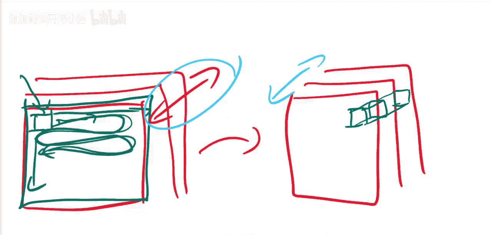