# YannicKilcher【中英⚡AI经典论文领读(全203篇)(上)｜Papers Explained】 p45 P53 如何阅读论文：Facebook的DETR（视频教程） [BV1o3xLznExj_p45]

Hi there people。 So a lot of you have asked me how I read papers and honestly。

 I don't think there is any super special method to it。

 but you know I thought because people have asked me to make a video on it so I'll make a video on it and I'll try to share my method of reading papers and hopefully this is going to be somewhat of a minise or a series where every now and then discuss how I read one of the papers that I make videos about and I'll try to select them such that different things are highlighted now I select this one right here for really for no particular reason other than I sort of remembered it and going to try to go with you through how I read this and how I encountered this and kind of try to honestly share what I thought at the first time when I read it。

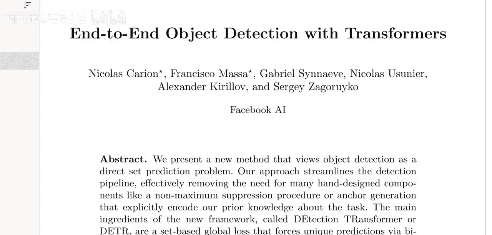

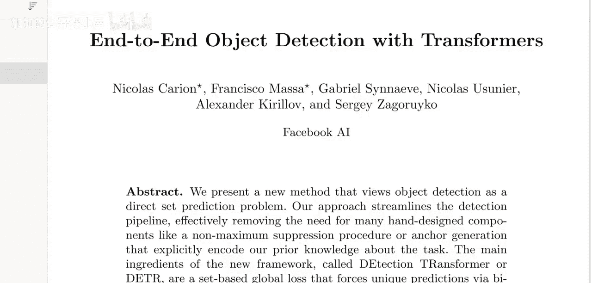

And I hope this helps some of you。 if it does help you。 And if you like content like this， of course。

 feel free to share this out and subscribe。 If you haven't seen my original video on this paper。

 it might be worth to go watch it。 I'll link it。 And with that， let's dive in so。

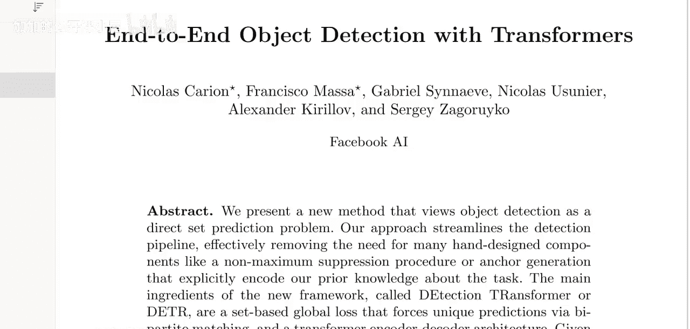

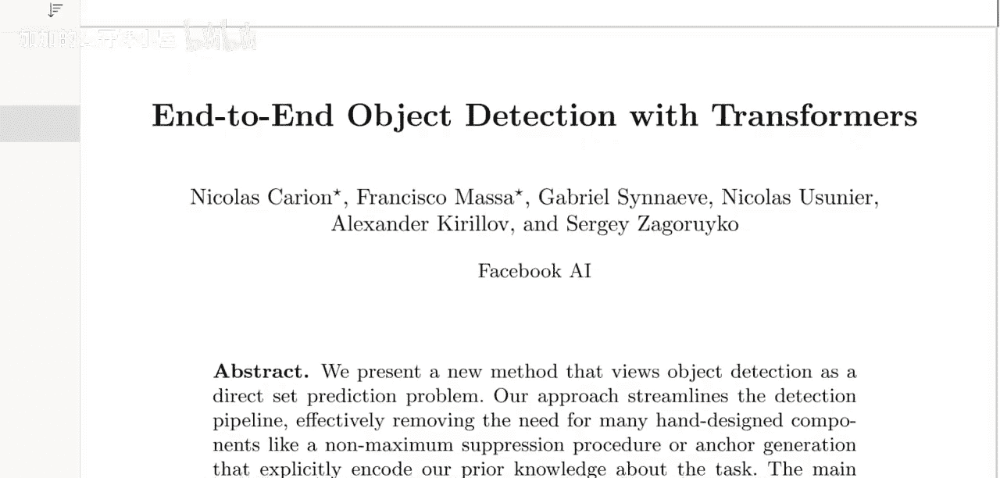

Again， this might be not really something new， but Ill， I'll just go through it。 Okay。

 so first thing I do is， of course， read the title。 So the title has three parts。

 end to end Object detection with transformers。 So what I notice that I do myself is I like through reading a paper It's like read the paper with an open mind。

 I don't do that。 I almost immediately form an opinion and a hypothesis of what's going on。 Like。

 so I see transformers。 So I know what transformers are。

 if you don't I've made a video I've made lots of videos on transformers。

 attention is all you need is the base paper for that。 So I know what the transformer is okay。

 And I know that transformers are usually in N LP。 are usually used in N LP there are things like。

 you know。

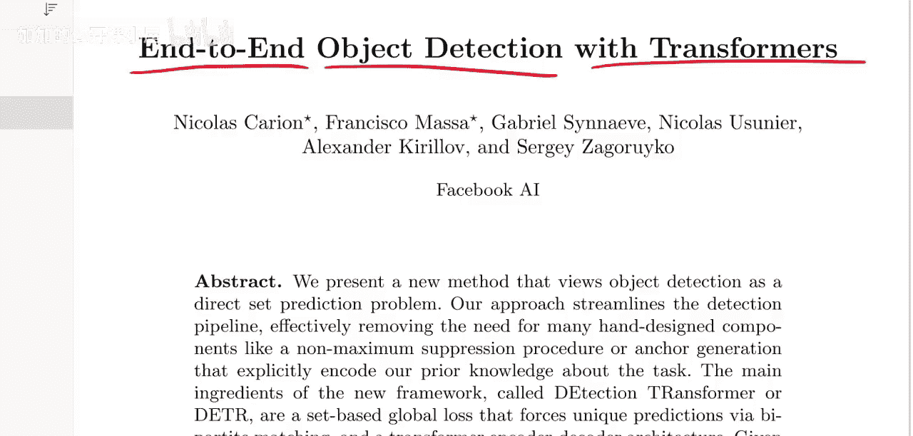

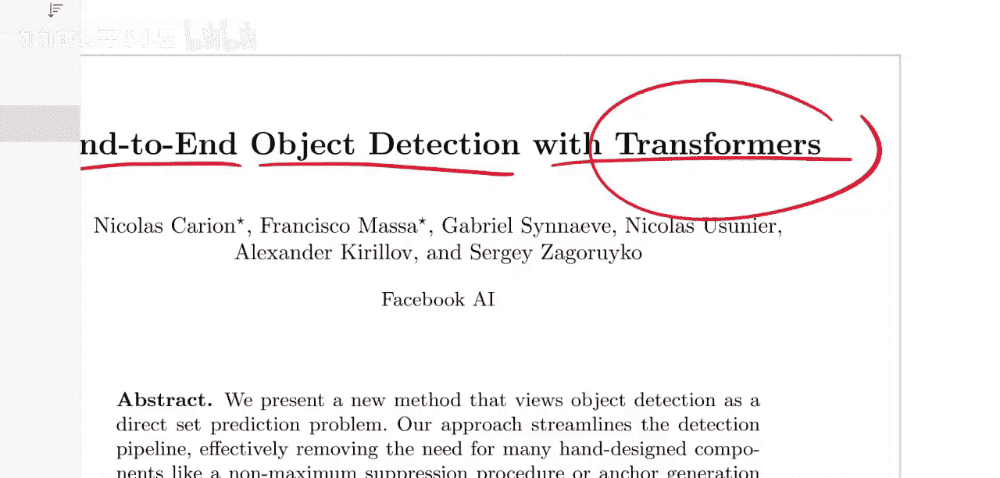

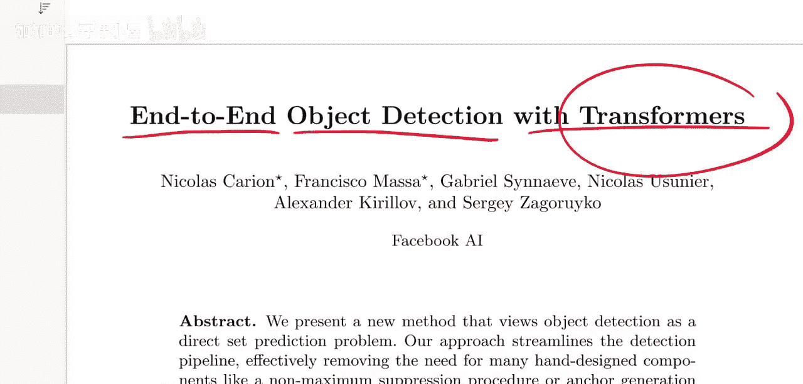

Other things with transformers。 But it's usually an NLP model。 then I read object detection。

 and I know object detection is a computer vision task。

 So immediately this here is sort of a difference。 And I immediately try to assess what's the new idea in this paper。

 And in this case it might be okay， it might be applying transformers to object detection。

 but then I also see end to end。 And the only reason to put that in a title is because that's the novelty because usually in deep learning we're sort of used to systems being end to end。

 and even if they aren't， if most systems aren't end to end。

 a lot of people don't is like end to end image classification on imagenet like think So I was guessing that the reason they put in end to end into the title was because that's actually something that's special about the model。

 So now I have like two competing hypotheses of why this paper matters。 first of all。

Because it does it with transformers。 And second， because it does it end to end。 And the， the。

 of course， the true fear is that the combination of。And to end transformers。

 all of that is what makes this model。 And I already form like hypothesis of whether I like this or not。

 like I have to be， I have to be honest。 I have very quick judgment of papers of whether I like them or not。

 And then I sort of catch myself each time and I still try to so they for most papers actually that I have sort of a negative opinion at the beginning where I well。

 negative。There are papers where I think， like there is no way this is going to， you know。

 work or something like this。 I'm actually positively convinced throughout the paper。 So for most。

 for most papers where I， that I read。I'm trying to find the positive things in there。

 but I do form an opinion pretty quickly usually。

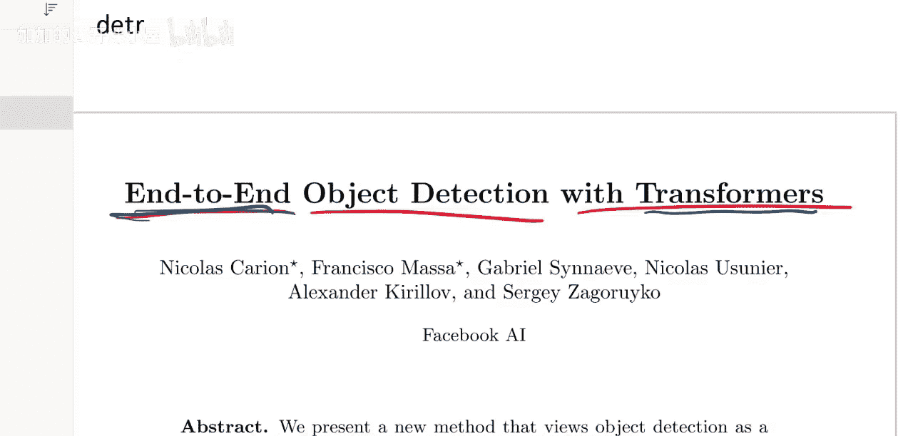

Alright， so the second thing， this part right here， I， I like， I don't even see。

 this is like advertisements on， on like Twitter。 I， like you， you just。

I have always had issues with author names。 Like people who come to me and be like。

 oh have you seen the new vinyls paper and no clue。 And then when they say like， oh。

 that's where they use this character level model to do that。 And I'm like that paper。

 So I like do not care who the authors are of a paper。

 Like I don't I can't remember the papers by their author names， I've gotten better at it。

 I have to say but I've always had trouble with this。

 Now that's not to say that a name doesn't pop out to me。

 like if this would be like like Yohua A Benjo or some someone like really famous。

 then of course that would catch my eye and but I also know that you know Yohua Benjo's paper。

 Yohua A Benjo's lab is huge。 So just because a big name is on the paper doesn't mean that the paper is going to be of any good or bad quality。

 sometimes the authors give you an indication of what kind of research is。There like if you see。

 know Jeff Kune or Kenneth or Stanley。You know that there's。

 there's going to be this certain type of of， you know learning to explore and and and kind of a bit more out of the box thinking in their papers。

 which I really like， but it doesn't immediately give you a clue。 maybe if you go by first authors。

 it's much more indicative， if you have already read some of their papers。

 but most often I just ignore authors and go on the affiliation sometimes matters in in that。

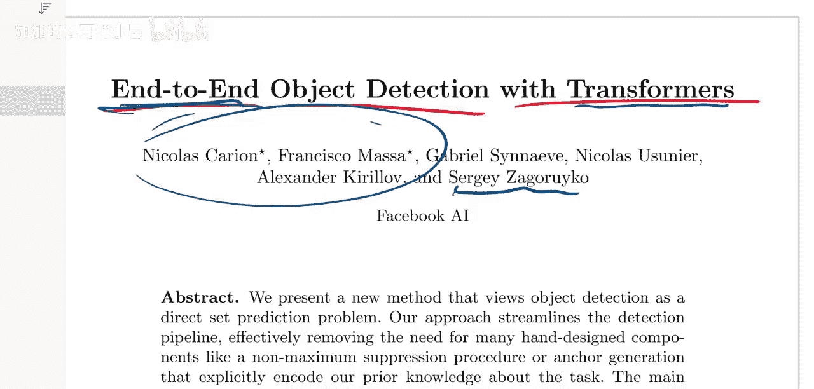

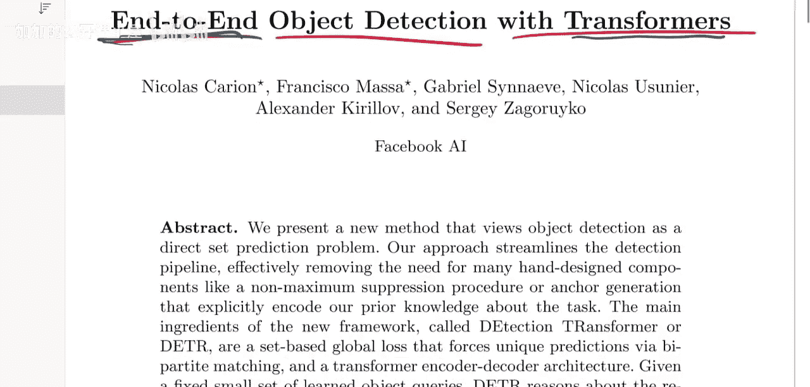

It's a bit of a vicious cycle if there is a big name affiliation like Facebook， AI， Google， AI。

 and so on。These papers。Also， they get more exposure in like the press and so on so。

 When Google publish a paper， all of these， all of these popey magazines like divverge and this and life hacker and hacker news and what not。

 they like， like， write a blurb about it。 So often they get much more scrutinized for these papers。

 They get， much more。😊，They get much more the public attention， but they also get much more scrutiny。

 which in turn， means that there is a bit more pressure on them to do good experiments。

 So that biases meet like a little bit into the direction of believing their experimental evidence more。

 Now， usually this is also backed up by the fact that I am actually convinced by their experiments。

 usually。 So these。These big name papers often I find myself even without or disregarding the affiliation to be convinced more than of like regular papers。

 my most often issue with papers is that I don't believe the experiments and I make no difference like even if it's Facebook I still my prior is the experiments are crap and I don't believe them and they have to convince me of the opposite but some like I can't say that it doesn't affect me that it's like a big name affiliation Okay。

 so then the second thing is I。

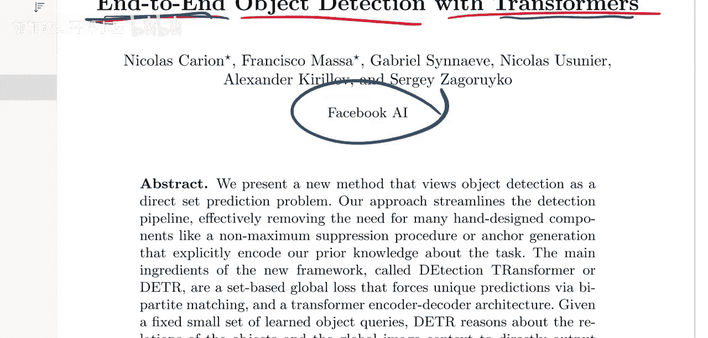

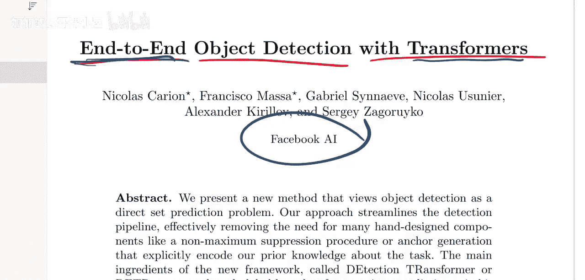

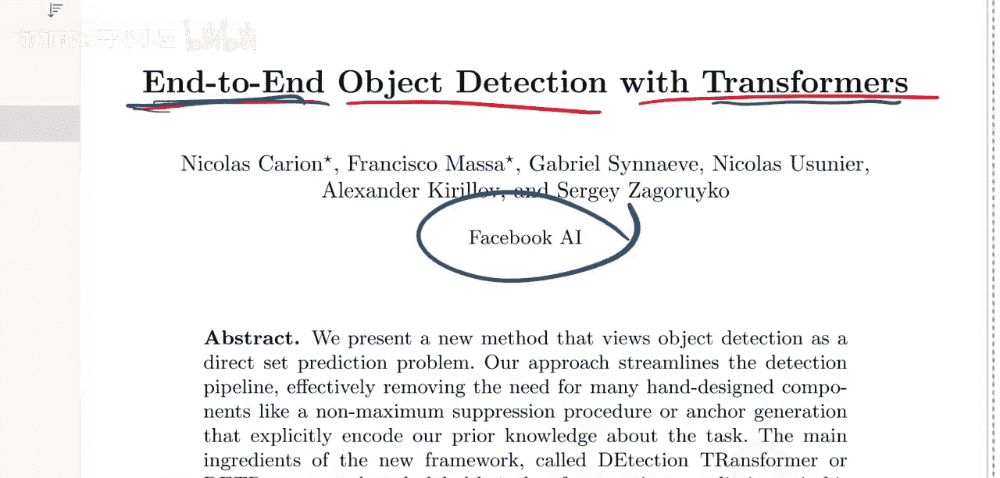

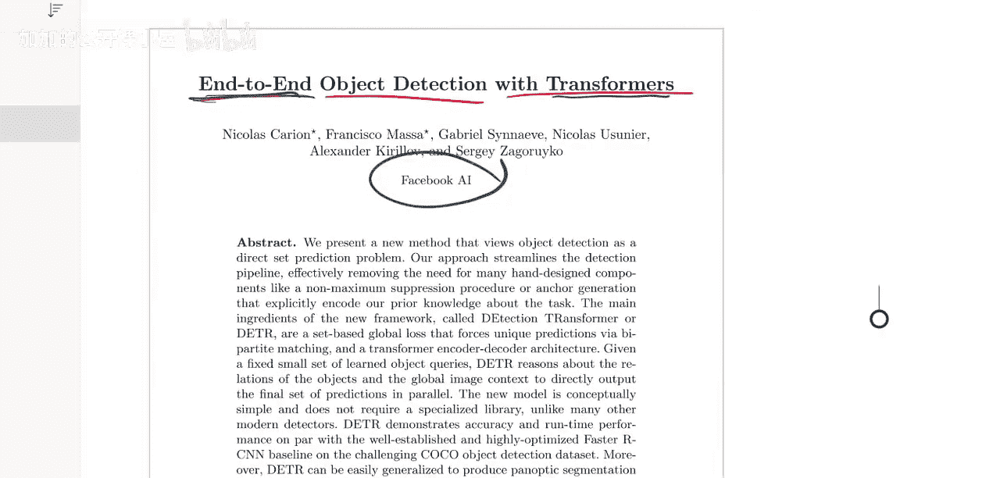

Sometimes I see the paper on archive and I skim the abstract。

Sometimes the abstract is informative and sometimes not。

 So here is like blah blah blah a new method that views object detection as a direct set prediction problem。

 And I'm like， oh yeah okay it' a streamlines the detection effectively removing the need for many hand design components like non-mum suppression。

 yada yada yada the main ingredients called detection transformer a setbased global loss that forces unique prediction via bipartite matching and that transformer encoder decoder architecture。

 So they make it clear here why it matters And that that's what I what I want to get at is sort of what's the new thing in this paper。

 Most papers are even though they're all very long and have lots of math and so on。

 they often have like one or maybe2。New core things that they really tell you。 sometimes 0。

 But a lot of times it's like one thing that they really do。 And you， you sort of have to but they。

 they're trying to cloak it often because they need to make their research。As impactful as possible。

 right。But you need to sort of figure out what it is they're doing here they make it fairly easy for us in that they say。

 okay， they remove the need for many hand design components like non- maximumimum suppression which tells me that they're building something that's easier than what came before them and that already tells me it's not necessarily going to be better。

 their argument is more that it's going to be easier right they're sort of two kinds of experimental results。

 the ones where you try to beat what came before you and the ones where youre trying to say。

 look our thing works just as well as this other thing while being more advantageous in some other metric So I would place this already in the sort of second category。

And then they say what are the actual ingredients， it's a set based global loss that forces unique predictions via bipartite matching。

At this point， I know what these terms mean， but at this point。

 I actually don't have to know what the terms mean。

 What I need to recognize is that I simply have to go later and figure out what that is and a transformer based encoder D。

