# YannicKilcher【中英⚡AI经典论文领读(全203篇)(上)｜Papers Explained】 p46 P55 从具有归纳偏见的深度学习中发现符号模型（论文解析） [BV1o3xLznExj_p46]

Hi there， Today we're looking at discovering symbolic models from deep learning with inductive biases by Miles Cranmer。

 Avaro Sanchez Gonzalez， Peter Patallia， Ruizsu， K Cranmer， David Sple and Shirley Hoe。

So this paper on a high level， it uses graph neural networks to fit a data set of observations of a physical system。

 and then it uses symbolic regression in order to parse out in equations。

 symbolic equations from the graph neural network， and the symbolic equations that will are found such they describe the physical system。

And they do find， they do recover some known equations。

 and they do find a new one in the field of cosmology。SoWe'll go through how they do it。

 what these two steps are and why this might work better than previous approaches。

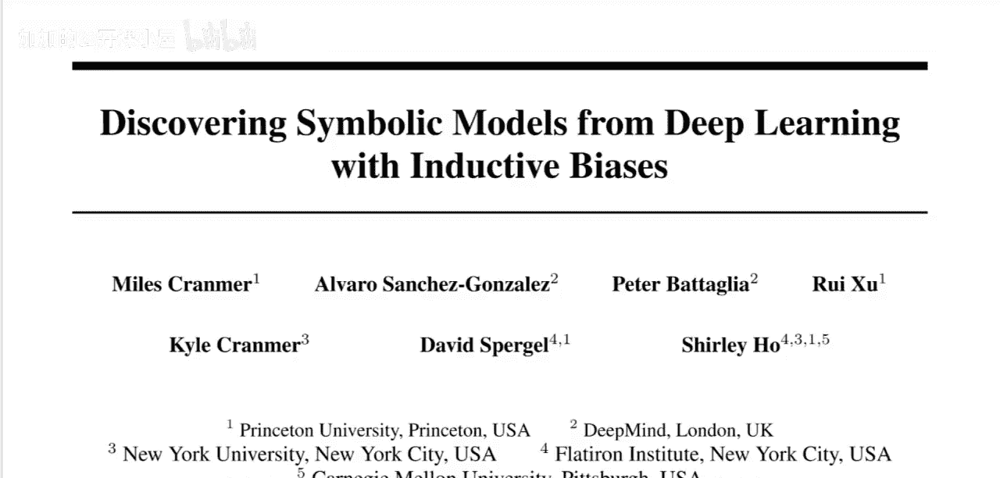

Yeah， join me if you like content like this， as always， feel free to share it。

 subscribe if you haven't， if you want more content like this and tell me what you think in the comments。

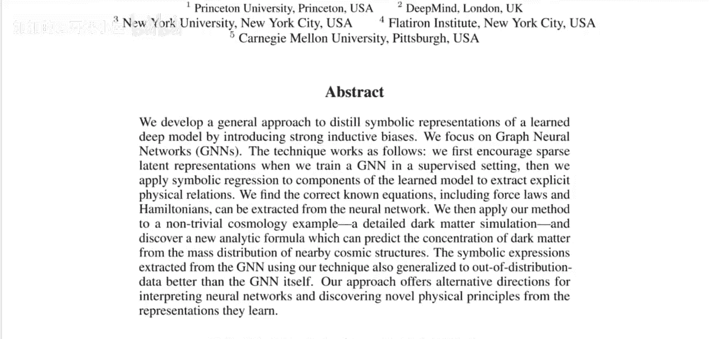

All right。So they claim we develop a general approach to distill symbolic representation of a learned deep model by introducing strong inductive biases and this。

It doesn't really say a whole lot， but I think the abstract doesn't say a whole lot。

Let me give you an example if you have three different， let's say， planets。Or stars， right。

 This is this three body problem is a unsolved problem， I think still。

 So if you have these three stars and you just let the simulation run， they have gravity。

 They attract each other， right， So they are going to move around somehow。

 So this one's gonna move here。 This one's gonna move like this。 This one's gonna move like this。

 and then it turns around。 and this one turns around and， and so on。

 So there is a fairly complex motions in already three different things that are somehow in a physical system together。

This is， a bigger problem than just stars。 So you have these systems， for example。

 when these are atoms and there is like an electromagnetic force between them or the strong force。

 there can be， these can be things where springs are attached to them and so on。 So our goal is to。

Derive equations that govern this behavior right In the case of gravity。

 we know that these objects sort of pull on each other with the with the force proportional to something like the mass of the first times the mass of the second divided by the radius that they are apart squared。

Something like this， times like this gravitational constant。

 that's we know the equation that governs these interactions。

 We don't know the symbolic solution to the whole problem。

 but we know the equation that governs the interaction， right。

Now imagine if we didn't know the equation， what do we have to do Well。

 what did Newton do ultimately he sat down and just came up with an equation that seemed okay to him and then found out that the equation actually does predict very accurately how the things move。

So we're going to try to replicate that process in in an AI system。

 the process of coming up with an equation that governs this behavior。 So what we have is a data set。

 As I said， we let this stuff run。 So we let it run for one time step。 and then this is here。

 Maybe this is here， and this is here。 Okay， and then we let it run for the next time step。

 This goes here， This goes here， This goes here and so on。So that will give us。Basically。

 it will give us frame by frame， how this system evolves frame by frame。

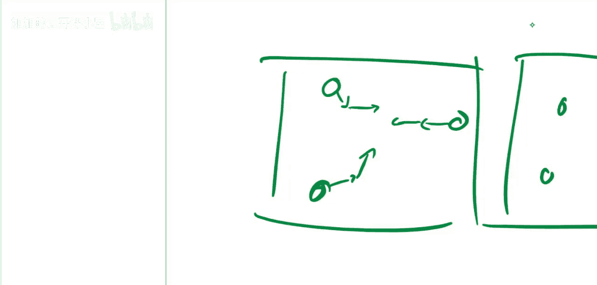

And that will give us a data set。 So this right here。

If we let it run and maybe we restarted a couple of times with different initializations。

 we let it run， we get a data set， so now we have a data set right。

 so our goal is to be to take that data set and come up with an equation like M1 M2 divided by r squared that governs this behavior。

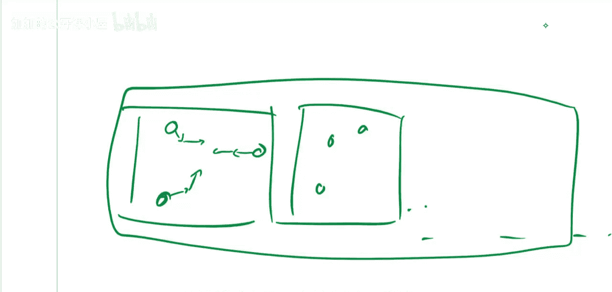

Now previous approaches have resorted to symbolic regression。

 I think they call this and that is basically it's pretty simple。

 namely what you do is you simply provide the system with a bunch of options you tell it I have a list and the list can include the mass of the first it can include the mass of the second and can include the x and the y position of the things。

 it can include the delta x and delta y which basically means the speed of the objects。

 it can include any constant a and B that you want it can include the symbols plus minus division multiplication square。

 maybe exponential function and so on so you give it a bunch of options of what it could potentially using an equation and then you simply let it make equations and you see。

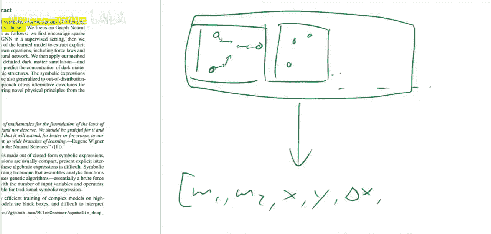

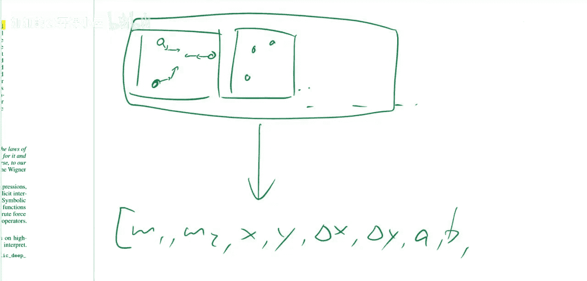

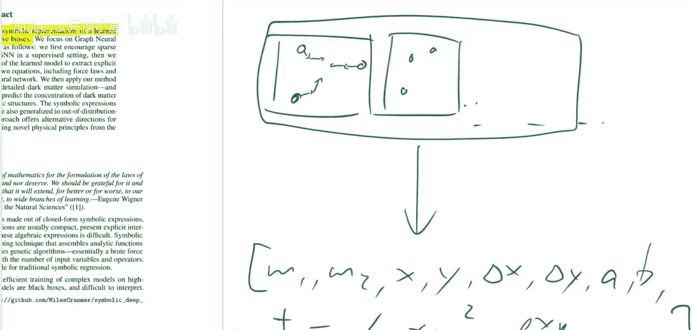

How well these equations describe the data set？And the way you do that is you can do it naively by just searching and trying out or you can be a little bit smarter about it and use like evolutionary methods。

 So you start with like some equations like this you okay I'm gonna x plus deelta X minus a squared you see how that how that describes the dataset set you'll find not very well and then you go on and you say okay maybe I'll make like a small mutation。

 I mut this to a minus and so on。 and if you do this with an entire population as is's common in these evolutionary methods you you'll end up with something better at the end。

Now this works until a point。 so whenever the space of things to explore like this one here gets larger and it doesn't have to be super large to already exhaust the the capabilities of these methods。

 So these methods are very limited in the space they can search and have proven not really effective so far for this type of problem。

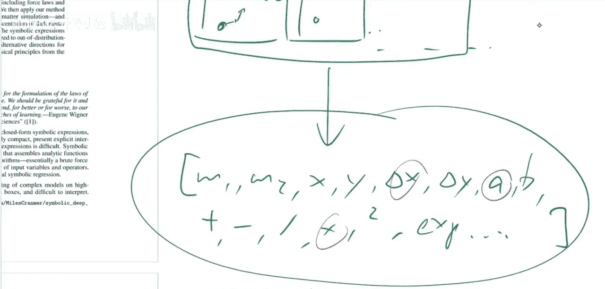

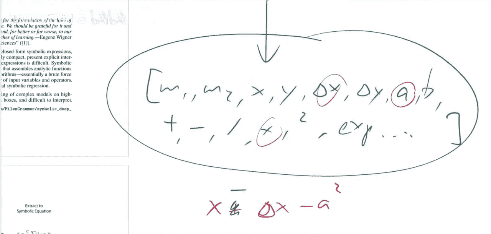

This paper right here goes a different route。 It uses graph neural networks in order to describe the data set。

 So in between this step of collecting a data set and making the equation， it fits another step。

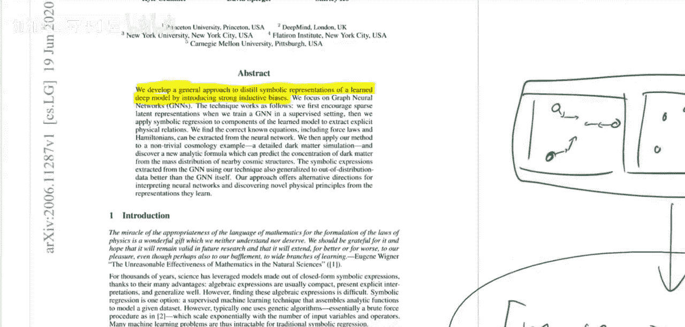

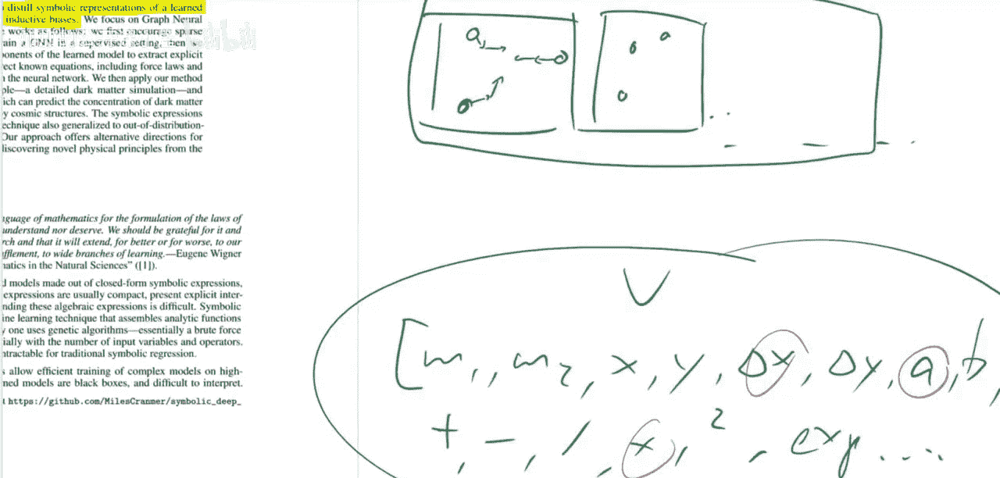

So it says in between here， we fit another step and that other step is going to be。

We have a graph neural network and you don't know yet you don't have to know yet what that exactly is。

 but it's technical。 it's like a type of neural network。

 And we're going to have that neural network learn the data set。 Now， as you know。

 from neural networks。 They can't do symbolic regression。 They can't give you an equation。

 They can simply predict numbers， right so。

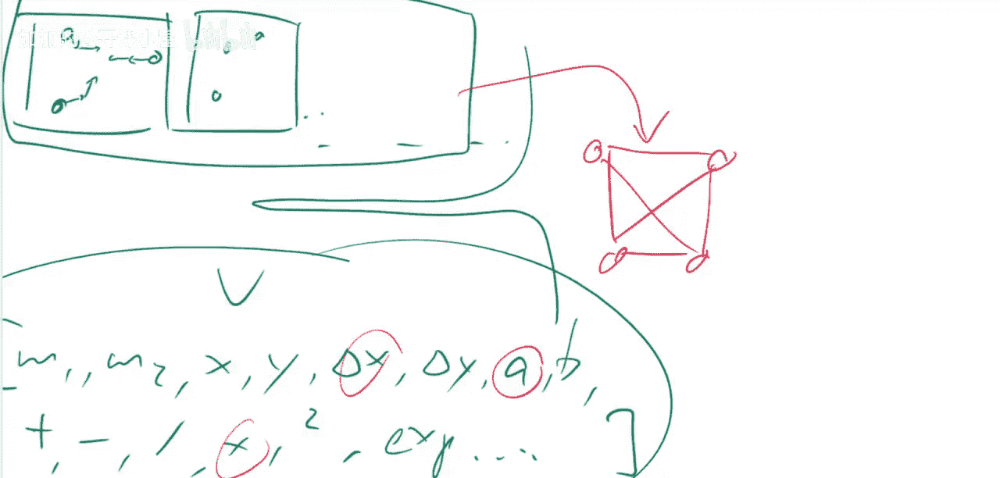

What the network will do is it will simply predict like the motions or the accelerations。

 whatever you're interested in。 It will predict those things as numbers， not as equations。

 as just you can plug in this situation right here， and it will tell you how the things will move。

 Okay， neural networks are pretty good at that。

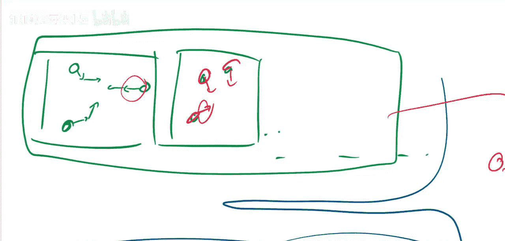

And once you have a graph neural network that can describe the system in a numeric fashion。

 then you parse out the equations from this graph neural network。

 And we're going go over why that is going to be much。

 much easier than parsing out the equations directly from the physical system。

 It's going to be because you engineer the graph neural network in a way that makes it very congruent with physical reality。

 that makes it very adapt to。

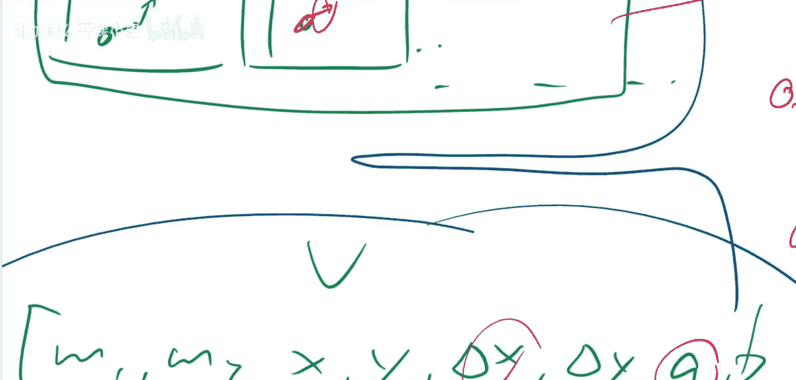

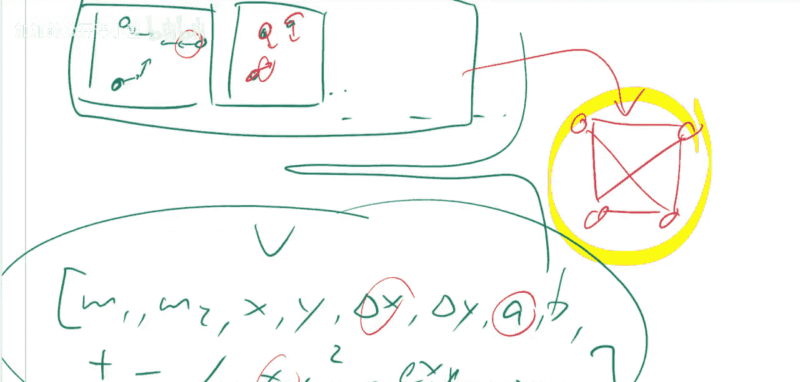

Purse out equations like this that makes the job of this evolutionary method much easier。

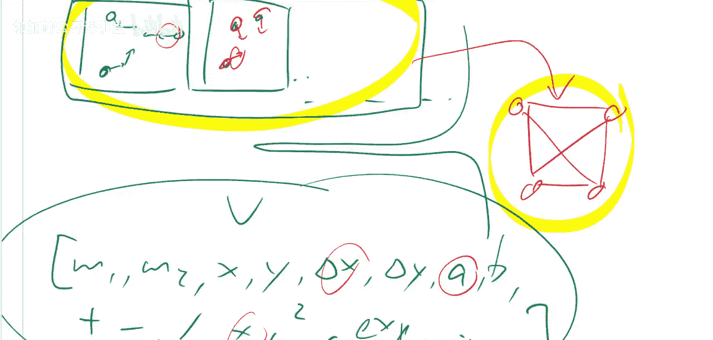

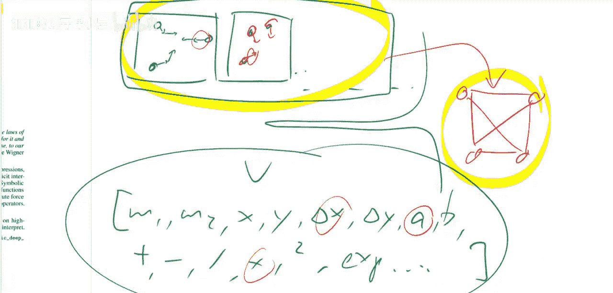

Al right， so that's that's basically the two step process here。 First step is to numerically。

Regress a neural network to describe the system， and then second step is going to be from that neural network。

 parse out the equations。

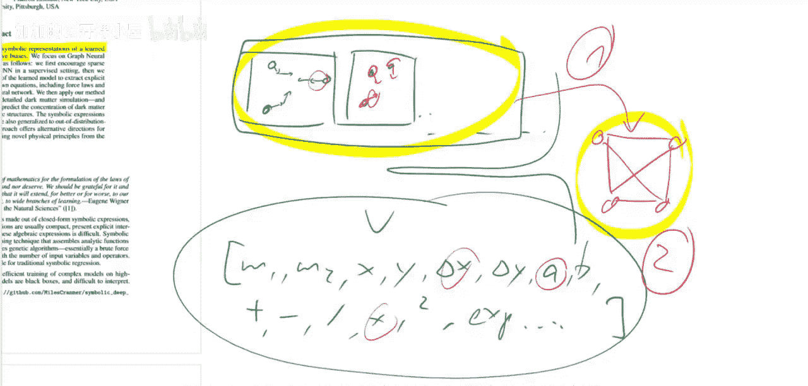

So we have to talk about graph neural networks。 so here you see the entire process as they describe it。

 so they have this data set right here of observations of these physical systems right this is like it's like you know any dataset set that you have in machine learning they predicted the dynamics which means in a numeric fashion with a graph neural network and then from the graph neural network。

 they extract the symbolic equation， as you can see right here。

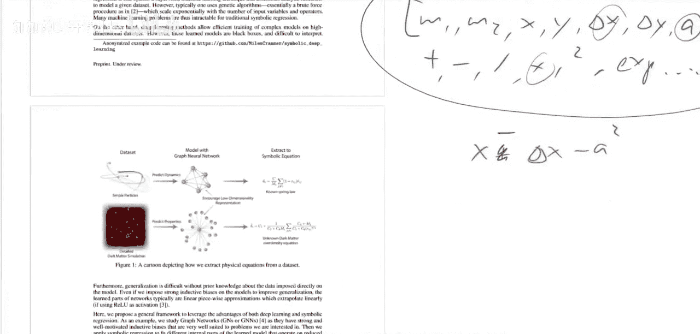

And this here is going to be the equation that they figure out that was previously unknown。

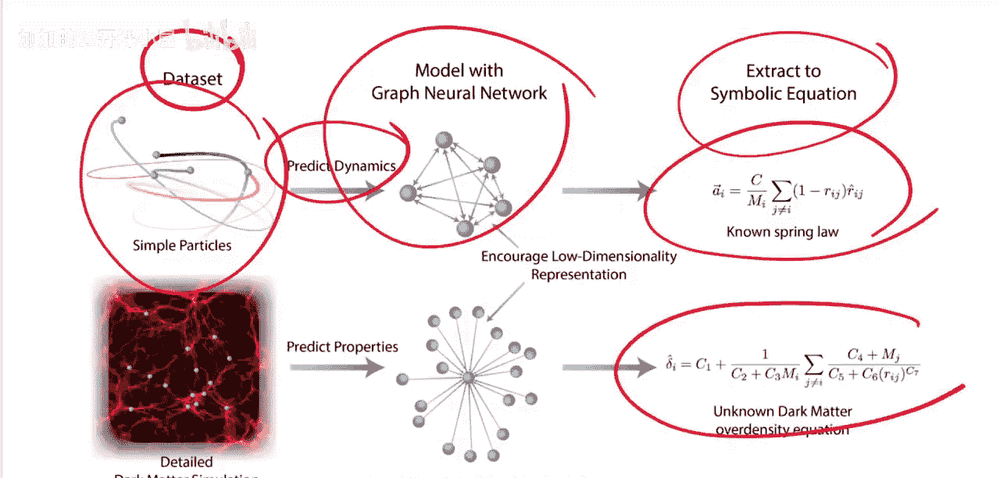

They even say an unknown dark matter over density equation。

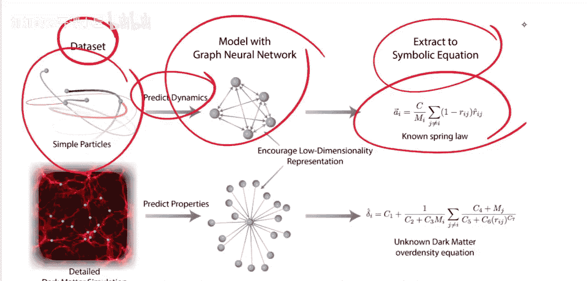

Cool， so we have to talk about graph neural networks。

 We haven't really done this on this channel so far。

 And I'm not the like a big expert on graph neural networks， but in。

They come in all shapes and forms。 in this particular paper。

 They use what they call a type of interaction network that's called a graph network。

 So graph network is something different than graph neural network。

 I think graph network is a type of graph neural network。And specifically， here。

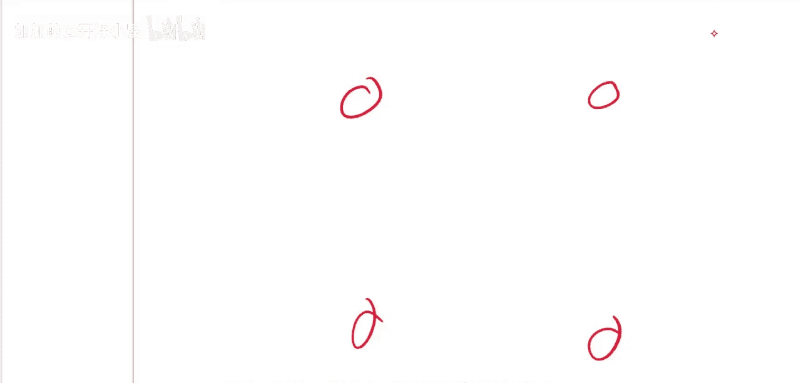

They use a network。That so a graph neural。