# YannicKilcher【中英⚡AI经典论文领读(全203篇)(上)｜Papers Explained】 p47 P56 直接反馈对齐可扩展至现代深度学习任务与架构（论文详解） [BV1o3xLznExj_p47]

Hi there， Today we'll look at direct feedback alignment。

 scales to modern deep learning tasks and architectures by Gi Loone， Yacopopolili。

 Franoncois Bonifas and Floron Kzaalla。So this paper on a high level。

 it replaces the back propagation algorithm in a deep learning architectures with this algorithm called direct feedback alignment。

 which is more biologically plausible。 the algorithm has been around for a while。

 but it hasn't yet been shown to be applicable to really modern。

 big deep learning architectures and then perform on par with back prop on modern deep learning tasks。

 This paper， as I understand it， is the first one to demonstrate that it can do that。

 So this is very much an an engineering paper and applied paper and。

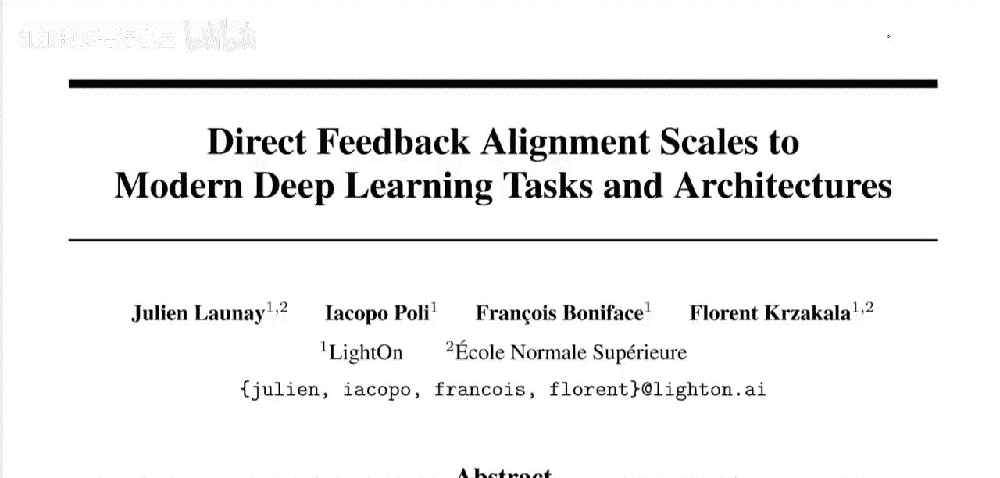

We're going to mostly go into direct feedback alignment as such。

 and I don't think we're going to go too much into what the actual empirical findings are because even though they're impressive and it's a good piece of engineering。

 I think they can be summarized pretty much by it works not yet on par with back propagation but into a promising direction。

All right。As always， if you like content like this。

 consider sharing it out and leaving a like and tell me in the comments what you like。

 of course subscribe if you aren't yet that that is， you know。

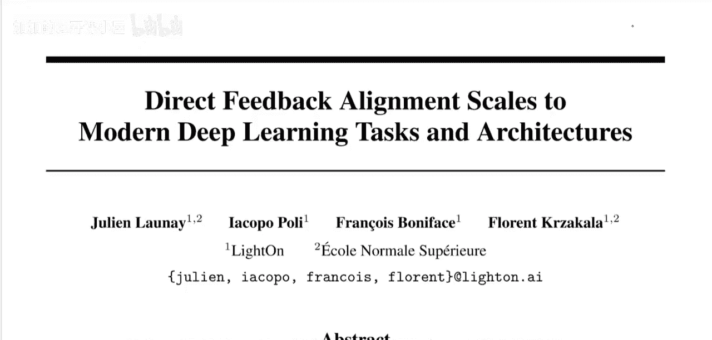

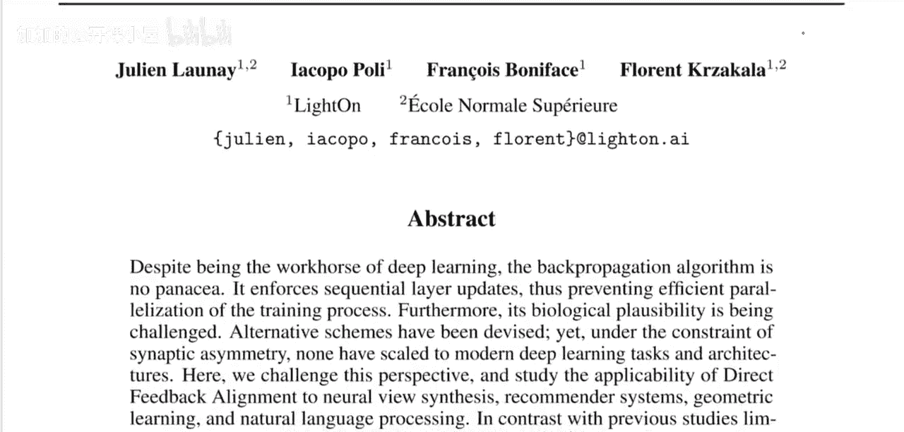

Essential。Otherwise， how are we going to hear from me in the future？Okay， let's dive in。

 They say despite being the workhorse of deep learning， the back propagation algorithm is no panacea。

 It enforces sequential layer updates， thus preventing efficient parallelization of the training process。

 Furthermore， its biological plausibility is being challenged。

 Alernative schemes have been devised yet under the constraints of synaptic asymmetry None have scaled to modern deep learning tasks and architectures。

 Here， we challenge this perspective and study the applicability of direct feedback alignment to neural view synthesis。

 recommender systems， geometric learning and natural language processing。

In contrast with previous studies， limited to computer vision tasks。

 our findings show that it successfully trains a large range of state of the art deep learning architectures。

 with performance close to fine tuned back propagation。At variance with common beliefs。

 our work supports that challenging tasks can be tackled in the absence of weight transport。

 So there is a lot to unpack in this particular abstract right here。So first of all。

 what's the problem with back propagation， back propagation， they have。

 they have two corals right here。 First of all， it's preventing efficient parallelization of the training process。

 So what does that mean。 So in back propagation， I'm pretty sure you all know basic back propagation。

 But you have an input to a neural network and the neural network is a bunch of layer。

 So the input will travel layer by layer and at the end。

 you'll get some output and your output Y hat。 let's call it here what the neural network thinks let's say it's a classifier thinks that the class of this particular x should be。

 Now， in the data， you have your true layer and then you compare that to your。

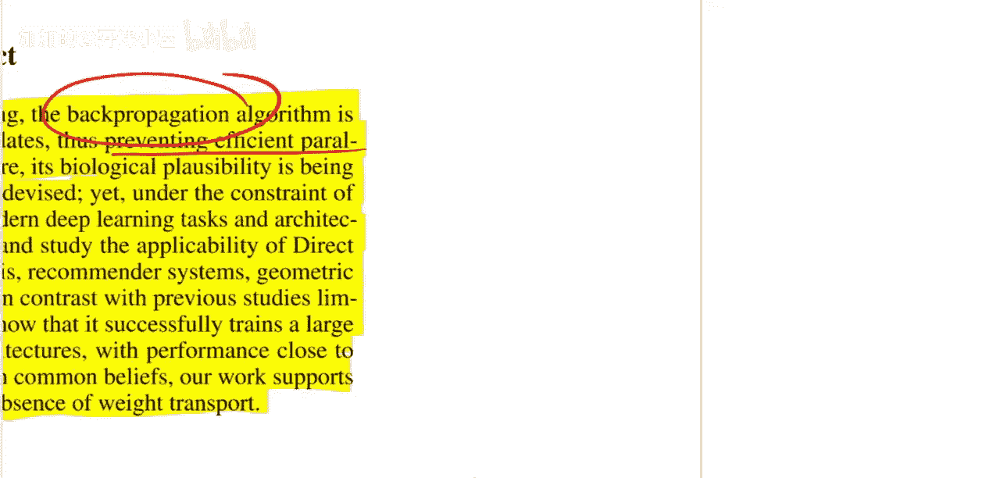

Output label， and you can compute a loss function。Now。

 the whole question of the back propagation algorithm is how do I need to change my layers of the neural network in order to make the loss as small as possible And for that you can use back propagation。

 That means you can take that loss and you can back propagate it down the layers in order to update each layer individually。

 So the first problem they have here with the back propagation algorithm。 And it's not。 I mean。

 it's kind of a secondary problem， but it is that is sequential。

 So in order to update this layer right here。 you need to have already back propagated to this layer。

 And then you need to back propagate further to this and to this layer。 So it's a sequential task。

 you need to back propagate down the layers again whereas。What is more plaus。

 but what would be more efficient if if we could somehow update all the layers in parallel。

 But this is a minor coral。 The bigger one is that back propagation isn't biologically plausible。

 We know that in real neurons， you have your dendrites。

 your inputs and of your axon and the signal only travels in one direction。

 We don't know of a feedback mechanism in true neurons in the brain that would allow for information sort of to flow in the opposite direction。

 There is， there is information flowing the opposite direction， but it's it's。

 I guess I think it's too slow and it's。So it's not really。It can't be。

 theres no analogous way of back propagation。 There' is nothing in the brain that would take the role of the back propagation algorithm。

 specifically if each layer is characterized by a weight matrix right here。

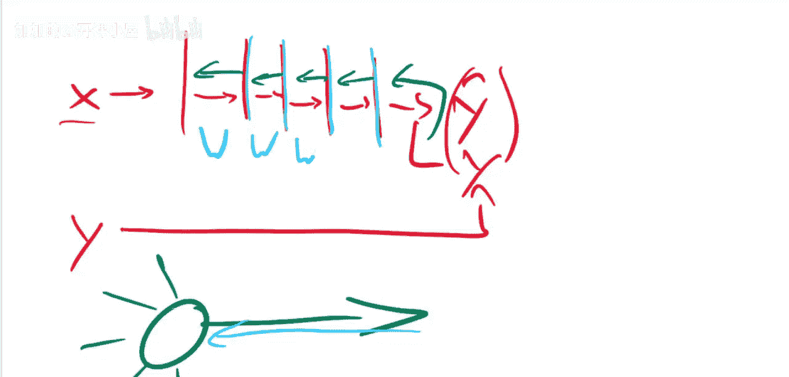

What back propagation does is it uses the transpose of that weight matrix to back propagate。So these。

 these arrows to the front right here。 they use the weight matrices and these arrows to the back。

 They use the transposes of the weight matrices。 So the transpoes of the weight matrices sort of。

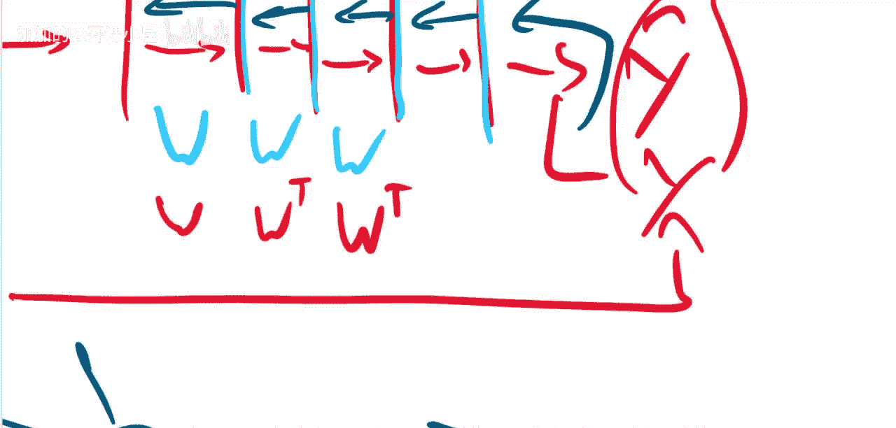

Relay the information of what needs to change。 That would be the loss。

 what needs to change to make the loss as small as possible。

 They relay this information down to the other layers。

 And we don't know of any biological analogy to this mechanism right here。 This transpose。

 it acts as sort of a layer inverse。 And that is called weight transport。

 So weight transport means that you can， you can do something like the transpose of the weights。

 basically， to carry， to bring information from the next layer back to this layer。

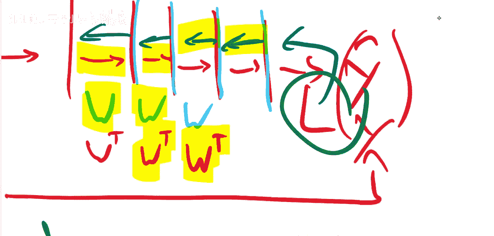

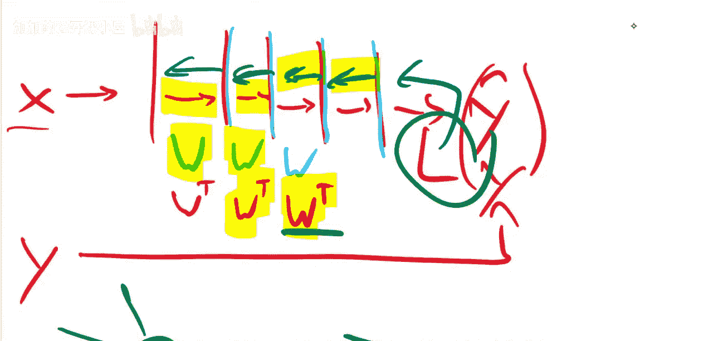

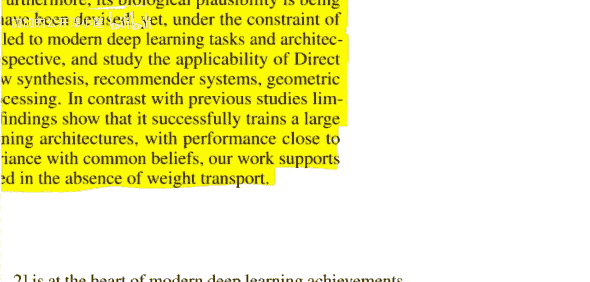

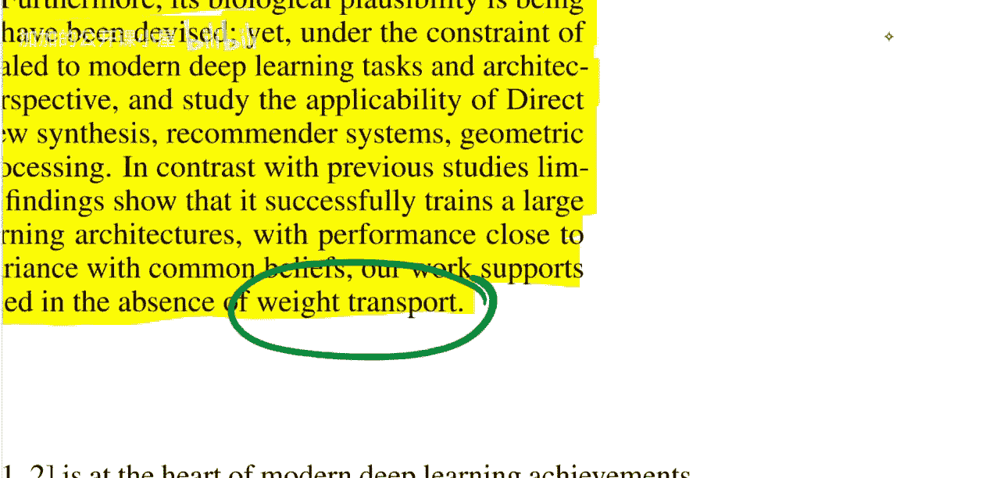

And in biology， we don't have this。 And in direct feedback alignment， we don't have this either。

 So direct feedback alignment， the next thing here in this abstract is the algorithm that they are going to apply here。

 direct feedback alignment and will go into what it is。

 but it is more biologically plausible in that what it does is it takes the loss somehow。

 and it distributes it globally to all of these layers like this。

And it does so without requiring these transposes and also without requiring these sequential steps。

 So both of their proposed problems here would be solved by this。

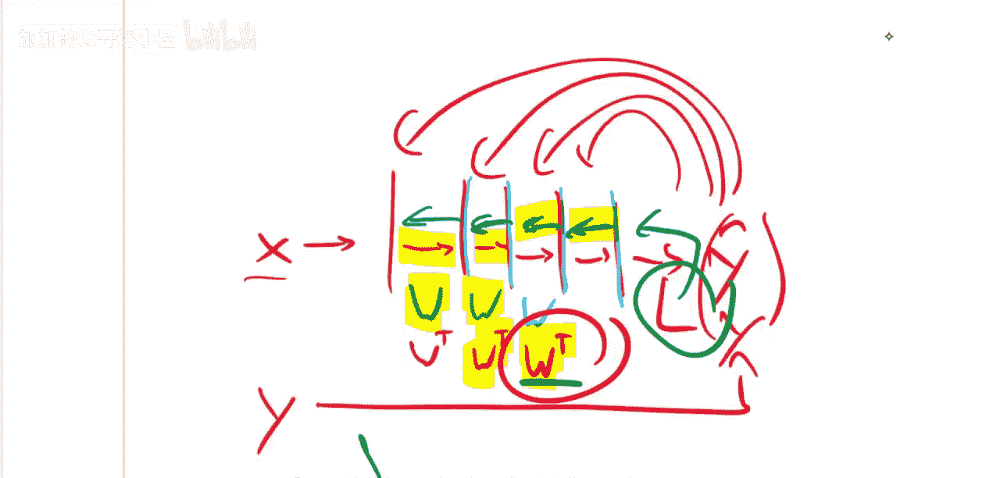

They say。They say that in contrast with previous studies limited to computer vision tasks。

 so what people have tried to do is they have tried to apply this DFA algorithm to computer vision tasks。

 but in computer vision， most architectures are CNNNs。

 and as I understand it as far as I understand it， DFA can only right now be applied to linear layers。

 so something that is Wx plus B and then a linearity。

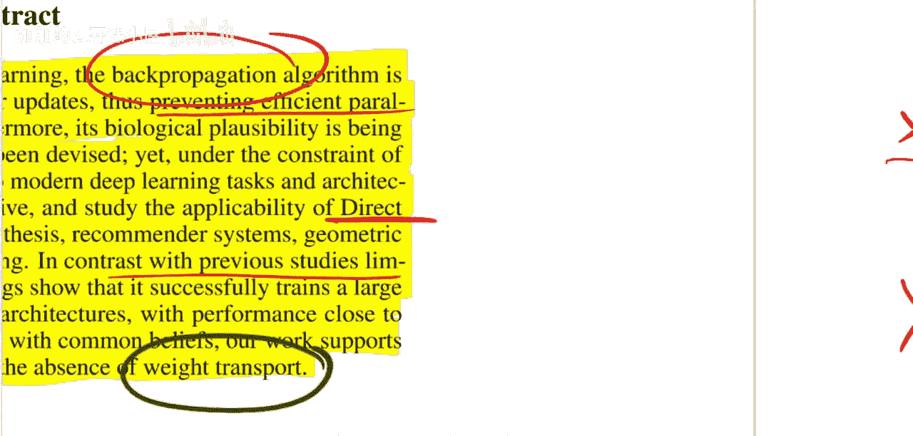

I cannot， even though you can write the CNN as like a linear layer with constraints。

 as I read this paper， I think to interpret that you can only apply DfaA to fully connected layers or things that look kind of like fully connected layers。

 So what they're going to do in their experiments is they're going to take these big architectures like transformers and replace parts of them with the parts that act as fully connected layers with with DfaA updates。

 So well they're not going to replace the layers， but they're going to replace the back propagation part of it with DfaA updates。

 it remains to say that they still use back propagation at some places where they can't replace the updates with DfaA。

 And that means where the layer isn't you know a fully connected layer I guess is too big。

 they somehow have to make it work。 So often they will not update， for example。

 the embedding layers and things like this。

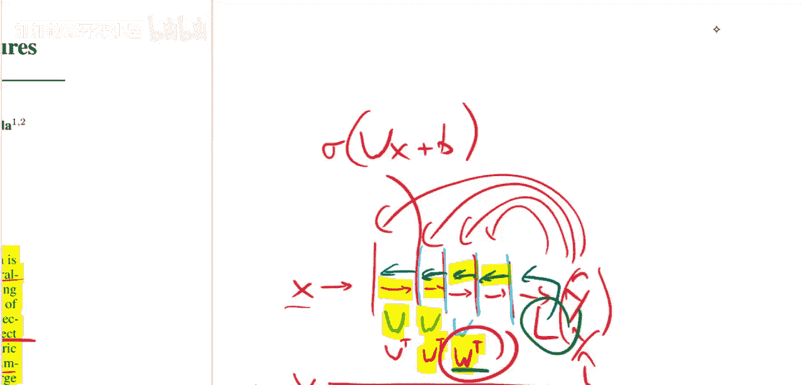

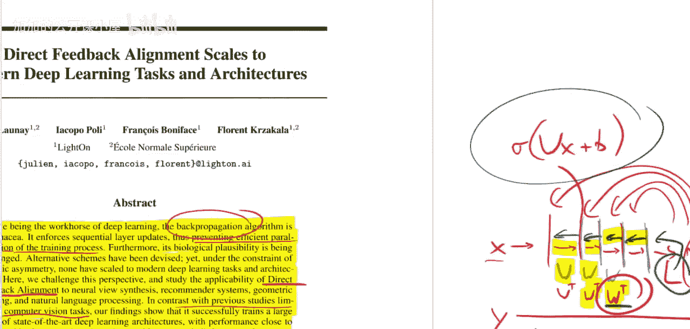

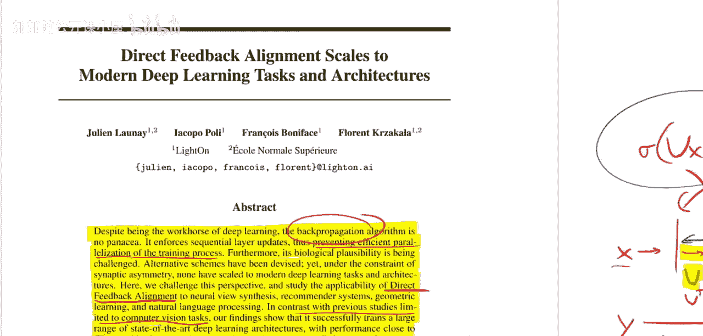

Okay， so what they're saying is they go away from computer vision tasks because if you go to computer vision and the CNNNs rule that world right。

 you can only do for feet forward layers， fully connected layers， you're gonna lose already so。Yeah。

 it's， it's kind of an unfair fight in that in that sense。 But even in absence of that。

 they say we apply this to neural view synthesis， recommend their systems。

 geometric learning and natural language processing。

 So these are quite diverse tasks and they're gonna to be quite diverse architectures that theyre applying it too。

 for example， in geometric learning。 I believe they do graph neural networks。 And there they。

 they replace the。Uual in graph neuralal networks， there are fully connected layers that connect the vertices and the edges together and compute properties of them。

 so that's a pretty good point for using DFA right because。

What you're looking for is state of the art， tasks and architectures that still employ fully connected layers because there your algorithm can shine。

Okay。