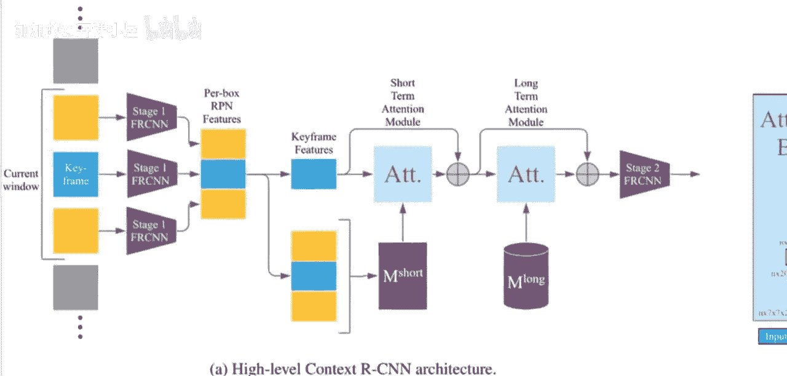
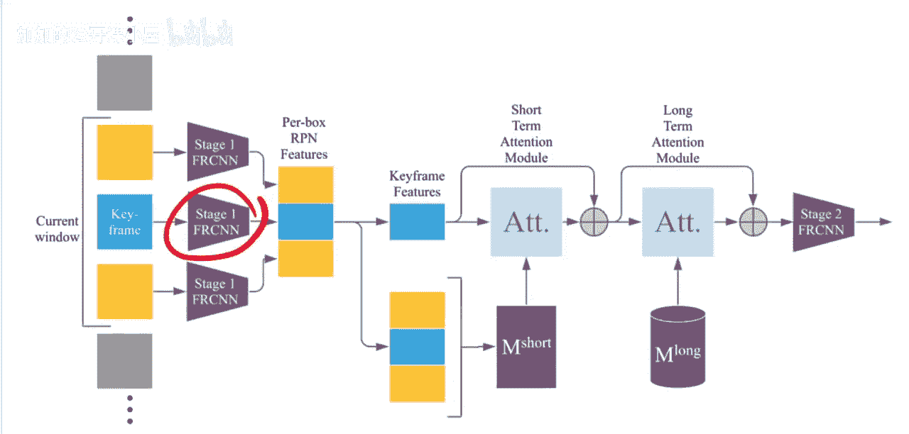
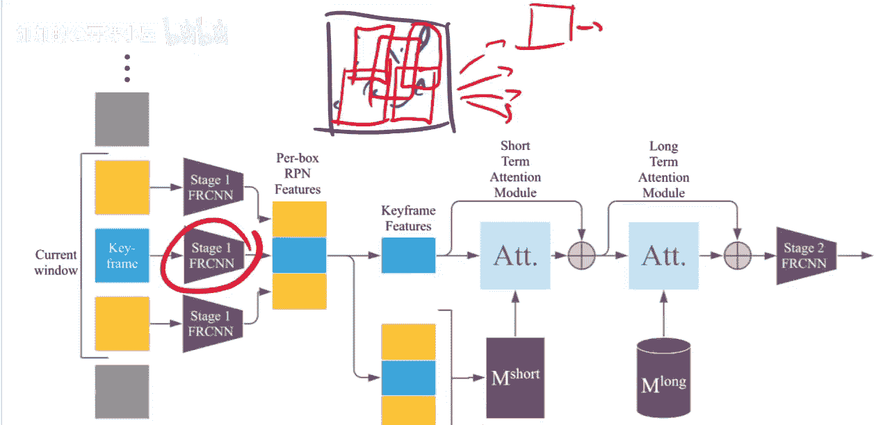
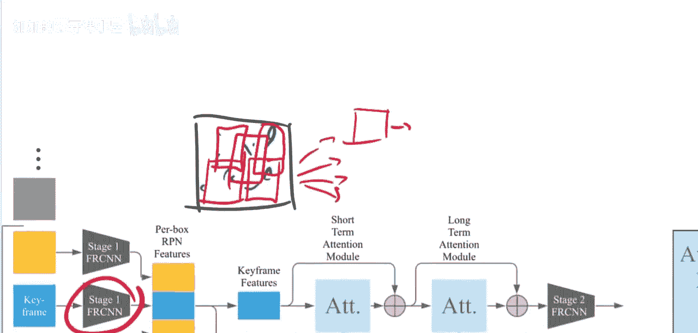
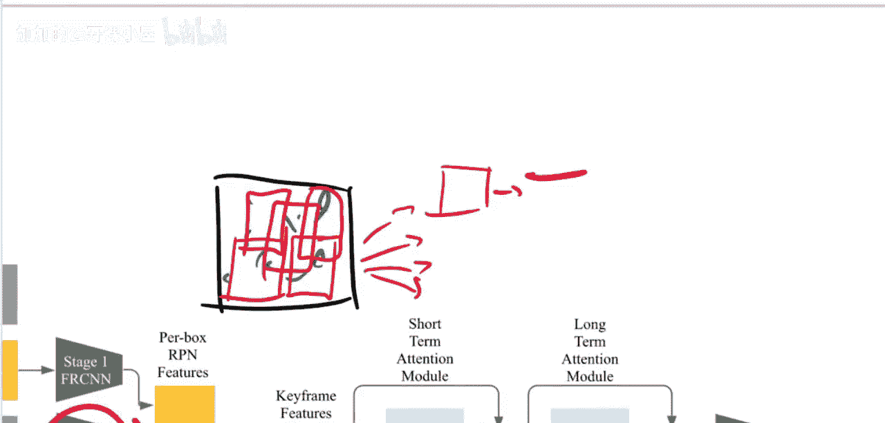
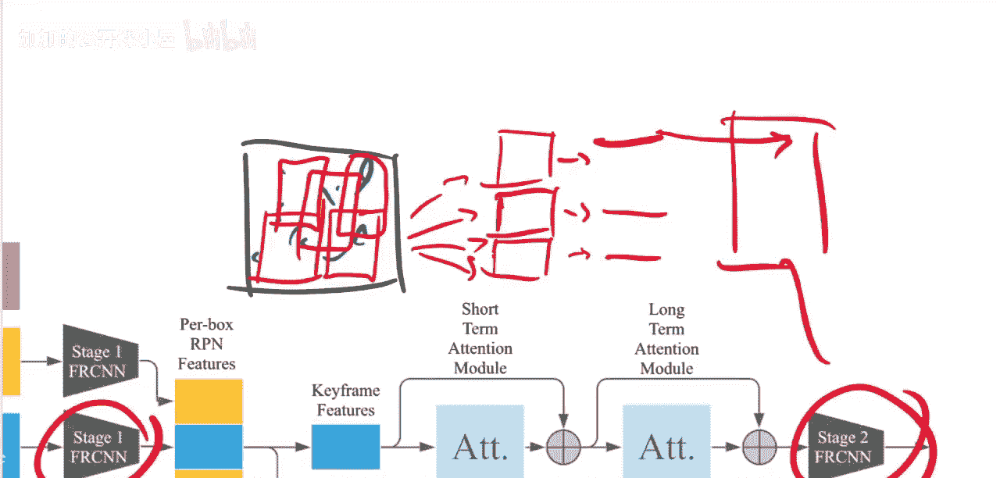
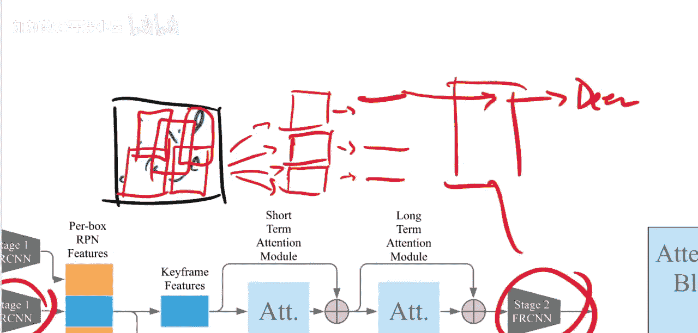
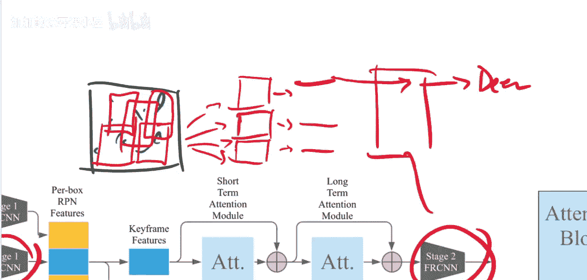
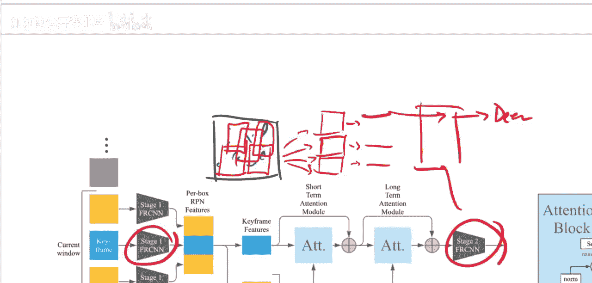
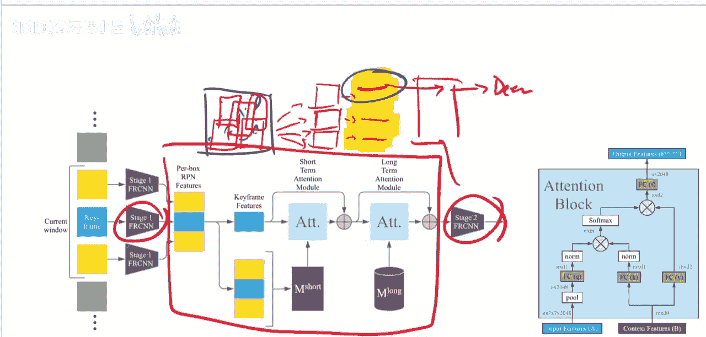

# YannicKilcher【中英⚡AI经典论文领读(全203篇)(上)｜Papers Explained】 p48 P57 上下文R-CNN：基于单摄像头长期时序上下文的目标检测（论文解读） [BV1o3xLznExj_p48]

Hi there。 Today we'll look at context or CNN long term temporal context for per camera object detection by Sarah Beri。

 Guang Hongwu， Vivek Grthd， Ronnie Votel and Jonathan Huang。

So on a high level this paper tries to do object detection for cameras where the camera is in the same place for a long time。

 for example， these wild trap cameras or traffic cameras right here。

 it proposes to do object detection by incorporating data from the images that the camera has seen in the past to help the detection in the current frame。

And it does so via an attention mechanism that it runs over a memory of past data。

So we're going to take a look at how this is done and how well it works and yes。

 take around if you want to know。As always， if you enjoy content like this。

 then consider sharing it out， telling your friends about it。

 subscribe if you haven't and tell me what you think in the comments。

So the paper starts off and describes the problem and the problem is fairly simply。

 we want to do object detection in images， Object detection is the task of basically if I give you an image。

 you should tell me what is on the image and where so in this case here you would have to draw me this bounding box and say this is a deer。

On the bottom you would have to draw bounding boxes， maybe they have to be rectangular。

 maybe not and say this is a bus and here is a truck and here is another truck and here is a car and so on so there can be many objects in an image there can be one object。

 there can be objects of different classes or there can be no objects at all。

So this is just object detection。 And there have been many papers on this。 And specifically。

 there has been this RC N。 and this is the model that we're going to extend。 So the R CNNN model。

 or specifically the faster RCN model that we're going to build on is a model that。

Simply detect these bounding boxes in single images。

 but now we consider the situation where we have a camera that records images for a long， long time。

So in these wild trap cameras， they often sit there for months。

 and it's not that easy to make use of them because。In addition to there being a lot of data。

 they have motion triggers， so that could be there is no nothing for a long time。

 and then there's a the the animal walks in the trap and then you have a bunch of images like one per second for 10 seconds。

 and then you have nothing again for like a day or two days and then you have 10 images again because another animal walks in or maybe doesn't and so on and another。

 So you have irregular sampling frequencies。 you have very。

 very different distance between the frames。All of this makes it very。

 very not suited for models like temporal convolutions or things like LSTMs。

 because they don't work super well with data like this。 Now。

 I know there are formulations where LSTMs can。Do this。

 but they don't work very well with these super long context and irregular sampling frequencies and so on。

So the idea is if we have a frame right here like this one and we want to detect what's on it。

 we should be able to pull information from other frames that the same camera has seen。

 like from this one or from this one or from this one right here。

And we should be able to do so in a dynamic way。 Now， why could that help If you look at。

 for example， down here， these images have been taken。 they say images were taken on separate days。

But you can see this thing right here is in both images。 So。

 or a very similar thing is probably that bus's regular route。 So in。

 in order to classify if whether or not this here， it is a bus。

 It might be very helpful to also look at this picture right here and see， you know。

 it's about at the same location， it looks the same And also it looks like a bus。 So you know。

 that that kind of gives evidence that this could be this other thing could also be a bus。Then also。

 there are background objects。 So sometimes the single frame detectors get confused。

 It might be labeling this here as a car， because just the lighting。

 the exact lighting in this picture is just off by the correct amount that it is confused。

 but considering this picture over here， maybe it recognizes here。 No， that's not a car， and。

It can bring over this evidence to that frame and and consider maybe maybe you know。

 this is the same thing。 So it's it's not a car。 So this this is not the same then simply adding training data。

 we really consider the fact here that these images。

 they come from the same camera that is in the same location or you know。

 that is filming the same thing。 So this all of this is going to be within the same camera。

 not just adding adding IID training data。 And with animals as well。

 like often the same animal has like its regular route or within these10 these burst of tents。

 the same as animal will kind of walk around a bit。 and maybe you know here it's half occluded。

 but maybe in a different image you see here I see the nose。

 So it helps you make a better prediction。Also， animals are often in kind of crowds in， and。

 and that helps。 if you see that there are other deer around。

 the probability that this is a deer increases rapidly。

So how are we going to do this What we're going to do is we're going to build an attention mechanism that can do these kinds of look into the past and some also a little bit of the future as we will see。

 but mainly we'll look into other images from the same camera in a dynamic way and we'll learn how to address those other images from a memory bank。

So the architecture is described right here。

Now， as you can see。We are still in the business of doing object detection。

 So what we'll do is we'll sort of hijack a a existing object detector。

 And the object detector we're going to hijack is going to be this F R CNN N。

 this faster R CNNN object detector。 That's an object detector detector for a single frame problem。

 So that means you have one image， And you're supposed to detect what's on it。 It has two stages。

 as you can see。 So stage 1。

If you have an image。 and let's say there's some stuff on it and stuff， stuff， stuff， there's stuff。

 Okay， this， what stage 1 is supposed to do is it's supposed to extract regions of interest。

 This could be， okay， all of these are regions of interest。So it simply says well there is something。

 there might be something right here in these regions of interest。And then。

It describes each of these regions of interest using features。 Okay。

 so it extracts these regions of interest， and each region of interest gets features assigned to it。

 So well these are， I think these are like 7 by 7 by by 2048 features。

 But let's just say for the sake of of describing it that these are just a vector of features for each region of interest。

 So each region of interest is going to be associated with one vector of features that this model extracts。

Okay，And the next region of interest also has a vector。

 and the next region of interest also has a vector and so on。

Stage2 then takes each one of these takes each one of these vectors and assigns a class to it。

 so this would be dear right here。

Okay so stage one proposes regions of interest along with features。

 then stage two takes each of these regions of interests and classifies them basically。

And I guess there there's there's many in between stages like this is massively simplified。

 There's not maximum suppression。 There is kind of an alignment stage where you can refine the the bounding box and so on。

 But in essence， these are two stages。 and you can see that this system here。

 it goes in between the two stages。 So all of this right here， we shove in between the two stages。

So we'll still use the stage1 and we'll still use the stage 2。

 But in between in this thing right here， we'll try to sort of pimp these features such that the stage2 detector has an easier time classifying。

 Okay， so we are going to pimp these features by incorporating in because these features right now。

 if we just do it vanilla， these are just from the current frame。

And we're going to add to them information from other frames of the same camera。

And we're going to do it in two different ways。 So the first way， as you can see。

