# YannicKilcher【中英⚡AI经典论文领读(全203篇)(上)｜Papers Explained】 p49 P59 集合分布网络：面向图像集合的生成模型（论文详解） [BV1o3xLznExj_p49]

Hi there。 Today， we're looking at set distribution networks。

 a generative model for sets of images by Shuang Fei Chai， Walter Tablet， Miguellong Baista。

 Carlos Garon and Josh M。 Suskind of Apple So this paper introduces a generative model for sets and it does so in an energybased model fashion。

 It will have an encoder decoder in form of a generator it will have a discriminator and it will have all kinds of math。

 but the end result is a model that can generate sets of images and by sets。

 we mean it can generate different kind of views on the same identity of image and you'll see what that means。

 and it can generate even sets that it has never seen before。

 which makes it different from a classconalgan or something like this。 So I can't really describe it。

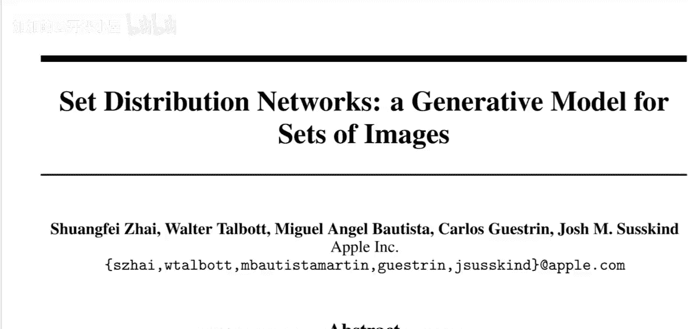

A high level in a very concise fashion， you'll just have to stick around and see what's going on right here Yeah so if you like content like this。

 feel also free to share it out and leave it a like。

 tell me in the comments what you like this is going to be a fairly math heavy paper and I'll try my best to kind of distill it down to what's happening。

😊。

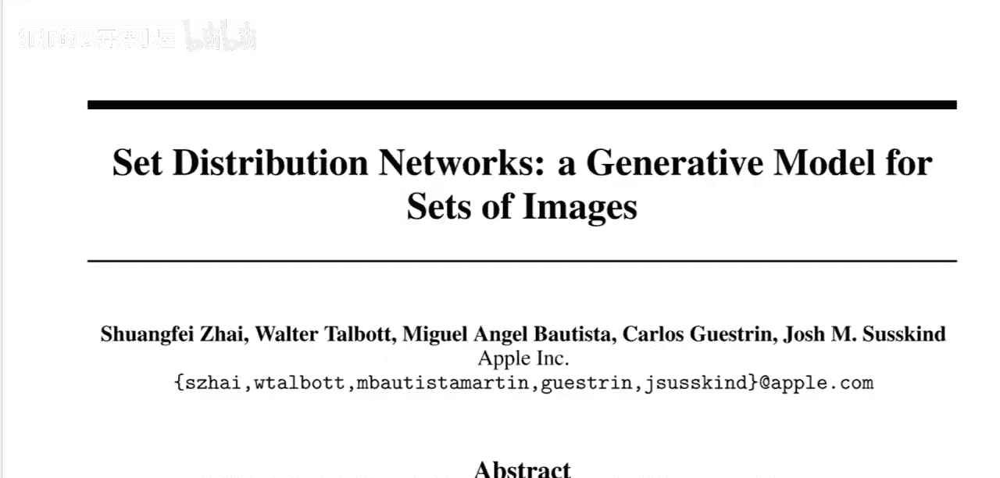

Because ultimately， it's not that difficult。

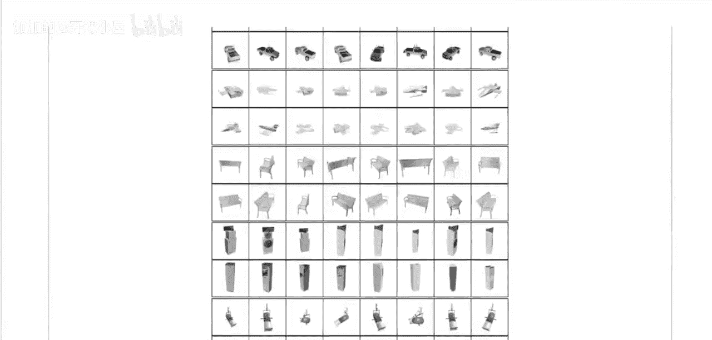

Alright， so if you have a look at these samples right here。

 these are examples of sets of images Now without actually caring for top and bottom row。

 they will have some meaning right here。 top row is always a row from the actual data set and the bottom row is the reconstruction of that set Now you'll see that the images don't really have a correspondence。

 So youll see it's the same truck in the top and the bottom row。

 but the orientation here isn't really shared or anything。

 and that's because as we said this is a set network。

 So what you want to do in this problem setting is you want to take you want to build a model that can take this set right here from the data。

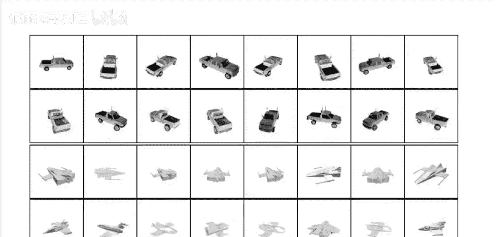

And it can encode it into a latent description that we call Z。 Z simply describes the set as a whole。

 So Z here would be， sorry。

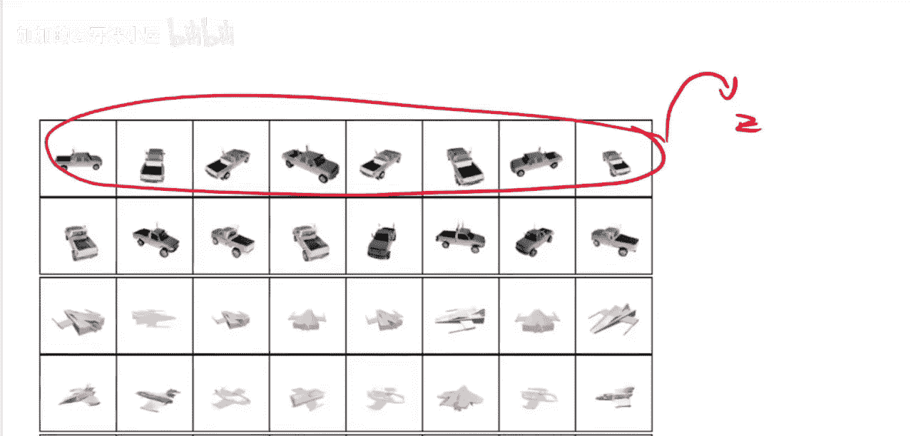

Would be truck。Right it would sort of be the 3D model， so not the class truck。

 but the 3D information of the truck without having any information of the different views。

 Okay and then you want to build another model that can generate from this low level representation of the set can generate the different views like each one of these by sort of rotating it。

 So we want to build a model that understands just from the pixels that here we have sets of things that they somehow always share a commonality and in this case。

 they always share their 3D structure right what they don't share is the view where they rendered from So our model supposed to kind of parse the two apart and encode that 3D structure just from the pixels in this Z variable and then encode the fact that you can rotate it and look at it from different views。

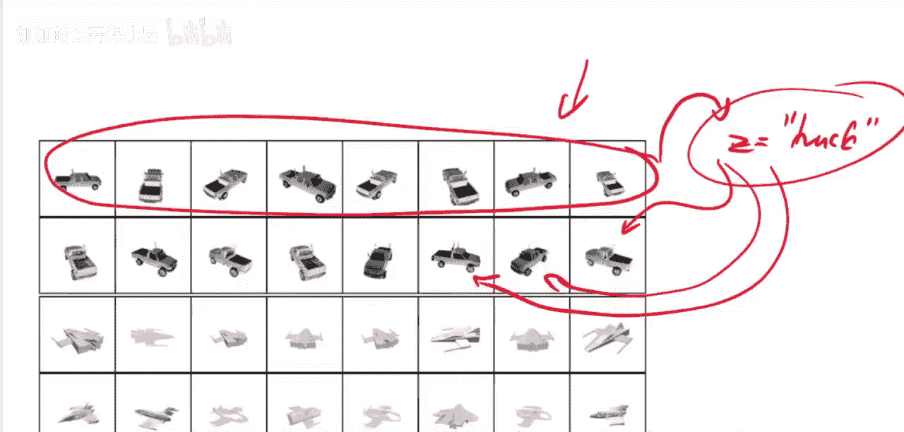

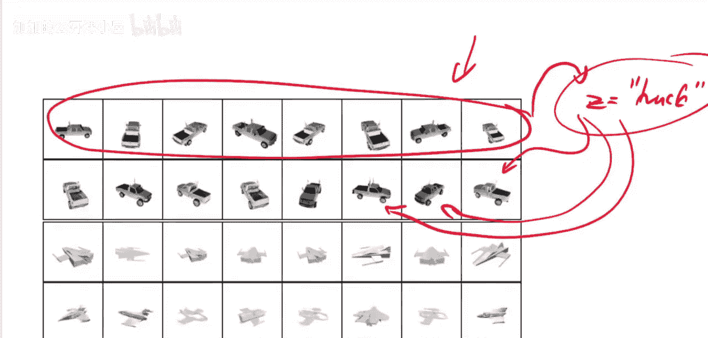

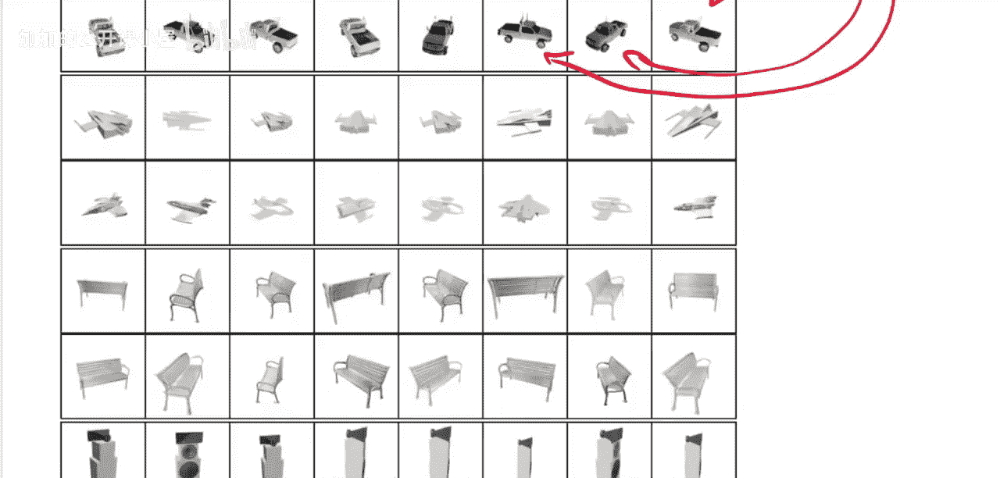

Into the generative model that then produces the different views。Okay。

 and the reason why there is no correspondence between the views is we， we。

 we simply regard these things as sets。 So our final objective is simply going to be that the set on top。

Is different views of that particular truck is going to be very similar to the set on the bottom。

 which is also different views of that particular truck。

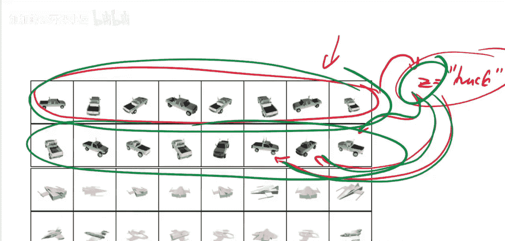

And that's what our model is supposed to do。 Now， you might know something like this from we can simply say。

 well， this， this looks like a class conditionalgan， right？ I simply have the class truck and。

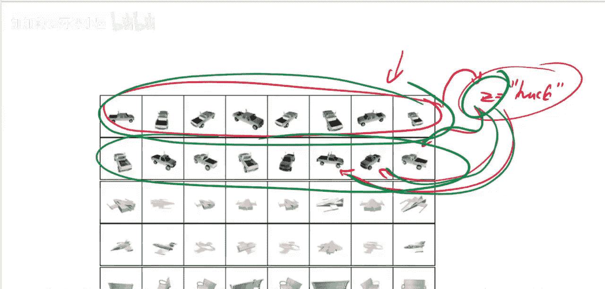

I， you know， I feed this to my generator and my discriminator and my encoder and so on。

 and they will produce the same truck。 and hear that。 and hear the bench and so on。 The problem。

 I guess， becomes more apparent when you go to this different dataset set。

 So this is a face dataset set And again， top row being the input and bottom row being the output。

 Now， what is here， what is supposed to be preserved。

 you can kind of see in the images is sort of the identity of the person on the photo。

 Now you have to kind of gloss around your human bias here。

 you as a human can tell extremely tiny differences between faces。

 And therefore none of the actual identities are going to be preserved right So this on the top。

 I believe is Ali and on on the bottom here， it's not not Ali so。

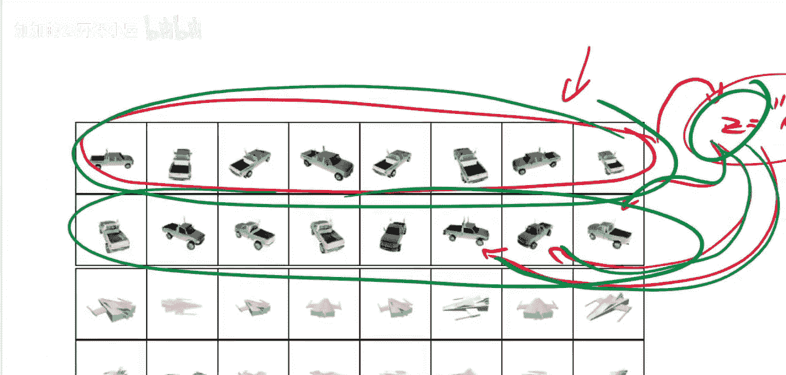

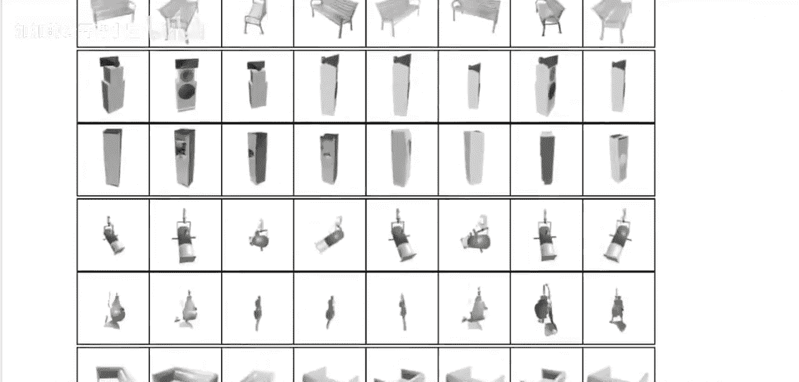

But you'll have to sort of gloss around this and you'll see that what is preserved or what is supposed to be preserved is something like the rough identity of the person on the picture and also a little bit of the image compositions。

 So you see here in the background you often have sort of these sports backgrounds right where there's kind of a washed out stadium or whatnot。

 And you can see that this is also preserved here I think it's kind of a glamour glamour shots of this must be some sort of glamour model and you'll see that this as well is preserved What is different within each set is。

 of course， the different views on the same identity right So you have the same person and you have pictures of them in different of different views。

 different lighting， different hairstyles and so on here see you have the black and white image and the set that is produced also contains some black and white。

So this model， this is already the trained model。Here is doing a fairly good job here。

 You can see that almost all the pictures have some sort of double。

 like two people with one being sort of half infr。 And it leads to fairly， fairly strange thing。 I。

 I'm gonna guess the model hasn't seen lots of that during。 I like， I particularly like this。😊。

This is this is pretty good also here。 we know that a lot of these face data sets。

 they don't really have bald people all too often。 So you can see here this results in sort of kind of a weird Richard Branson type picture in any case。

 it does， it does a fairly good job right， as you can see right here。😊，And what's the problem with。

 with these faces， Can't we just do a class conditional again where we basically say here。

 this is Ali， right？ And that's one class in our latent vector and then and so on。

 What we want to do is we want to train something like this that where we can give in a new identity that we haven't seen during training。

 In fact， we want to train something where we don't even know how many sets there are going to be in the end。

 right， we simply want to want to train it in a way where we say， look。

 I'm going to give you a set and the set will have， you know， images of the same person。

And you're going to sort of reconstruct that in a way where you output a set of images of that person conserving the identity of the person and the rough style of the picture。

 so this is really different from a class conditional again。

 as in we don't know how many classes there are， and there can be new unseen ones during testing。

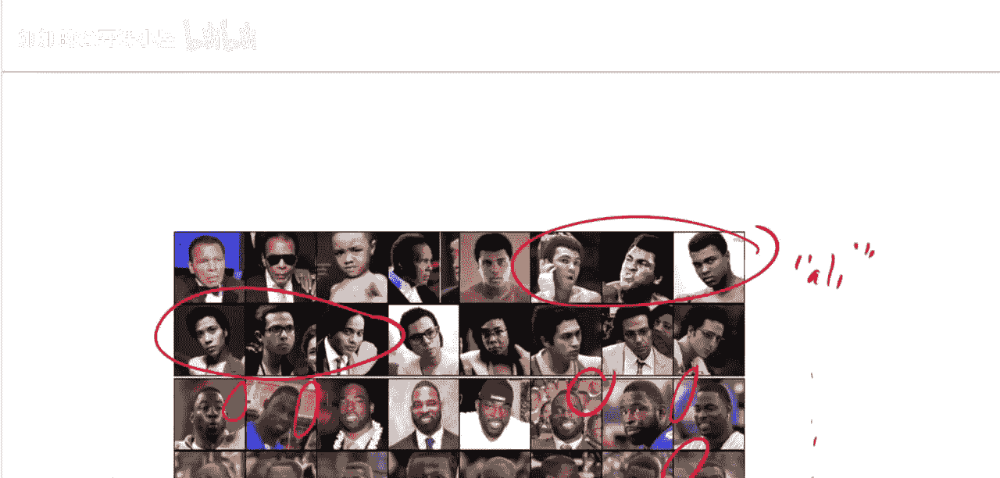

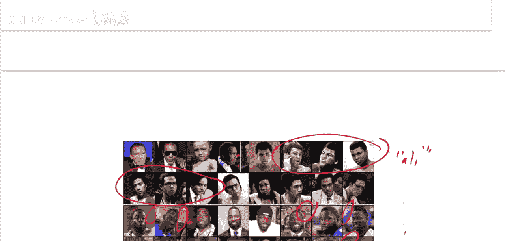

So how do we go about something like this。And here here is where the thing starts。

 so we're going to dive into a bit of the math here and then into a bit of the reasoning。

 but ultimately。😊，What they're going to do is they're going to build。

And they're going to build three things。 They're going to build an encoder。A。

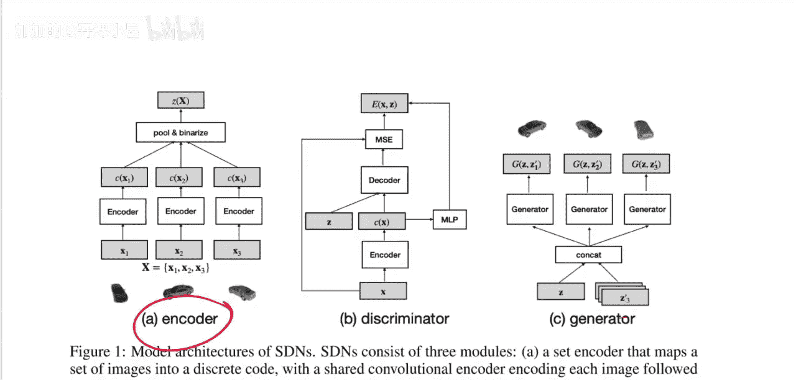

Discriminator and a generator。 So what does the encoder do。

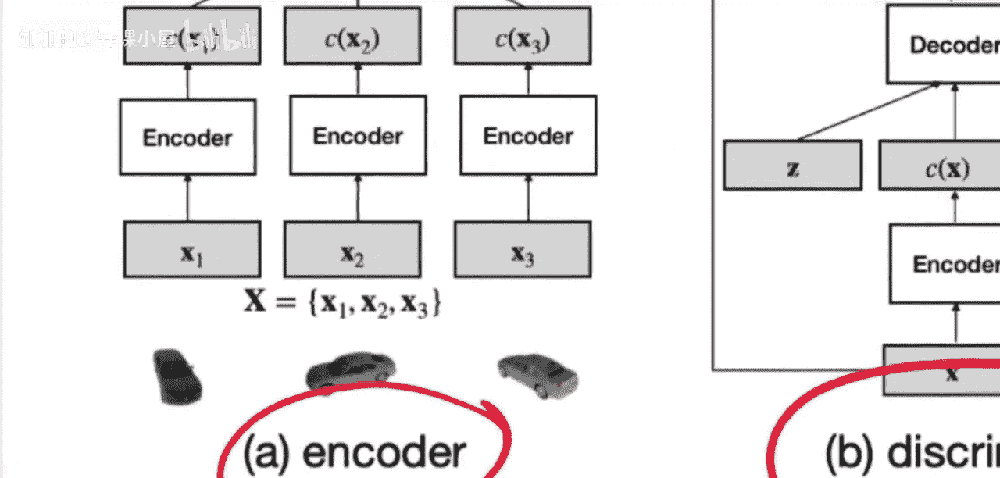

And remember， our task here is going to be the way we train it is going to be by。

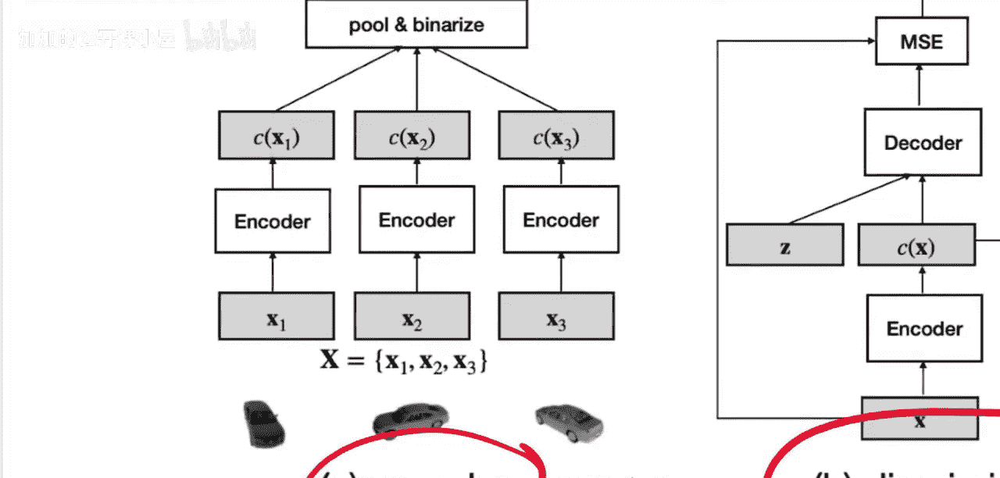

Reconstruction， at least one way， we train it。

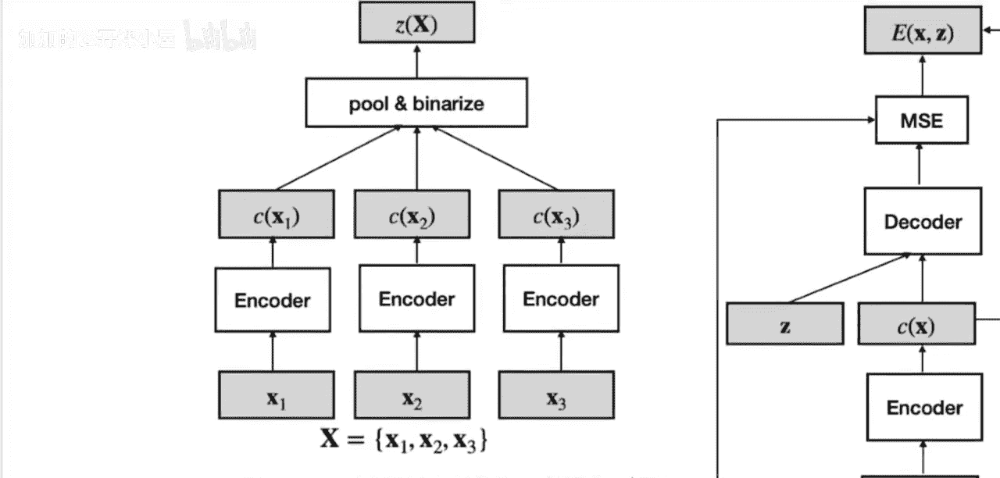

So the encoder is going to take this set of images that we give it。 for example， here。

 different views of this car。

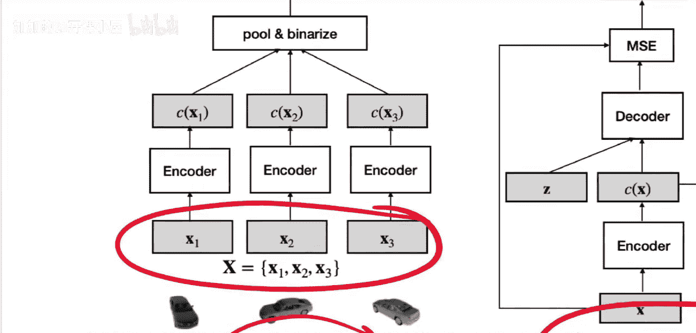

And is going to produce this representation， this set representation。

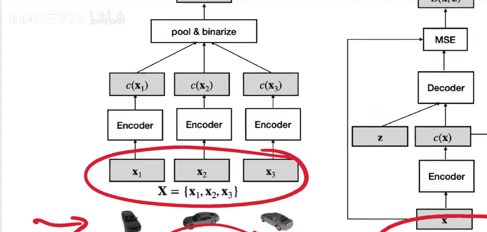

Now， what should this， what should the property be of the set representation， for example。

 it should be。Independent of the ordering of these inputs， right。

 a set is simply a collection of objects。 It's independent of the ordering。

 and it's also independent of the size in in some way， of course。

 a bigger set gives you more information， but the set identity。

 The fact that this is this particular core is independent of how many views you have so。

What they do is they build and they put each image through an encoder。

 which is a convolutional neural network。I guess that gives them a hidden representation and encoding and embedding for each image。

 and then they have this operation called pool and binaryize and so this does two things namely first of all it pools it simply averages these things。

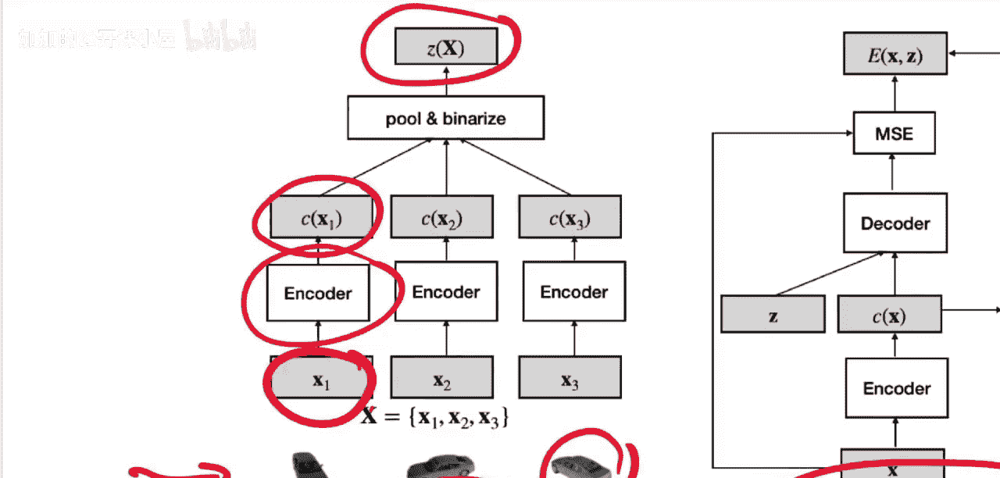

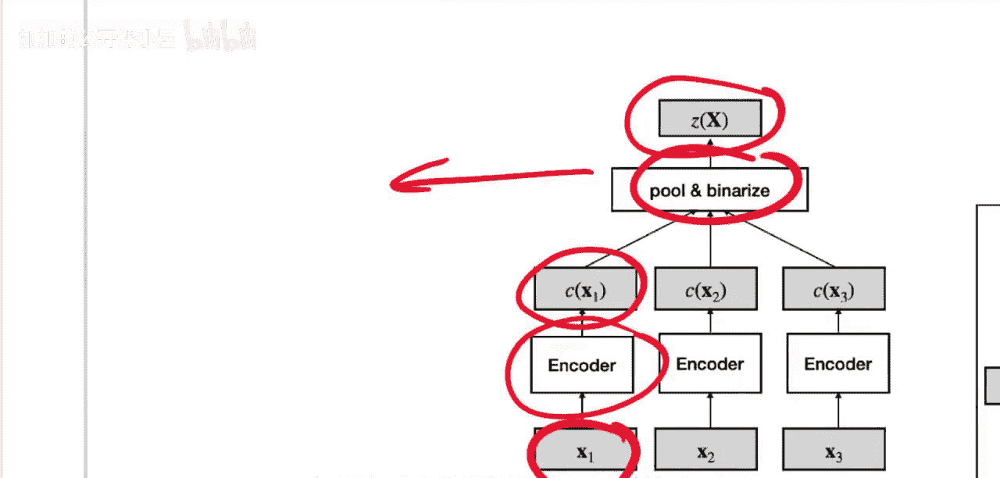

It goes1 over n。