# YannicKilcher【中英⚡AI经典论文领读(全203篇)(上)｜Papers Explained】 p51 P62 运动剪枝：通过微调实现自适应稀疏性（论文解读） [BV1o3xLznExj_p51]

Hi there Today we're looking at movement pruning， adaptive sparsity by fine tuning by Victor son Thomas Wolf and Alexander M。

 Rush of Hugingface and Cornell University on a high level this paper proposes that if you have a transfer learning objective and you want to do pruning you should not do pruning by weight magnitude you should do pruning by how much the weights move during the transfer learning This yields better result in the very sparse model regimes and is specifically relevant to current NLP transfer learning tasks such as Bt models。

So if you like content like this， consider subscribing and sharing it to your friends and as always leave a comment if you have anything to say on this。

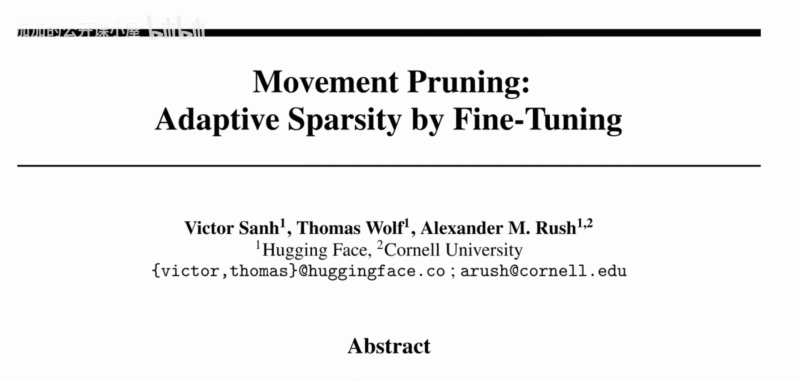

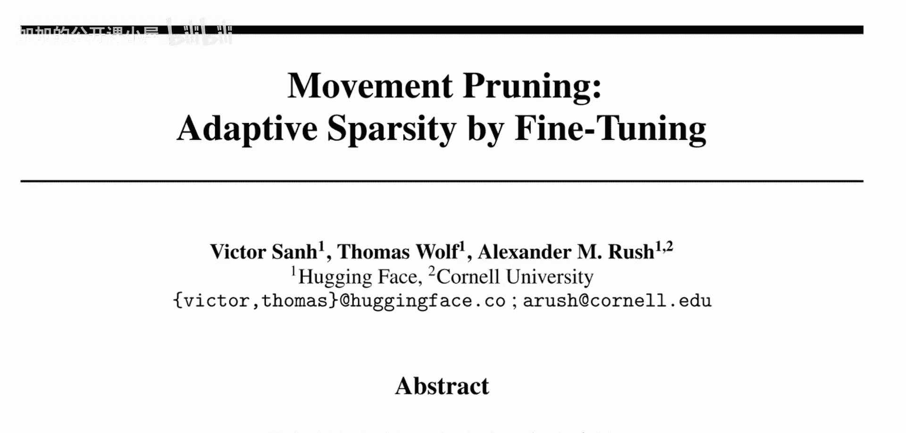

Alright， let's dive in so。They say magnitude pruning is a widely used strategy for reducing model size in pure supervised learning。

 So what is magnitude pruning Now if I have a neural network let's say I have a convolutional neural network and I input my little cat right here and I have a bunch of layers right and now if we look at these layers。

 each of these layers is going to be made up of these units of the neurons and the next layer is also made up of these neurons Now what kind of neural network that is is not that important but what is important is that you have these connections from neuron to neuron and in let's say a fully connected network。

 every neuron is connected to every other neuron in a CNN that would be slightly different but in essence you have a lot of connections here and these are usually called weights。

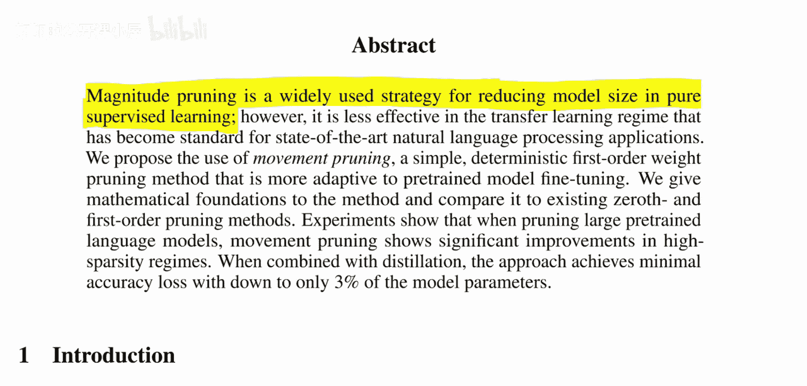

So these are the weights。 Now， the problem is， if I train like these giant neural networks and I want to ship them。

 for example， to mobile devices to my customers。 then they won't be able to download gigabytes of models or even like hundreds of megaytes of models It's just not possible。

 So what we want to do is we want to prune this model which means we want to remove parts of these weights。

 a lot of these weights， but we don't want to lose accuracy of the network。

 So imagine I have a network and that's trained。 It's an image classifier it here。 It's cats or dogs。

And I have it trained to a good accuracy。 I want to delete。These weights。

 But I want to retain the performance。 and these methods are called pruning。 Now。

 what people do is usually they sort of go in in a stepwise fashion。 They say， well， first of all。

 I don't need some of these。And then they delete some and then they sort of retrain the prune network。

 and after that they go again and they say， well， I don't really need that one and they don't really need that one so they do it in this stepwise fashion until the network。

Is of the size that they want。 And the hope is that you don't lose too much accuracy。 So the current。

 the question is， how do you select which weights you need and which ones you don't need。

 And usually this is done by so called magnitude pruning， which means that。

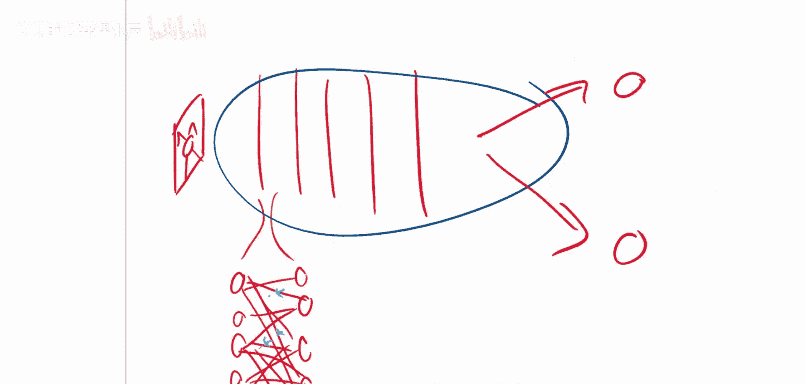

Look at the weight。 You look at the weights and the weights， they'll have some distribution。

 There'll be。

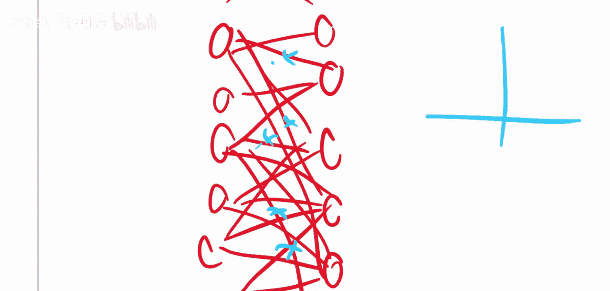

Nably。Very negative。 So here is very negative weights。 And here is very large positive weights。

 And what you'll say is that， okay， probably the weights that are very large。

 they contribute a lot to the signal of the network within the network and the weights that are quite small Theyre。

 you know， since there's all this noise and stuff Theyre probably not that important。

 So I'm going to cut off basically right here。 And everything that's in here。 I'm going to delete。

 those are the nonimportant weights， whereas on the outside。 Those are the important weights。

 This is called magnitude pruning because it goes by the magnitude of the weight。

 The absolute value of the weight。

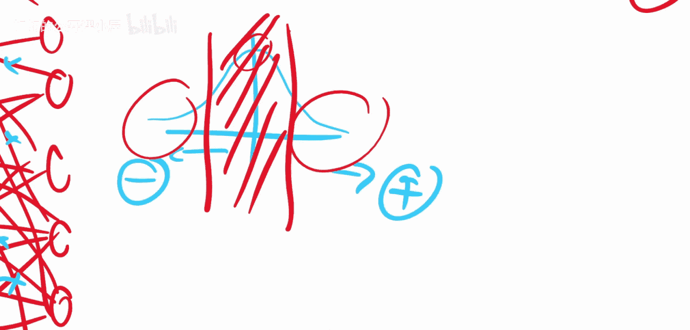

So you don't actually need so there's not one threshold here， you don't need a threshold。

 you simply need a method to order the weights right and then you keep removing them until you're satisfied with the size。

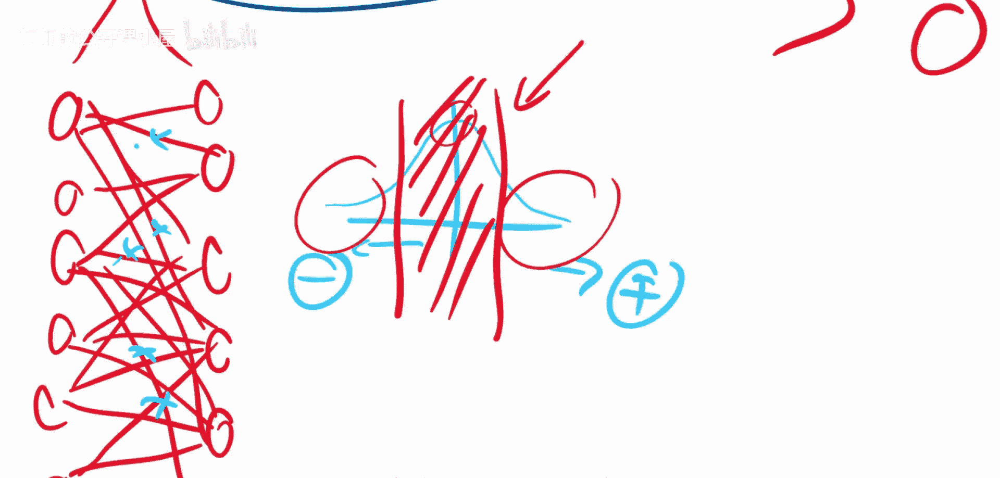

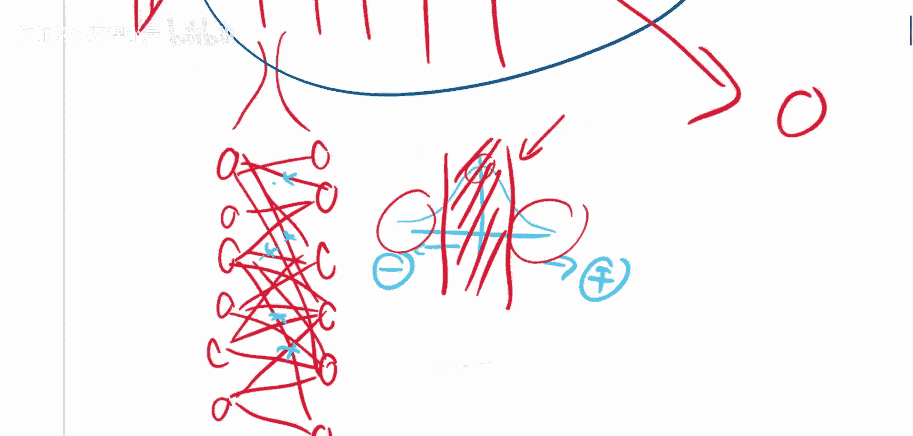

So this is magnitude pruning Now what's the problem with the magnitude pruning in these kinds of tasks？

They say however， it is less effective in the transfer learning regime that has become standard for state of the art natural language processing applications。

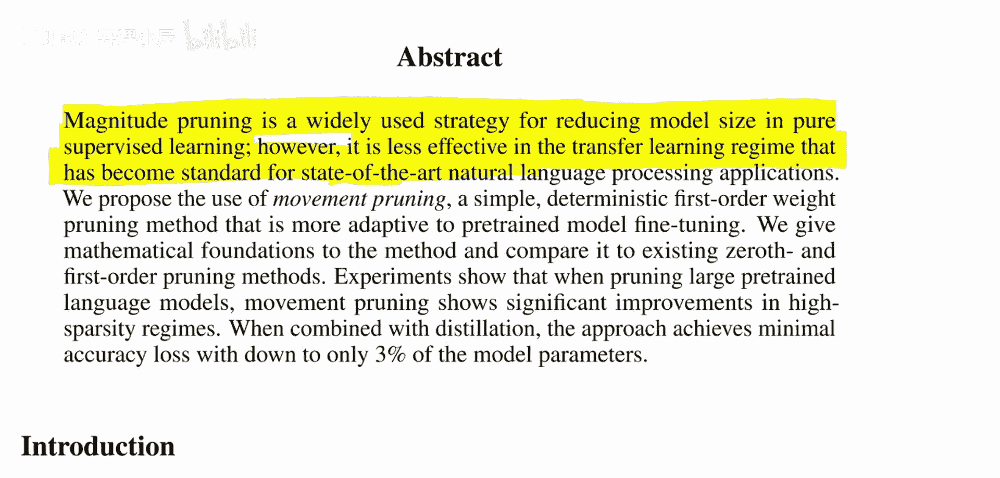

So what do you do in these transfer learning regimes in the transfer learning regime and let's go with the image example right here。

 even though it's mostly used in NLP， we can do the same thing。

 So let's say we have a classifier here for cats and dogs our classifier and we had a big。

 big database of cats and dogs images right so we were able to train that fairly well and we don't prune it yet。

 we have this full network now we want to adapt this to a task where。

We want to recognize whether or not the animal is sick。

 so we developed this app for a veterinarian and it's like a short screening for a particular disease that a cat might have and we already have this cats and dogs classifier so。

It's reasonable to assume that this classifier has some good features to work with cats and dog images so what we can do instead of because let's assume for this other task we just have this tiny little data set which is not enough to train a neural network of this size right but so in a first step we'll train this big neural network on the cats versus dogs and then what we do is we transfer learning so we transfer all the weights right here and here we have a different task now sick or not sick this is cat this is dog and here it's sick or not sick。

Not sick。And of course， we can't transfer these particular weights。

 but we hope that the features here。Will sort of be the same。 So we transfer them。

 and then we train these weights， including the the head right here。 this part。

 we train it on this little data set。 And we hope that we already have this good starting point。

 Do we only need to， you know， learn the basically the specifics of what makes these two dataset sets different。

 And we won't have to learn entire task of dealing with cat and dog images from the get go。 Okay。

 so this is called transfer learning。 now。In this case， we combine the two。 So first。

 we want to transfer learn， like if we build this app for vets。And then we might say， oh。

 this is not you know this is not only for vets， this is actually for anyone you know who has a cat or a dog at home。

 so what we could do is build an app where anyone at home could scan their cat and it would output like a probability of the cat having that disease so we want this neural network is still the same size as this neural network and now we want to do the pruning we want this neural network to become sparse to only have a couple of connections left such that it's a few kilobytes large。

 but retain performance now they say when you do this step。

You can't just do the magnitude proruning like you did right here and why not。

 because this is not this model right here is not the result of a training step like of a regular training process but is the result of a transfer learning process where first you do the big training and then second you adapt it。

And why is that the case will ultimately what you want to do is you want to prove the nonimant weights Now there could be a weight right here。

 this one that is very important for the cat versus dog task。

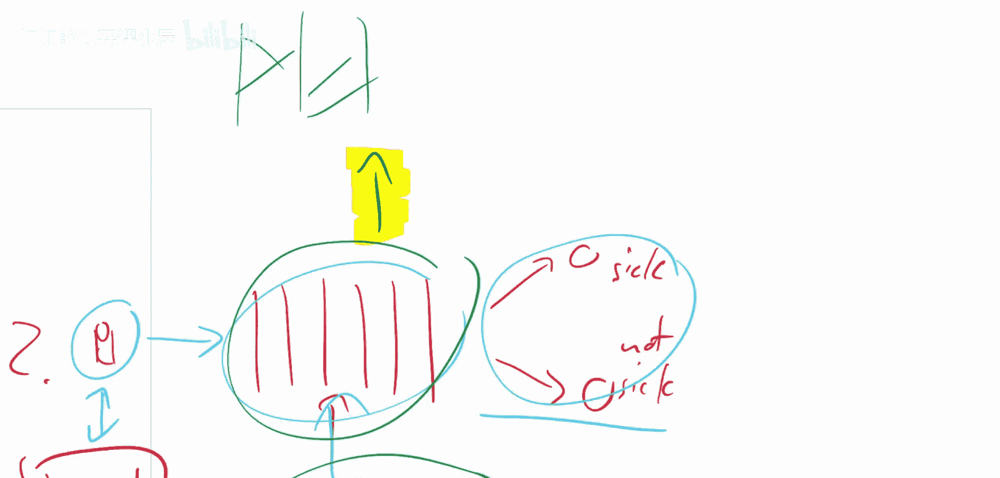

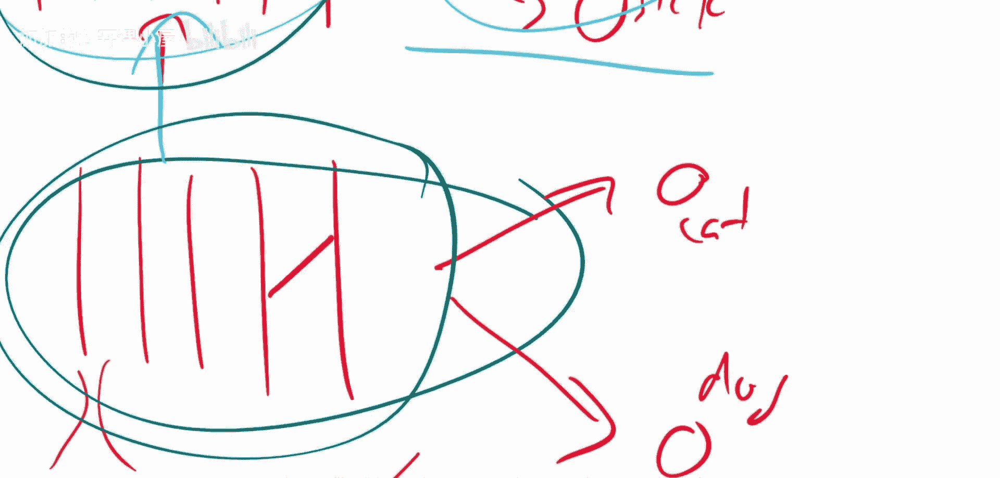

But that is not important for the sick versus nons task。

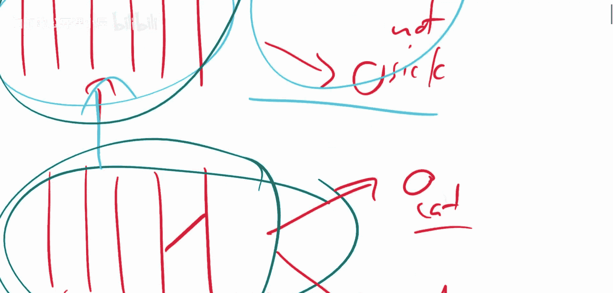

And we also we know that in these transfer learning settings。

 the weights they don't tend to move that much。 in general。

 the research shows that once you've trained a neural network basically the beginning is important。

 but then once you did it like if you adapt it or transfer learning and so on the weights they won't move that much。

 So in essence， this weight maybe starts out right here and it will sort of stay around this place it will maybe go a little bit down because it's not important。

 but it won't move much during transfer learning that's just a property of transfer learning So this paper here says we can't just use magnitude pruning when we transfer learning because what will basically go by what will basically say is will assign the importance based on the original neural network task on the cavers do we will missspecify the importance of the weights。

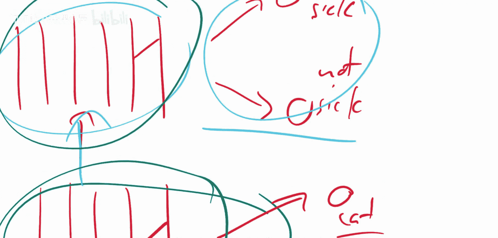

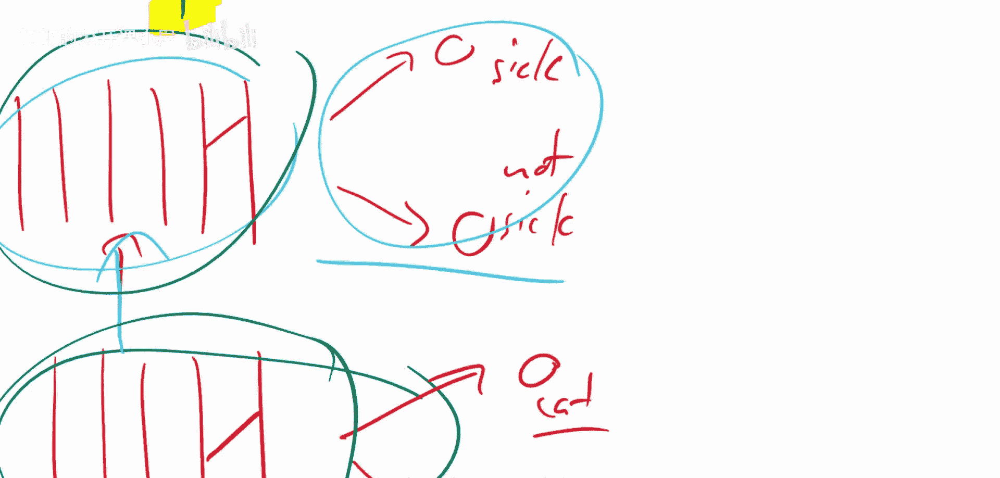

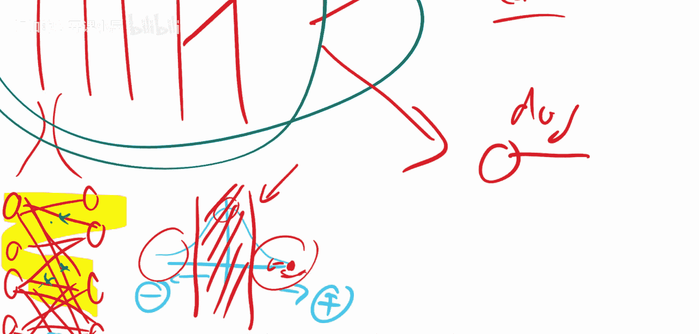

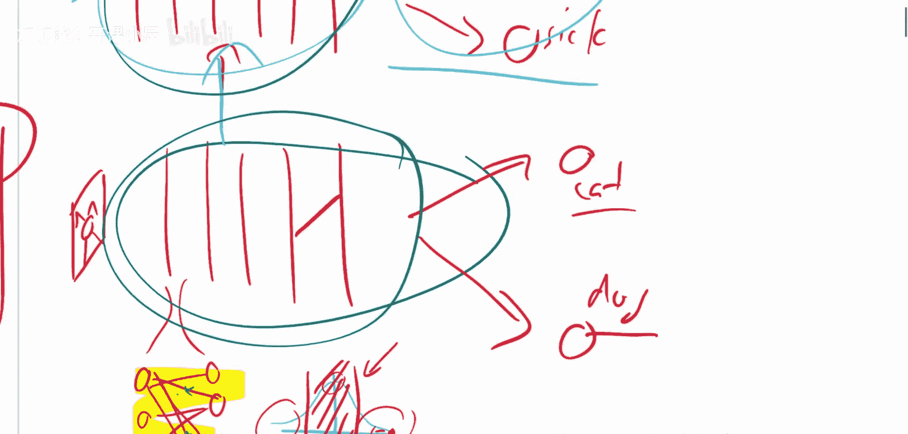

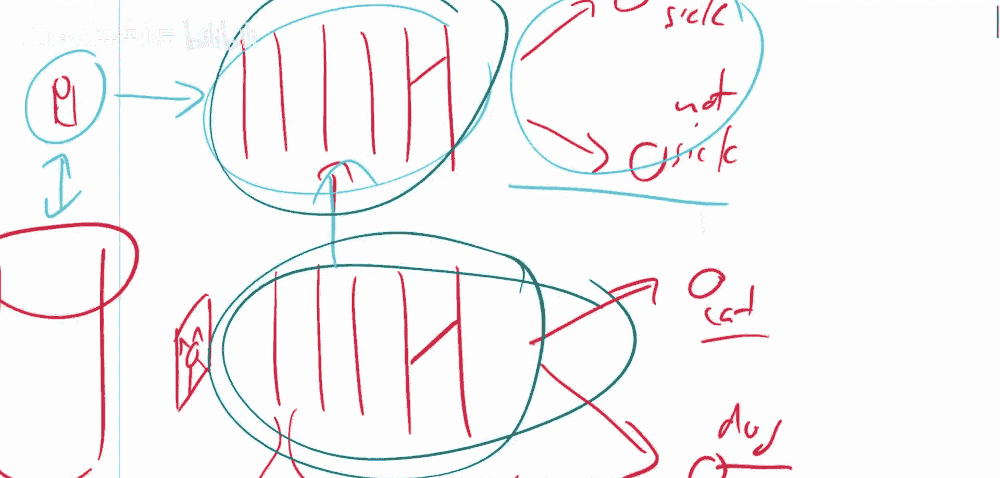

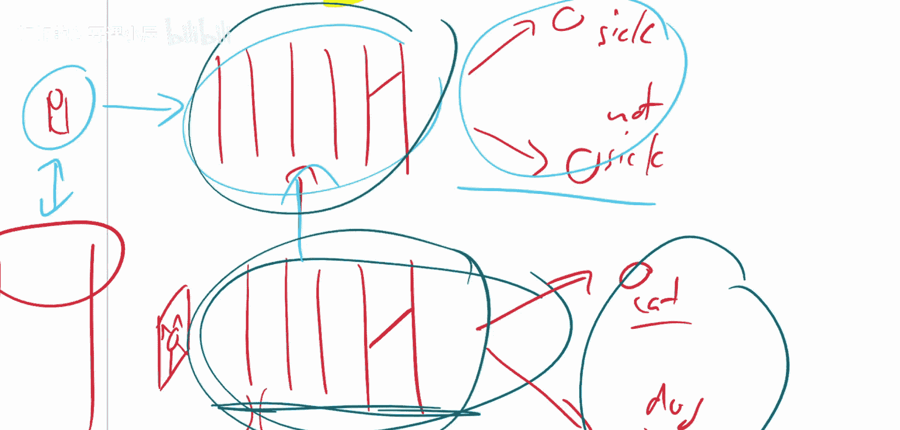

Should do is actually measure the importance with respect to this task。 and how do they achieve it？

 So on a high level， they're basically saying， okay， if we start out， well， this was。

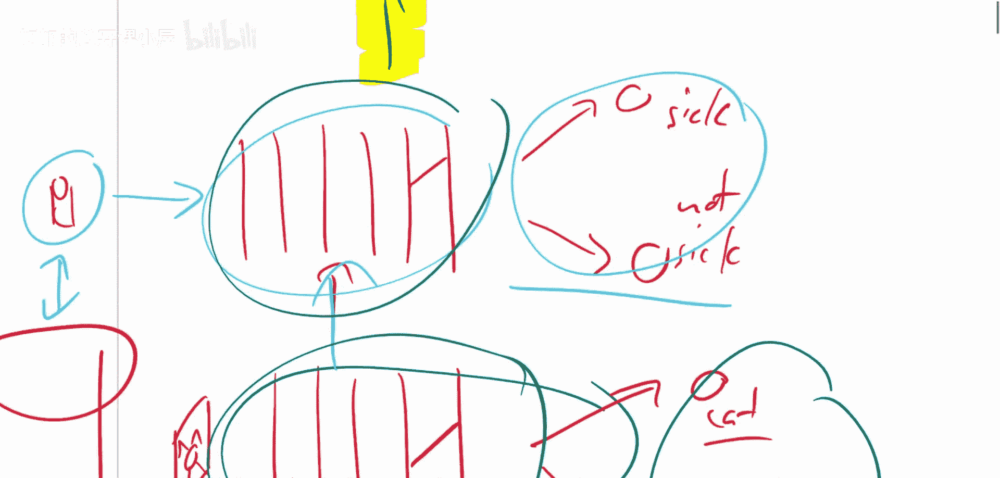

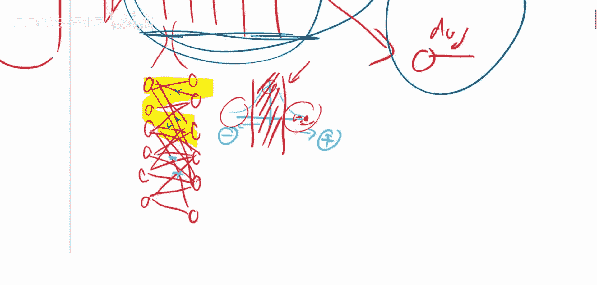

Fatal， if we start out with a point over here。Let's make that red。Red。I want the color red。

Well it's blue now so if we if we start out with a point over here， what we should do。

 what we should do is we should observe how it moves during transfer learning。

 if it moves towards zero， then it's probably not that important for the new task and if it moves to to be even larger then it's probably important for that new task。

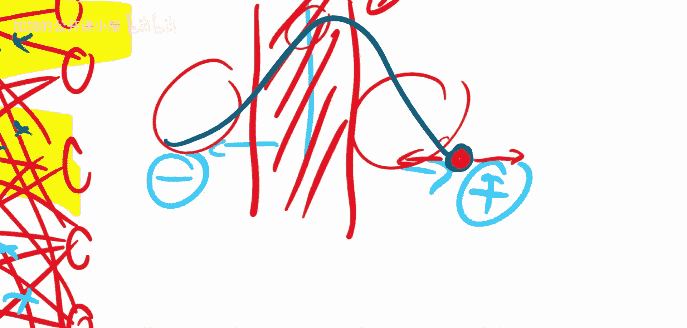