# YannicKilcher【中英⚡AI经典论文领读(全203篇)(上)｜Papers Explained】 p53 P64 GShard：利用条件计算与自动分片技术扩展巨型模型（论文解读） [BV1o3xLznExj_p53]

Open AI has a hundred 75 billion parameter model。 You thought that was large。 That's cute。

 Check out Google's 600 billion parameter model，600 billion floating point numbers。

 doing things at the same time。 This is absolutely become a body part measuring competitions between companies。

 Google be like， oh G 3。 I spit on you。 I spit on you and your little tiny hundred75 billion。 Okay。

 let's stop kidding。 this is a giant model that Google has trained right here。

 The paper we're going to look at today is called G shard scaling giant models with conditional computation and automatic sharding by Dmitri Lepikin at Al of Google。

 and this paper。😊。

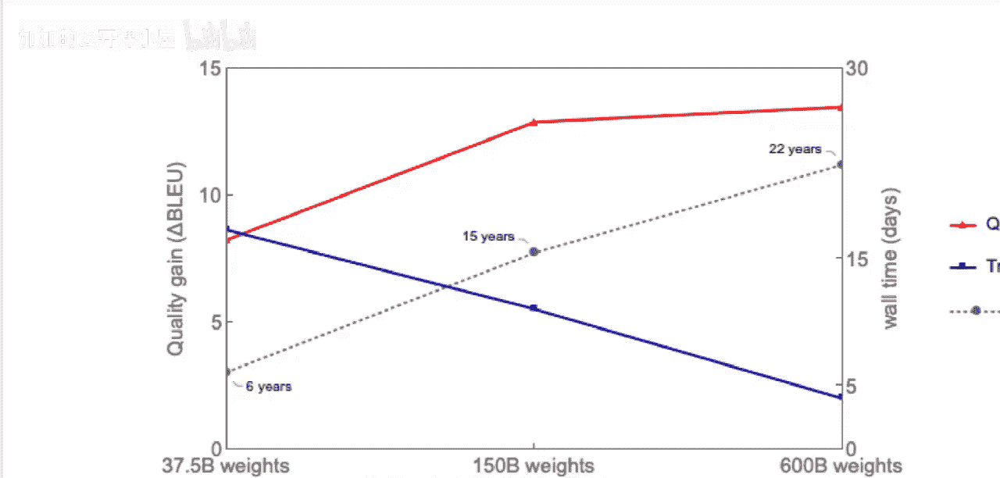

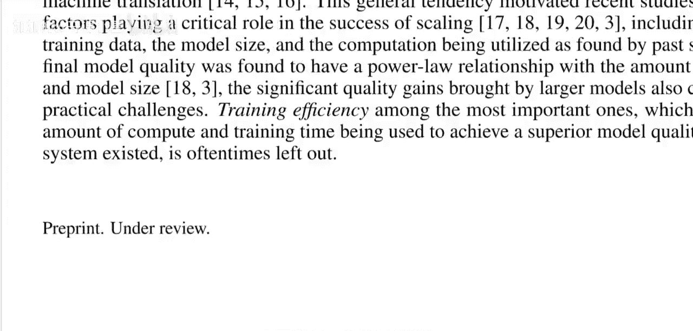

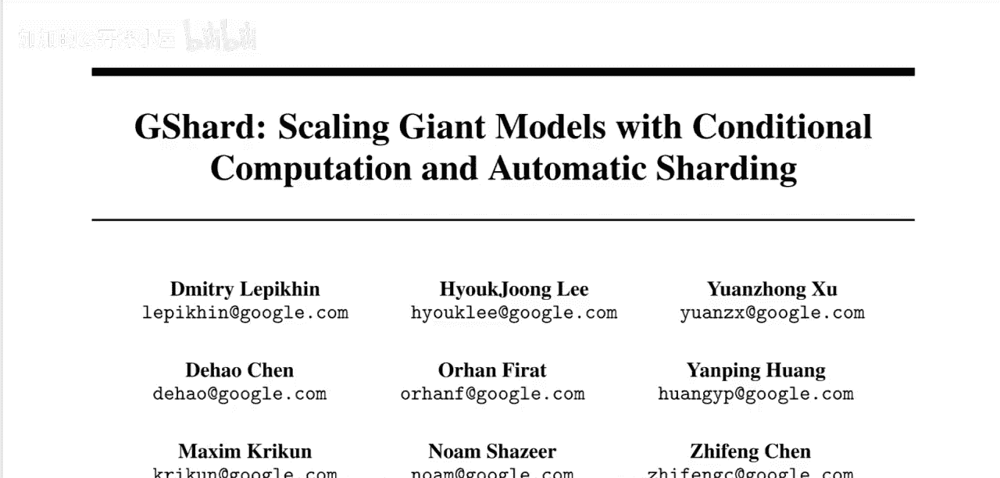

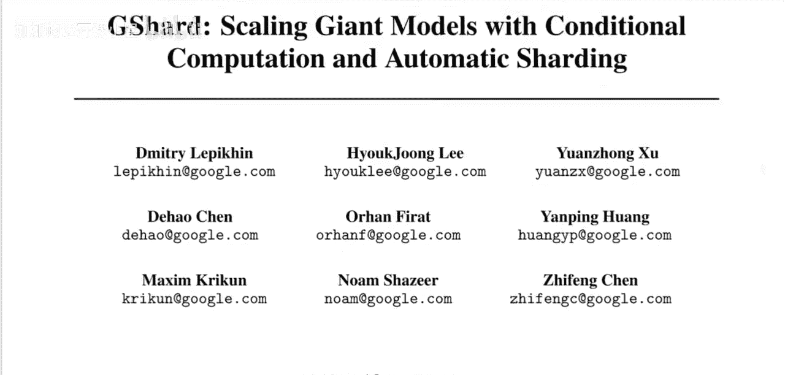

Basically tells the story of how they built this 600 billion parameter model。

 how actually they attempted to build a model that had a trillion parameters but just didn't manage to quite train it and this is all using this system called G shard so I haven't actually seen the code out for G shard yet but I'm going to maybe assume that this is something that they're going to release at some point who knows。

Or maybe I just haven't seen it yet。 So this is basically describing a system on how to train these giant models。

So if if you have watched my video on GP3， which of course was this 175 billion parameter model of open AI。

 which already was record breaking。This paper， the paper was very much like oh we built a model and look at what things it can do。

 So that was the openaiI paper。 This paper here is like the complete opposite。 It basically says。

 oh yeah， we do language model but but here is how we build the model which is equally cool。

 So openaiI basically just made everything bigger And here they say to make everything even bigger。

 you need some tricks in how to build models and theyve basically they've developed this entire framework to build these giant models and this paper mainly describes that framework and the actual task here。

 which is machine translation is almost sort of a side thing in the paper。

'ss it's just a task to showcase what this system can do。

 So this is very much an engineering paper rather than that much than a machine learning paper and that's how you have to look at it right here。

 That being said the machine learning。

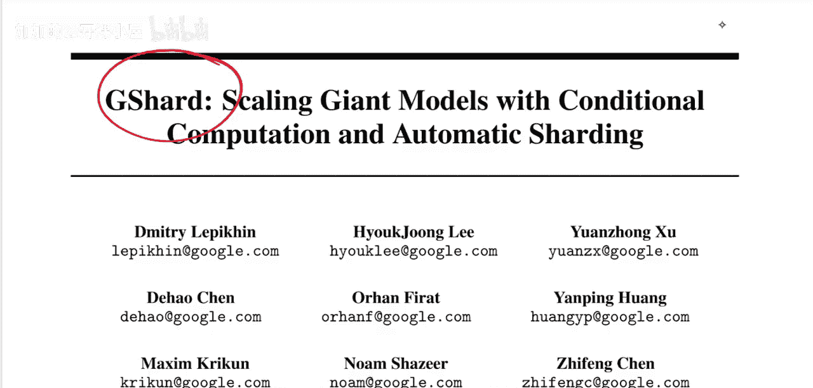

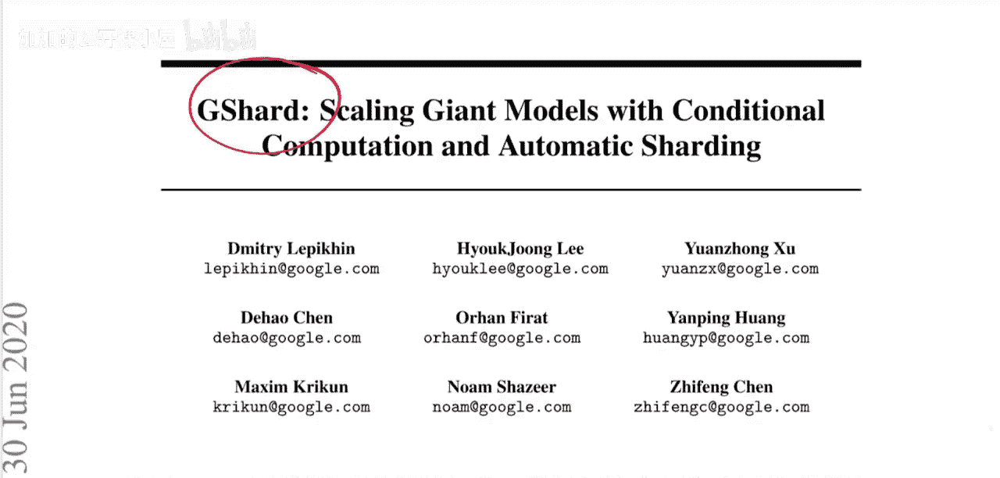

Results are， of course， quite impressive if you look at this graph here you have a quality gain it's a difference in blue score and this is a quality score for machine translation over the previous state of the art so over their baseline。

 which as you can see，😊，Here you have 37 billion weights。

 hundred and 50 billion weights and 600 billion weights， which they only train。They train for。

 you know，200 and on 2048 TPs for just four days。 that's they stress this is very efficient because they just have to train it for four days on 2000 TPUs absolutely crazy So let's have a look at what this paper does if you enjoy this。

 if you enjoy this at the end。 consider， you know sharing the video out if you like it and。😊。

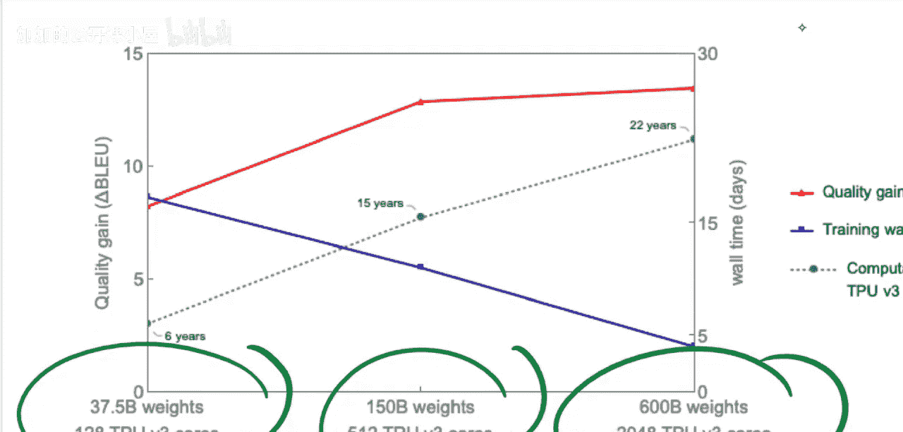

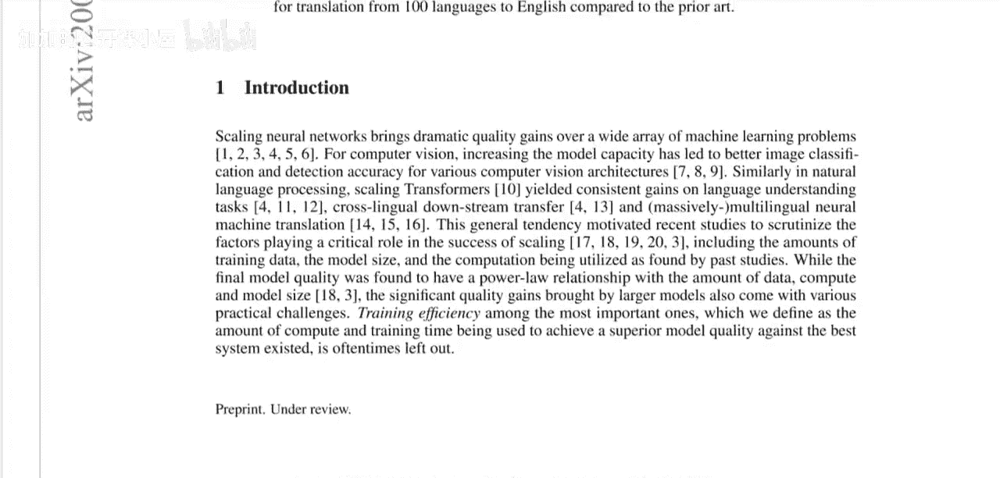

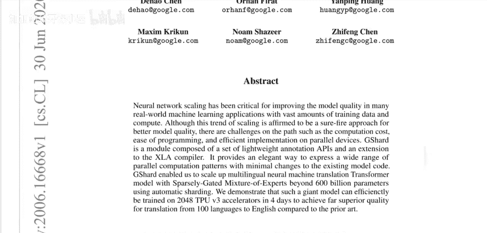

Tell me what you think about this stuff in the comments。All right。

So we'll go through the abstract and then we'll go through highlighted sections of the paper because the paper is 23 pages long。

 so I won't be able to cover everything， just kind of give you the high level ideas and highlight a few things。

Actually， let's not go into the abstract。 Let's go into， yeah， these results first。

 So as you can see， they manage to continue the trend。

 The trend in NLP has always been and at least since you know， transformers were invented。

 the bigger， the better， like larger model， larger data， more compute means better performance。

 And this is sort of unbroken here， as you can see。

 if you increase the number of parameters in these models， you do get a very。

 very big gain in these blow score， though it sort of seems to be kind of a logarithmic scaling。

 like you have to， you have to keep doubling and doubling and doubling the number of weight。

 it's sort of like more's slowing computation。

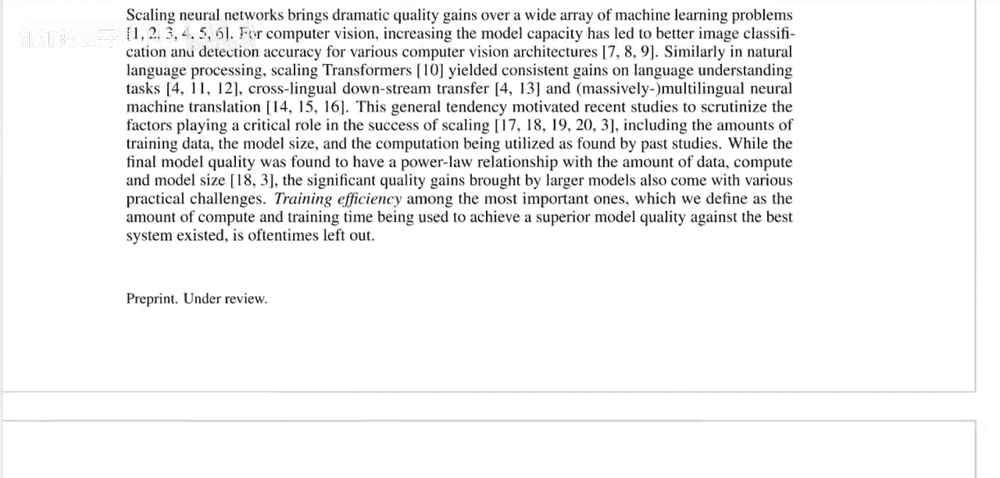

You can see that at the same time the training wall time is going down and the computational cost。

 the computational cost of these models， it doesn't scale quadadically like you would expect it scales linearly and that's the big difference here in how these authors scale their model rather than how the open AI authors scale their model。

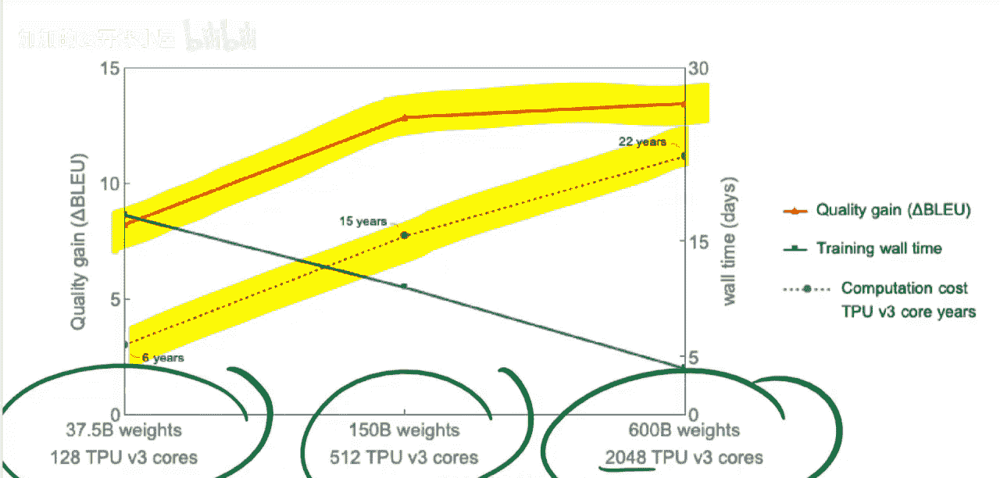

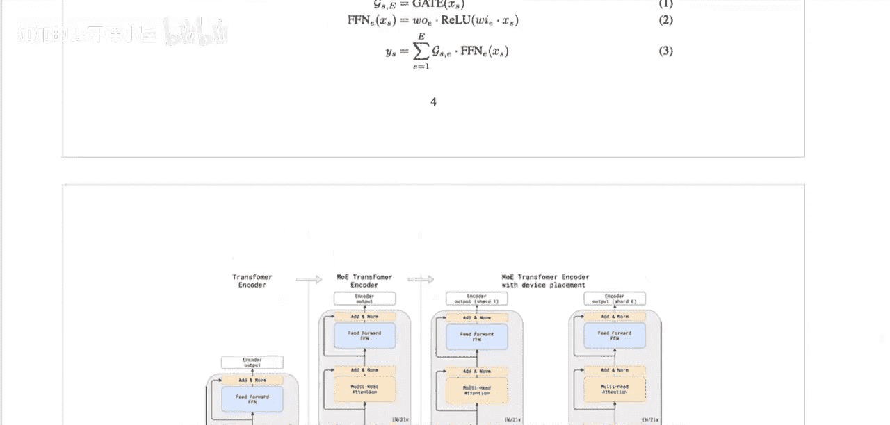

In a traditional and traditional transformer， looks like this。 So it has these blocks of attention。

 If you don't know what this is， I have a video called attention is all you need。

 I explain how the attention blocks in transformers work。 So this is nothing different。

 These are just transformers standard transformers， there is an encoder and a decoder。

 everything works as you know。 So you have these blocks。 you have n blocks。

 These are the number of layers that you have。 And in these blocks。

 you always have an attention layer and then a feet forward layer that acts on the tokens。

 So without repeating too much what an attention mechanism does。 basically。

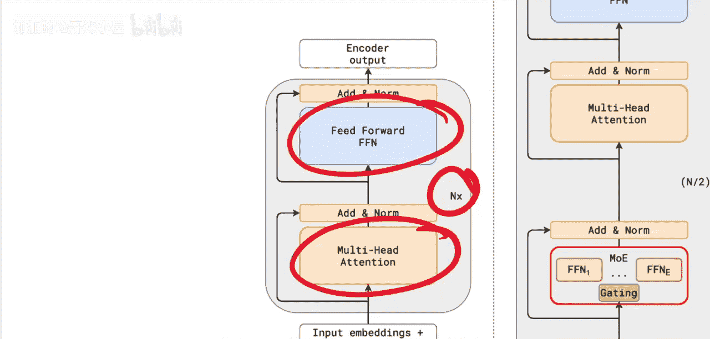

you have input tokens。 So this is a sequence。 It's technically a set processing unit。

 but we use it for sequences of text。 So here you have six tokens。

 a sentence of maybe six words and then you transform it with the attention layer by having this attention mechanism that routes information from tokens to from positions to other positions。

 maybe like this route is here， route this here。 and then you have a feet forward network that is applied on a per token basis。

 So each of these tokens now goes through this feet forward network。 and is kind of transformed。

 So the embedding of that token is transformed by that feet forward network。 Now。

 every token does this and it's always the same feet forward network。

 So this network here is the same as this network。 Now。

 usually when we talk about scaling transformers。 we talk about this part right here。

 we talk about the attention。

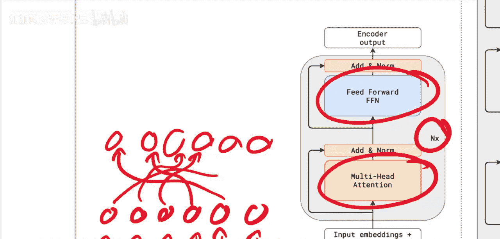

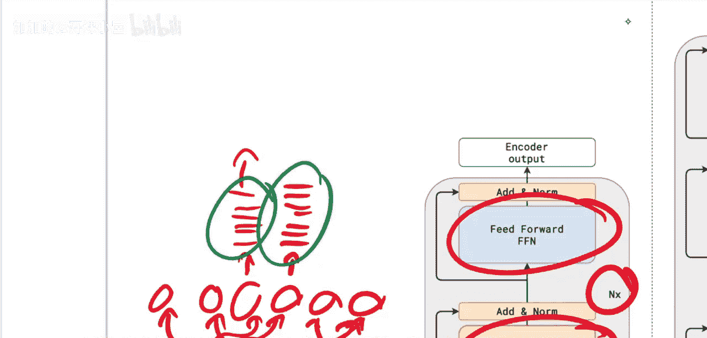

And also we talk about this part， the number of layers。

 So you know we talk about scaling the number of transformer layers， more layers， more layers。

 more layers， and if we want to scale the attention mechanism。

 what that basically means is we have we increase the context size of the text we can input。

 So transformers are very limited by the size of this context right here that they can take the like the original transformers started with something like 512 tokens that they were able to take because this attention mechanism has quadratic complexity。

 this went up and the open AI G3， I believe had a context size of 2048 tokens。

 which if it scales quadraically， that's quite an achievement。 And also it stacked the layers very。

 very deep。

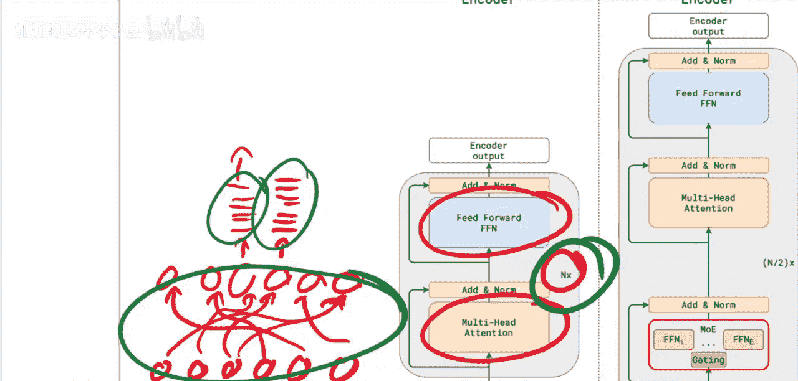

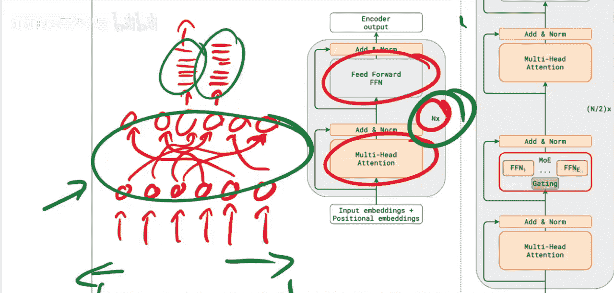

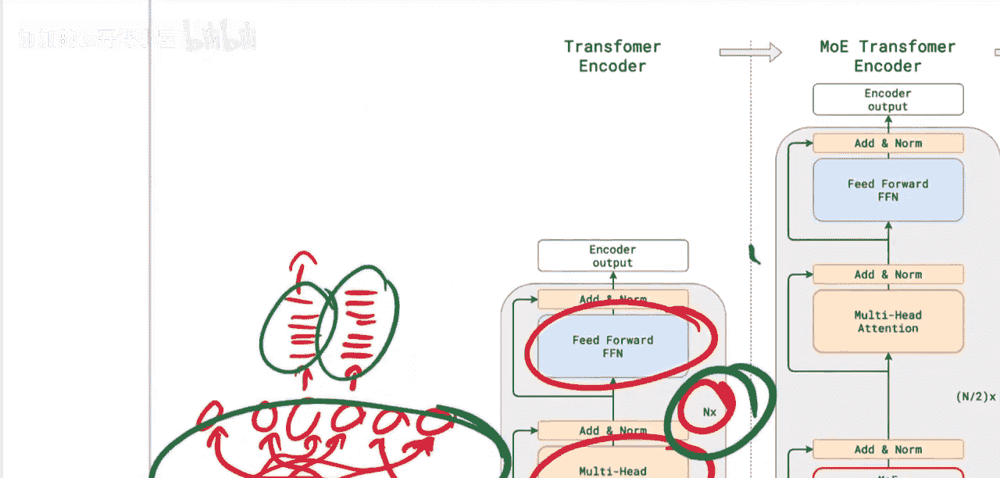

Now， in this paper， they scale the transformers differently。 They basically leave the context size。

 and I believe they their context size is 1024。 so significantly smaller than the open air context size and they don't scale the layers。

 So their largest transformer is 36 layers whereas I believe G3 was maybe correct me。

 but I think it was like 90 or 100 layers or something like this at least significantly larger than this instead what they scale is this part right here。

 the feet forward layers。 Now that might seem counterintuitive。

 but they basically they basically say what if we didn't only have one feet forward network right here。

 but we had many right we don't always have the same we have many， many feet forward networks。

 different ones。

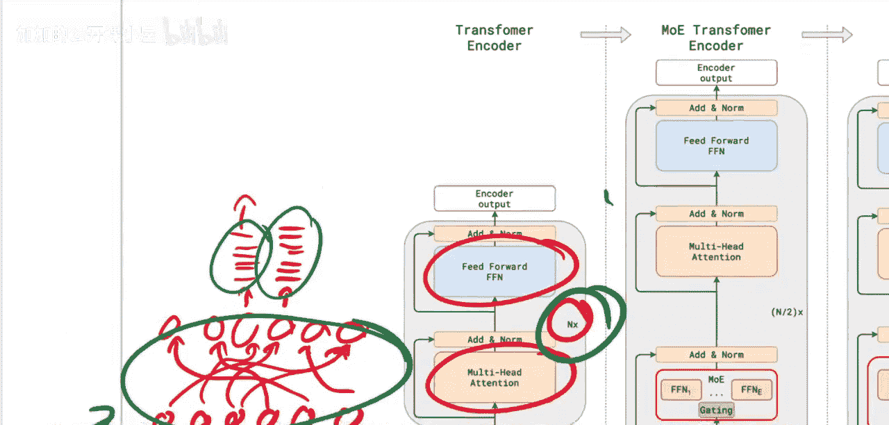

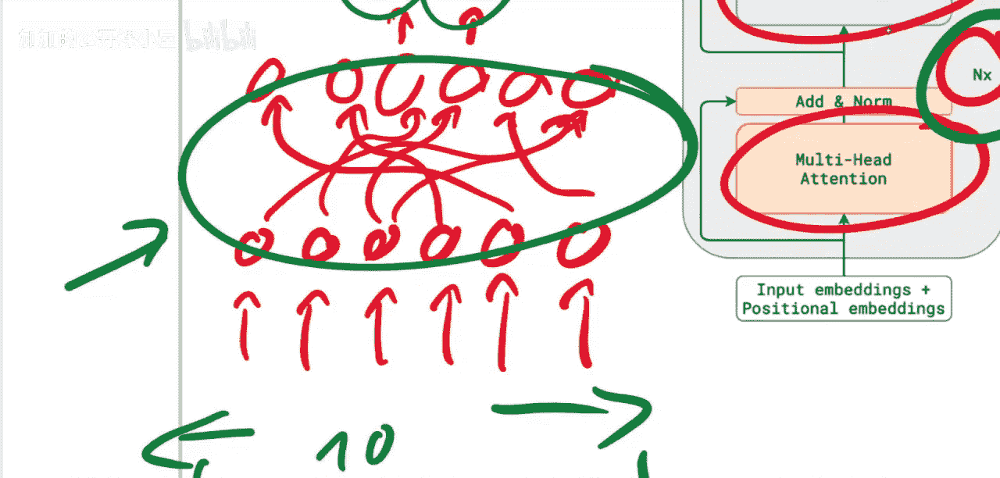

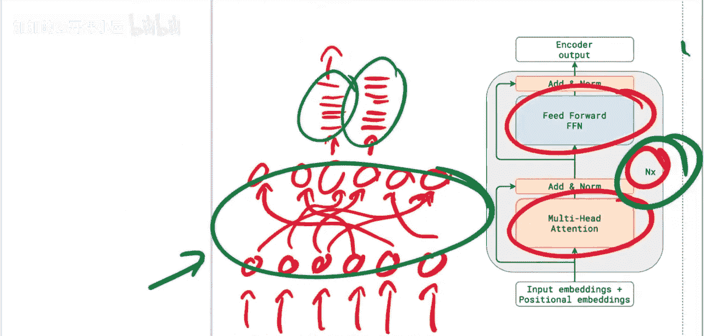

That can do different things。 So that's what they call experts。

 Each one of these feet forward layers is an expert。 and then you have yet another routing mechanism。

 kind of like in attention。 you have a routing mechanism that decides which tokens go where。Okay。

 so this token here， this token here， this token here。

 and the sort of the the implication being that different tokens。

 different parts of the input you want to transform require a different kind of transformations here。

 and these different experts can sort of specialize in how they transform the input。

 Now their task here is going to be machine translation as a multitask setup up。

 So what you'll have is you'll have all kinds of languages like French and German what that the and maybe like a lot of languages。

 I don't know any other languages。

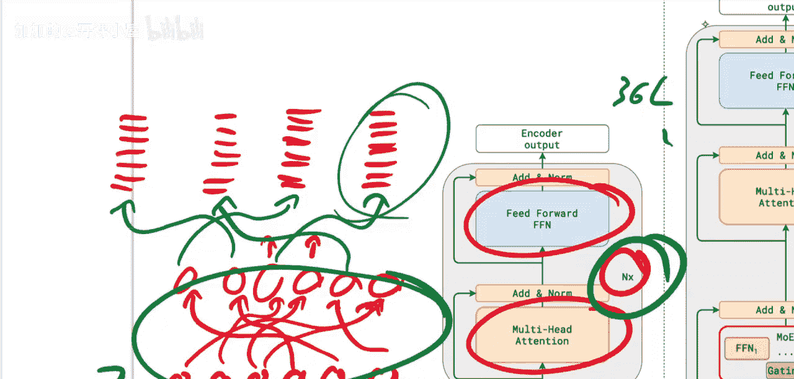

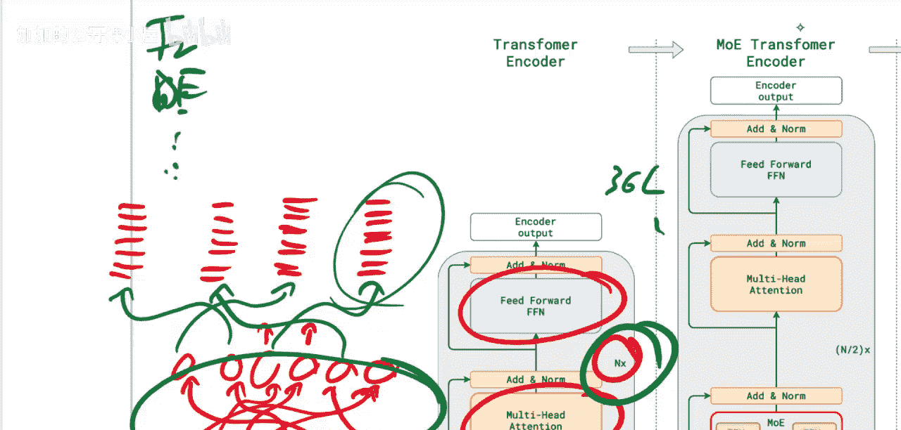

And you want to translate all of them to English and you want to do it using the same model So these experts here。

 they might specialize in， you know， the individual。

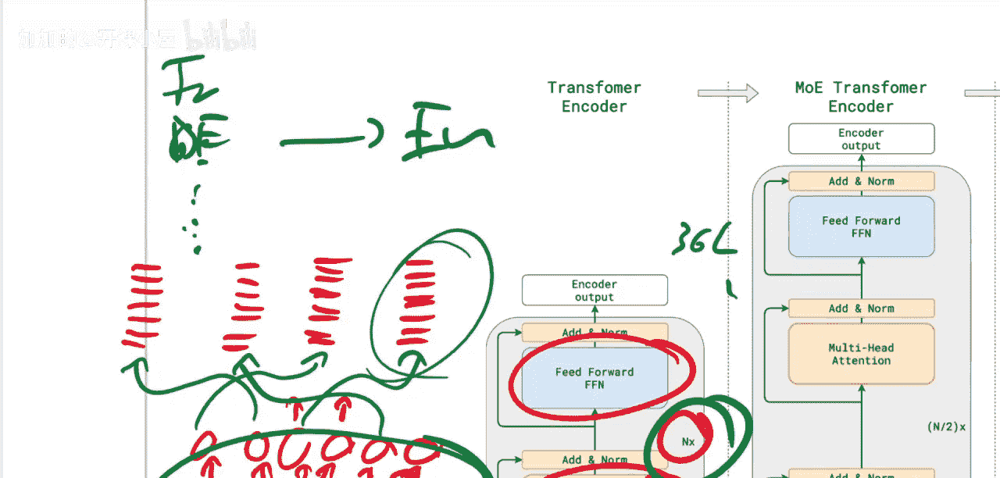