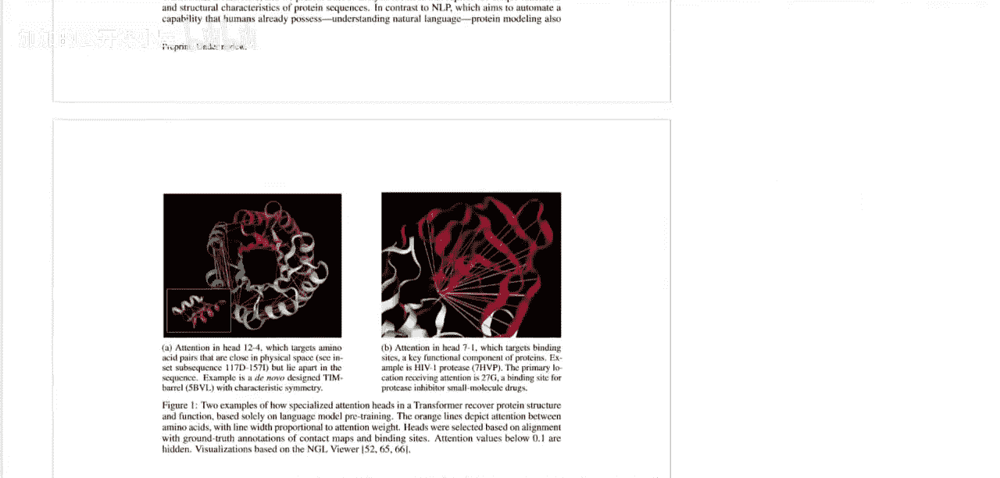
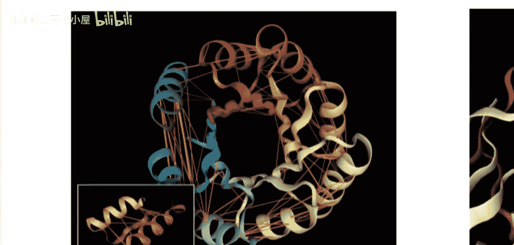
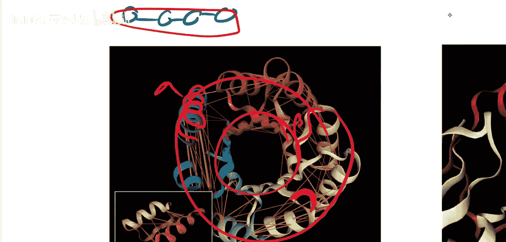

# YannicKilcher【中英⚡AI经典论文领读(全203篇)(上)｜Papers Explained】 p54 P65 BERTology遇见生物学：解读蛋白质语言模型中的注意力机制（论文解读） [BV1o3xLznExj_p54]

Hi there。 Today we'll look at Btology meets biology。

 interpreting attention in protein language models by Jesse Vig， Aliimmadani， Lav Arverni。

 Kaiming Siong， Richard Soer and Nasine Fatima Rajani。

This paper is an investigative paper into models that are trained on biological data。

 specifically into birdRT models， actually into a one specific bird model that is trained on protein sequences。

 now it is trained to simply perform language modeling on this protein sequences， but。

Out of this language model， you can then inspect this birdRT model and read important biological data of these proteins。

 higher order data from the attention heads of the bird model， which is pretty interesting。

 basically means that the information of these higher order functions。

 is at some point encoded in the structure of the language of the protein sequence。

So we're going to go through what this means and how this comes about and what they did in order to investigate。

 I think this is a pretty cool investigative work and probably very promising for future research。

Yeah， as always， if you like content like this， consider sharing it out and leaving a like。

 also tell me what you think in the comments。Biology。

Really quick for for people who maybe never never heard this in your every cell。

 you have this thing called DNA， which basically is an encoding of all of your biological functions now usually biological functions are realized through proteins。

 so DNA is basically a building plan for all of your proteins。

This happens in the following two steps first there is this transcription step where RNA is built。

 this is basically a copy of your DNA， but is only single strand， as you can see right here。

And then there is a translation step that finally translates the RNA into the protein。

 What will end up is just a sequence of these beads right here。

 Now these beads are what are called amino acids， so a protein is simply a chain of these amino acids。

 there are 20 different amino acids， and the order of these amino acids in the chain makes the function of the protein。

Now， specifically， we know about these proteins that。

It seems to be very important how their three dimensionional shape is。

 So a lot of these different amino acids have different chemical properties。 Some are sort of。

 I think negatively charged some are neutral， some are acids and so on。

 So they have very different chemical properties。 So once you build this protein and you kind of release it into the cell。

 it will curl up into a three dimensionmenal structure。

 So this one might be you know doing something like like this and sort of form form a circle or something like this。

 just because the these proteins here， they kind of attract each other。

 maybe electrically and thus the protein forms a circle and the function of the protein is very much related to its shape。

 So if it is a circle， it can maybe you know trap something else in here。

 So you really have to think of these things like kind of tools。 there are proteins that。

Cut other proteins。 And they are really shaped sort of like。

 like a scissor that exactly fits these other proteins such that you can effectively cut them。

So sometimes you can substitute an amino acid for a different amino acid like this here。

 if it doesn't change the shape very often you're fine， the protein function isn't changed。

 but if you change a different amino acid that is sort of vital to the shape and the shape changes then your protein very often loses function。

Mutations in DNA。Sometimes lead to mutations in protein， not always。

 because there is some redundancy in this in this translation step from RNA。

 But if they do lead to a different amino acid， it doesn't actually mean that the the function changes so。

There is sort of value in analyzing the sequence of the structure of proteins rather than the structure of DNA。

 Of course， it's also important to analyze the structure of DNA。

 but it is also it is equally important to analyze the structure of proteins because they。

Not all the information is in the sequence， not all the。Obvious information is in the sequence。

So what does this paper do， This paper goes and takes a model that has been trained on protein data。

 So if you look at this protein， it is simply a sequence of amino acids and these amino acids they all have names。

 I think I have a table somewhere here。Yes， so these are the different amino acids that exist。

And you can see a protein is simply a。A sequence of these names。

 So usually they're abbreviated by like a three letter abbreviation or just a one letter abbreviation。

 So a protein might be A， V，M， M， V， A， G， and so on。And this is just a string of text， right。

 So what I can do is I can train a language model on this。

 A language model is simply a model that takes a piece of text。😊。

And tells you what's the next piece of text。 So what's the next letter， what's the next word。

 In this case， what's the next amino acid。And we can use tools from NLP for that specifically we can train a birdRT model now BRT works a bit differently than a standard language model。

 BRT does what is called masked language modeling， so you would take this string。

 you would feed it into a BRT model right here。And I've made an entire video on Bert。

 if you w to check that out。 And what you'll do by inputting that。

 you'll mask out some of the tokens。 So you'll maybe mask out this one， mask out this one。

 And then you ask the model to reconstruct those。 We say that here is an M。

 And here is an a without seeing them。 So the model somehow has to learn from the surrounding amino acids。

What this amino acid could be， right， So it has to reconstruct this sequence。

 So the hope here is in natural language is that Bert somehow learns something about language itself by。

 by being able to reconstruct these things。 It has learned something about language about which words appear together and when it might even learn very long distance relationships between words。

 just because it has to predict those， and。The the idea carries over to biology。

 So it we might hope that a bird trained on a amino acid sequence will learn something about the about the language of proteins。

 about the amino acid sequence。 and our goal here is to be。To ask。

 can we somehow infer the 3D shape of a protein， which is the important part from its sequence right here。

 So given its sequence， can we infer the 3D shape？ Now， as I understand it， Usually。

 this has to be done in like a simulation， So you would。You would build this in a simulator。

 and then do you do some sort of a molecule simulation to see how this ends up in a 3D shape。

You could train a model to just predict the 3D shape。

 but in this case we're just interested what does the BRT model learn about the 3D shape while only ever having been trained on predicting the next or predicting the sequence of amino acids。

 so it's never been trained to look at the 3D shape。And that's our goal here。

So specifically we'll look at two different things。

 so here you can see examples of proteins and their high level structure。

In these proteins， what you call the primary structure is this sequence of amino acid。

 This is simply which amino acid are in which order。There is a thing called the secondary structures。

 and we often observe that spans of these amino acids like substrs form these what are called these helixes as you can see here or these sheets I don't know how they strands in English we call them sheets or I think these are the alpha helixes and these are the beta sheets and there is also a turns I think this here might be a turn So there are these kind of secondary structures and then the tertiary structure is how these this is still one。

 this is one protein。 this is one unbroken chain of amino acid and you can see this here kind of forms this double ring which would be its tertiary structure。

Very important for predicting the tertiary structure。

