# YannicKilcher【中英⚡AI经典论文领读(全203篇)(上)｜Papers Explained】 p57 P69 SupSup：叠加中的超级掩码（论文详解） [BV1o3xLznExj_p57]

Hi there。 Today we'll look at supermasks in superposition by Mitchell Wetzman Vivek Ramanun at L。

 So on a high level， this paper tackles the problem of sequentially learning many。

 many tasks without catastrophic forgetting by leveraging these things called supermasks。

 A supermask is basically a binary mask that you wonlas over a randomly initialized neural network to make the mask network perform better than a random initialization。

 they will train these mask for each of the tasks that they consider and then at inference time。

 they can recover the task that the data is from and therefore kind of do this lifelong multitask learning better than the baselines that they compare against。

 In fact， they can do better without knowing the task than the baselines can with knowing the tasks。

 So that's pretty， pretty cool。I this is a pretty dense paper in terms of content and we won't go over everything in the paper。

 but we'll go over the ideas and what kind of what I think makes them work So yeah stick around if you w to know that also consider sharing this video out。

 tell your friends about it and subscribe if you haven't its it helps so yeah。

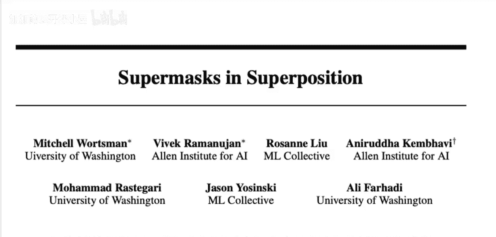

Cool， so let's dive in。 We present the super masks in superposition model capable of sequentially learning thousands of tasks without catastrophic forgetting。

 So the term catastrophic forgetting comes from the world of this kind of sequential multitask learning。

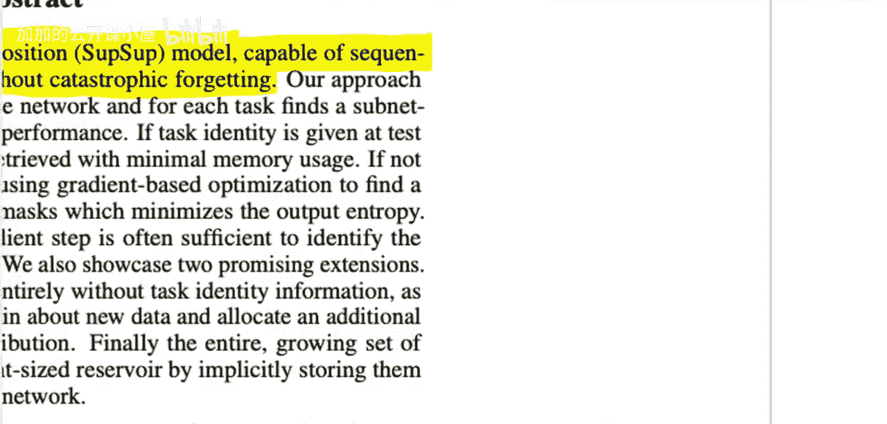

Where you have a model， let's call say this is your model。

 the black box and you let it learn on a task。 Let's say this is an image recognition task。

 So you have a data set and you let it run on this data。 You learn the data set， maybe it's C4 10。

 right， so this is C4 10。Cool， and now the model can do C for 10 pretty well。

 Then you also want to learn a different task。 You want to learn Mnist。 Okay， so you have mnist。

 and you want to learn mist and you want to learn the that one。

 So your hope is that your final model can do both。 So you'll take this one。

 And you simply train it on Mnist as well。 And then， you know。

 we know there is this kind of fine tuning， pretraining and so on。

 So your hope would be that at the end， it can do both。 But then you want another one。

 You want imagenet。Okay， now ImageNet is a pretty big data set。

 so you take your model and you also train it on IageNet。And with time。

 the model is always going to be very good at the task you just learned。

 but it is going to forget the tasks that you learned previously。

 This is the catastrophic forgetting problem you might ask why don't I just train on all the tasks equally like at the same time and that's a valid question you can do that but in the task description here it's necessary that we learn the task one after another because you know maybe we get this data in this year and then it's pretty big data we can't just afford to retrain on all the data all the time。

 we want to kind of continuously integrate our knowledge。

 this is very important in the fields of like lifelong learning where you want to kind of the hope is you can build a system that continuously integrates experience but doesn't forget the old experience okay and and the experience might come from new data sets and so on but you don't want to forget the old ones。

So catastrophic forgetting is one of the main problems in these types of research in this field of research of lifelong learning and this paper is going to tackle this how it's sort of so if you think of what could you do right here what you could do is you could simply not use the same model you can simply train the different models for each task and just keep them around and you know test time you need some way of deciding So there are two different scenarios at test time So you learn all of these models and then at test time there's an image and it could be that I tell you that this image by the way。

 that's an Mnes image so you just grab this model and you apply it very cool or it could be that I don't tell you what image it is like you have no clue then you need a way to decide where it comes from。

 but once you do decide where it comes from It's again pretty。I one you think。

 I think this is an Mist thing。 You can apply this one。 So you could technically do that。

 but it's very unhelpful because these models， they can be large， right？ First of all。

 they can be large， so。U。That means it costs you to store those。 And second of all。

 there might actually be some overlap like C for 10 and Inet are both natural images。

 so they might benefit from each other's feature in some way。

 Now what we're going to do here is we're sort of going to do this separate models approach namely we're going to use these we're going to build these super maskasks。

 So supermasks are the second thing that we're going to combine here。

 Our approach uses a randomly initialized fixed base network and for each task。

 find a sub network a supermask that achieves good performance。

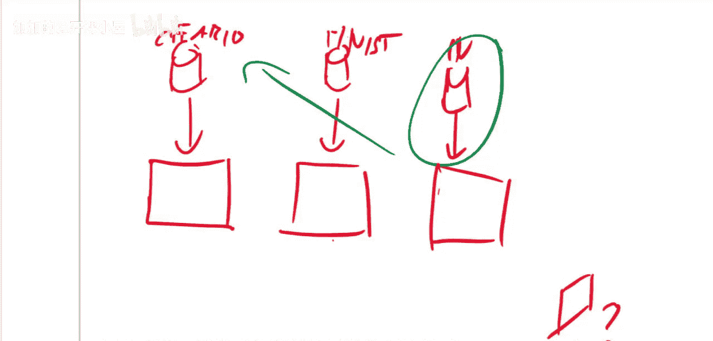

So what's a supermask， a supermask comes from these kind of papers about lottery ticket hypothesises。

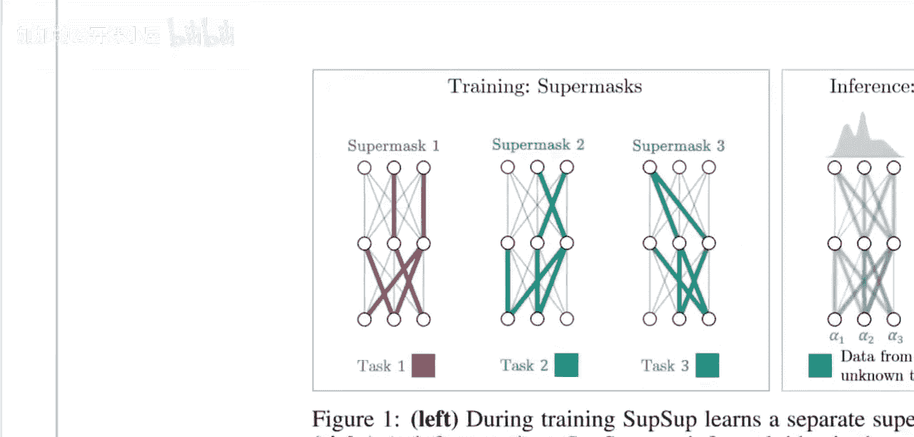

One of these papers discovered basically or conjectured and then showed in evidence that if you have a network that is randomly initialized。

 just like this is your neural network， the gray thing。

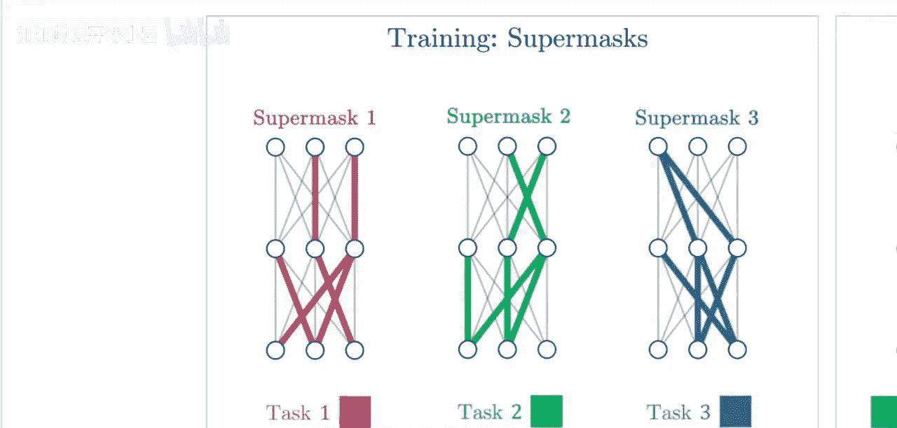

And。There is a way to mask it， which means masking。

 basically means that you either activate or inactivate connections。

 So you have your network and you simply multiply it by a binary mask that for each connection is a one or a 0。

 So like one。 So here is like 0，0，0，0，0。 This is a1。 This is a 0，0，0。 This is a1。

 So the network isn't going to be zeros and ones， but it's going to be multiplied。

 Each connection is going to be multiplied by a 0 or a1， which means wherever there's a one。

 whatever weight that connection had。 That will be the value of the weight of the connection。

 if is a0， whatever weight that connection had， it will be it will be。Pinned to zero。

 so there would be no signal flowing。So this paper established that。

If you take a randomly initialized neural network， there is a way to mask it and you can find those masks where if you mask in a particular way。

 the network will already perform better than random on a given task。

 So there is a way to solve Mist by using a randomly initialized neural network and then simply masking it cleverly。

 and then the mask network will have a good accuracy on Mnist。 Okay。

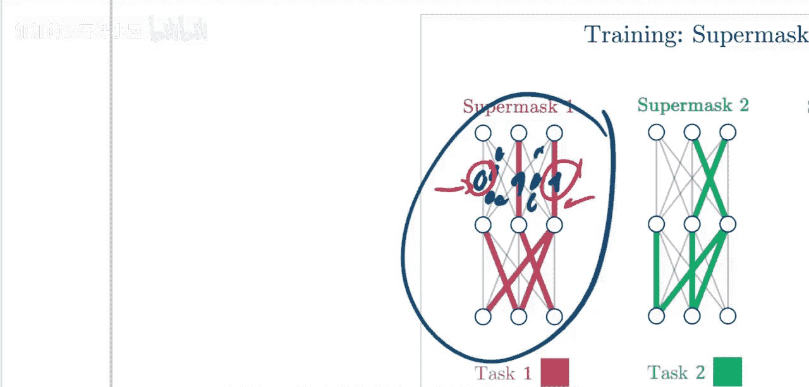

And they， they found that。 And I have， I've made a video about that。

 And the sort of intuition behind the super masks is this is just my intuition is that， you know。

 M N， Im， this is what I'm guessing， M N is a relatively easy task。 In fact。

 most of the tasks they're considering in these papers are relatively easy。

 And if you have a randomly initialized neural network。 basically。

 what you have around is a bunch of weight， right？ So if。

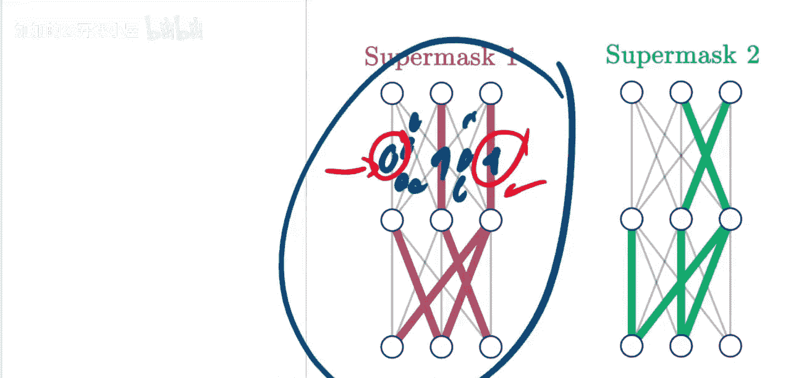

If I have my two layers right here and then each connection here is a number like 。25。

 this is you know7 this is negative 3 and so on。 Now they're going to consider they here are going to consider weights that are initialized in a very special way。

 but ultimately you just have a bunch of random weights lyinging around。

 And if the task is super easy， let's say and the neural network is sufficiently over parameteraized there might be many。

 many ways of achieving your goal。 so。

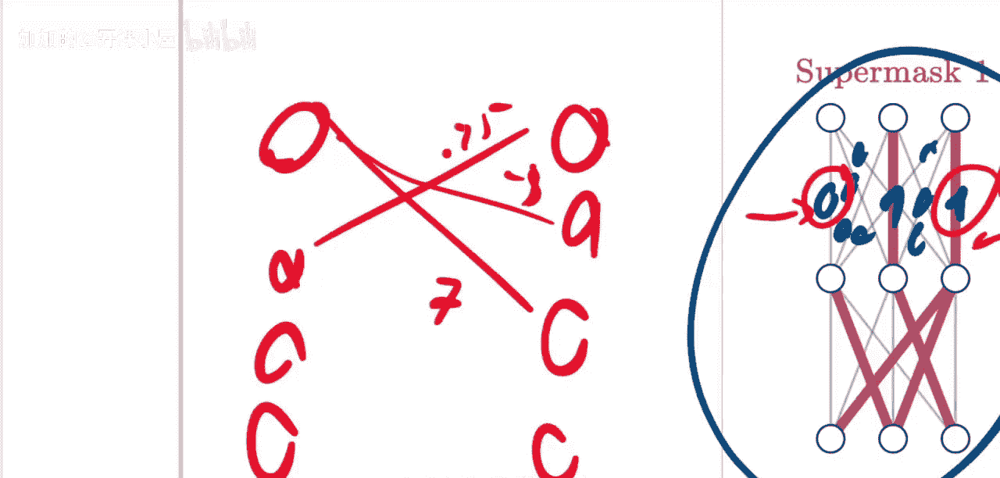

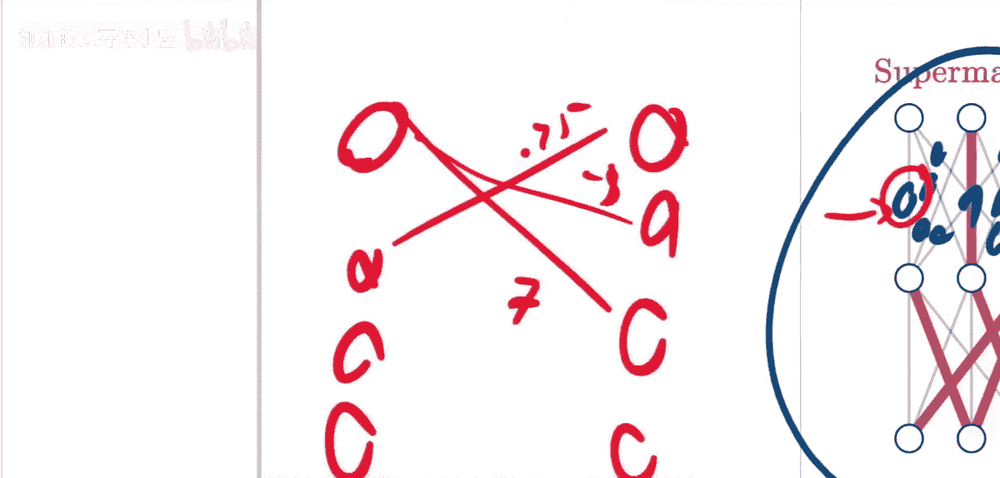

Rather than being able to adjust the weights like you would do when you train the neural network。

 you would actually change those numbers， you get away with simply selecting the combination of weights that will。

 you know， give you a good performance， so。it's kind of it's sort of a mix of dropout and vector quantization。

 so in vector quantization， you also you get away with quantizing the vectors to given precision here the task is easy enough such that by simple over parameterameterization and selecting of the weights that you have around mixing them correctly by simply so you can't mix arbitrarily but you can mix with0 or1 you get good enough so this is sort of my hypothesis。

 my hypothesis would be that the harder task the harder it gets to find supermasks that perform well。

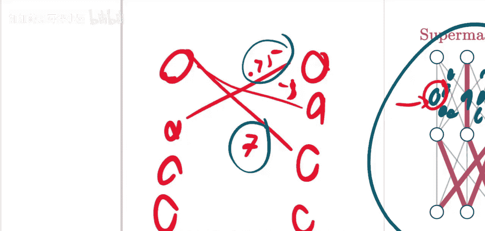

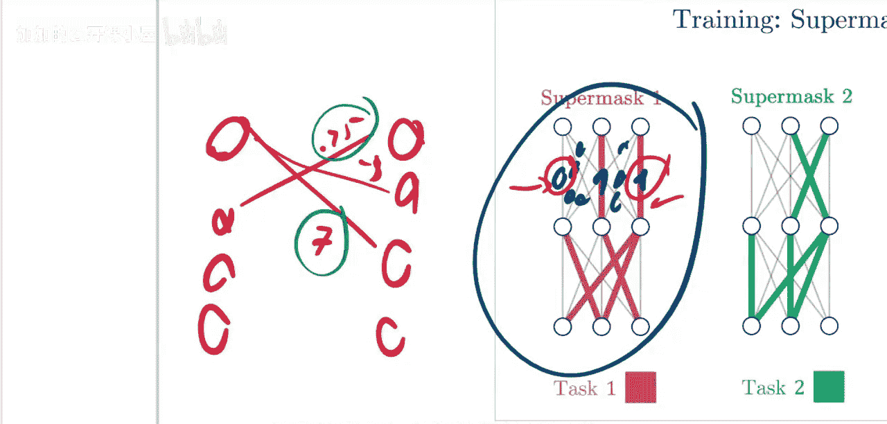

That's what I think， but nevertheless to say， for the tasks they're considering here。

 you can find these super masks and there is a way to do that by using gradient descent。

 even though the super maskasks are discrete。So what we're going to do is we're going to use。

The same randomly initialized neural network for each of the tasks， right， So this is like C for 10。

 This is M Nest。 This is imagenet。 We're going to use the same grey network。

 but we're going to find an individual mask for each of those networks。

 for each of those tasks on top of the same network And they're all going。

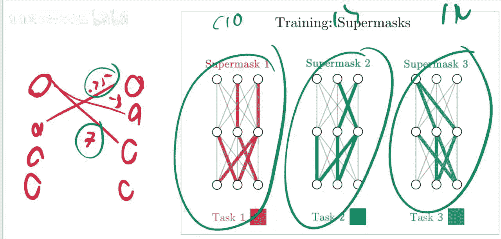