# YannicKilcher【中英⚡AI经典论文领读(全203篇)(上)｜Papers Explained】 p59 P72 NVAE：深度分层变分自编码器（论文精解） [BV1o3xLznExj_p59]

Alright， hi there。 Have a look at these faces right here。

 So you're probably used by now to seeing computer generated faces of really high quality。

 but probably you're used to seeing these faces coming from a generative adversarial network。

 However， these faces right here are from a variational autoenr。 Now。

 variational auto encoders are fundamentally different than GNs。 and traditionally。

 they've been a bit harder to scale up to high resolution images and give sort of very detailed sharp output。

 This paper right here， attempts to build such a V Ae for these high resolution， large data set。 and。

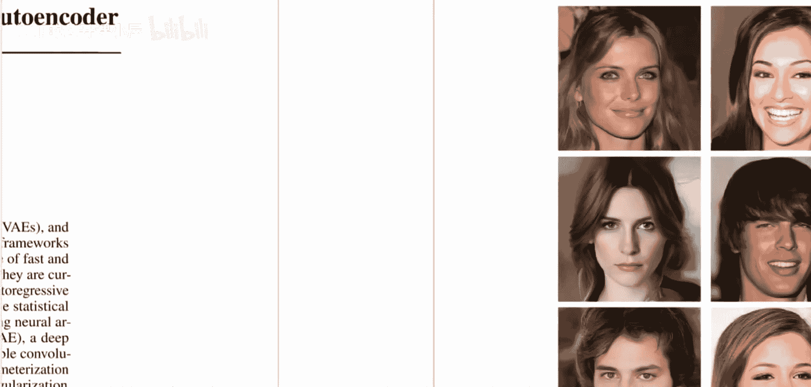

It basically details everything you need to do to get a VE like this。

 So the paper is called NVE or the I don't know how to pronounce that a deep hierarchical variational autoencoder by Arrava and Jan ks of Nvidia As I said on a high level this paper is about how to build a deep hierarchical variational autoencoder which is sort of a combination of already existing techniques combined in a clever way and then listing all the engineering efforts that you need to do to actually make this work and there is not one thing where you can say this is the thing that really made it work but each of these techniques is going to stack and stack and stack until they reach a model that surpasses the state of the art on these datasets and they are also able to apply this to an entirely new high quality image dataset So these again are some of these samples from。

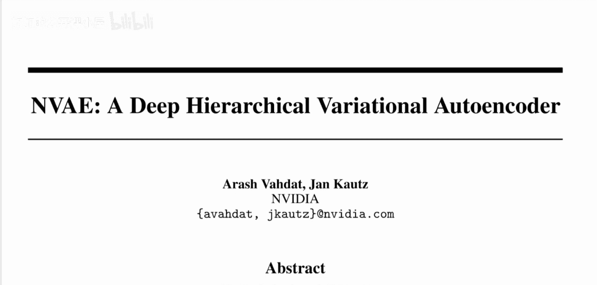

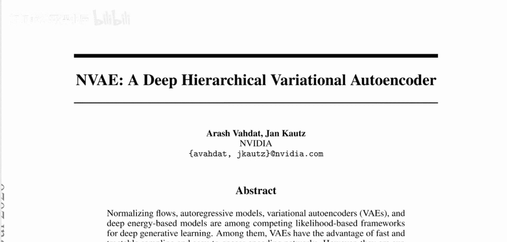

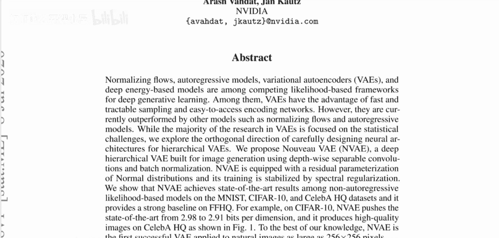

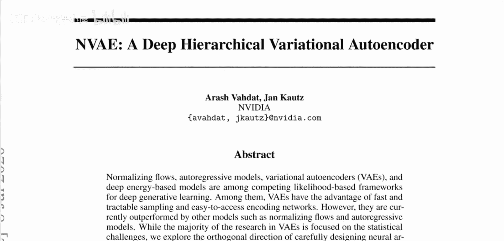

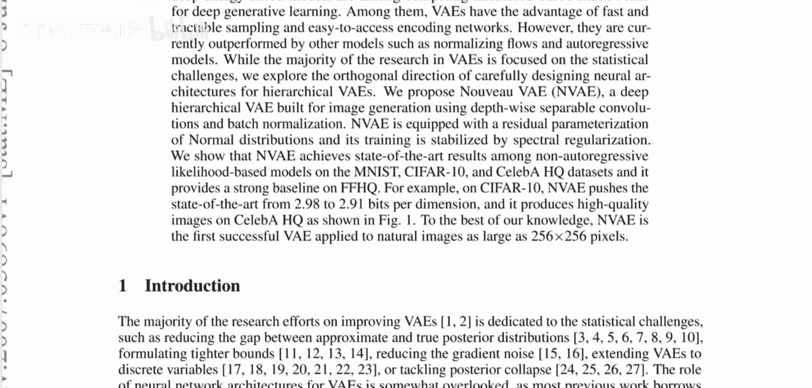

That model。 And as you can see， they look very， very crisp， very sharp and。

Also very let's say real yeah so really briefly variational autoencors。

 So this paper attempts to build a variational autoder。 What is it for that。

 you need to start with a what an autoencoder is。 So an autoenr traditionally。

 let's say you have an image data set and you take an image and you train a model that consists of an encoder that maps your image to a lower dimensional space。

 a compressed space， which you call the latent space Z， and then you train a decoder to again。

 go from the latent space back to the image space。 and then you train those two models such that the distance between the output and the input is minimized。

 okay this is called the reconstruction loss and you train the encoder and the decoder to minimize that reconstruction loss。

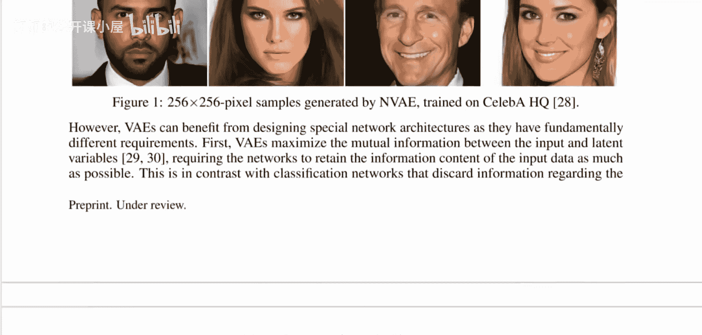

And thereby you hope that this latent space will learn something about the data Now。

 a sort of advanced version of this and a probabilistic version of this is the variational autoencoder。

 where we say what we want to do is we don't want the encoder to just output the directly the latent code。

 but we interpret this in a probabilistic fashion。 So the encoder is now a probabilistic function that outputs a distribution over latent codes。

 So we take our same image。And what we want to do is we want a Bayesian。

 basically it's a Bayesian way of thinking of it。 we want a distribution over latent codes corresponding to that image。

 so our encoder here is not going to output Z， but is going to output mu and sigma。

So it would be ideal if you could output an entire distribution。

 but we're going to make some assumptions here that that is a normal distribution and it's going to output the mean and the standard deviation of that normal distribution。

And then you actually because now how you're going to feed this into the decoder。

 if you just feed mu you are back to the normal autoencoder so that doesn't work。

 what you do is you actually instantiate that normal distribution with the mu and the sigma。

 so you plug that in here， you sample one sample from that normal distribution。

And then you feed that sample into your decoder again。

 your decoder outputs an image from that sample and you compare this with the reconstruction loss。

 and now you train the entire process。 so you train the the encoder and the decoder to produce。

To reproduce these images correctly。 Now， if you only do that， then your。

 then the model will basically regress to a standard auto encoder。 Why is that？ Well。

 what's pretty easy for the you can see that estimating the distribution is harder than estimating just the latent code。

 at least for the training dataset set， right？ So if you don't pay attention。

 What's going to what the encoder is going to do is it's， it's going to say， oh， well， I。

 if I just make this here。My latent code。 and if I just make this as small as possible。

 like 0 or like1 to the minus 10， the 10 that that's still1，10 to the minus1。That's not that small。

10 to the-101112。 Okay， a very small number。 Then that normal distribution will basically be just spiky around my。

 around the thing， around my mean and。So this here will always be kind of the same Z。

 so it won't be a distribution at all。 it will just be this di。

And I'm back to the original autoender， which I don't want。

 I want my probabilistic framework so I can compute likelihood and so on there are various advantages to having a probabilistic view of the data rather than just a model that produces it。

Okay， and that's why in a V Ae， there is not only the objective， not only this objective。

 the reconstruction objective， but there is a second objective where we say that。

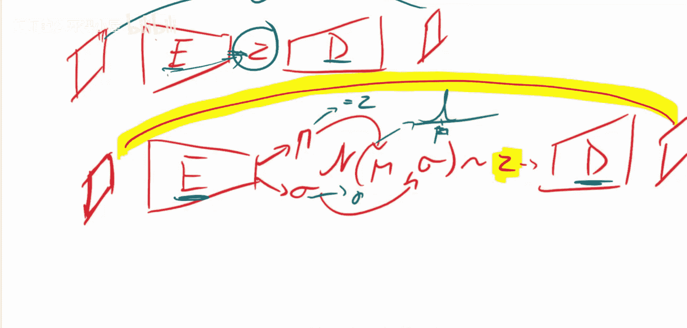

We impose a regularization， and the regularization is that this here is as close as possible。

To a standard normal distribution and I guess you can you can choose that the prior。

 but in regularly you say， okay， this here， I don' I don't want you encoder。

 I don't want you to go far away from a standard normal distribution like do what you have to do to make the loss small。

 but don't go away too far。

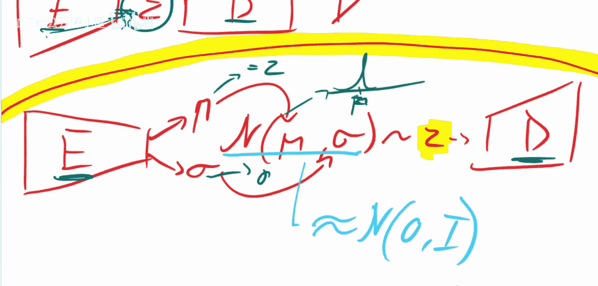

Alright， so that's the kind of balance in the Ve。 And as you can imagine。

 if you have a normal distribution and you sample these Z vectors here and the reconstruction loss is always the same。

 So if you input the same X here a bunch of times。 you will get different Z， right， you get Z1。

 Z2 Z3 because it's sampled from this distribution， There's a sampling procedure right here。

 So if your discriminator here is kind of smooth， then it will output different images。 Now。

 these images will always be compared to that same input image， right。

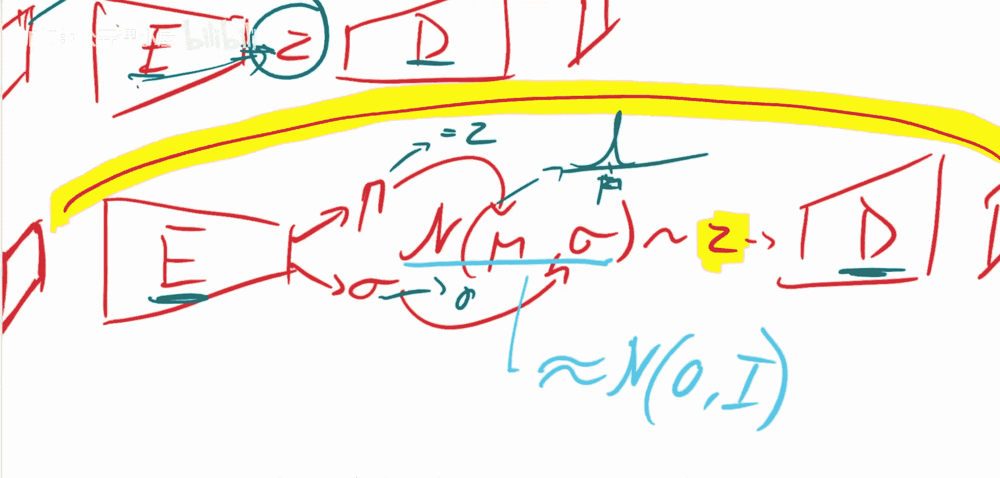

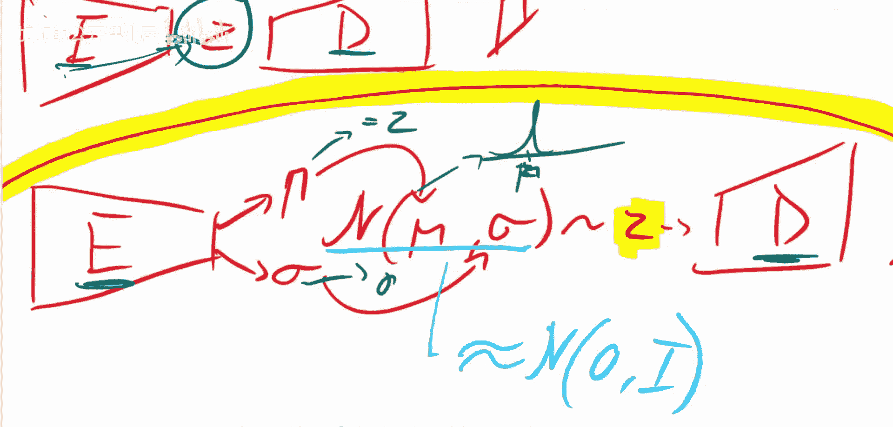

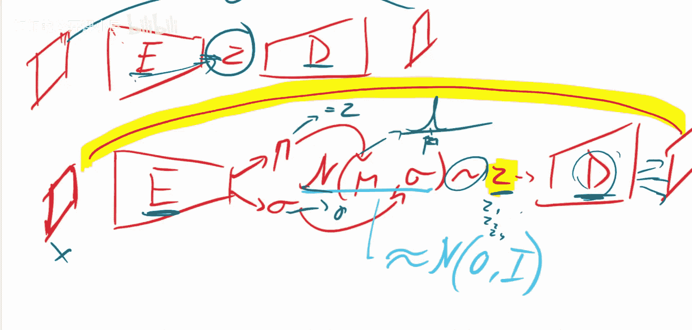

So。You're training this whole architecture to always reconstruct that input image from different images。

 so the。There is an interaction I think I think that's what's happening。

 I guess I'm not an expert on on VEs， but this here usually is something like the L2 loss。

 So in terms of how this affects the images， if I have different images that are sort of the same but sort of different and I have to make it L2 loss close to this image right here then one option I have is to make them kind of blurry。

 So if I make all of them kind of blurry in the L2 loss that will give me a lower penalty。So that's。

 I， I believe that's one of the explanations I heard at some point why V AEs produce usually blurry images。

 And that's been a problem for a long time that everythings kinda， kinda blurry， so。

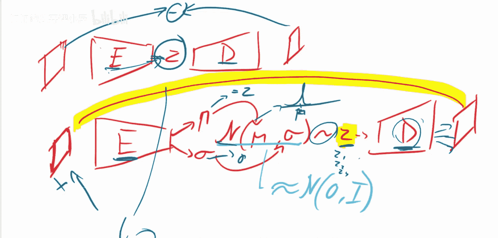

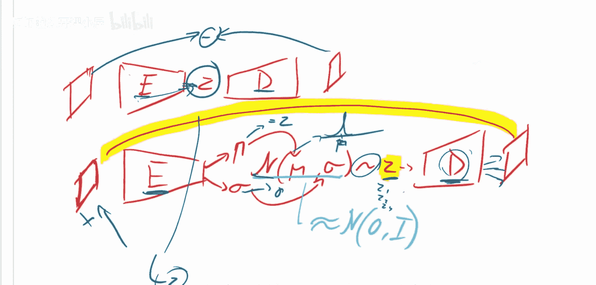

Here， the hierarchical VAE comes to the rescue。

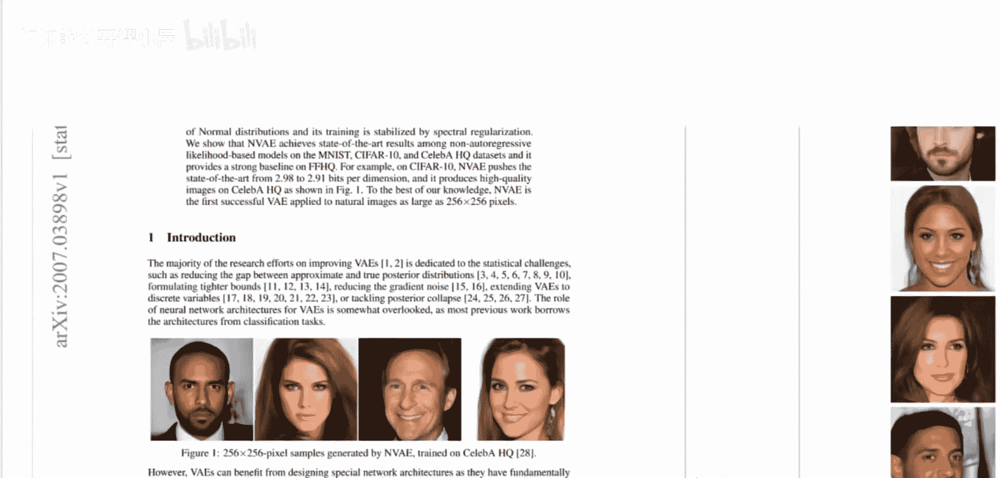

So how they are going to battle this problem is by doing a hierarchical variational autoenr。

 and this is how it works。 So you start off。This is your your generator。 By the way。

 once you've trained your VAe， right， once you've trained it。

You can simply sample from your prior from this here because that's you know close enough to this。

 or you can I guess learn the prior of your data distribution and so on。

 and you can just use the generator right here， the generative part， this part right here。

Is your generator in order to produce images， So you can sample from a V AE like you could sample from agan。

Okay， so here we'll look at a model that could combat those things。 On the right side。

 you can see the model that you would ultimately sample from。 So this is going to be your decoder。

 Okay， this generative model right here。And what they do is it's very similar to if you in video also this paper about this G where they are on different scales like progressive。

 I think Prog G， which was the first that introduced actually this high quality face data sets。

 I believe at least so here we are going to do a very， very similar trick So the idea is that。

We start out。 This is a learned quantity， but you can also view it as just kind of the0 vector。

 We start out with our noise。 We sample our noise， but our noise is going to be。

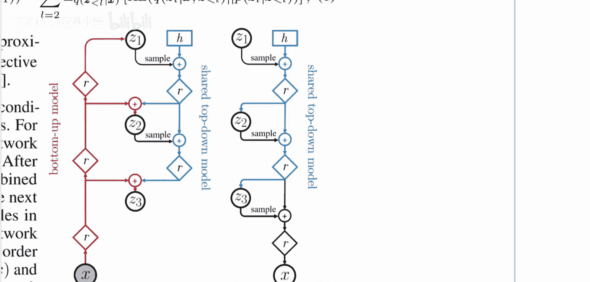