# YannicKilcher【中英⚡AI经典论文领读(全203篇)(上)｜Papers Explained】 p61 P76 深度集成：从损失景观的视角解析（论文解读） [BV1o3xLznExj_p61]

Hi there， Today we'll look at deep ensembles， a lost landscape perspective by Stanisla Fort。

 Huyihu and Balaji Lakshmiar Rayanan。This paper on a high level explains the lost landscape of deep ensemble models。

 so ensembles of deep neural network， and it hypothesizes。

 and it shows through experiments that each member of the ensemble by means of being initialized at a random point will go and through optimization go and end up at a different place in weight space。

 and therefore the deep ensemble is able to capture different modes of the functional space of the space of solutions。

 They compare this to Bayesian networks， which are sort of promised to do the same thing。

 but they often only characterize a single mode and therefore they don't generalize as well。

So join me exploring this paper I think it's a pretty cool paper the experiments are cleverly designed to show what they're supposed to show and I generally enjoy this type of research because it's kind of an explanatory research that shows you what's going on inside of these networks rather than you know chasing the next state of the art number。

 it's also an example of research that you can still do while youre you don't have you know giant resources of compute even though this is by deep mind but I do believe that this kind of research is still you know wide open and available to academia and。

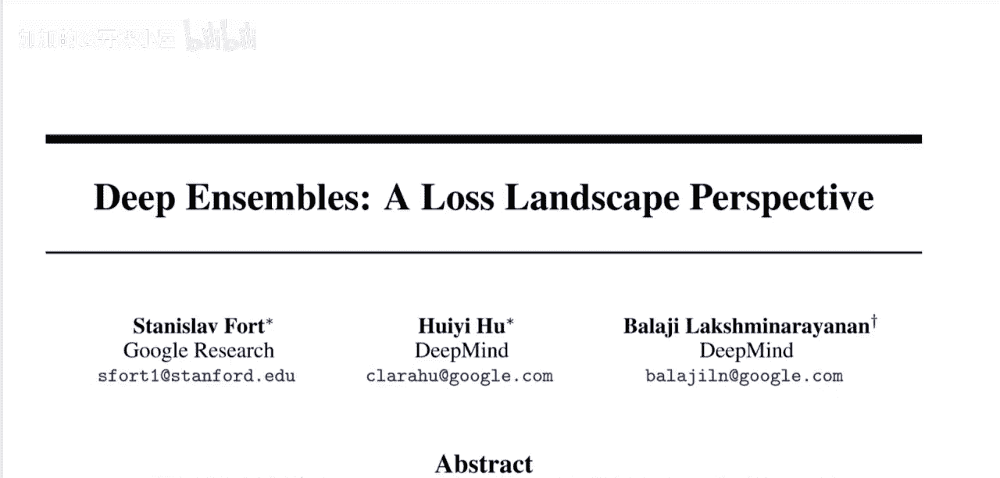

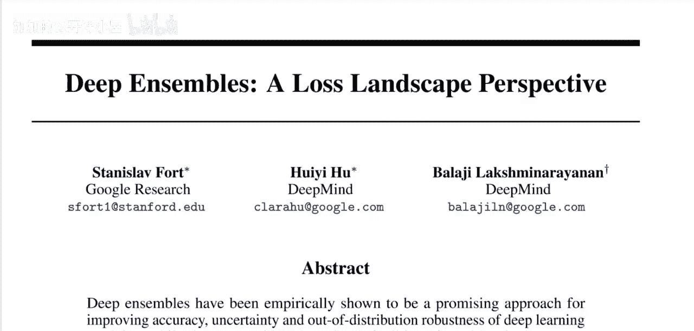

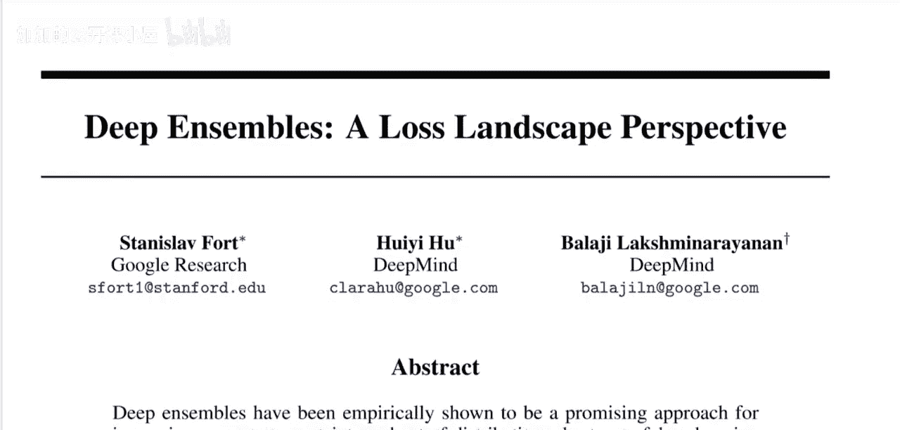

Whereas the other kind， the state of the art kind slowly goes into more and more of the money game。

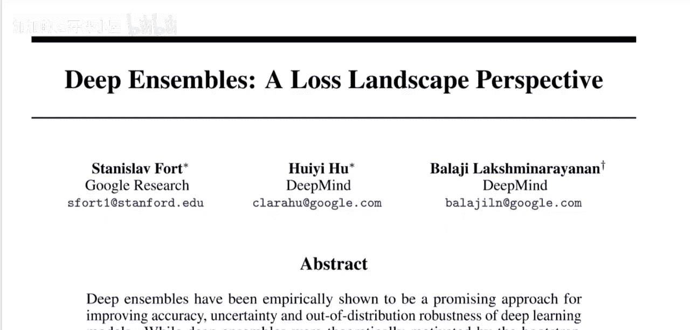

All right， in any case join me in reading this paper， if you like it， share it out。

 leave a comment to tell me what you think and leave a like if you enjoyed it。

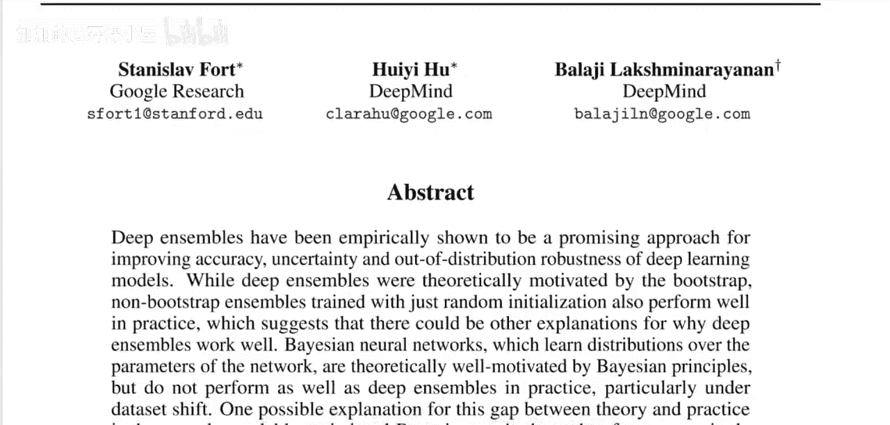

Alright， so we'll start off。 The abstract says deep ensembles have been empirically shown to be a promising approach for improving accuracy。

 uncertainty and out of distribution， robustness of deep learning models。

 So what are deep ensembles really quick and an ensemble model。

 And we're in the classification setting。 So in the classification setting。

 we have data points and each data point has features， So which are the X X's。

 some kind of D dimensional feature， And then you have y， which is the label。 So that's。In some。

 let's say that's some natural number or something like this or is element of a class set。

No that's the complex numbers。It's， it's element of some some some bound set of class labels。

 So it's either a cat or a dog or。

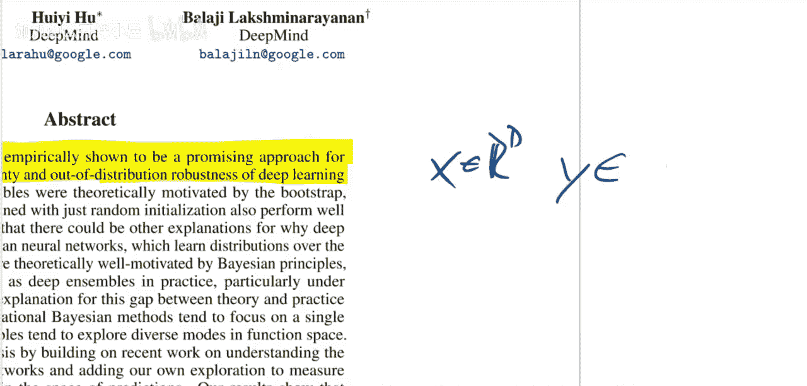

And know whatever you want。So you have a data set of these things and your plan is to use X to predict Y。

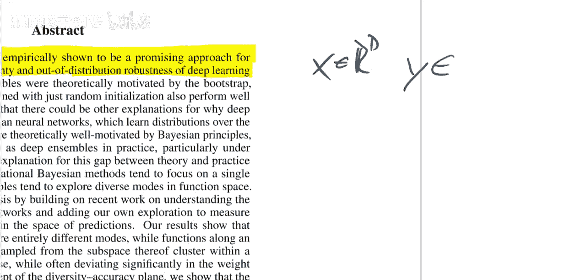

If if you build a model， a deep neural network， for example， for this task。

 you would simply characterize this function here， you would parameterize it as a deep neural network of many。

 many layers。

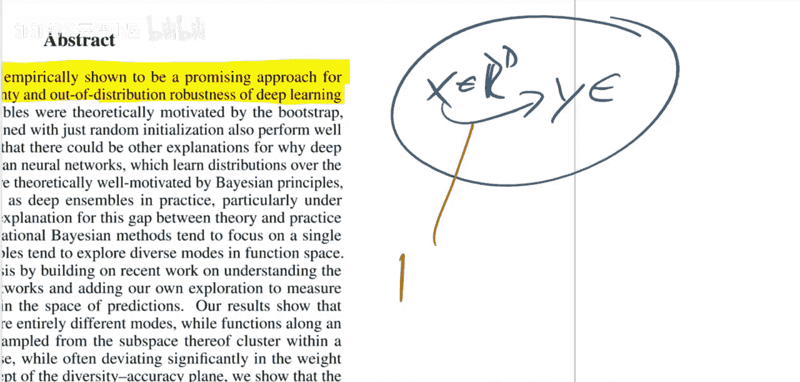

If you build an ensemble， now， what you would do is you would take the data set and simply train multiple different ones of these deep neural networks。

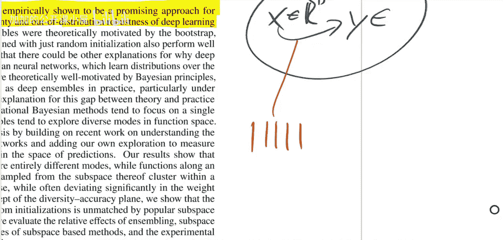

So you'll train multiple different ones and if you now want to classify data point。

 you'll input that data point into all of these three and at the end you would somehow aggregate and there are different methods of doing this。

 but the most obvious one is simply either to aggregate by the mean or the mode。YeahMen。

 whatever you want， you can also kind of also learn something here。

 but you can just average the predictions and that will usually give you a better prediction than if you only have one model So this is called an ensemble model and if the ensemble members these thing here are neural networks or deep networks this is called a deep ensemble。

So why do we hope to become better？ That's the， the point of this paper is to show what happens in the lost landscape of these deep neural networks and why do they perform better than other methods that are supposed to achieve the same thing。

 So usually when you build an ensemble model， What are you hoping for。

 You're hoping to sort of learn。

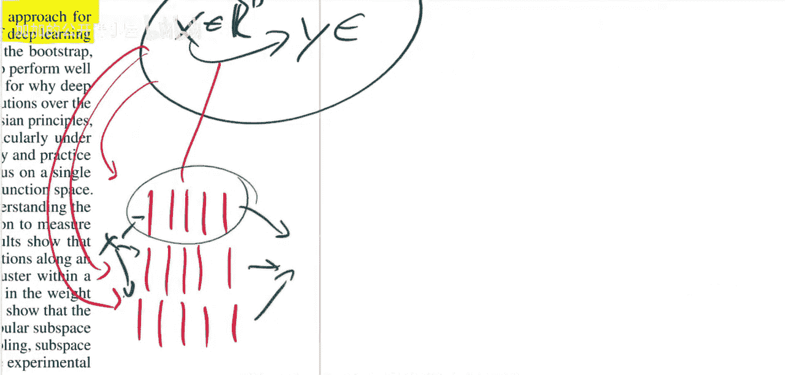

A generalizable function， and they have this drawing right here。Where it's a bit of a。

 you have to sort of think differently than you usually do。 So on the X axis。

 you have the space of solutions。 So imagine that your your neural network only has a single weight。

 So that this axis here is that single weight。 or you can projector or whatnot。

 this is the space of different solution。 So after you optimize， you land somewhere on this axis。

And you can see that there is a solid line which represents the accuracy on the training set。

And then there is a dash line which represents the accuracy of the validation set for a given parameter so what you usually do is you optimize one neural network to its very best training accuracy。

 so let's say you start off here。What you would do is you would see my training accuracy is this high。

 I need a different color right here， is this high and you calculate the gradient and you could do a gradient descent and that means you go down the loss up the accuracy so you go over and over and over until you reach this point right here where you have maximum training accuracy and then you'll suffer some generalization loss like you know so right here。

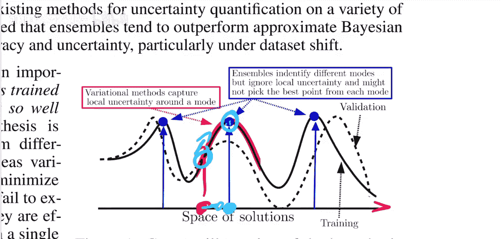

It software some generalizationless because the validation accuracy at that point isn't as high。

 but generally it's correlated， as you can see by the general overlap of these two lines of these two shapes right here。

Okay， so this is called a maximum a posteri estimate。

 you simply optimize one neural network until the best training error。

There are different approaches right here。 There are approaches that say， okay， we can do。

 we could do better。 So， first of all， what you see right here is rather peculiar。

 and you might not be used to this， that there are different peaks right here。

 There are different peaks。

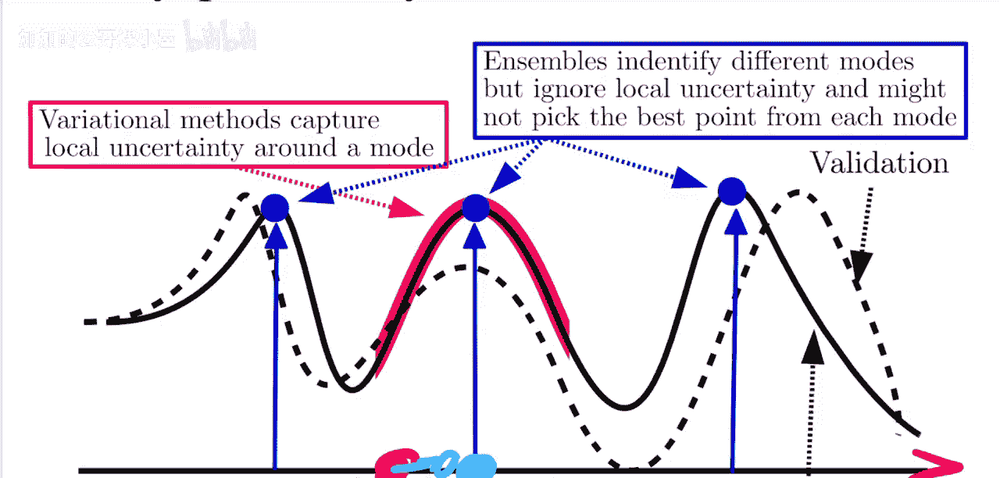

As you can see in the training and the validation error， so they're correlated。

The idea is that neural networks are very nonlinear and we've known from other papers that they have many。

 many local minima and in fact， so this is one of the astounding things about neural network。

 most of these minima are performing equally well。 so even though the neural network has different local minima。

 they all perform about equally well and other papers even say they're all sort of connected on a low loss landscape。

So there are many， many things that are still mysterious about neural network。

 but we know that there are multiple minima and we know that we basically need to find one of them and it doesn't really matter which one they all perform sort of equally well。

Now。As you can as you might imagine， there are people who aren't really satisfied with this and their approach is to say。

 why don't we just capture this entire curve right here？

So if we could build a model that could not only you know not only tell us at this point right here。

 you're this good， but could tell us that at any point right how good we are capture the entire distribution of solutions and these are usually in the category of the Bayesian neural networks。

 they try to capture the entire distribution， of course that's not really feasible because you know you always have to calculate that posterior。

So what they end up doing is they do some approximation and usually they do some sort of a multi-variate Gaussian approximation because you can calculate posteriors in closed form and so on。

 and this paper， this paper's hypothesis is that these can only usually capture one of these peaks so they are very able to capture the surrounding right here。

 they they can capture very accurately what happens around this particular peak。

 they are very aware of the shape of the curvature here and can tell you a lot of things about it so they can tell you。

 for example， that the validation so that you。

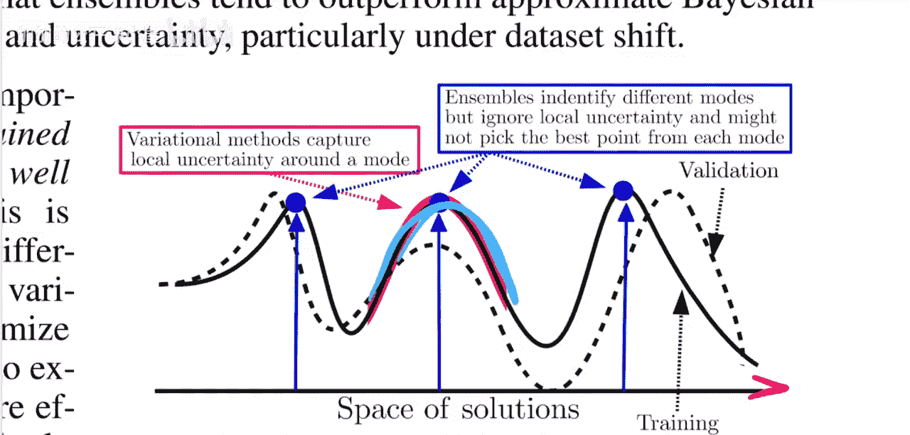

Might want to be a bit over here rather than over here。But they cannot。

 they don't generally know about these other modes because they are only approximations。

 they generally don't produce multimodal solutions。Another approach is a deep ensemble。Now。

 this paper shows that in general， if you train a deep ensemble。

 what will happen is because you randomly initialize the deep ensemble at some points。

 it will happen that if you do gradient descent on all of them。

 they will end up sort of covering all these different modes。 they still， they don't have an idea of。

 you know， the curvature sorry， this one shouldn't go here。 This one should go here。

 they don't really know about the curvature， but they will give you these different minima right here。

 and therefore they can capture the landscape much。

 much more easily if you know that these three are minima。

 you sort of it might look something like this。 And that's a hell of a lot better。

 then simply the bayesian approximation that only is able to capture one of the peaks。

 but really accurately。So their hypothesis here is that deep ensembles do this job of。

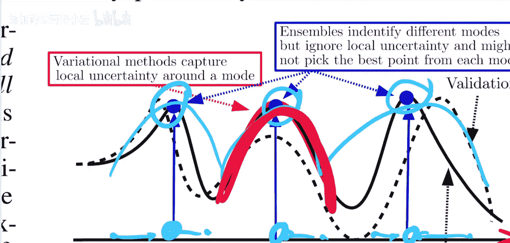