# YannicKilcher【中英⚡AI经典论文领读(全203篇)(上)｜Papers Explained】 p62 P78 [经典] 深度强化学习玩转雅达利游戏（论文解读） [BV1o3xLznExj_p62]

Hi there Today we'll look at playing Atari with Deep reinforcement learning by Vladimirni at All of Deep Mind。

 So this is another one of our series of impactful past papers this paper right here kicked off an entire revolution in reinforcement learning specifically it sort of started the deep reinforcement learning hype before that I reinforcement learning was kind of this weird field of Markov decision processes and so on I know there were successes and all and stuff was happening but this really made a lot of waves because it brought the power of deep neural networks to reinforcement learning and with a pretty simple application of convolutional networks managed to solve these reinforcement learning games where previous algorithms really couldn't either or were heavily reliant on hand engineer。

Features。So we'll take a look here and what people did back then。

 what was the state of the art and what they are telling us about that and kind of set it in relation to today。

Alright， if you do like papers like this commentary like this， share it out。

 leave a like and tell me in the comments what you think so let's dive in。

 they say we present the first deep learning model to successfully learn control policies directly from high dimensional sensory input using reinforcement learning。

The model is a convolutional neural network trained with a variant of Q learning。

 whose input is raw pixels and whose output is a value function estimating future rewards。

 We apply our method to 7 Atari to any 600 games from the arcade learning environment with no adjustment of the architecture or learning algorithm。

We find that it outperforms all approaches on six of the games and surpasses a human expert on three of them。

So there's a lot packed into this。 First of all， I wanted to recognize the absolute latex savagery right here and here。

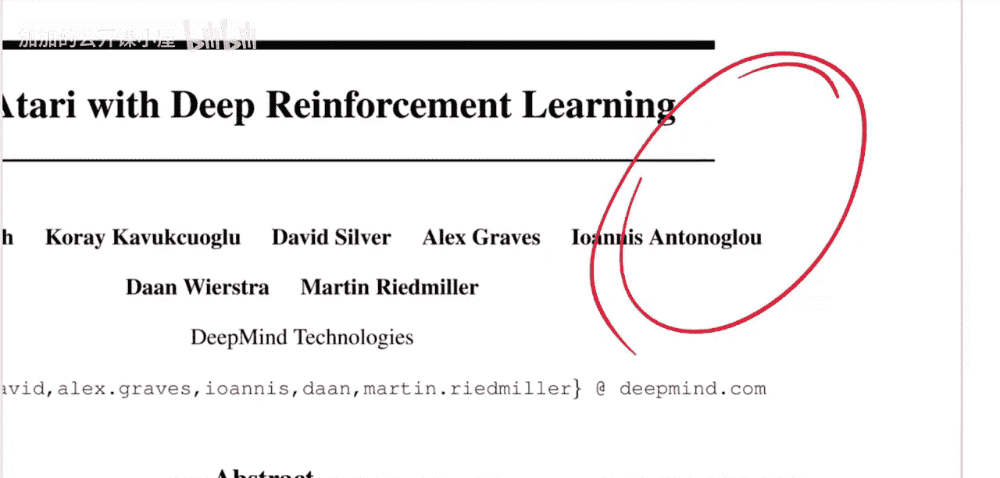

Yeah。You know， it's just just something。

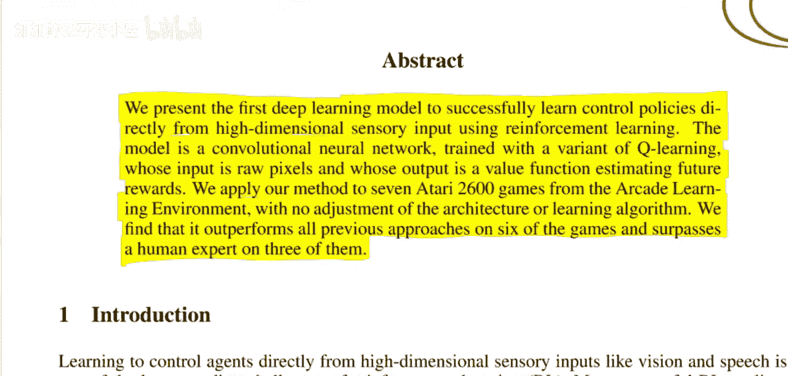

I'm'm not OCD about that kind of stuff， I think we should ditch lot tech honestly but。

So there's a lot of information packed in this abstract right here。

 So they say this is the first deep learning model to learn control policies。

 So that's the task of these reinforcement learning algorithms directly from high dimensional sensory input using using reinforcement learning。

 So what do they mean these are called learning environment。 if you don't know what it is。

 it's basically these old games right here。 you can kind of emulate them and run them。

 And the inputs are always sort of the same。 So you have one joystick I believe So you have kind of this joystick and it can go into various directions like left right up down and then also the intermediate directions and then you have a。

 I think also a button that you can push and that gives you a total of some somewhere around 16 or 20 actions in each of the games。

 So the good thing about this environment is that the actions are always the same。 but of course。

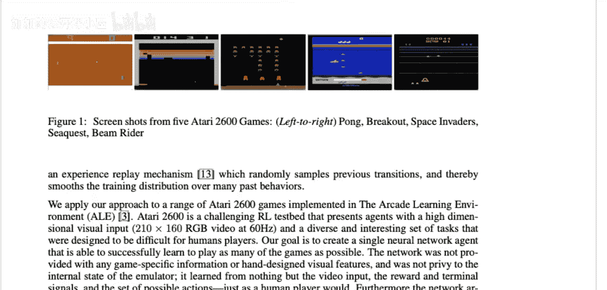

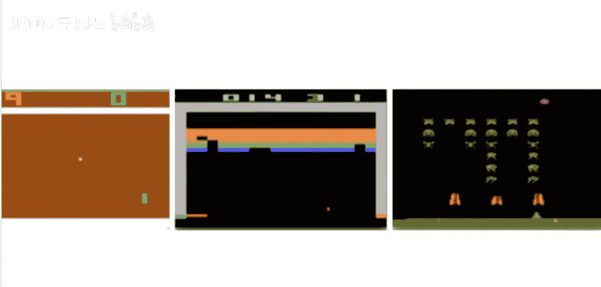

Me different things in different games。 So the games here， you know， for example。

 pg or this breakout。These games are kind of really low pixel games as you can see and they come in form of an image right so this is an image this is like 180 pixels and this is like 150 pixels and the task here is to learn a policy which means which buttons and directions you need to push depending on the observation right here。

 these pixels and achieve the maximum amount of reward so reward is given in each game differently as well for example。

 in this pg game the reward is every time you score kind of a goal against your opponent in breakout you get a reward every time you manage to hit or kill one of these blocks and so on so。

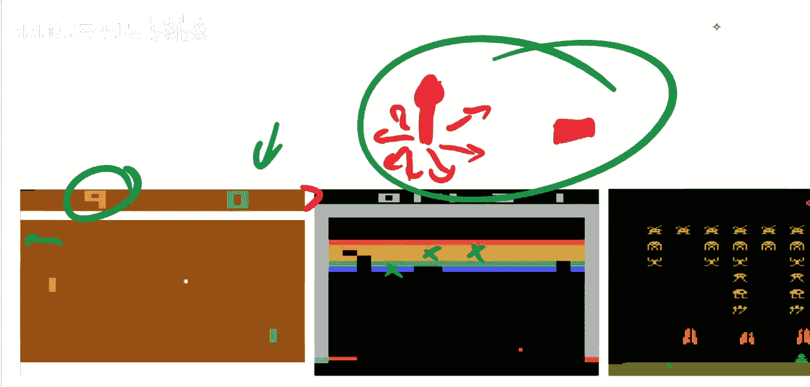

Reward is different， but your objective is always to maximize the reward in in a formal framework。

 you have an agent and an environment and the environment would always give you an observation which in this case。

 the observation is one of these images and the agent will give back an action So the action。

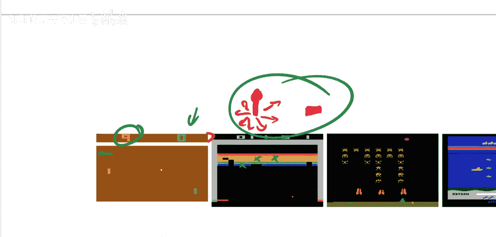

In this case， would be。The which button to press or which direction to move the joystick into。

 And then the environment would get back， give back a reward。 So the reward。

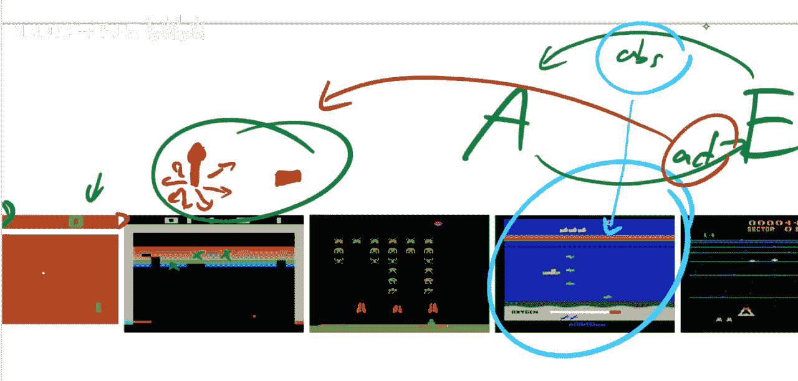

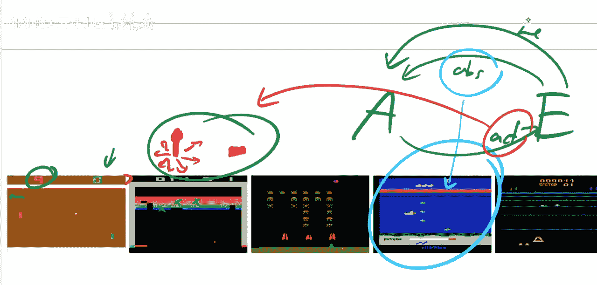

I could be， you know， it could be this。 you scored a goal。 So that's zero most of the time。

 and sometimes it's one or9， or it could be like how long you're alive and so on。 This is very。

 very variable。

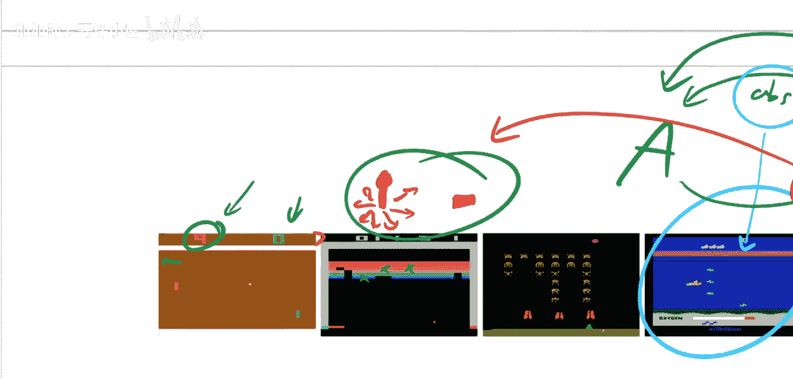

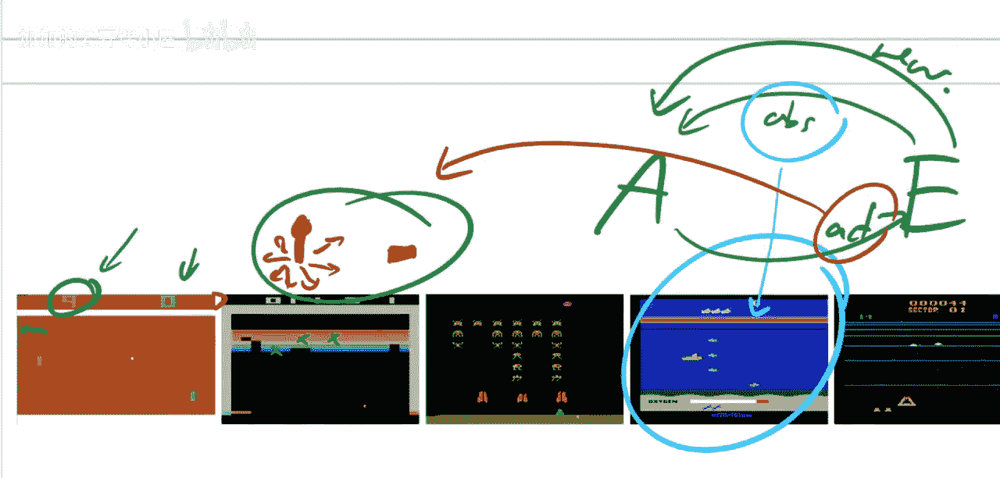

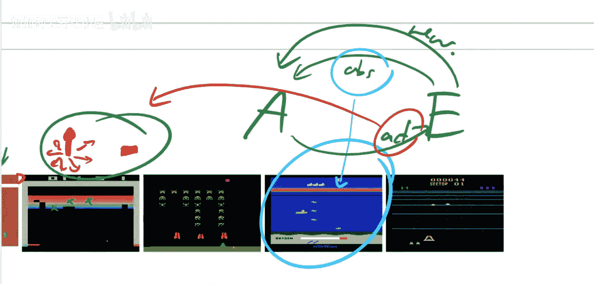

So the difficulty of reinforcement learning very often。Is that these episodes can go for a while。

 So this whole process here will repeat over time。 and this can go on for hundreds of steps or thousands of steps until you're done you know。

 playing a game like this like this right here。 And the reward can be very sparse。

 So you might only get a reward at the very end of the game。

 Sometimes most often in these games you get one in between。

 but still there can be multiple time steps where you don't have a reward。

 And your task is to figure out which of the actions where the good ones。

 This is known as the credit assignment problem。 And to do the credit assignment problem just from pixels alone。

 that was unheard of at the time this paper came out。

 That's why they say we are the first deep learning model to successfully learn。

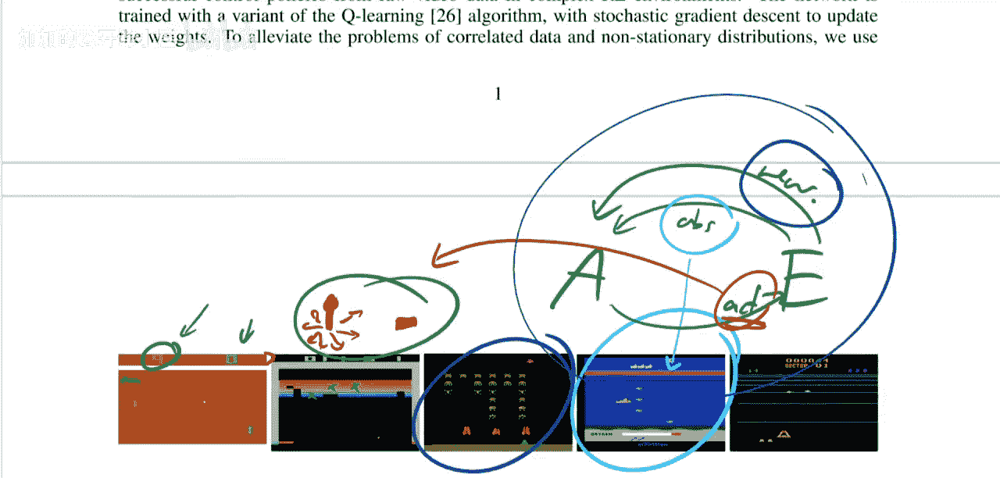

The directly from high dimensionional sensory input so the power of deep learning。

 they argue is that a deep neural network， a convolutional neural neural network。

 can extract these highlevel features by itself。 however。

 at this time people only knew that it could do so for supervised learning。

 basically for every input of an image。 you had a label and and that's how you train these convolutional neural network here it's very different here you'll get maybe1 thousand of those images and you'll simply say well。

 you got a score of 1100。

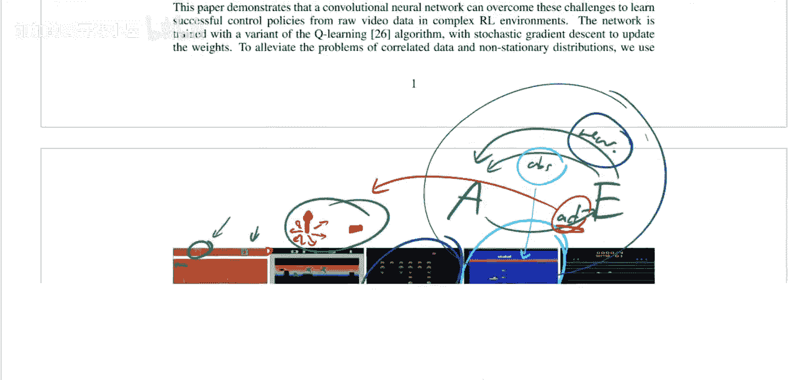

And somehow you need to figure out which ones of these were the ones that gave you the good score。

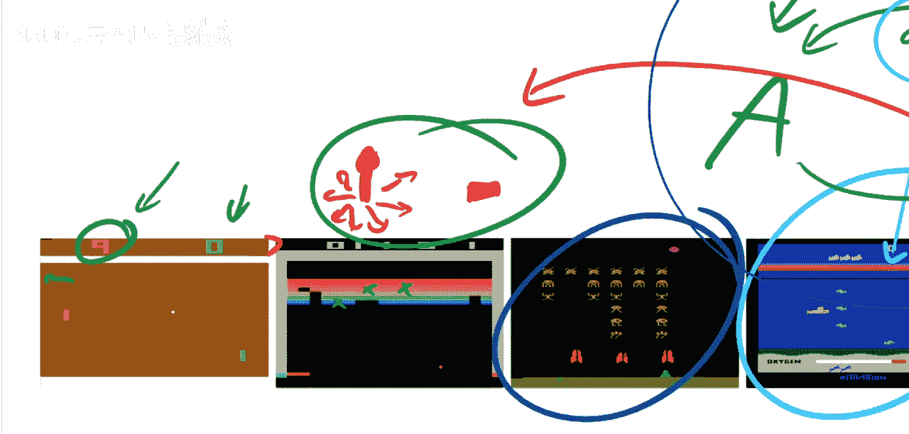

And how to generalize that。 So there are various difficulties here to apply convolutional neural networks to this problem。

 and they have detail right here how they did it。

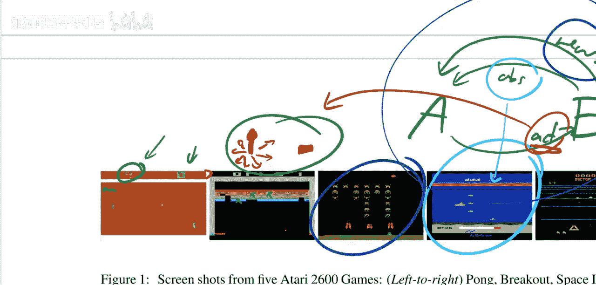

So they say the model is a convolutional neural network， which you know have been demonstrated。

 so this is after things like AlexNe， though before ResNe， trained with a variant of Q learning。

Whose input is raw pixels and whose output is a value function estimating the future。

 so we'll get into Q learning， Q learning is a reinforcement learning algorithm that has been around for a long time。

 but just not combined with deep neural networks。And yeah。

 then they say the last cool thing here is that they apply them to seven games with no adjustment of the architecture or learning algorithm。

 so they apply these same algorithm， the same hyperparameters to all of the seven games。

 and the model learns all of the seven games， not as a single model， but a seven different models。

 however， they all have the same hyperparameter， so they don't need to to tune them。

 which is an additional benefit， like this would have been a cool paper。

 even if they had to sort of tune the algorithm to each of the seven games。

 but you know they didn't which makes it even more impressive。

 It's kind of their point here that that these reinforcement。

 deep reinforcement learning can be some sort of a general learning mechanism。 Of course。

 you know later there has been like giant amount of development since this。

 and people have come up with all kinds of giant。

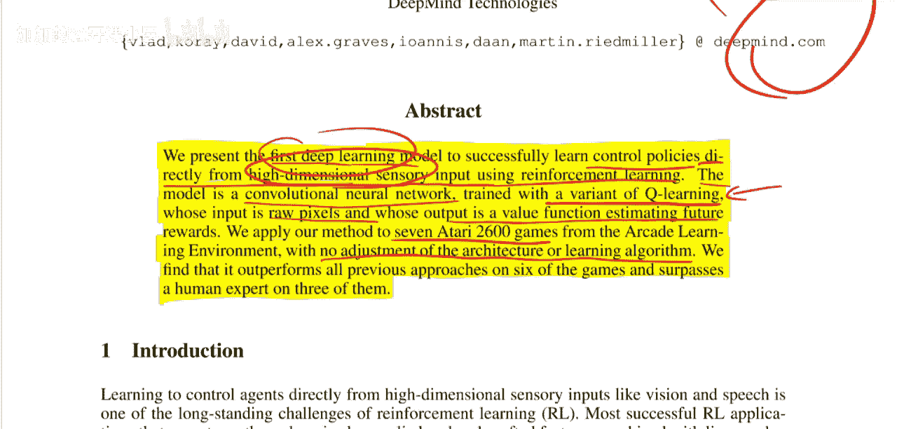

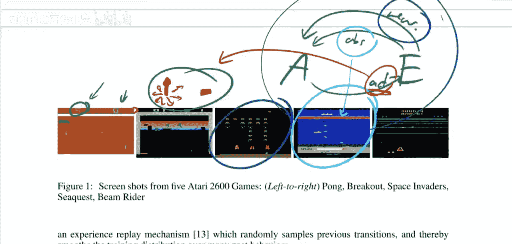

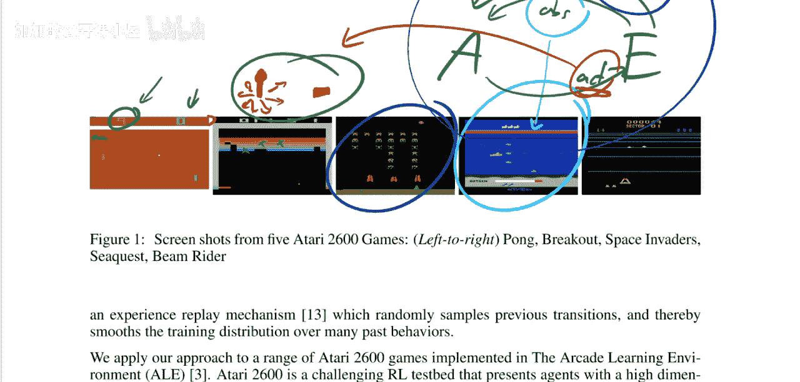

archrchitectures and whatever corrections of policy corrections seem to real continuous control this is。

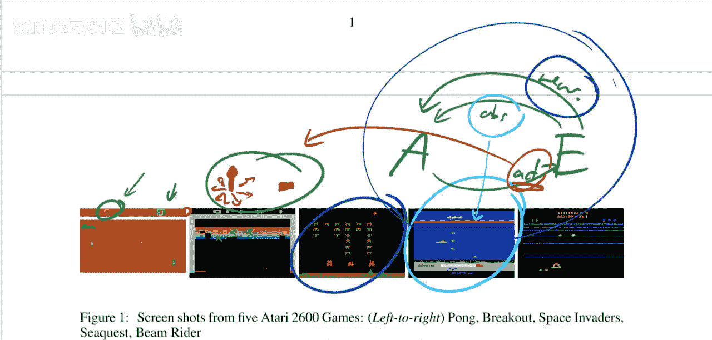

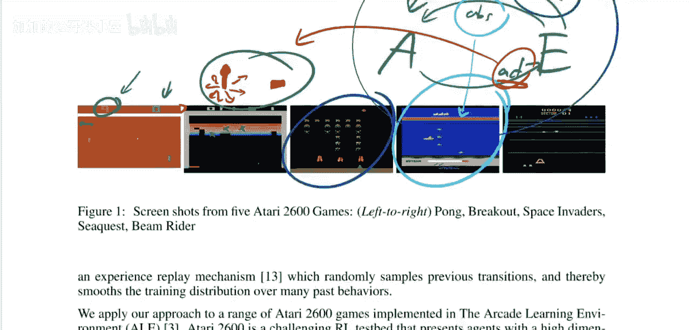

This is most of it is a derivation of this work right here and this work。

 it reads surprisingly simple， I have to say， and it's almost like they had little idea what problems were to to be tackled later in RL because it kind of reads like。

 you know， we have this thing and you can learn general things。 So yeah。

 that was we're we're still not done with reinforcement learning。 I I guess we， we've just started。😊。

Okay， so in a bit of more formal setting what you will have in reinforcement learning are these rewards right so at each time step you perform an you're in a state so we said you get back an observation and we call the observation the state Now these two things aren't a sorry these two things aren't entirely the same thing so the observation is what you get back directly from the environment and then the state it can be something more like if you remember something from the last observation that can be part of your state。

 the state is basically what you base your decision on。

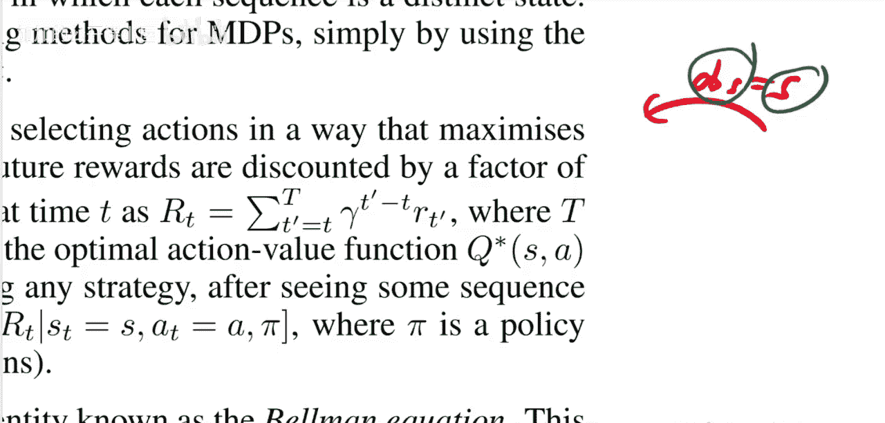