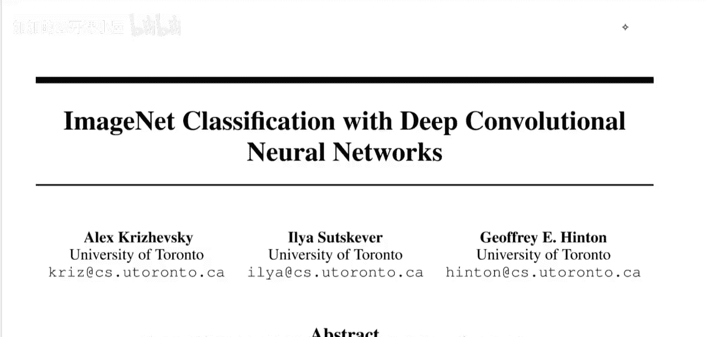
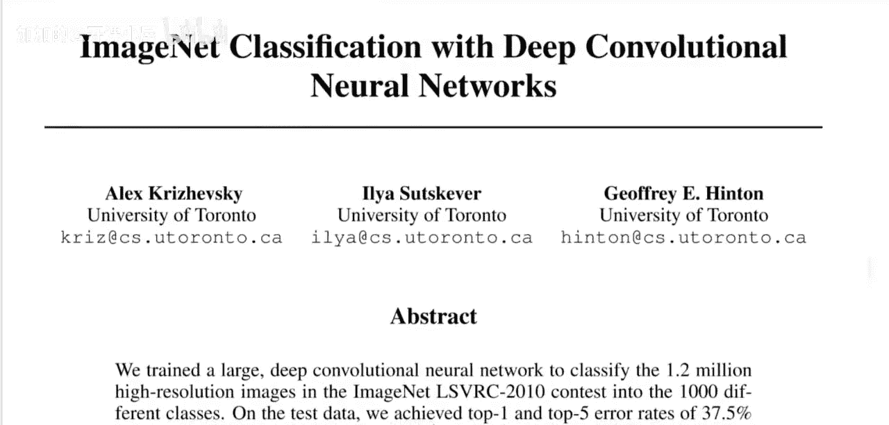
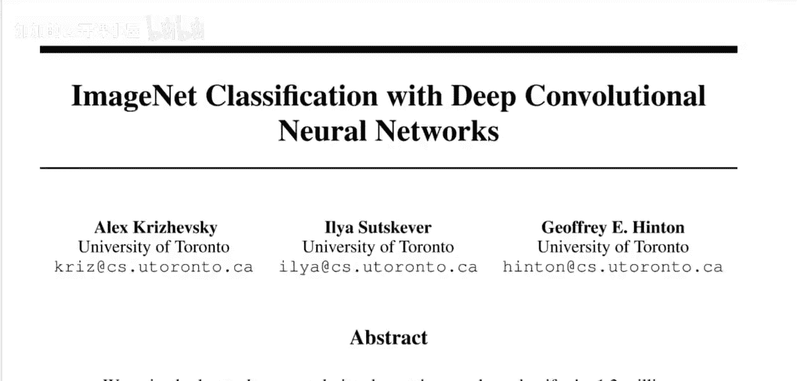
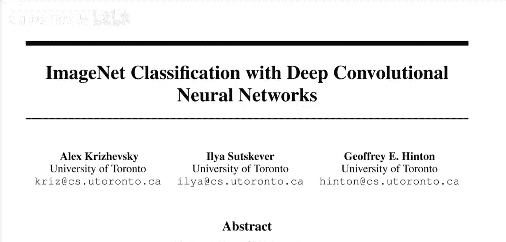

# YannicKilcher【中英⚡AI经典论文领读(全203篇)(上)｜Papers Explained】 p63 P80 [经典]使用深度卷积神经网络进行ImageNet分类（论文详解） [BV1o3xLznExj_p63]

Hi there。 Today， we'll look at imagenet classification with deep convolutional neural networks by Alex Krushevsky。

 Elilia Suskiver and Jeffrey E。 Hinton。 So this paper is another one in the installment of our historical paper overview where we go through kind of old papers that were or weren't very impactful and see what people knew at the time already how this developed and so on。

 Of course， this paper here also known as AlexNe was the one that started the deep learning revolution。

 so to say or at least contributed in large part to it。

 It was the first paper that showed that you could train these very deep neural networks and very deep in here is a。

Relative term。 but the first one that showed that you could actually use Kuda GPUs to train those large networks efficiently。

 and it won the imagenet competition that year， and it did so by a very。

 very large margin So kind of shook the world Because previously computer vision was still doing like hand engineered features and then using some kind of classifiers on top of those。

 This paper basically changed everything。 So we'll go through the paper and we'll see what was already known and especially I always enjoy with these papers。

 How did the choices that people make back then， how did they pull through to today sort of what arbitrary choices that Alex Kushevsky made right here are we still doing today and what have we learned since then。

😊。

So the paper is written relatively straightforward。

 I have to say it's a good read if you want to read it and you know。

 straightforward and sort of gives you a little bit of an intuition of how much work must have gone into this。

 which is I guess a lot and yeah so。😊，They start off by saying that。

That current approaches to object recognition make essential use of machine learning methods。

 This was also new right， Object recognition wasn't always learned。 the， you know。

 object recognizers， you could even do it in the indiffer way。

 like matching templates and so on machine learning。Was still one of the methods used。 And of course。

 today， it's the method used。To improve their performance， we can collect larger data sets。

 learn more powerful models， and use better techniques for preventing overfitting。Until recently。

 data sets of labeled images were relatively small on the orders of tens of thousands of images。

 so this， this especially at Nor or here the C for 10 or C for 100。

 these are relatively small data sets with relatively small images as well like C for 10 is 32 by 32 pixels。

So they're saying that okay in these small dataset sets。

 you know you can solve it with classical computer vision models。

 but if you have larger datas and especially more realistic datasets like bigger resolution and so on。

 you need bigger models they say but objects in realistic settings exhibit considerable variability to learn to recognize them it is necessary to use much larger training sets so they say that this imagenet dataset is one of those larger dataset sets consists of 15 million labeled high resolution images in over 22000 categories and people keep forgetting this and I included in that group of people that the imagenet dataset is actually much larger than we know when we talk of Inet when we speak of Inet。

 we think of the imagenet that has1000 classes and about one or one and a half million。In however。

 that's only a subset of the much， much larger imagenet data set in many， many more categories。

It's just that the Inet competitions were performed on this subset because I guess people， well。

1 thousand0 classes and million images is already plenty。 so we'll do that。So that's。

 I guess how that came to be。So their argument is right here to learn about thousands of objects from millions of images we need a model with a large learning capacity。

 however， the immense complexity of object recognition task means that this this problem cannot be specified even by a data set as large as imagenet。

 so our model should also have lots of prior knowledge to compensate for all the data we don't have。

So their， their， their main argument for using neural networks is that the size of the data set is so large。

 Therefore， we need a large model， you know， granted， they already recognize the。The inherent。

 the inherent connection between large models and a lot of complex data。 But in the the opposite。

 they say， well， even if we have that much data。 The task we are trying to solve object recognition is way more complicated than the amount of data we have。

 So our model should also have lots of prior knowledge to compensate for all the data we don't have。

 Remember at this time， convolutional neural networks weren't really you know， known to do anything。

 I guess I guess they were used for handwritten digit recognition and so on and were kind of on par with other methods。

 However， it wasn't like obviously clear that you would use them for image recognition。

 So here they make， they have to make like a a argument to convince people that。Okay。

 we can use neural networks for these tasks because they have such a high capacity。 How however。

 neural networks feet forward neural networks are already too powerful。

 They don't know anything about the data。 everything' is connected to everything。

 and they argue right here。 Our model should have lots of prior knowledge to compensate for all the data we don't have。

 So they allude to the convolutional neural networks constitute one such class of models。

 Their capacity can be controlled by varying the depth and breadth。

 and they also make strong and mostly correct assumptions about the nature of images。

 namely stationity of statistics and locality of pixel dependencies。

 So the their argument here is that the convolutional operation。

It's such a strong prior that is mostly consistent with what we know about images that they are very well suited to computer vision。

 again， something that was not abundantly clear at the time as it is right now。

 it's interesting to see how they get to this point where they say we need lots of capacity but we also need a model with lots of prior knowledge and of course CNNNs fit that very well。

So。they go into the problems of CNN， despite the attractive qualities and despite the relative efficiency of their local architecture。

 they are prohibitively expensive to apply in large scale high resolution images。Luckiily。

 current GPU is paired with a highly optimized implementation of 2D convolution are powerful enough to facilitate the training of interestingly large CNNs and recent data sets such as imagenet contain enough labeled example to train such model without severe overfitting。

 so overfitting was also still like very much at the forefront of people's minds back then right now。

 we don't really care about overfitting that much anymore。

 Basically we figured out that if we just build large enough models， we don't overfit。

 which is strange in itself like this double descent phenomenon and so on but。

Overfitting was still a， a very much at the forefront of the people's minds。

 And they do a lot of things here to prevent overfitting， which。

Gives them kind of a boost in the test accuracy， which might actually not have been the overfitting that they're combating。

 So they do， for example， data augmentation already in this paper。

 And they always allude to this is to prevent overfitting。 However， we know。

 nowadays that it might not be the overfitting that's combated in the by data augmentation。

 it might actually be more have something to do with like regularizing your function。

 making it more smooth and so on。 but。So you， you just see how。

 how coming from a classical machine learning perspective。

 overfitting was like the number one or one of the number one problems in classical machine learning。

 you know， in SVMs and things like this。 so it's， it's。

It's safe to say that they thought if we built these large models。

 we're going to have a huge overfitting problem。 And yeah。

 so that's why this pulls through right here。 also the。

I guess one of the main contributions of these papers is to show to combine this CNN training with GPUus。

 also not very non clear at the time， like it was known that you could do computation on GPUs。

 but the fact that these are very capable for training these the CNNNs or generally neural networks wasn't something that was you know known at the time。

 so this paper basically show that if you use a GPU， you can you can get that much faster。

And that makes it possible to train these big neural networks。Again， right here。

 the size of our network made overfi。