# YannicKilcher【中英⚡AI经典论文领读(全203篇)(上)｜Papers Explained】 p64 P81 [经典] 生成对抗网络（论文精讲） [BV1o3xLznExj_p64]

Hi there。 Today， we'll look at generative adversarial nets by E And J。 Goodfellow at Al。

 So this one is another installment in our series of historical papers that had great impact。

 Gs nowadays or general generative adversarial nets back then were sort of This was a starting shot in a long line of research that is still continuing today。

 So I remember when I started my PhD in 2015。 Gs were just about spiking。

 I remember Nipps or back then nips in 2016 and every other paper was about Gs。

 It was there was also this famous Schmidhober Goodfellow moment at the tutorial。😊。

It was it was a wild time and this is the paper that started it all and the paper is quite well written。

 it's very kind of focused on convincing you that this is a sound method mathematically that it does do you know that it doesn't just do wild things and also it is already quite has a lot of the it has a lot of sort of the modern tricks for Gs already sort of built into it so astounding how how much foresight there was already in this paper but of course Gs have come like a super long way since then and today we'll just go through the paper and look at how it looked back then and what this paper was like so yeah join me in this if you like it and please share it out。

 let me know in the comments what you think of historic paper reviews this is not going to be like a beginner's tutorial。

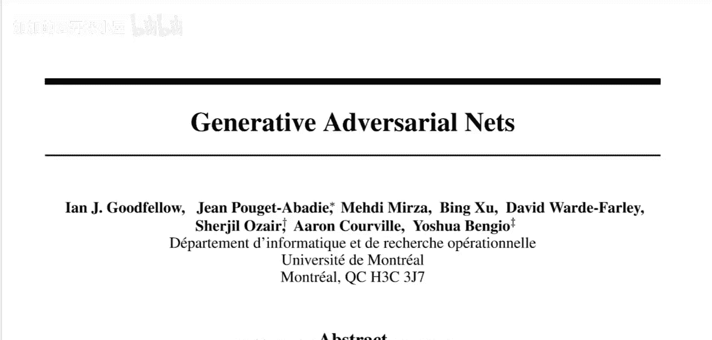

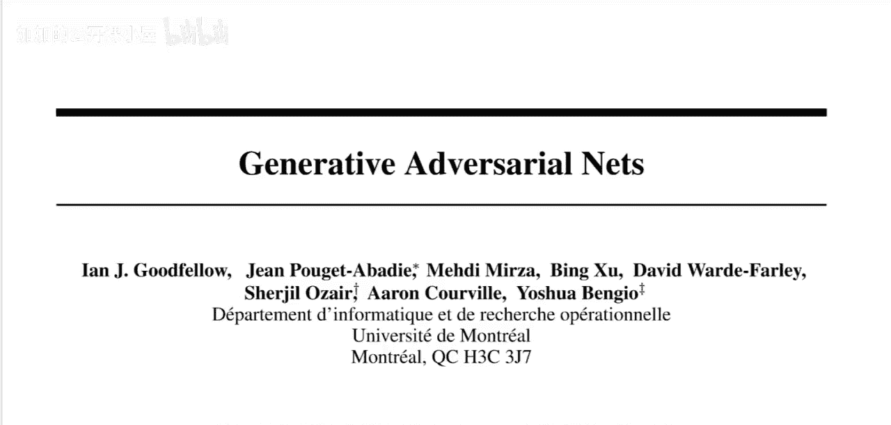

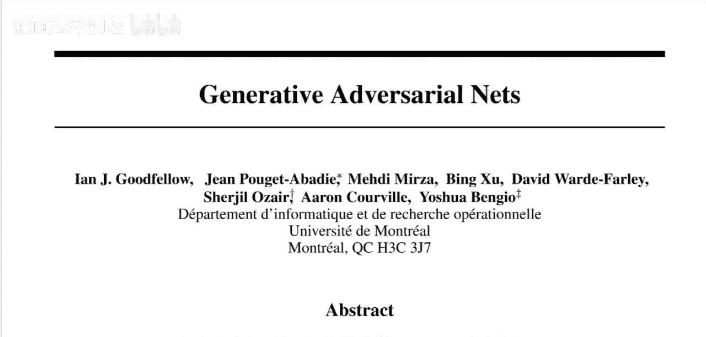

Gans this is really going to be， we'll go through the paper。 youll see right here。

 the paper is from 2014。So it would still be another like two years or so until GNs really take off from this point on。

 but the introduction of course， was really important。

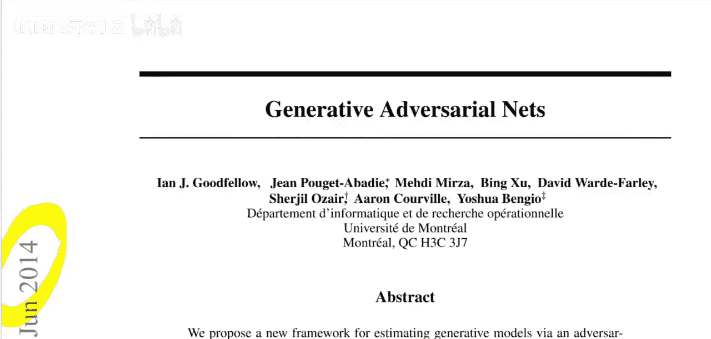

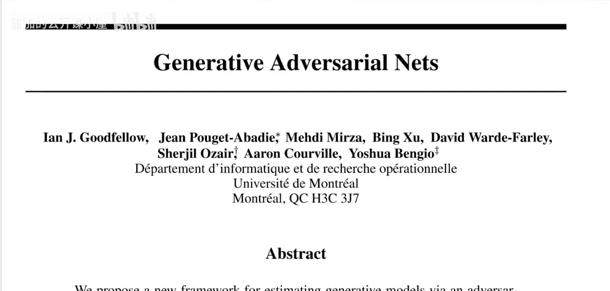

Okay， so。Abstract here we go。 We propose a new framework for estimating generative models via an adversarial process in which we simultaneously train two models。

 a generative model G that captures the data distribution and a discriminative model D that estimates the probability that a sample came from the training data rather than G。

Okay， this was sort of a new thing。 Now， I know。 I know people disagree with this being a new thing。

 but this was a new thing and。Specifically， this was the first paper that made something like this really work for data。

 so to have a discriminator the and the words generator and discriminator were also introduced in this paper so you train this D model which is the discriminator and the D model basically decides whether or not a given data point comes from data。

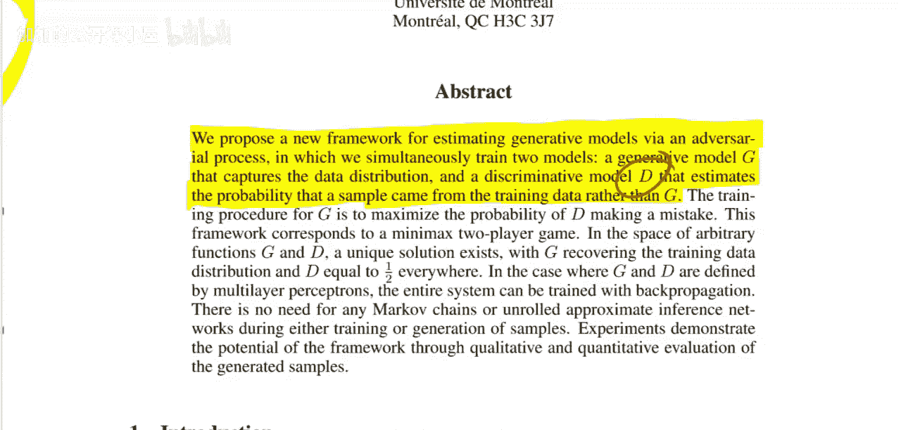

Or comes from the fake distribution and then you have a generative model G that is supposed to just create this data X rather than coming from the database so you want to sample a couple of times from the data and sometimes you sample from this model G and then the discriminator is supposed to decide whether or not it comes from the data or from your count from your counterfeiter like from it is generator G。

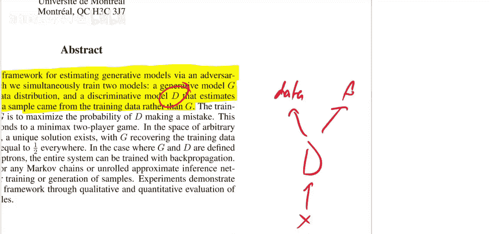

And it's supposed to say whether it's data fix。 So you train the D model as a simple image classifier。

 So people already knew how to build image classifiers。

 was this was shortly as you can see before Resnets came on the scene So people already kind of knew how to build CNs build really good image classifiers and the thought here was really generative models weren't really a thing until then。

 So people were in language models were toV was kind of coming up。

 but they were would still be doing like RnNs using these word to V vectors for generating language in images generative models weren't really much of a thing so you would do like compositional models or you would do autoencoders which were just either really blurry or really。

 really artfactory and there were also approaches like Dbelief networks and so on but。

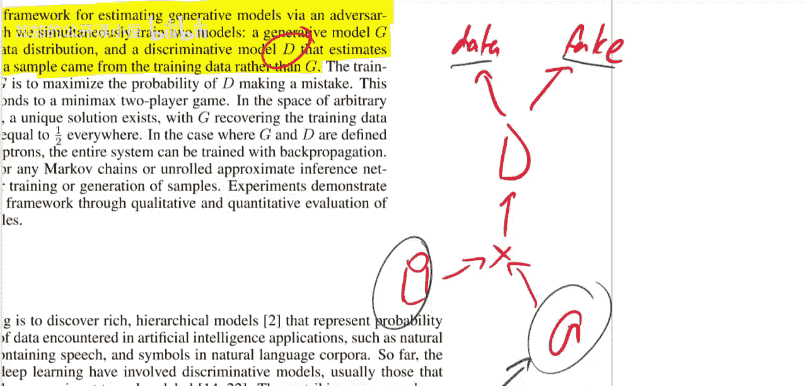

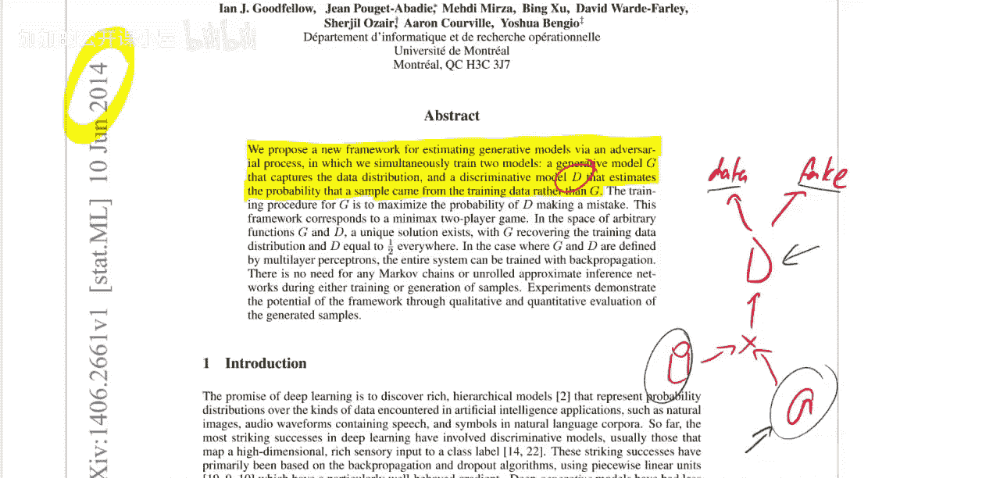

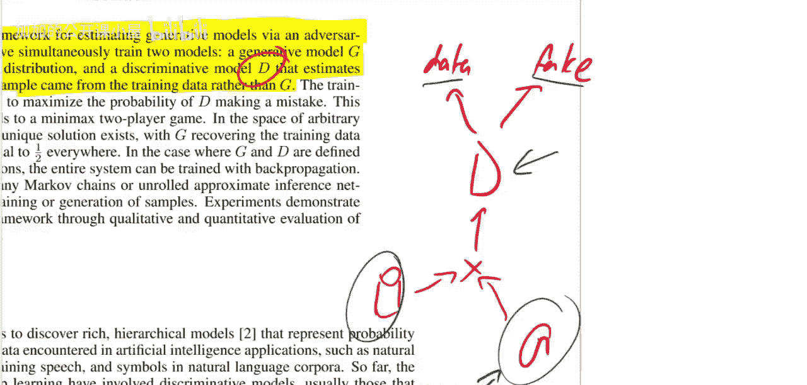

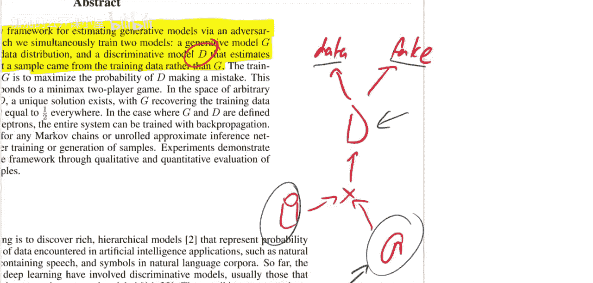

Ha their own problems。 So there wasn't really a satisfactory way to do image generation that resulted in really high quality images。

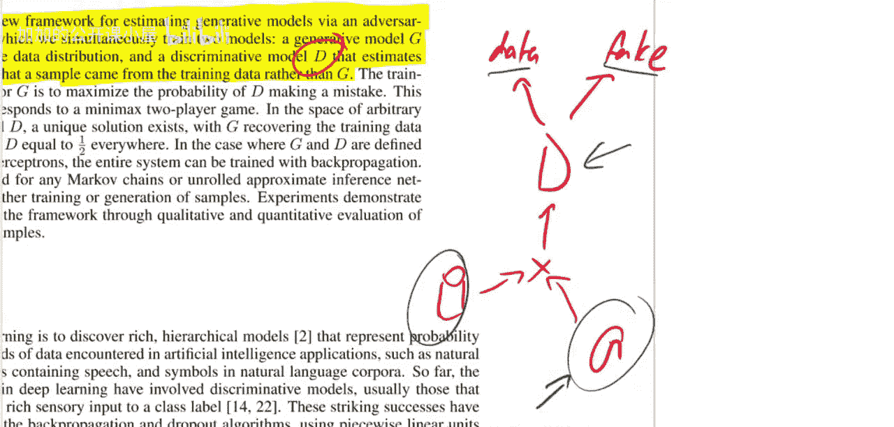

Now， here， I think the entire thought。 and this is not really spelled out。

 but the entire thought here is that， hey， we know how to train really。

 really good image classifiers right， this has been evident in these since Alexnet。 So for two years。

 this was evident how to build really good image classifiers。

 And the question here is to say that rather than also building really good generators。

 Can't we like harness the power of building really good classifiers for training and generator right And this this is this idea right here。

 This wasn't the one before， as you know， in like an autoencoder。

 what you do is you'd input a sample into some kind of auto bottleneck thing， whatever。

 and then at the end you train your output sample to match the input sample as close as possible。

 And then in here after you've trained this， this part here is your generative model。

 And then here in here， you'd input。

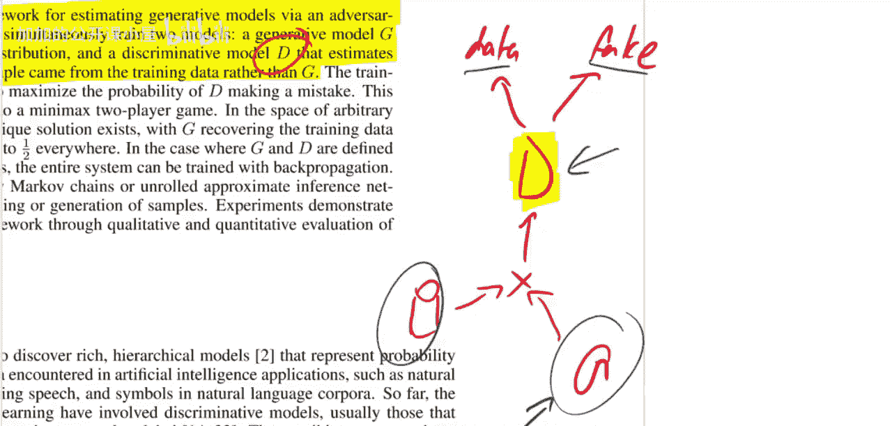

Like MCMC sampler or whatnot。 And then， of course， variational auto encoders came up。And so on。

 But still what you always would do is you would somehow use the data directly。

 So this is data in order to train your model。 So you would somehow say the output here should probably match the input in some way or in some at least distributional way this was a new thing。

 as you can see right here， there is no direct connection between the data and the generator。

 And I think this this was the success of this model。

 The fact that the generator did not wasn't trained from the data like you would do if you were just approaching this problem。

 but the philosophy here is let's use the power of discriminative models which we know how to build in order to train this generator So the generator's task now isn't to match any sort of data point。

 The generator's task is to produce images that the discriminator would classify as data and you can do。

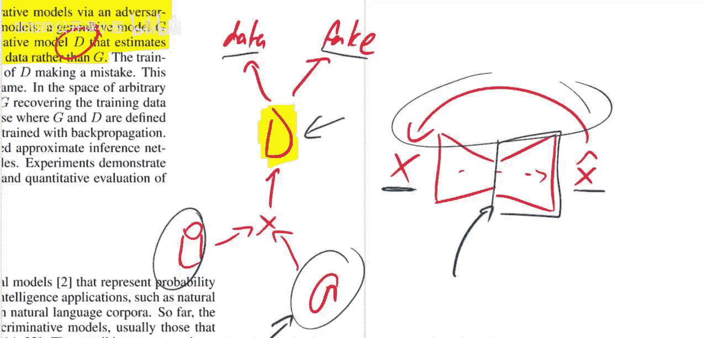

By simply back propagating through the discriminator to the generator。Okay， so。

I think that that's the only thing that's kind of unstated in this paper。

 the reasoning behind why this is new， why this might work。

 but everything else is spelled out very well in this paper， I have to say if you read through it so。

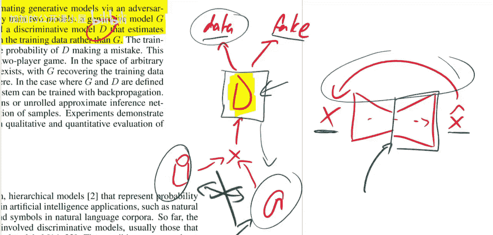

The training procedure for G is to maximize the probability of D making a mistake。

This framework corresponds to a mini max two player game。 So as I said。

 the paper is very much focused on convincing you that there's something sound happening here because at that time。

 if you were to look at this， you would say something like there is no way， right。 is。

 you would be like， yeah。So， so I can understand the motivation here to really convince people that。

 you know， something， something good is happening also on the on the theoretical side。

In the space in the space of arbitrary functions。G and D。

 a unique solution exists with G recovering the training data distribution D equals to12 everywhere in the case where G and D are defined by multilayer perceptionceptrons。

 the entire system can be trained with back propagation。

 there is no need for any Markov chains or unrolled approximate inference networks during either training or generation of samples。

Okay， so the point here is that it's much easier than current methods of of producing of generative models。

 and also it does something sound。Now。Let's jump into the loss function right here。 So they say。

G and D play the following two player mini Maxax game with value function V。

 and this is you know still understood until today。

That it was already like if if this was a pure engineering paper。

 they could simply build the architecture and say， oh。

 we let these networks fight and they they are kind of adversarial and they they pump each other up and so on。

 and and this here was more much more into the direction of kind of a theoretical reasoning into why something like this would work。

 Of course， there is still a lot of engineering going on to actually make it work so。

have there is this value function right here okay and the value function is the following so what you have is you have the log probability of data。

And you have one the log one minus d of the generated samples。 So here you can see。

 and this was introduced。 This seems also obvious now， right。

 but you have a prior on what this is called the noise distribution。 Okay。

 so you have a prior on your input noise to degenerate。

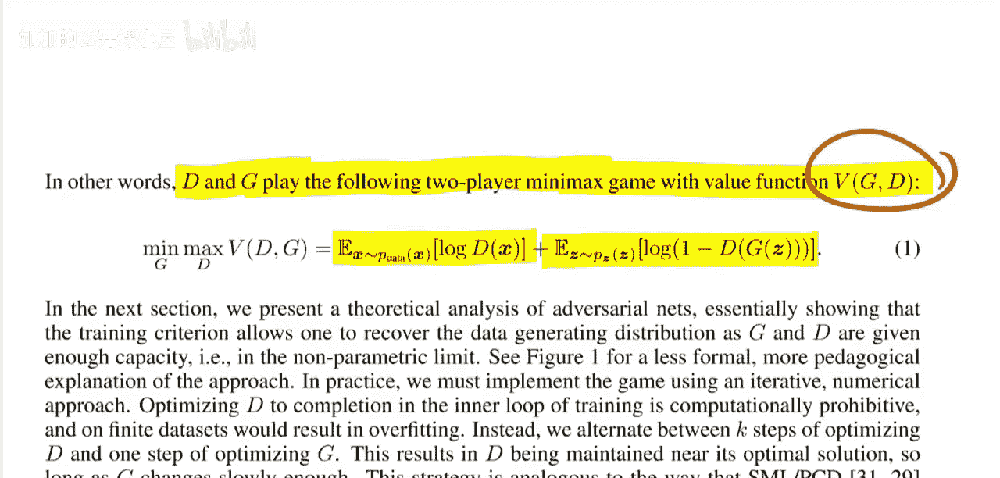

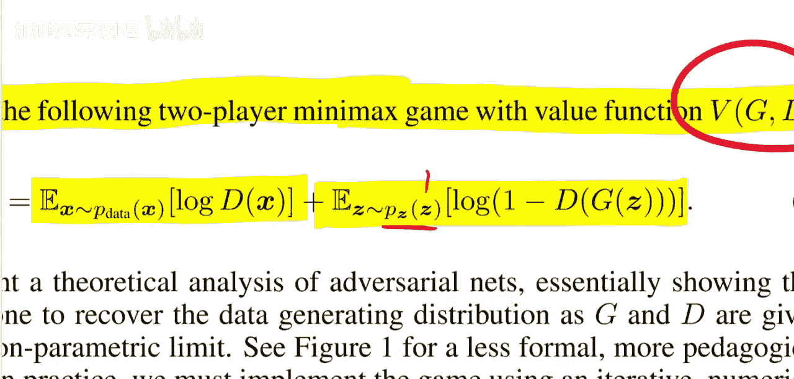