# YannicKilcher【中英⚡AI经典论文领读(全203篇)(上)｜Papers Explained】 p66 P85 [经典] 用于图像识别的深度残差学习（论文解读） [BV1o3xLznExj_p66]

Hi there。 Today， we'll look at deep residual learning for image recognition by Kaiming he Xiang Yu Chang Shaoqing Ren and Jan So。

 So this， you know it， this is an old paper。 it is from 2015。

 but I thought we'd still look at it because this not only is it one of the most influential papers in modern deep learning。

 It is also a very well written paper。 And I remember it like it was yesterday when this came out。

 This was like a bomb。 So around that time， this meme was going around。😊。

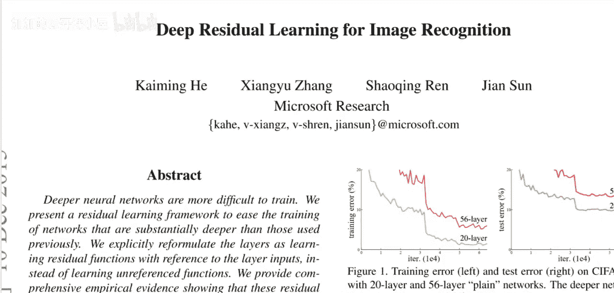

I was winning image net， but then someone made a deeper net。

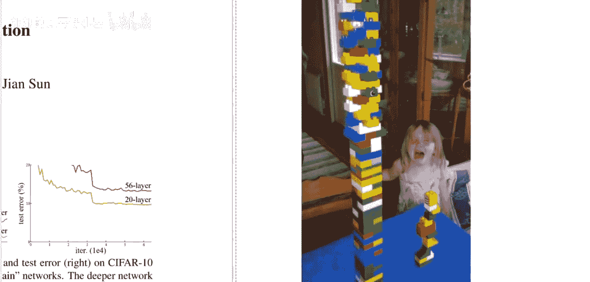

This this was this was at the time when after Alex and that people were trying to build bigger and bigger networks and every time someone managed to build a bigger network。

 the accuracy on imagenet data would increase pretty much in lockstep with how much bigger the network was。

 but people got to the limit of building bigger networks and then this paper drops and changed everything and now residual connections are everywhere。

 not only in image recognition， they are in transformers， they are in whatever wherever you go。

 you'll probably find some residual connections somewhere in there。So， yeah， let's。

 let's look at this paper and let's revisit what kind of problems people had then and how they solved it so。

Here they go directly into into this problem of deep neural networks and the problem that people had was they knew that if you can increase the if you can increase the depth of a neural network you can make it perform better。

 you can make a generalize better， you can reach lower training loss。

 but optimizing it was hard specifically this was a phenomenon that people observed。

 So if you have a 20 layer neural network， you could train it and you know there is this learning rate drop。

 people have had already figured out that you need to drop the learning rate and。

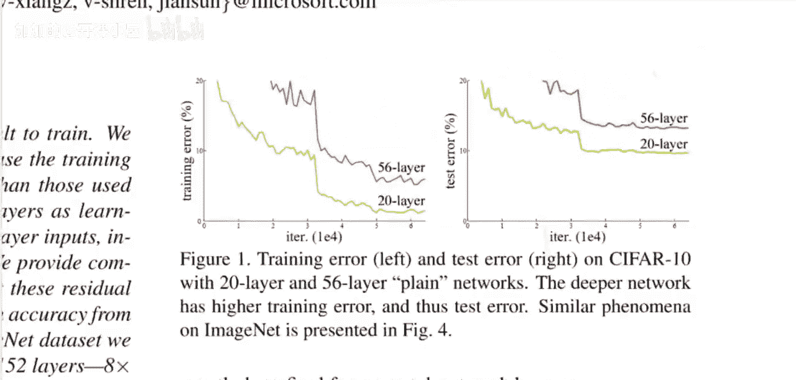

It would reach a certain level and here this would be the test error over here， however。

 if after a certain point， if they increase the depth even more。

 the training error would actually go up again and so would the test error and this is not a problem of overfitting because overfitting would be when the training error is lower or as low and then the test error went up。

So this is the first thing。 This is not a phenomenon of overfitting of too many parameters。

 So why can't we train bigger layers Networks until that time have very much followed kind of the original network design that was envisioned by sort of people like Jan La and also Alexnet and the most popular ones where these VG G nets and they were very much of the philosophy that you'd have like some you have the image here and you input that into。

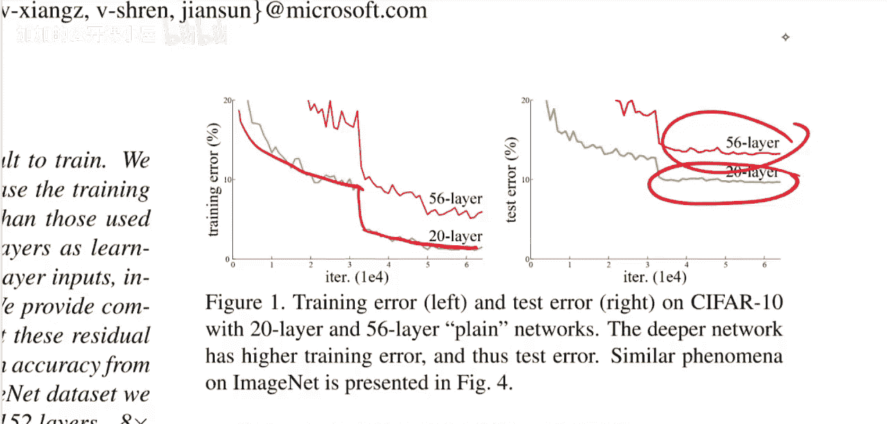

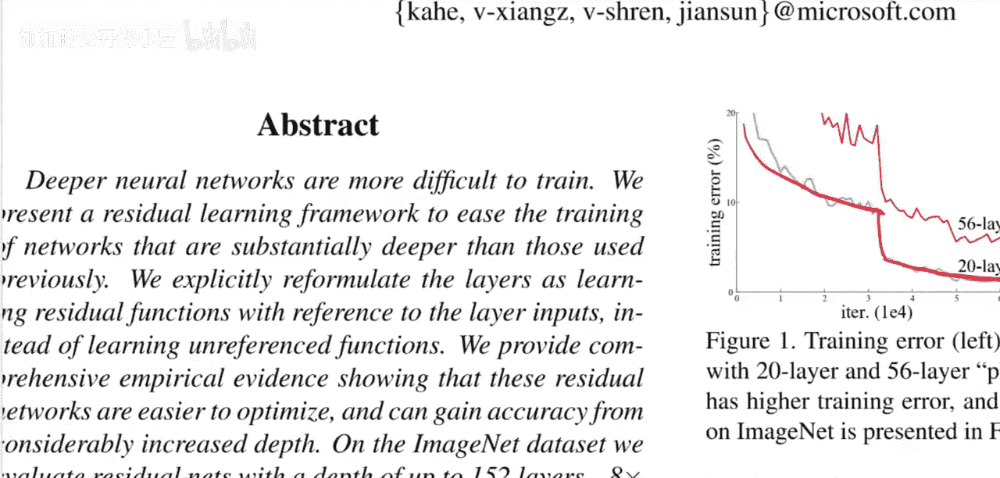

Into convolutional layers， which first would kind of keep a big resolution， but。

Would increase the channel size by， you know， some amount。

 And then you would sort of downscale the image as you increase the number of filters。

 So you would stack more and more filters draw more filters。

 you would stack more and more filters while downcal the resolution of the image。

 The reasoning was that if you do image classification， right， then you know， where on this。

 where on this， maybe you want to classify this into a Lego tower or whatever that is。

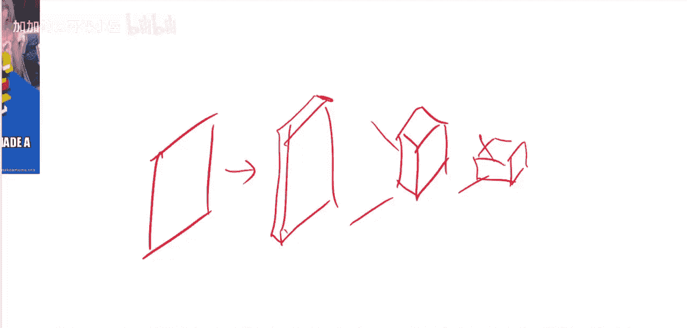

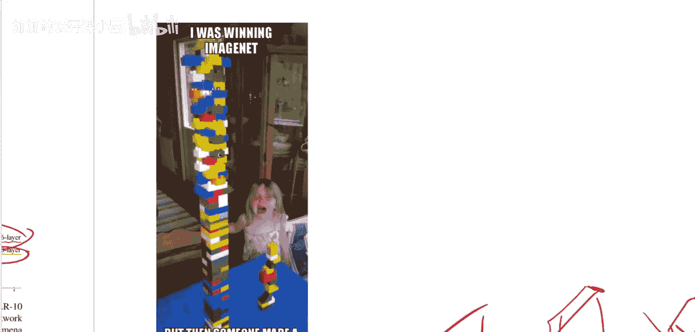

It's not that important where it is。 So on the lower levels you would want to parse out like very low layer features like edges and so on。

 and these are still important where they are， the fact that here's an edge， here's an edge。

 here's an edge but then as you go higher up and go to more and more abstractive features and we already knew that these neural network they tend to learn more and more abstract features as you go up the layers。

 the hypothesis was that the exact localization of these abstract features would be less and less important So if if you recognize that there's a rectangle it's not that important where it is just that it's somewhere there and maybe where it is in relation to the others。

 So if you have if you recognize want to recognize a car the lower layers would recognize the fact that there are edges and then the intermediate layers would recognize the geometric shapes of maybe here the wheels and these bodies but it's not。

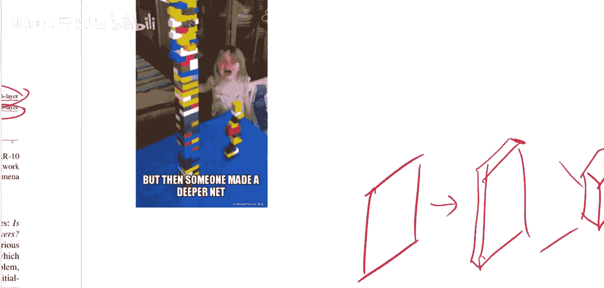

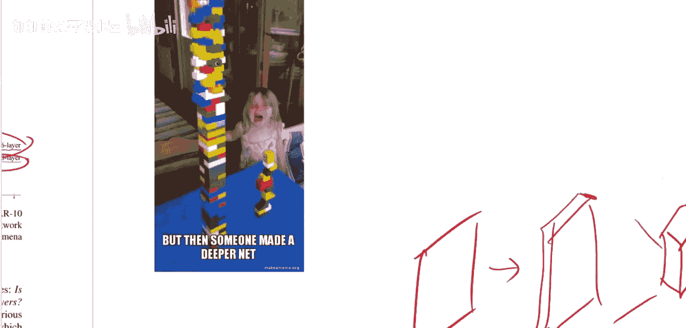

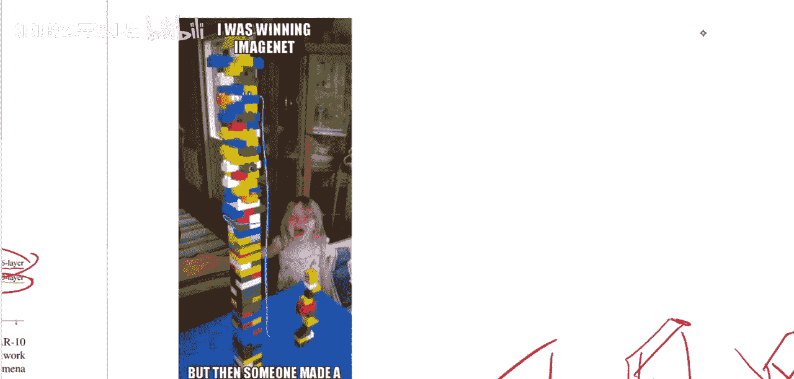

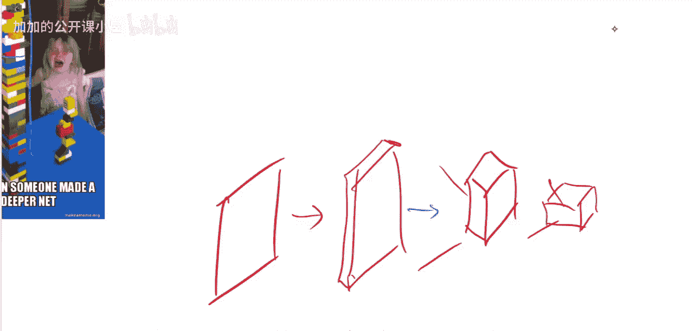

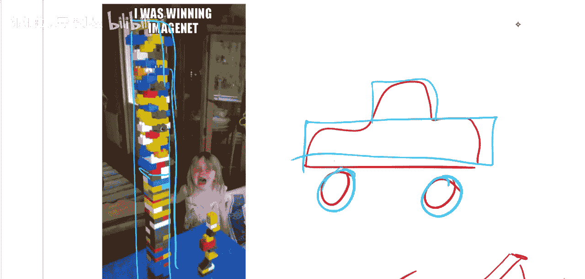

Important where exactly they are， and then the higher layers would learn to combine the individual parts to each other。

And again。It becomeses less and less important where these things are。

And more and more important that you build more expressive features。

 So people would downscale the resolution， upscale the number of filters。 Now。

 that's a good heuristic。 but this was basically the architecture of these networks。

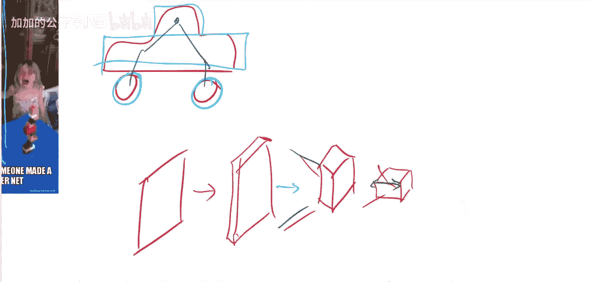

And we would question why would if we increase the number of layers， so if we instead of one here。

 we have two of these layers， right we simply have two of these layers and here we have two of these layers why。

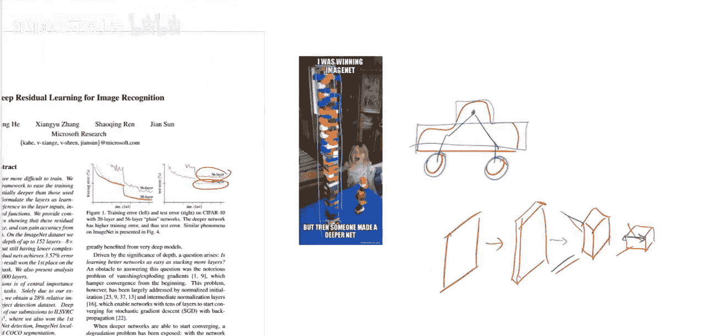

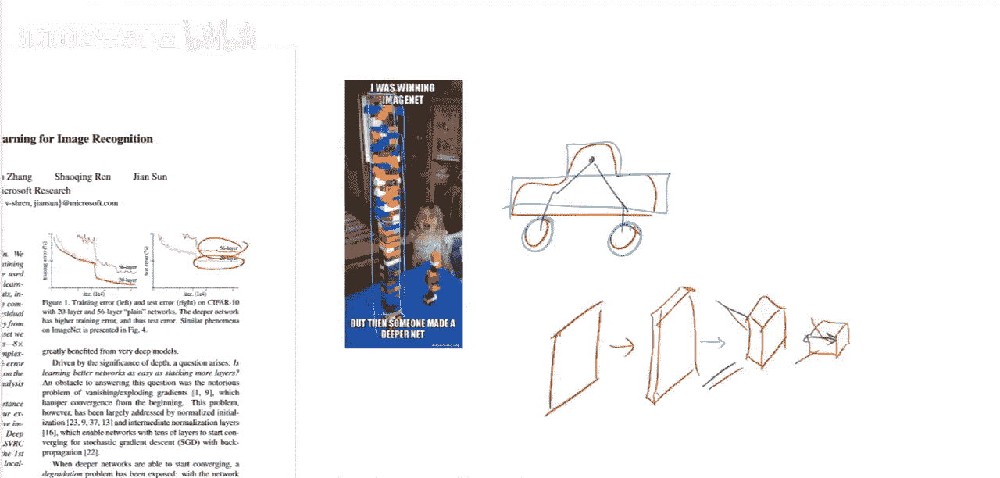

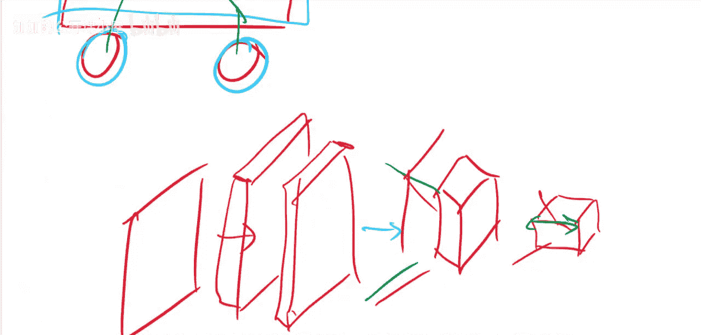

Does it get worse？Especially this paper here makes an interesting observation。

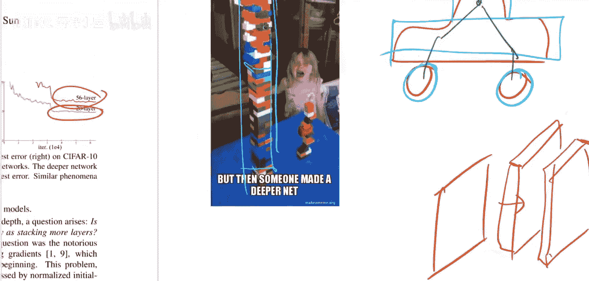

So it is not caused caused by overfitting。And adding more layers leads to a higher training error。

The degradation indicates that is not all systems are similarly easy to optimize。

 let us consider a shallower architecture and a deeper counterpart that adds more layers onto it。

There exists a solution by construction to the deeper model。

 The added layers are identity mapping and the other layers are copied from the learned shallower model。

 so pretty easy if you have a shallow model。Like five layers that learns a particular function。

 I can pretty easily prove that there is a deep model that learns the same function by simply copying over these five layers。

And having these here learn the identity function Okay so if we are able to learn this。

 we should be able to train this network to at least the same accuracy。

 that's what this paper argues， because it can you know these layers can simply learn the identity function so it must have something to do with the easiness of optimizing these deep architectures。

 not with overfitting。

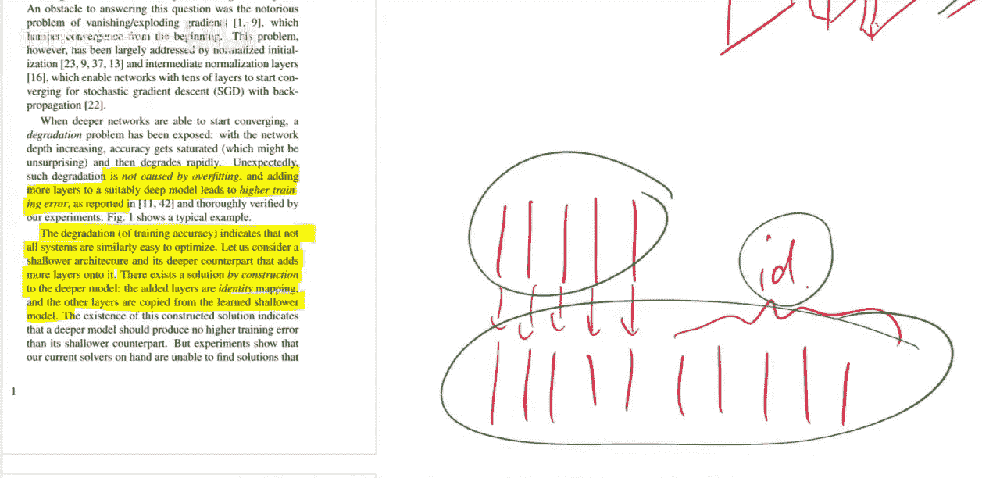

This is I think if you read the entire text here， it's very， very clear if you read it。

 they lead you through this reasoning saying that look all these layers have to do is learn the identity function and then we could at least get the same accuracy so so。

😊，Why don't they learn the identity function Well， because we initialize most weights you know towards0。

 we initialize them randomly， but mostly we initialize them around 0。

 our initialization procedure usually sample from some Gaussian with some kind of a standard deviation。

 but around the mean of0。And also if we use things like weight decay， L2 regularization。

 all of these things they do they bias the weights towards zero。

 so if there is any natural thing that these networks are good at is they learn the zero function really well learning the identity function is as difficult as learning any other function。

 the identity function， convolutional filter is actually pretty difficult to learn。Because you know。

 if I have a my， if I have my three by three filter。

 whereas my nope nope this if I have my three by three filter。

 the identity function is like a one here and zeros everywhere else。

 that's the that that would be one of the things。 it's not that easy。

 You need need to learn nine weights in the correct way。

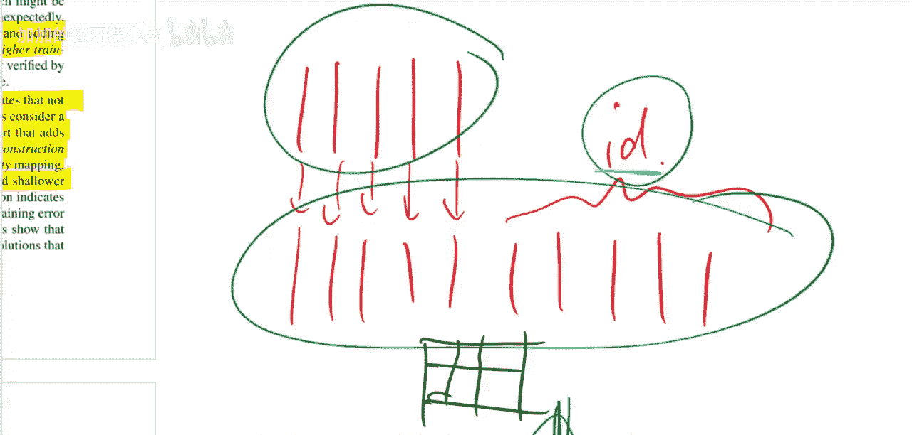

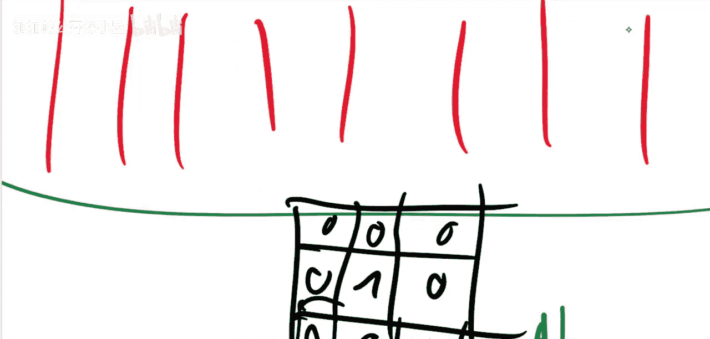

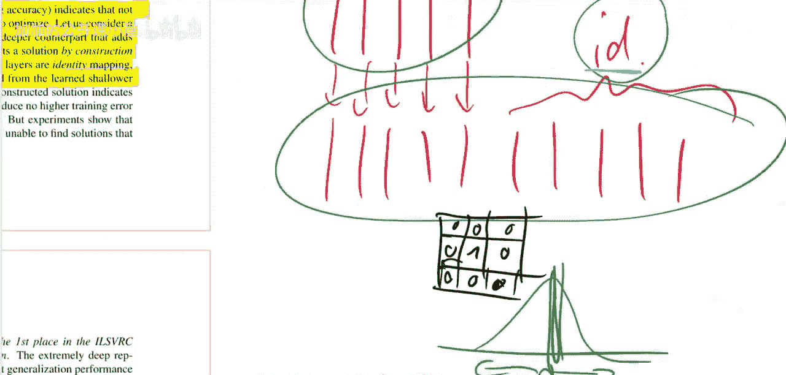

So this paper says， can we do something to make the default function of the network not be the zero function or whatever the randomly initialized function。

 can we make the default function， the one function。

 can we make the default function the identity function？And that brings you to residual connections。

 So instead of learning to transform x via a neural network into x， which is the identity function。

 why don't we have x？Stay X and then learn whatever we need to change。 Okay。

 so if let's call that Tilde， if the assumption is that it's a good default to not change much。

 So this is almost the same as this。 We might make this。Built this directly into the architecture。

 the fact that these two are equal plus plus some deviation that is learned right here。

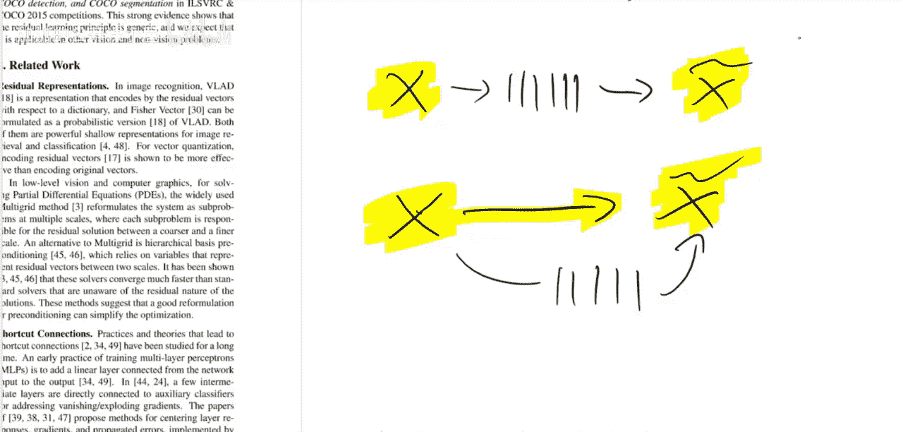

And the hypothesis is that especially the deeper you go。

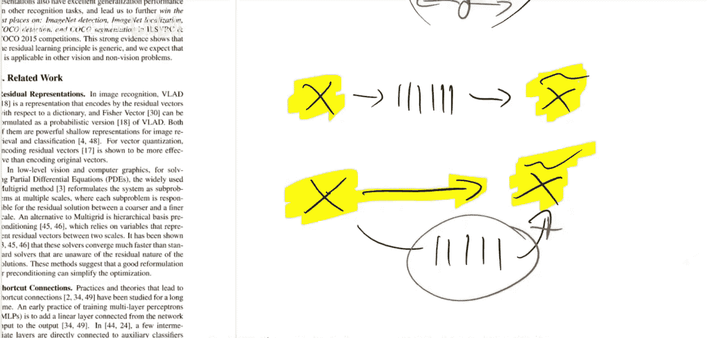

If you go very。