# YannicKilcher【中英⚡AI经典论文领读(全203篇)(上)｜Papers Explained】 p67 P87 无需训练的神经架构搜索（论文解读） [BV1o3xLznExj_p67]

Hi there， today we're looking at neural architecture Search without training by Joseph Miller。

 Jack Turner， Am Storkey and Elot J。 Crowley。On a high level this paper performs neural architecture search by looking at the correlation matrices of the Jacobian of the data when you pass it through the network and it does so at initialization so you pass the data you look at the Jacobbian and if it's very correlated then the network is bad and if it's very uncorrelated。

 then the network is good and by simply observing that。

 they can already achieve a very good score on neural architecture search benchmark。

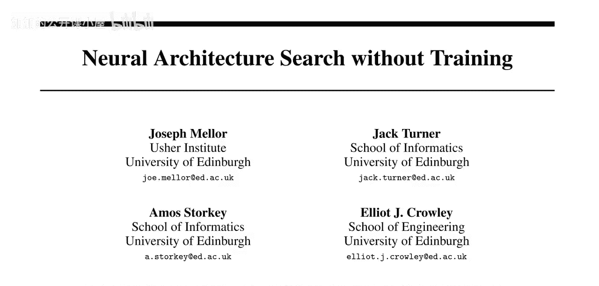

Allright that was a high level and maybe a bit too simplified but that's sort of what's going on Okay let's dive in so what's neural architecture search neural architecture search is the discipline of you are given a dataset let's say here we have a dataset which could be something like C410 which is an image dataset and you are given a sort of a training procedure let's say atom or SGD for 100。

000 steps or something like this with mini batches of size 64 okay and you're given a loss function which the loss function here could be the cross entropy between the outputs of the network which we'll call L and the label Y and your task is now to find a neural network architecture that conforms to the specifications but gives the lowest possible loss or the sorry the high。

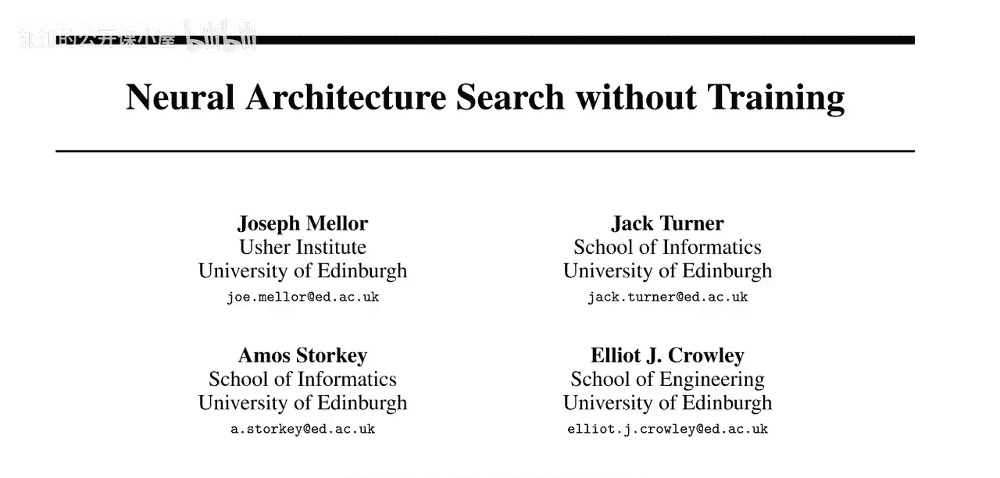

Possible validation accuracy in this case。So this here would be like the train and then you'd have the test accuracy or the validation accuracy。

 Okay so you could decide， well， I'm going to go with you know first like three convolutional layers。

 each one having like a relude non linearity。 but you could also say， well。

 I'm going to build like a skip connection from here to here。

 you could also say that I'm going to downs sampleample by two。

 you could have maybe a bigger stride and so on。 So the kernel size of the convolution。

 you can vary until now people have done this by hand right in effect。

 we all use like the same 10 to 20 different architectures。 So if it's an image problem。

 we tend to go for like a resnet or a wide resnet like a VGG style architecture。

 someone has come up with those at some point with each of those。

 Disc that it works well and we don't really do much exploration， we simply kind of use the same。

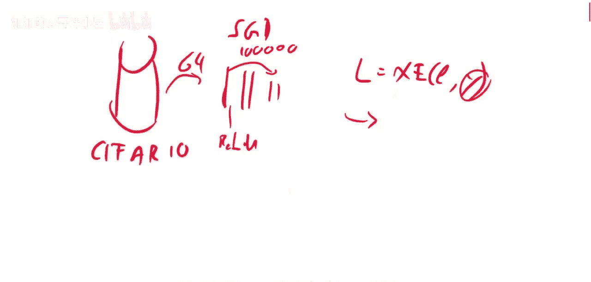

Things over and over。

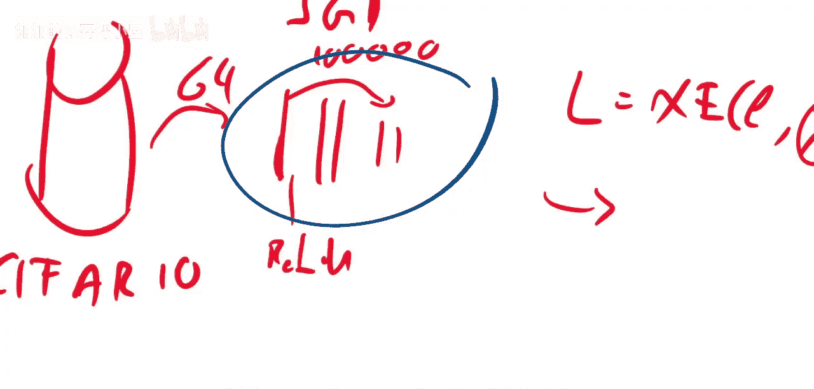

And the the truth is that there might be much better architectures that we're simply not exploring。

 right， there might be much better building plans for networks that we don't know of that might perform a lot better with the same data and the same training。

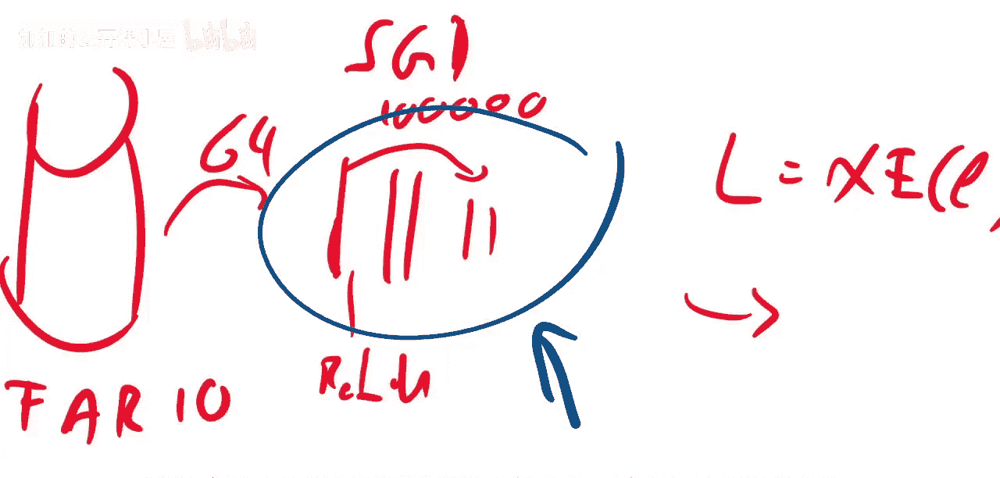

So neural architecture searches the process of automatically searching for these better architectures。

 Of course， that's a combinatorical problem。 But the idea is that。You know。

 you can actually learn to construct good architectures and by doing so you can sort of speed up this process that is manual otherwise。

And the idea behind it is there is some regularity of when an architecture is good。

 There's some like high level pattern that you， as a human maybe cannot really grasp。

 but like a machine can figure out which architectures are good and which ones aren't。

So there have been a few inventions in this in this area。

 but they are mostly costly and that's what they say here。

 The time and effort involved in hand designing deep neural networks is immense。

 This has prompted development of neural architecture search techniques to automate this design。

 However， neural architecture search algorithms tend to be extremely slow and expensive。

 They need to train vast numbers of candidate networks to inform the search process。

 So what neural architecture search methods do is what they'll have is they'll have something like a controller。

 the controller itself， of course， is going to be a neural network。

 So therell be this thing that will be the controller and the controller will emit like a building plan。

So the controller will emit like a building plan for this network right here。

 and then you train the entire thing once through for the entire 00000 steps。

 and then you observe the final validation accuracy which might be something like 80% And then you know。

 okay， this is 80%。 So you feed the 80% into your controller and the controller outputs the next building plan that it thinks will score higher。

 And then you train the entire thing again and you maybe observe a 70% accuracy。

 You again feed that in right， And the controller realizes， oh， I may have done something wrong。

 let me try something else。 and does again， if this looks like reinforcement learning to you。

 That's because this is reinforcement learning。So the re the， the C here。

 the controller would be the agent， the percentages here。

 the acuracies would be the reward and the envi， the observations would be basically。This thing here。

 this thing would be the actions， but sometimes it's the observations and you need to score the different things。

 okay so。The problem of course with this is that the reinforcement learning requires a lot of data。

 it requires a lot of steps to converge because the signal from the reward is just so weak you simply get one number for your action and you don't know what you can change to make it better。

 you simply have to try。

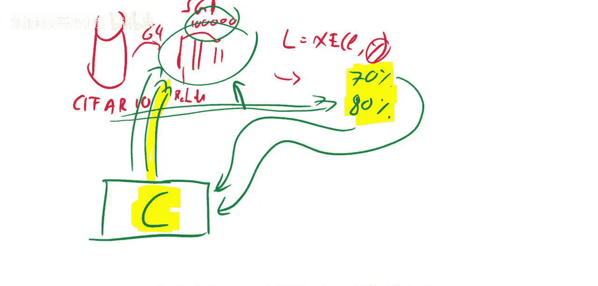

So you need a lot of steps， but this thing here is mighty slow because each single step in your reinforcement learning procedure involves training an entire neural network for like this many steps。

All of this is ginormously slow and resource intensive， and that of course。

 blocks a lot of research because， you know we we started with the plan to automate this part right here。

 but automating it itself is super expensive。

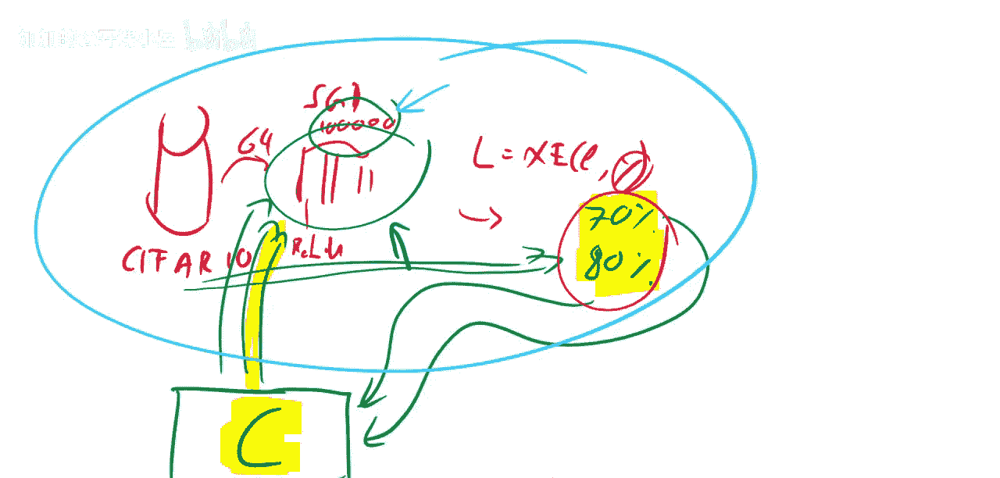

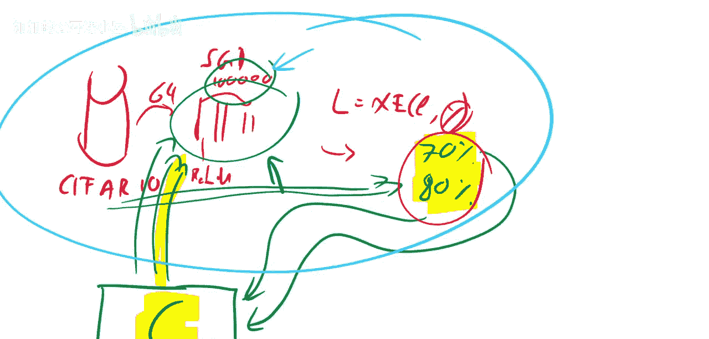

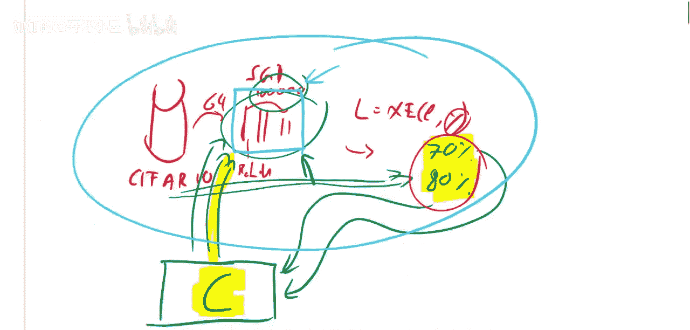

So they go for a different solution。They say this could be remedied if we could infer at network。

 sorry， if we could infer a network's trained accuracy from its initial state。 Okay。

 it seems a bit out there， but let's， let's give them benefit of the doubt。

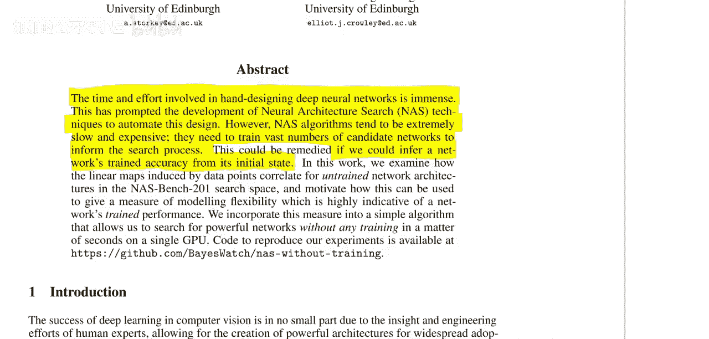

In this work， we examine how the linear maps induced by data points correlate for untrained network architectures in the NAS Bench 201 search space and motivate how this can be used to give a measure of modeling flexibility。

 which is highly indicative of a network's trained performance。

We incorporate this measure into a simple algorithm that allows us to search for powerful networks without any training in a matter of seconds on a single GPU。

 Okay， and they have the code available right here。 if you want to go and check that out。

 So let's go in， let's go into that。 The claims are pretty big。

 and the reasoning behind the claims is the following observation。

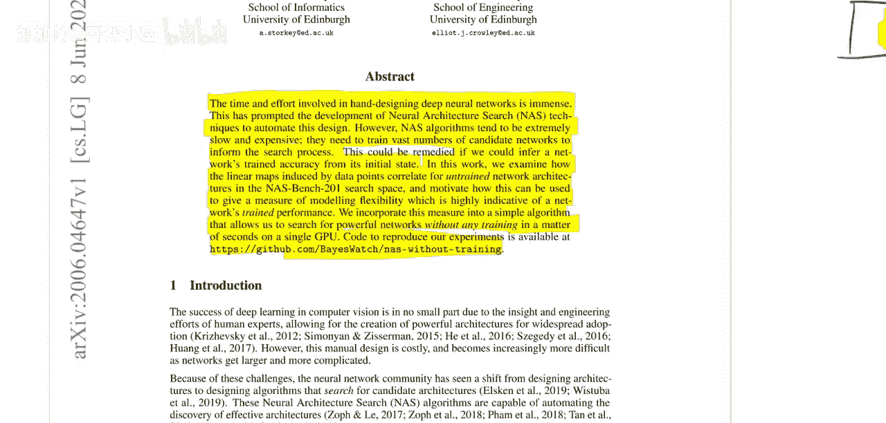

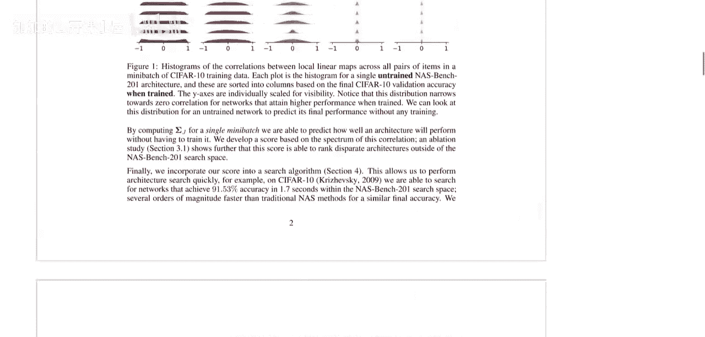

You can already sort of see in this graphic right here。 we'll go over what it means in one second。

 but what they do is they take different networks in this search space and the search space in this case is given by this benchmark So this benchmark basically has a long list I think of architectures that you could consider actually so it's it's a constructive list。

 So they don't actually give you the list。 but they give you like a way to construct architectures and they took those architectures and they rank them by how well they score on C4 10。

 So there are very good architectures which are here。 there are good ones。

 They are mediocre ones and then the bad ones。

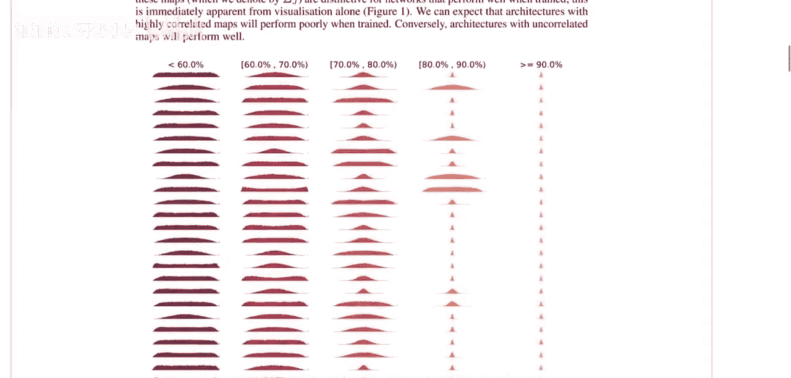

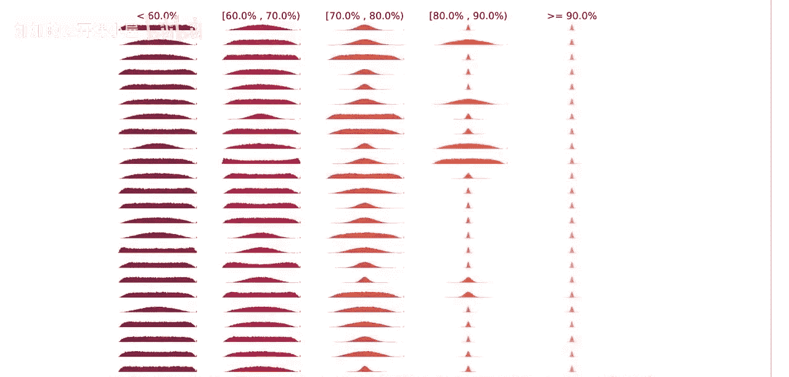

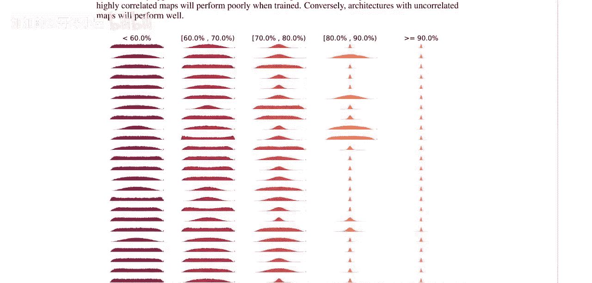

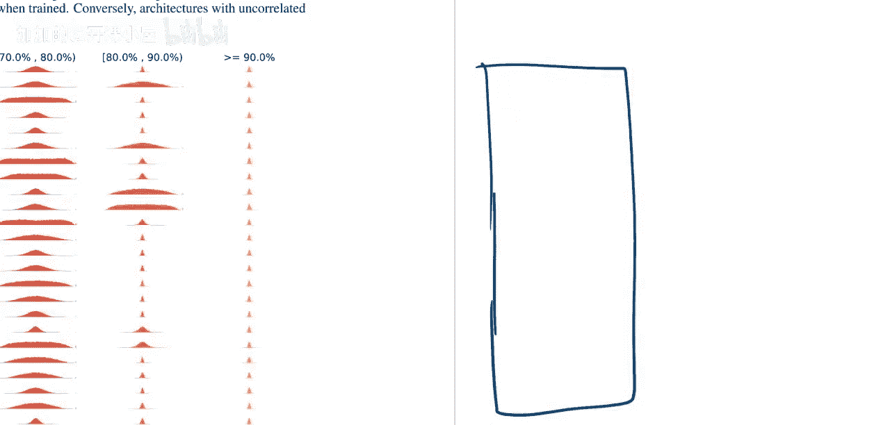

And you can see that the histograms here of whatever they measure， they look quite different。

 So the histograms with the good ones， they all of kind of spiky around0。

 and the histograms of the bad ones all sort of look spread out。

 So this is the measure that they're going to propose。

 is they have some sort of number some sort of histogram that they produce。

 And if the histogram is very spiky and close together around 0。

 then they conclude that this network is good。 And if the histogram is very spread out like this。

 they conclude that the network is bad。 Now， these histograms， as you might expect。

 they are computed not from the final trained network。

 but they are computed from the initial network。

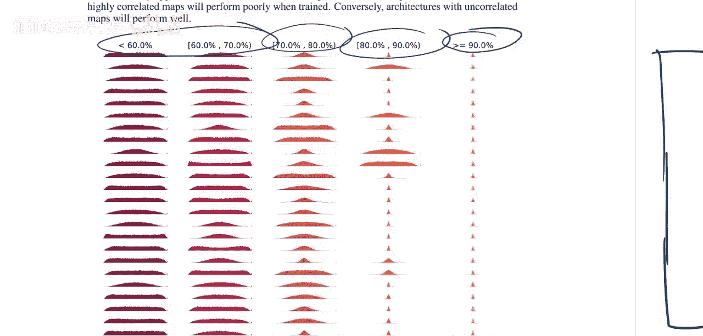

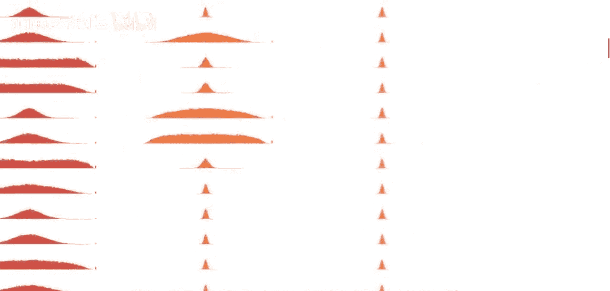

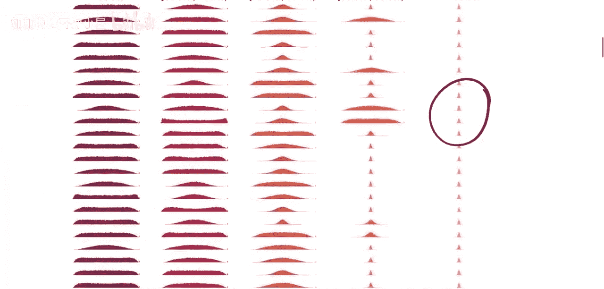

So here they show at least， you know， in this case。

 it seems to be that there is a general correlation between the trained accuracy and how this histogram looks。

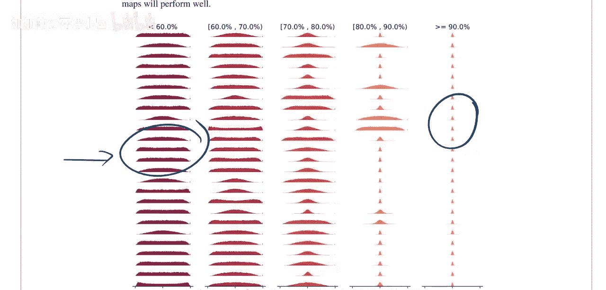

And we're going to explore what they do。

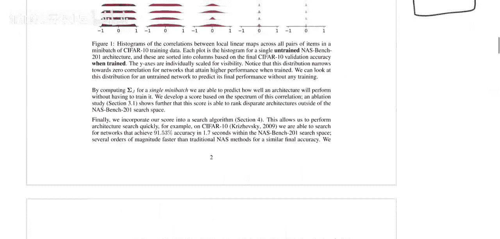

So essentially it's pretty easy。

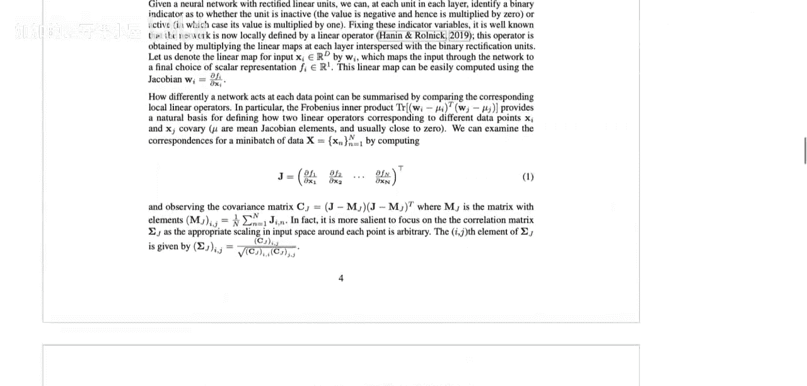

They compute the linear map around each data point。

 So what is that if you imagine a neural network as a nonlinear function。

 which I guess you should because it is。 And so let's imagine it as like a nonlinear function from x to y。

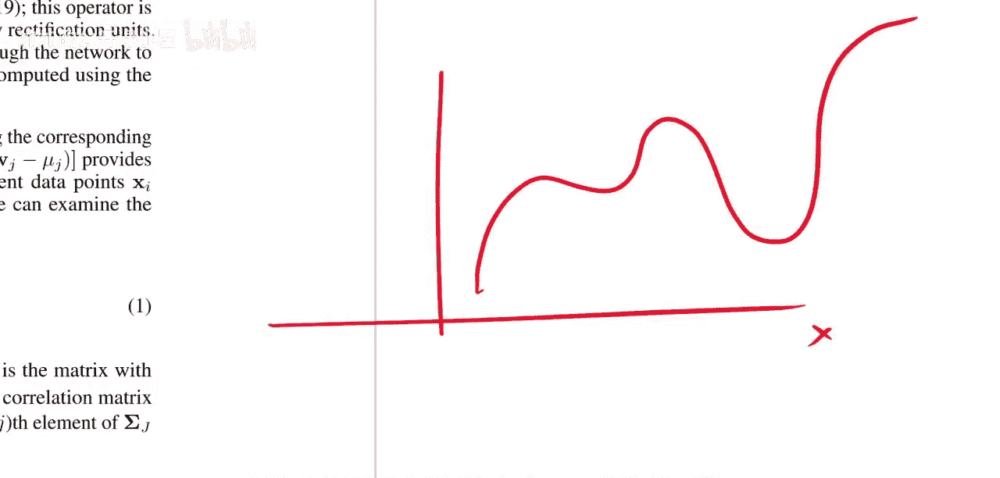

What they'll do is simply they'll look at a。