# YannicKilcher【中英⚡AI经典论文领读(全203篇)(上)｜Papers Explained】 p68 P88 论策略强化学习的关键因素：一项大规模实证研究（论文解读） [BV1o3xLznExj_p68]

Hello there Today we're looking at what matters in on policy reinforcement learning。

 a large scale empirical study by Google Brain。

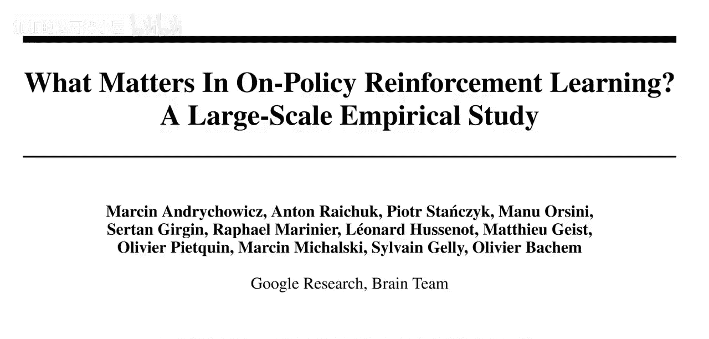

On a high level this paper investigates a five different continuous control tasks and they train agents with all the different choices that you can make basically on these continuous control tasks so the different choices are like network width and height of the value and policy network learning rate type of loss function。

 regularization constants and they train all of these agents and they try to parse out what works in general and what doesn't and they have some surprising findings。

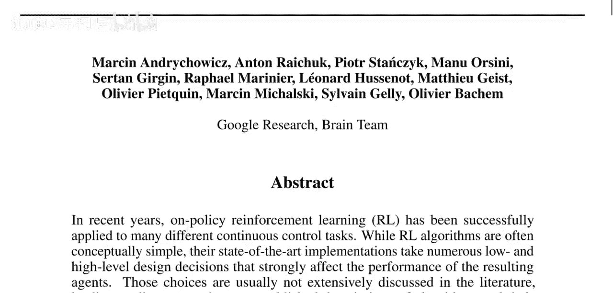

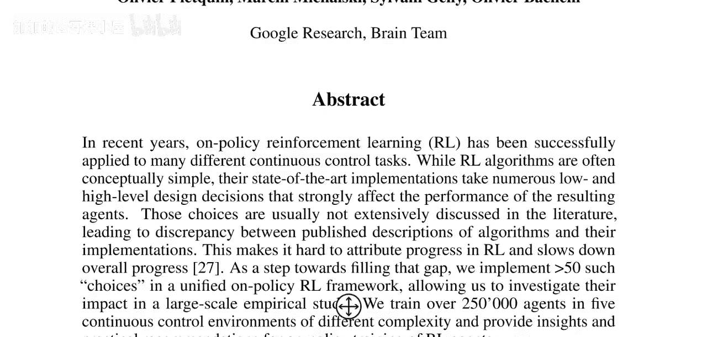

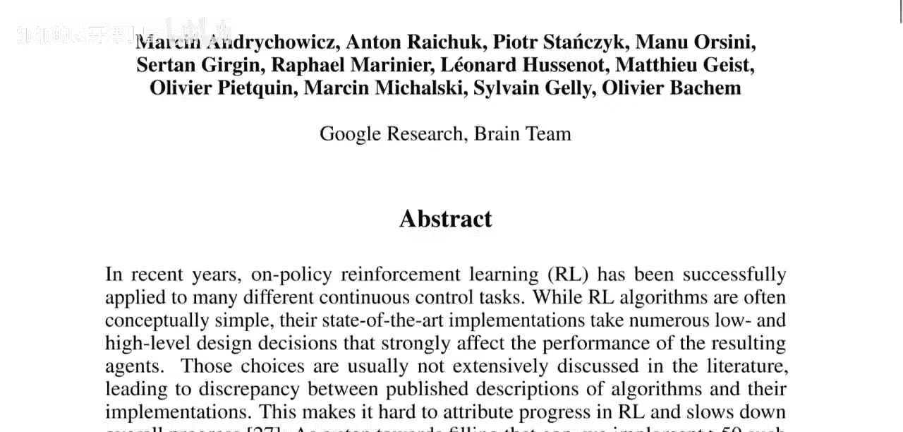

That number 7 will surprise you。Yeah， okay， so that's the that's the study on a high level。

 as always， if you like content like this， consider subscribing and sharing it out。😊。

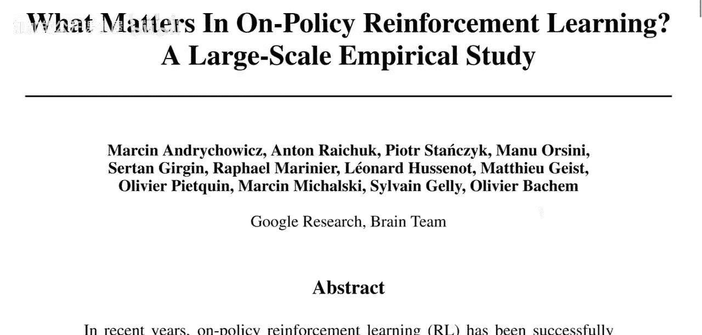

That would be excellent。So they say that on policy reinforcement learning has been successfully applied to many different continuous control tasks。

While orL algorithms are often conceptually simple。

 their state of the art implementations take numerous low and high level design decisions that strongly affect the performance of the resulting agents。

Those choices are usually not extensively discussed in the literature。

 leading to discrepancy between published descriptions of algorithms and their implementations。

 So the sort of things they mean here are the things that when you read the paper。

 the algorithm will be sort of describe pretty well on the main idea。

 but then if you look at the code， there is a whole bunch of hacks there。

 like on the Atari environment you have to repeat certain actions you have to introduce sticky actions。

 then the question is do you have like a random starts or you always start at the exact same time。

 therefore the randomness of the level is not given then whether or not you normalize certain observations。

But we've had these things， even in supervised learning or NLP， things like this。

 we've had pre processing， I remember the re first ressonnet paper that beat ImNe to a significant degree over the last year's baseline。

It was， oh， yeah。 we have the simple idea of the resnet。

 and then they have an entire section where they go， oh， and we do this normalization。

 We do this pre processingsing。 We do this and this and this and this and this。 And I mean。

 there's an argument to be made for all of these， these choices。

 But often it's hard to disentangle if the choice choices of these pre processinging things or whatever the choices are matters。

 Or if the idea in the paper matters。 And it's also very hard to compare different things。

 So what they're doing。Here so I would say this is not only a problem in orL。

 this is a problem generally。They say as a step towards filling the gap。

 we implement over 50 such choices in a unified on policy RL framework。

 allowing us to investigate their impact in a large scale empirical study。

 so a large scale empirical study it basically means grid search over these choices。

 kind of smart grid search。We train over 250000 agents in five continuous control environments of different complexity and provide insights and practical recommendations for on policy training of RL agents。

 So as far as I could figure out the code and or and or the checkpoints of these 250000 agents or the code of these unified on policy RL framework is not available yet。

 and I don't know if it's going to be。 but basically what they're doing is they're building one agent。

 So in usually you have this agent environment dichotomy right here。

 you get observation and reward and here you get you give action。

 They build one single agent that has a lot of switches that has a lot of like flags that you can。

Say， okay， either do you want this loss or this loss， Cool。

 Do you want this regularization or this regularization And in， if so， by how much， right。

And so on so I have this agent with lots and lots and lots of switches over 50 of these choices that they implement right here。

 and they can basically turn each one on and off and therefore they can investigate these algorithms。

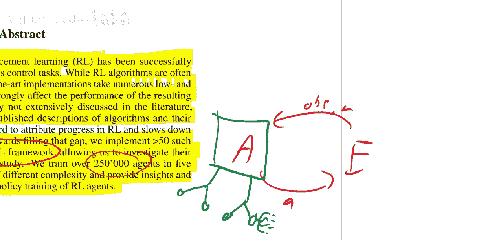

So let's jump over the most surprising finding， which。Okay， the most I can tell you。

 the most surprising finding is that the policy initialization scheme matters significantly。

That's what people maybe didn't know what also matters a lot is the learning rate and。

Things like the discount factor。 But I think people in R L were already familiar with that。

 I find it also interesting。 what doesn't matter， namely。

 most things seem to not really matter too much， but there might be other explanations for this。

 Alright， so they say we consider the setting of on policy reinforcement learning for continuous control。

 Now， this is where I have a bit of a， of a problem right here。

Because the title is what matters in on policy reinforcement learning。

 It's not what matters in on policy reinforcement learning for continuous control。

 they do say in the abstract here， as you've already seen。

 in the last sentence that they have continuous control environment。

 five continuous control environments。

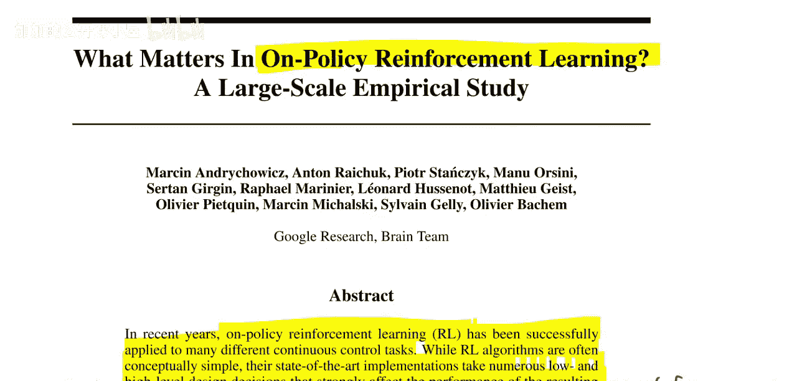

But yeah， I get it。 you need to make the title a bit click， baby。

 but the title overstates a bit what this paper says。

 This paper basically says what works in these particular five continuous control environments。

 right So they vary a lot of things with respect to the agent， but they keep the environments。

 relatively constant。 and it's not five diverse environments。

 It's five Mujoko continuous control environments that are very， very。

 very similar to each other in terms of their observation in terms of how the world works and so on。

 so。

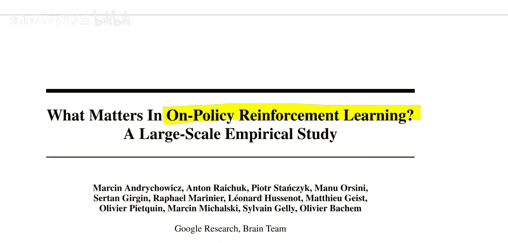

Consider this paper as an investigation in what works and doesn't work for these five and possibly for very relatively close environments。

 So that's， I think my biggest trouble I have with this paper right here is sort of it overstates what what it says in the title。

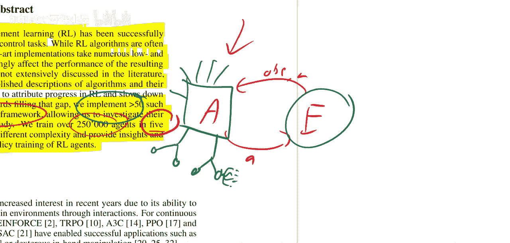

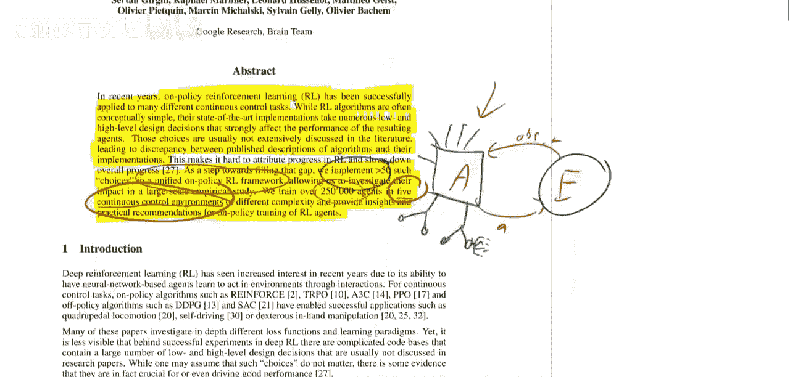

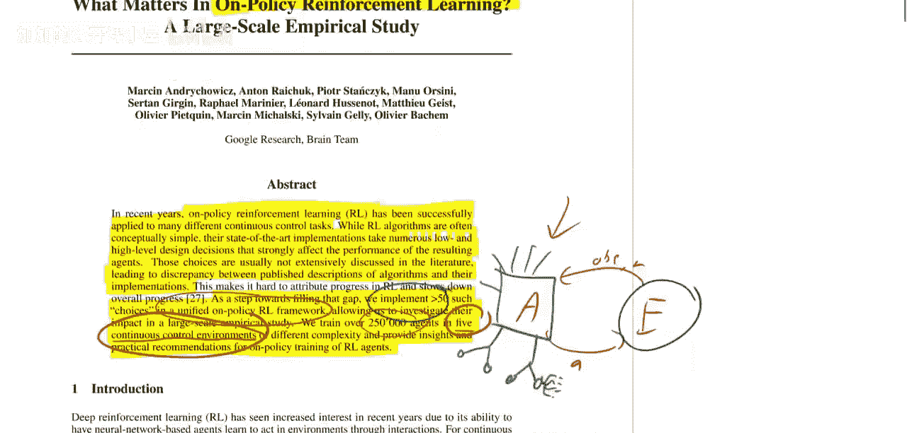

But I mean， the investigation itself is done， I feel very， very well。So。

They say they have a unified on policy learning algorithm where the research prior work。

 took popular code bases， made a list of commonly Le choices。

 and then implemented everything into starting from the CL code base CL is kind of a framework for distributed or for reinforcement learning in general。

And they say whenever we faced we were faced with implementation decisions that required us to take decisions that could not be clearly motivated or had alternative solutions。

 we further added such decisions as additional choices so this I feel if I write research code。

 this is generally what I do right I write my research code and whenever I come to a place where I'm like should I use this or this should use this optimizer or this optimizer or simply make a flag and then even if it's just one choice for now just make a flag and parameterize everything。

And that's， that's that's the thing here。 They parameterize everything。

 but other than I would do now then I would sort of sparsely explore the space of these parameters。

 Now they do a more dense dense observation or dense sampling of this space than me myself would do with limited resources。

 Of course， being Google， it is possible to do these kinds of things where you investigate all the choices。

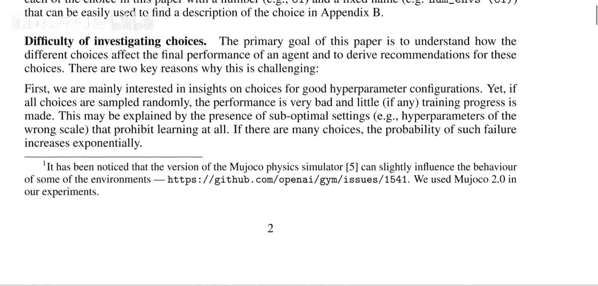

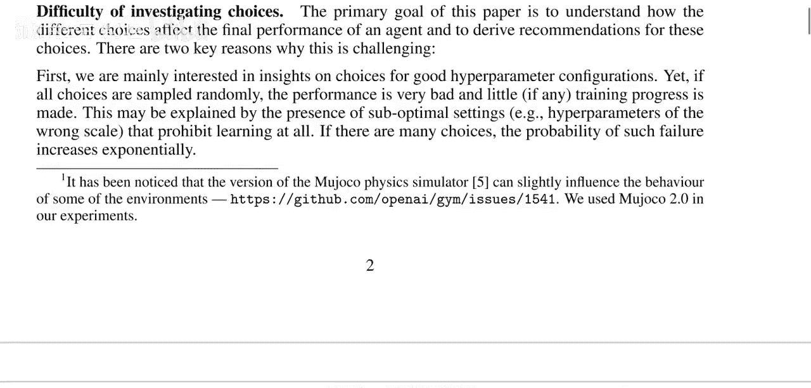

So they say here difficulty of investigating choices。

 the primary goal of this paper is to understand how the different choices affect the final performance of an agent and derive recommendations for these choices。

There are two key reasons why this is challenging。

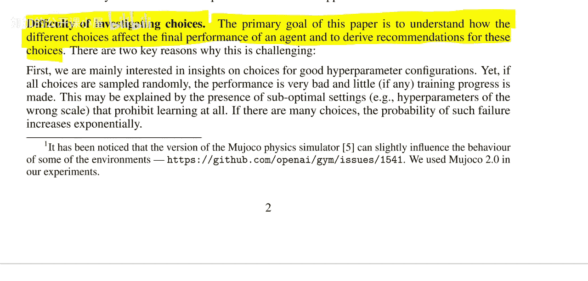

First， we mainly interested in insights on choices for good hyperparameters。

Yet if all choices are sampled randomly， the performance is very bad and little training progress is made。

 So that means if you have， if you have all of these hyperparameters。

 then lets let's consider like a three dimensional hyperparameter space。

 then there are combinations of hyperparameters that are very good right here， maybe here。

 So there's this this cube in here。

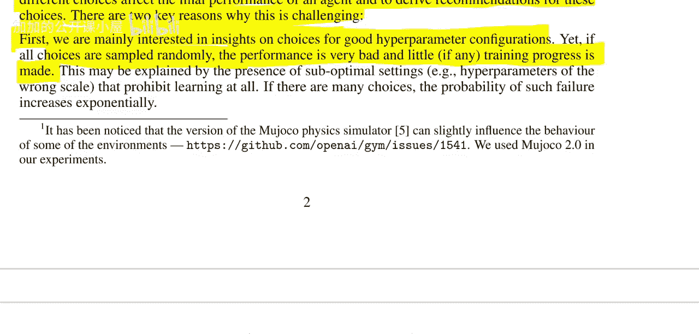

That's sort of very good。 But the rest aren't really good。

 So if you just simply sample from anywhere in the space， like here or here or here or here or here。

 you will， we will basically never get anything that works。

 You sort of have to hit the combination correctly and。That that's a problem in three dimensions。

 but it's way more a problem in 50 plus dimensions like they have here。

 so they have to resort to a different strategy。

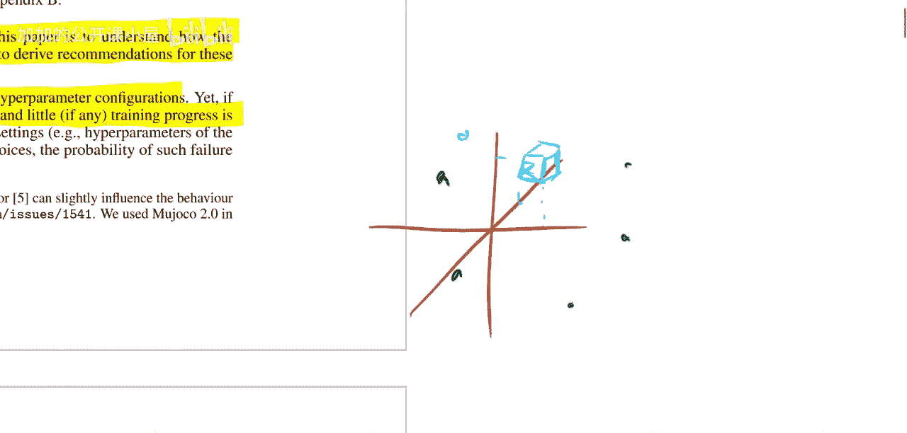

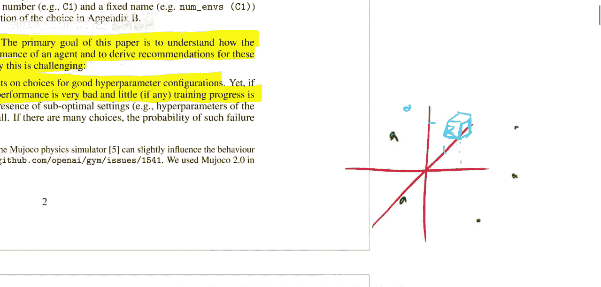

。They have to go and basically start out from a good configurations。Where they say。They grew。

