# YannicKilcher【中英⚡AI经典论文领读(全203篇)(上)｜Papers Explained】 p69 P90 你只需要霍普菲尔德网络（论文详解） [BV1o3xLznExj_p69]

Hi there Today we'll look at Hopefield Network is all you need by researchers from the Jones Kepler University in Lyz and the University of Oslo。

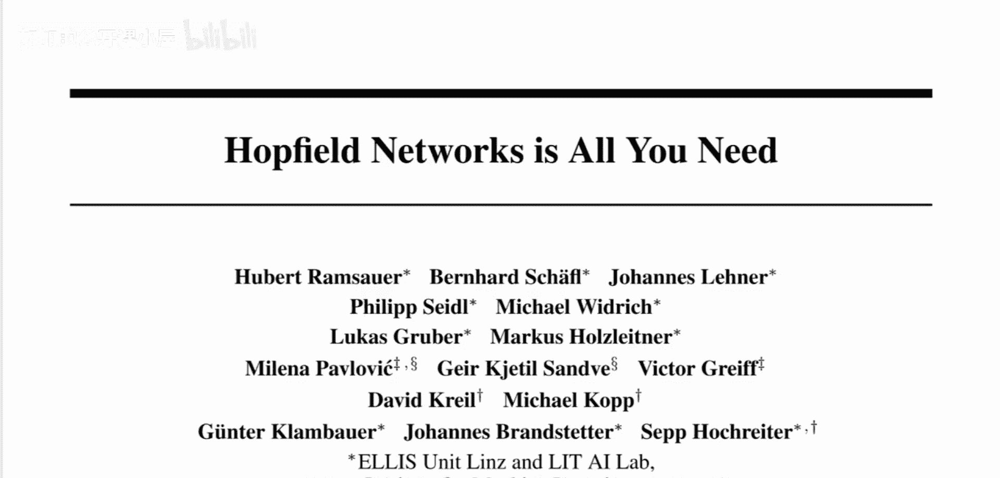

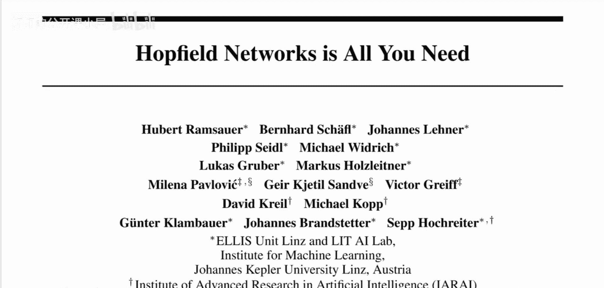

So on high level this paper proposes a new type of hopfield networks that generalizes modern hop field networks from binary patterns to continuous patterns and then shows that the retrieval update rule of these new H field networks is equivalent to the attention mechanism that's used in modern transformers。

And it's actually a more general formulation of the attention mechanism。

 and therefore it can be used to do kind of a variety of things to improve modern deep learning。

And it also has a companion paper where it applies this to some kind of immunology research and gets a chiefs state of the art in a task that is specifically suited to this type of attention。

Alright， let's dive in together。 We'll go over what this paper does， what it proposes， and so on。

 If you like pay， if you like videos like this， consider subscribing。

 you know sharing it out and I hope you're enjoying this。

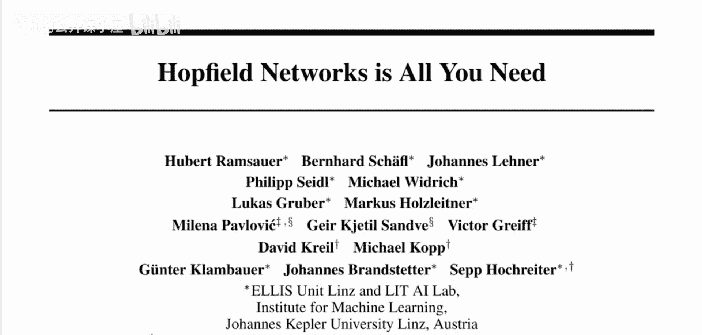

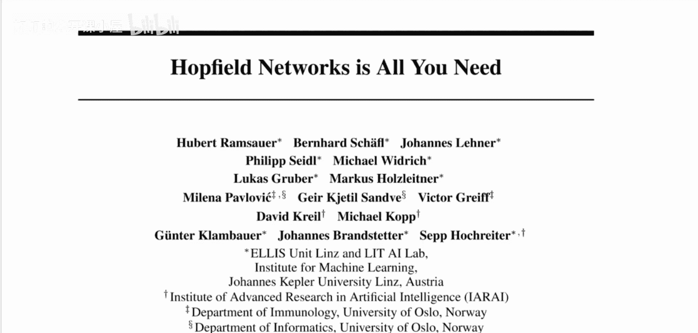

Alright， also thanks to my Discord community for， you know。

 very helpful bringing me up to speed on this paper super interesting discussions there。

 If you're not on our discord yet， I invite you to join。 it's fun okay。

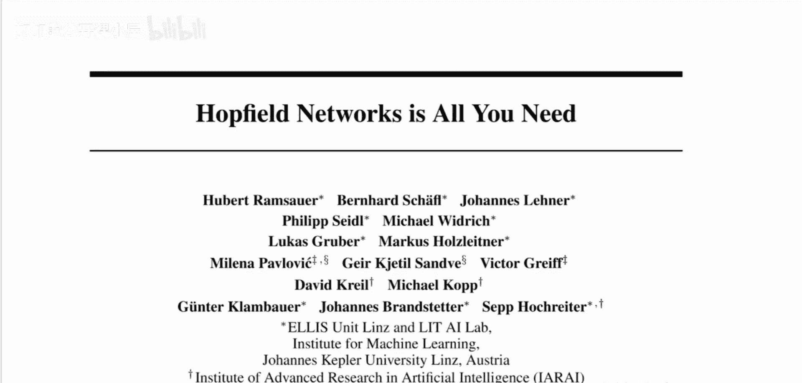

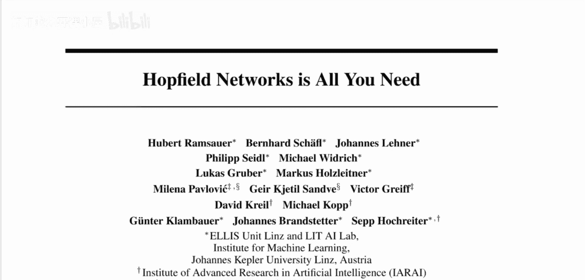

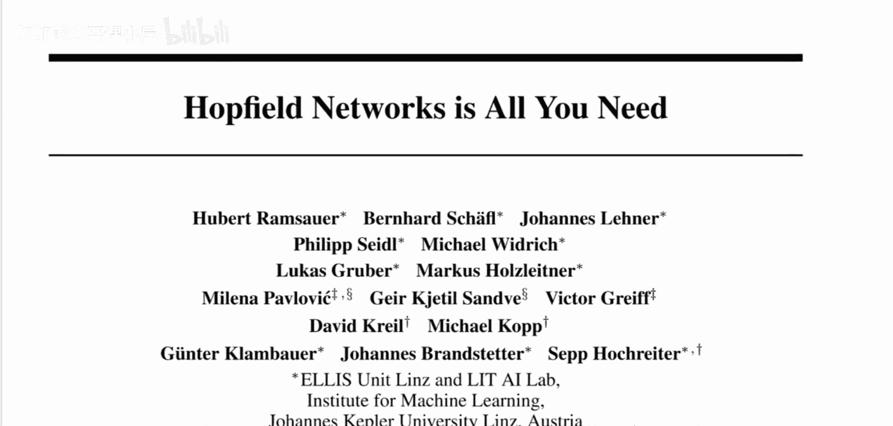

So。

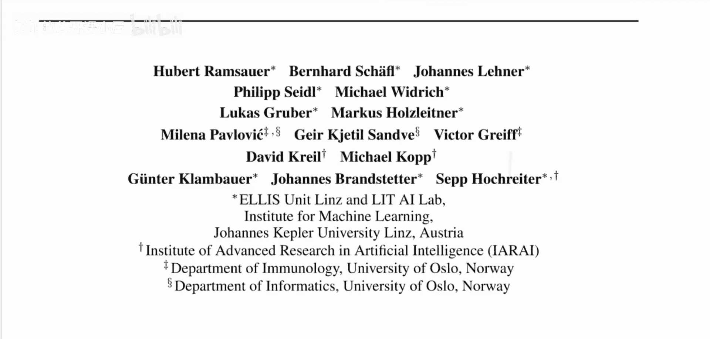

What is a hop field network， A hop field network is a pretty kind of old style。

 old conceptualization of a neural network。

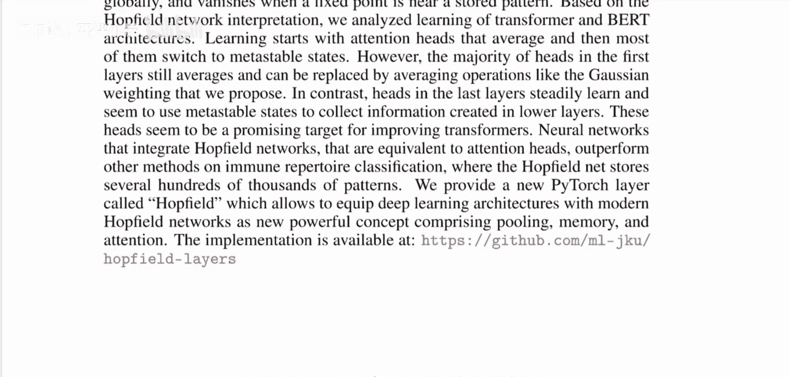

So in a hop field network， what your goal would be is you can conceptualize it as a bit of a neural network。

 So let's say we have five neurons or something like this what your goal would be is to have a neural network where you can store so-called patterns and a pattern in this case would be a binary string of size 5 So for example。

 10100 or 11，0，1，0。 and you'd have a list of these patterns and what your goal would be is to store these patterns in the neural network such that in here you know we'll just consider everything to be sort of connected to everything else。

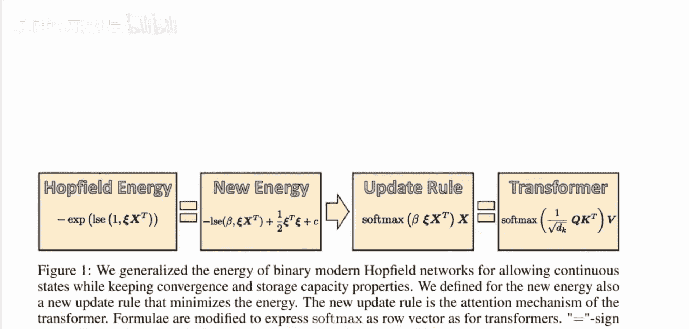

And what your goal would be。In this is that you can kind of store patterns inside this neural network and you adjust the weights somehow。

 So this was， as I said， this was， this was， this is kind of an old model。

 you store you adapt the weights such that you store these pattern。

 And what does it mean for a pattern to be stored。 If you have stored a pattern。

 you can you will then be able to retrieve it and you retrieve a pattern in these kind of old style hop field networks by providing a partial pattern。

 So what you'll say is， for example， I， I want a pattern that starts with 1，1。

0 and you give that to the network and there would be so called update rule。

 and the update rule is kind of an internal rule， so。Let's just go through this。 So here this 1，1，0。

 maybe this is 1，1，0。 And then they would kind of send messages around。

 So this update rule would somehow adjust the value of this and this neuron here to what's most compatible with the network weights。

 And if， if the network weights have been adjusted correctly， this will turn out。

 Then at the end of applying this update rule that。This is a 1， and this is a 0。 And therefore。

 this pattern here is retrieved。 Now， had I input 1，0，1 at the beginning， then。

The outcome would be different。 Hopefully， this pattern here would have been retrieved。 Okay。

 so you can see the applications of this like you can have the first three digits as sort of a database key。

 And then the last ones as sort of the value that you store along with it。

 And then you can simply provide the first few。 You can also provide。

 You don't always have to provide three。So this all depends。 This is， this is。Sort of an， as I said。

 an old conceptualization of neural networks。 So people were imagining that this is kind of how the brain works。

 you know， fire together， wire together and。Also with research into this， it turns out that。

 you know， you might think， you know， there's there's kind of five neurons。

 so maybe I can store five different patterns， you know accurately because if I store too many patterns right。

 if I have many， many， many， many patterns， then I can't expect to be able to retrieve all the patterns again。

 because some of them will just be so equal that you know many will start maybe with this and I won't have a chance to to retrieve the one I want。

 or the update rule will make a mistake So you might think this might be like five because I have five neurons or maybe 10 because I have 10 connections。

 but it turns out that in modern hop field networks with the appropriate update rule。

You can store exponentially many patterns in these networks， exponentially many in the。

 in the dimension of the in the dimension of the patterns。 And here。

 I guess that would be the length of the pattern， so。

This is a little bit surprising the kind of storage capacity of these networks and。

this paper here generalizes that to continuous states。 so what do we mean？With continuous states。

 I guess， I mean， continuous patterns。 So no longer is a pattern， a binary string。

 but a pattern now is a string of floating point numbers。 Okay， like 0。51。3 and so on。 And， you know。

 a string of floating or a sequence of floating point numbers is naturally depicted as a vector。

 Okay， so our patterns are going to be different vectors that we store。 And， you know。

 in high dimensions that。

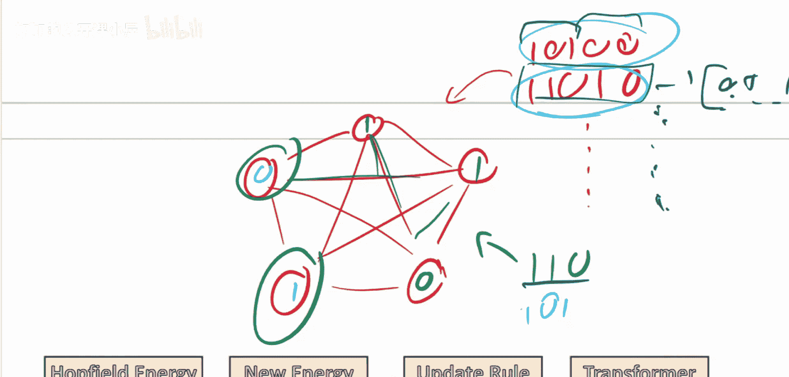

The des。Will be kind of separated well from each other as long as we don't have too many， but。

This paper shows that all these properties for the modern field networks that hold for binary strings still hold。

 if you go to these kind of continuous to these vector patterns。

 That means you can store exponentially many patterns in the dimensions of the vector。

 which is pretty surprising， right， because you'd think like， you know。

 after you have one vector per dimension that， you know， after that， it might get a bit shaky。

 but no， you can actually store exponentially many。

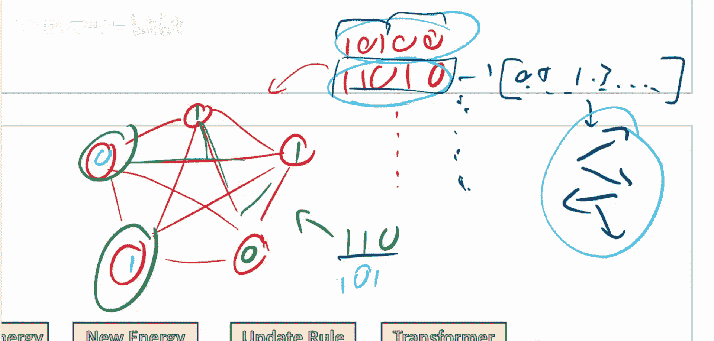

That's pretty surprising。 And this paper is a lot about how to do that。

 the fact that that happens and so on。 So we've talked about update rules for these kind of hop field networks。

 And I haven't really specified what that is。 I've just said that， you know， I enter a pattern。

 And then the network does something and out comes out the whatever the pattern that matches my query。

 So this here is called a query。

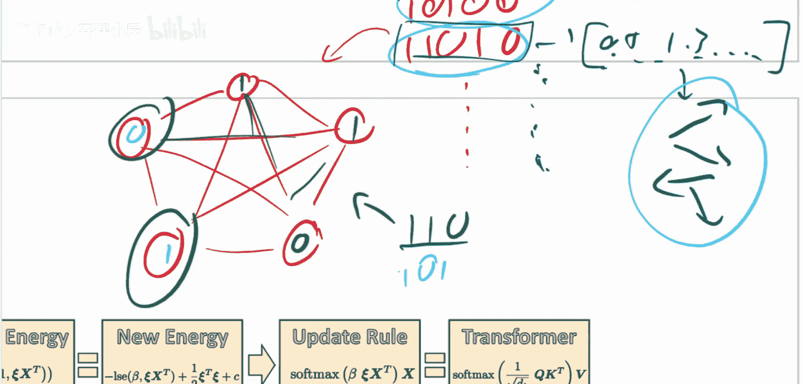

You might already this is on purpose like the kind of overlap between the attention mechanism lingo and the hopfield network lingo。

 we're going to conflate the two to kind of make clear where the two overlap if you don't know what an attention mechanism is or aren't familiar with it。

 watch my video on attention is all you need once you watch that this video will make a lot more sense。

Alright， so。In what the update rule does is specifically and the update rule， there isn't only one。

 right， there are many different proposals of hop field networks。

 and they all lead two different properties。 But what an update rule does ultimately。

 is it minimizes what's called an energy。 So every type of hop field network is associated with an energy function。

 and this the energy function of the modern hop field network for binary strings is this energy function right here。

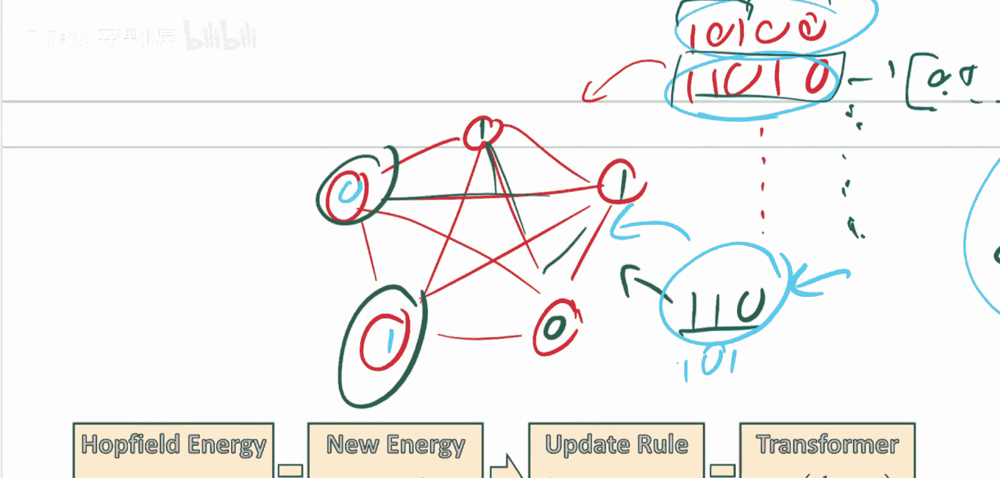

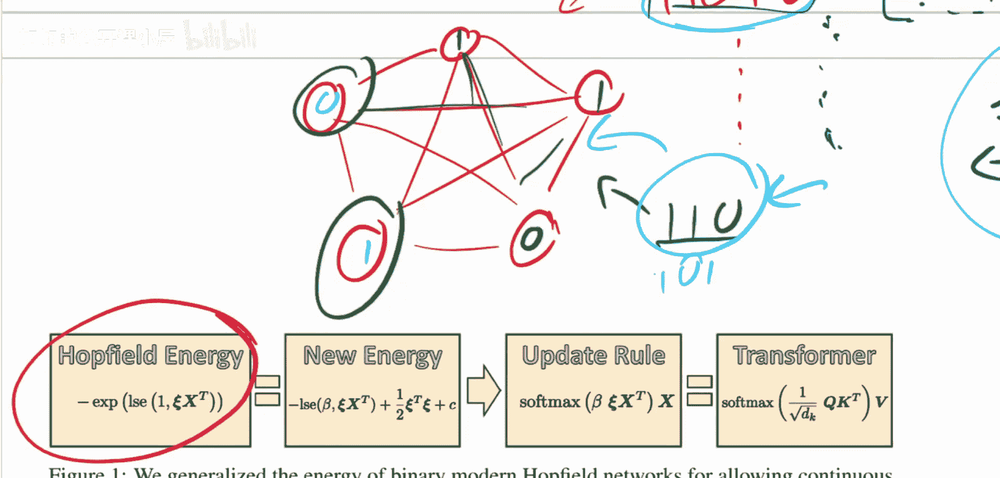

So， with x。X is the pattern。 the pattern， this is the kind of state of the Hope field network。

And so these are the whatever is stored in the network。

 And then the Z here is the query that you enter into the network。And then the energy here tells you。

This quantity， you have to minimize this quantity in order to retrieve the pattern that you want。

 Okay， now， we are never directly working with the energy as such。 So what you could do is。

 for example， use back prop or something to use gradient descent to decrease the energy， but usually。

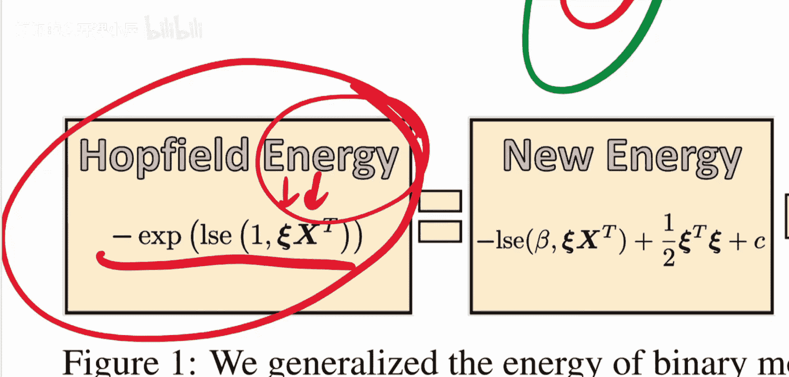

Along with an energy function comes an update function。

 And the update function is what I've talked about here。 Like you do something。

 and then the network does something。 and then you get the pattern out。 What the network does is it。

Minimizes its energy function。 And the update rule is made such that the corresponding energy function is minimized。

 So the energy function is more like a theoretical consideration。

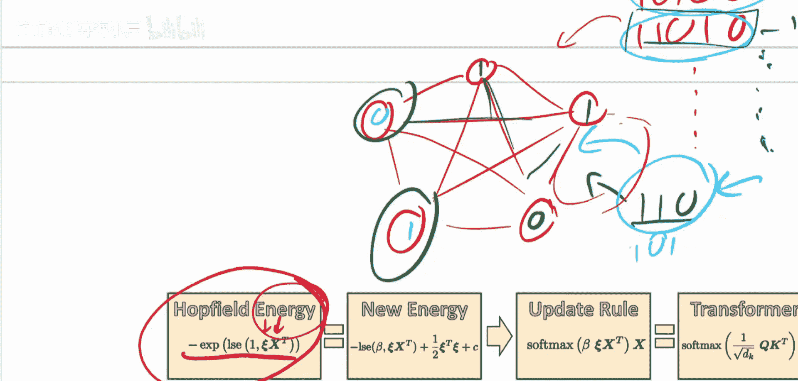