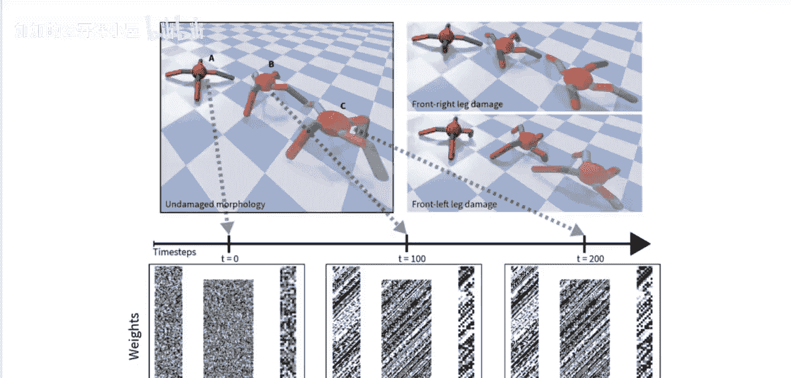
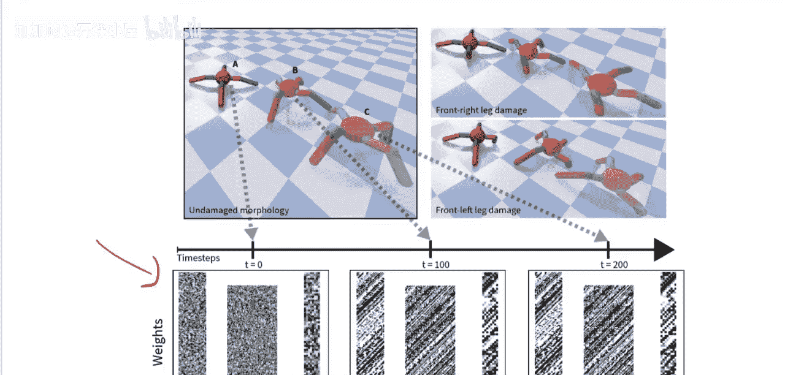
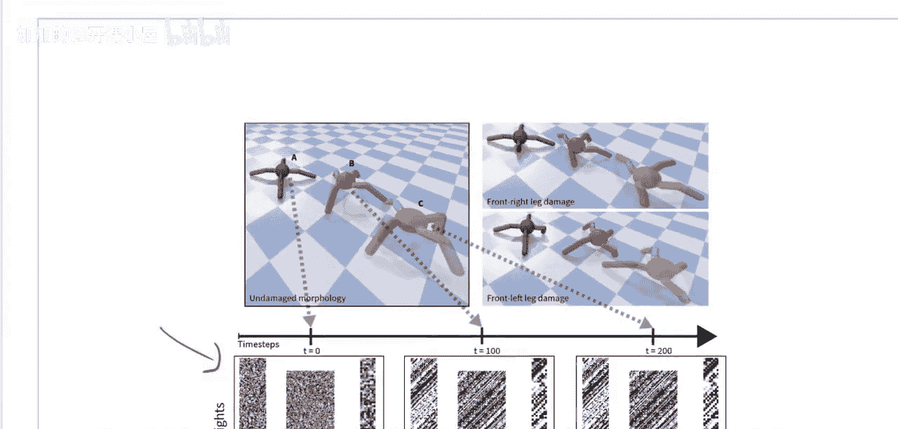
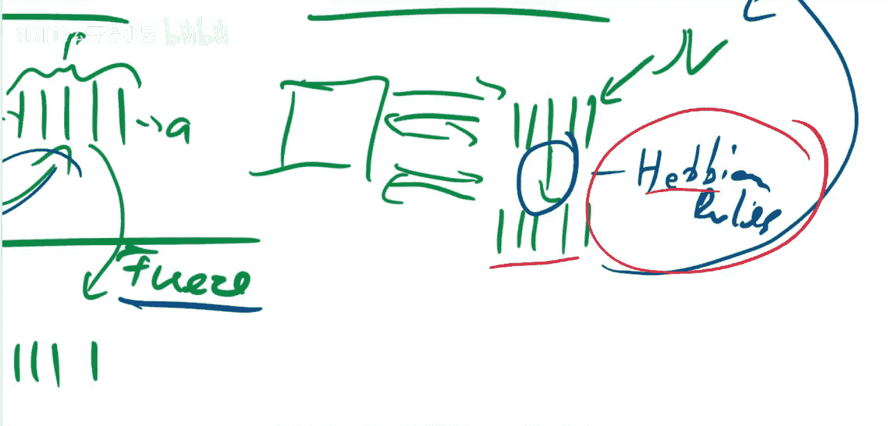
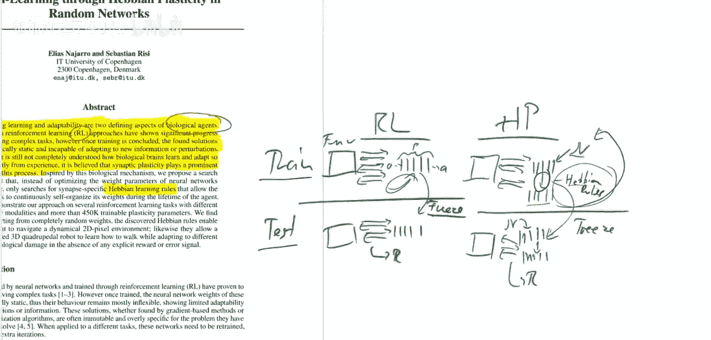
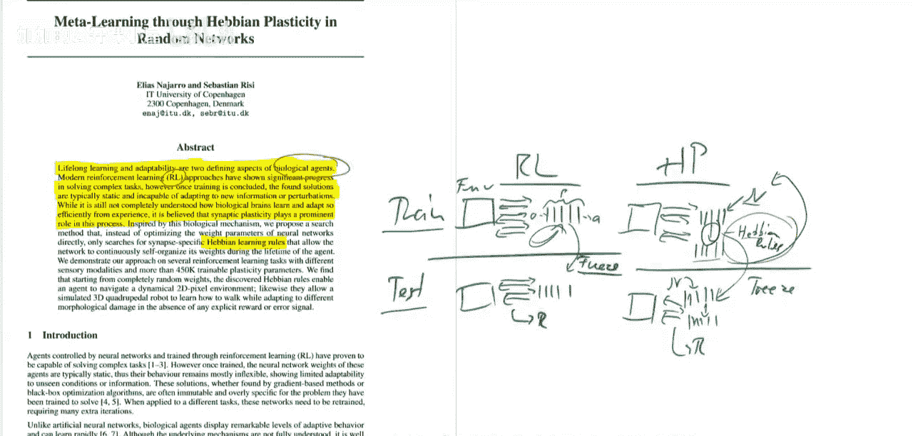
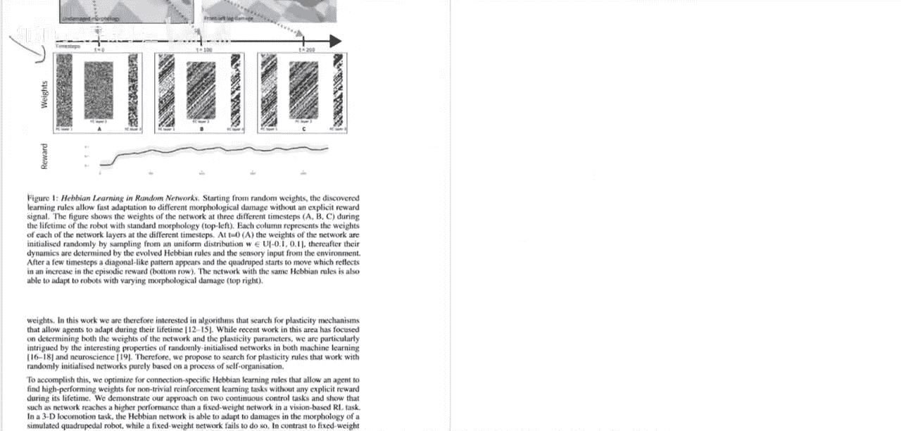
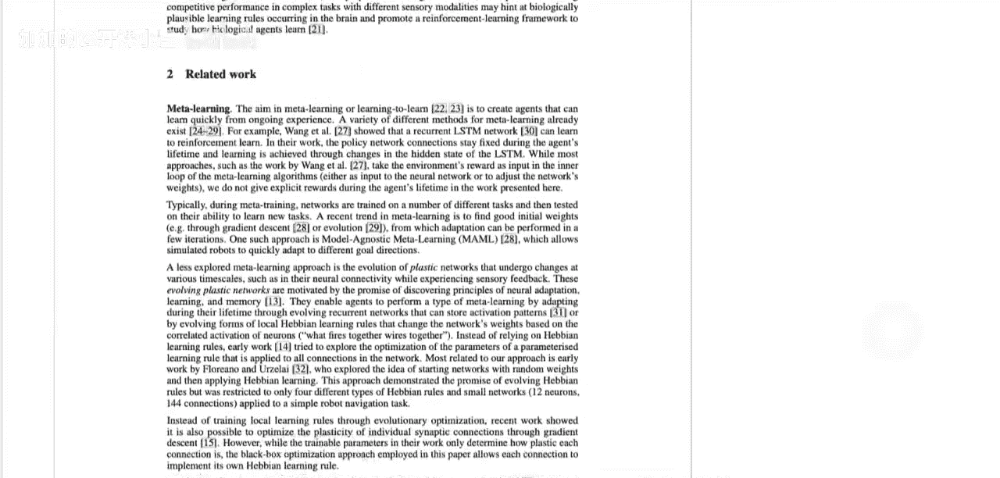
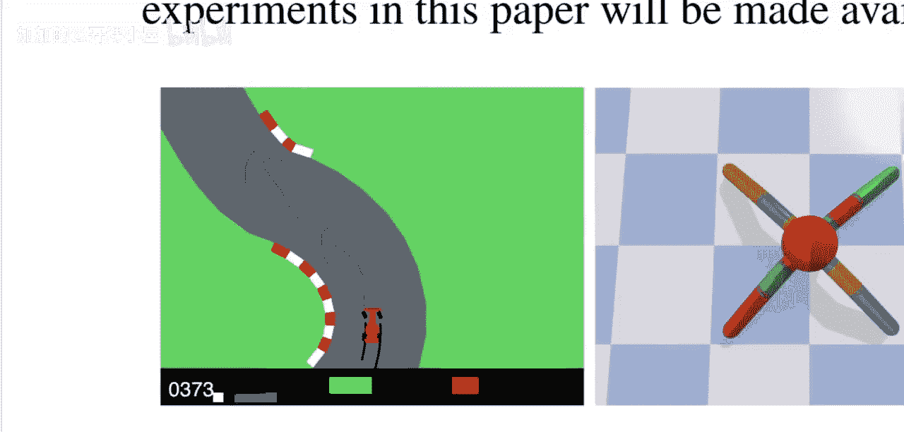

# YannicKilcher【中英⚡AI经典论文领读(全203篇)(上)｜Papers Explained】 p70 P91 随机网络中的赫布可塑性元学习（论文解读） [BV1o3xLznExj_p70]

Hi there。 Take a look at the following problem on the left right here。 So you have this quadrup pad。

 And the goal is to have it walk forward or in any direction as far as possible。 Now。

 usually this is the domain of sort of reinforcement learning。 So you have inputs。

 which is the sensors of the joints of the quadruppa。 and you have outputs。

 which is how much force you want to put on each of the legs。

 And you have to somehow learn a policy to make it walk forward。

 reinforcement learning does that by sort of trial and error using an environment to learn the policy directly。

However， this paper does something different。 What it does is it learns a policy that is adaptive during training。

 which basically means that at the beginning of each episode。

 the policy in is initialized randomly and by policy here。

 we mean a policy network policy neural network， which you can see at the bottom。

 so that's initialized randomly， and then during the episode depending on the input this network is changed and adapted in order to achieve high performance。

So even at test time， the network is started randomly and then adapted during the episode so this paper deals with this problem and tries to implement this sort of more biologically plausible way of learning a policy adapting to the environment and achieve ultimately good performance in this task。

 and it has some nice property namely that it can deal with these things as you can see here front right leg damage front left leg damage。

 but we'll get to that later， but just so you know what's coming。

So the paper is called meta learning through Habeian plasticity in random networks by Eliliaas Naharro and Sebastian Rei。

 So we'll go through the paper what it does， what evolutionary methods are really briefly which they use what hebeian plasticity is and the difference to classic reinforcement learning and then we'll look at the experiments and that's gonna be it。

 if you like content like this as always。 don't hesitate to subscribe and share it out。

 and tell me what you think in the comments。 I still read all the comments。

 So I am very interested in what you think about works like this and about the video itself。

 Okay so they say lifelong learning and adaptability are two defining aspects of biological agents。

Modern reinforcement learning approaches have shown significant progress in solving complex tasks。

 However， once training is concluded， the found solutions are typically static and incapable of adapting to new information or perturbations。

 So they contrast the two things here。 reinforceforment learning， as you know。

 is very powerful in these domains。But its goal is to learn a policy and then that policy is fixed and it's specific to that particular problem。

However biological agents， you know， humans， animals and so on， they are able to adapt usually very。

 very quickly。 They give some sort of examples right here， like if if an animal is born。

 it almost immediately knows how to walk。 So even if it has some sort of injury。

 even if it has some sort of disability， usually the animal can walk pretty much instantly。

 and that means it sort of adapts to the body that it is in， sort of reconfigures itself on the fly。

 and that's what we're going to explore here。 So this isn't going to outcompte or L anytime soon。

 it's just a different way and a biologically more plausible way in order to do that。😊，So again。

 they say we still don't know completely how biological brains learn and adapt so efficiently from experience。

 it is believed that synaptic plasticity plays a prominent role in this process and that's why they are using these heian learning rules in order to configure the network。

 so let's contrast the two things for a second。In reinforcement learning。

 what you have is a policy network。 Now， the policy network is a neural network that maps sensory inputs to actions。

 Okay， so you have the observation goes in and outcomes in action。 This is your policy network。Now。

 during training in reinforcement learning， what you do is you have some sort of environment。 Okay。

 this is the environment。And you play this back and forth game with the environment。

 and you try to improve。This policy network right here as best as you can in order to achieve a high reward。

Then during testing。 So this is train。 Then during testing， you freeze。

 you freeze this network right here。 So you freeze。The network。

And then you simply play that game and you see how well it does okay so this gives you some sort of reward and that's going to be your testing reward and you know that can be generalization。

 it can be two different environments and so on， but the crucial part is that you in train。

 you learn and then you freeze during test。In this。In this particular paper right here。

 they do something different。 So let's call that the Hebeian plasticity。World。

In the hebeian plasticity world， again， you have your environment。And you play this game。But。

You play the game in episodes。 and at the beginning of each episode。

 you initialize this using some sort of distribution here， a normal distribution。

 you initialize the network， and then you learn。You adapt。During the episode。

 you adapt the network to have good performance。 Okay， so this thing right here。

 these are the Hebeian rules。So you update the network during the episode and then at the end of the episode。

 you go back， you initialize the network again， you start a new episode and you again adapt that randomly initialized network So what's actually learned here isn't the weights of the network What's learned during training is these rules that transform any randomly initialized network into a high performing network Now of course you might just object and say。

 hey， wait a minute I can just basically hard code you know the optimal weights here into these heavyian rules like my rules can simply you know not care about the input and simply output whatever good weights there are and ultimately that would lead back to RL but as you will be able to see in the experiments and they also have some videos provided that I invite you to watch you can really see that the network reconfigures。

lf first of all， at the beginning， it reconfigures itself to a good state。

 but then also as the episode is progressing， it continuously reconfigures itself depending on the input。

 So this is the real power of these heavy rules in that during the episode。

 the network can continuously reconfigure itself in order to achieve higher reward。

 So it's not just that I can go from the random initialization to a good performing policy。

 I can adapt that policy， depending on what the input is。 So at test time in this heavy world。

What we're going to do is， again， we are going to freeze the learning rules。

 So you have to kind of rethink we're going to freeze。The Hebean rules。 But still。

 we're going to randomly initialize our policy in each episode。 And then we're going to。

Change that during the episode。 Okay， and then that's ultimately going to give us our reward。

So the the thing that's learned is just something different here。

 you learn the weights directly in the RL setting and in the heavy and plasticity setting。

 you learn the rules to update the weights dynamically， depending on the input。

This is a form of meta learning， right， It's not exactly， but it is a form of meta learning。

 So let's see what those heavyian rules are。 And you can， as again。

 you can see this right here during training。 So this is one episode。

And it always starts with these random networks at the beginning。 And then you can see。

 as you progress， there is structure emerging。 And again， I link to the videos。

 And you can see that during the episode， even this is changing。

 and this is especially visible on their other example that they have here like this。

 this core example。

So in this core example， during the video， you'll see that there's a curve like this。

 And then as imagine you're a driver， like there is a kind of a left curve coming and you adjust your mental state。

 let's say to say， okay， I don't know what's around the curve I need to be ready to break and so on。

 And then there is a straight piece coming and you'll be like， well I see everything。

 know I can focus on different things that you can reconfigure your state in order to adapt to the observation and that's exactly what you'll see in that video is that the weights are continuously updating。

