# YannicKilcher【中英⚡AI经典论文领读(全203篇)(上)｜Papers Explained】 p71 P92 REALM：检索增强语言模型预训练（论文详解） [BV1o3xLznExj_p71]

What's the angle of an equilateral triangle so if your high school math isn't fresh in your head you might be forgiven for not knowing this。

 but what do people do when they want to find out the answer to that question of course the standard way nowadays is to go to a search engine like Google type in the question find some website that contains the answer and then sort of read that website and answer the question from there。

Now the goal of this paper here is to do the same thing， but in a machine way。

 so the machine would see this question right here and it would be able。

 it will be able to get additional textual knowledge from a corpus and consult that and then at the end come up with the answer。

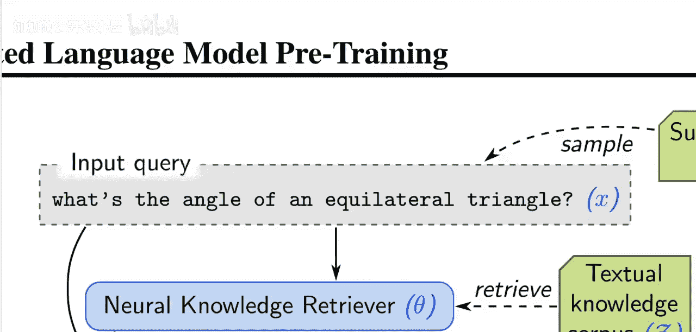

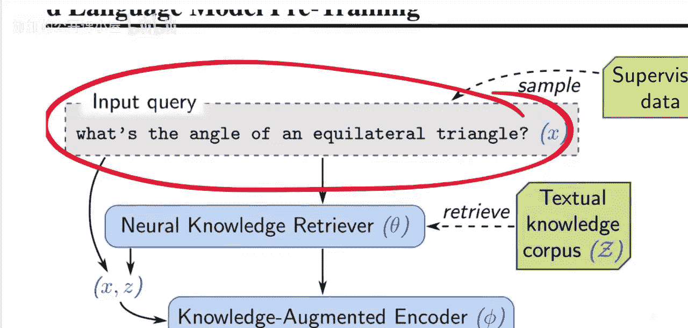

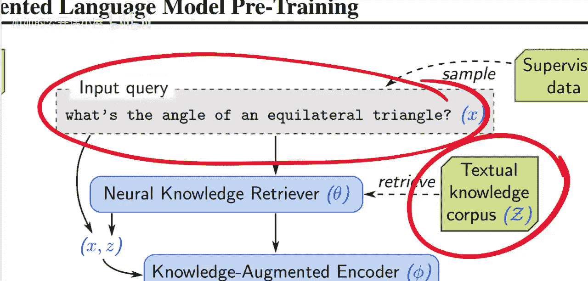

Which is 60 degrees right here。 This type of this type of task is called open question answering。

 So like open QA or QA and the distinction here between this and the previous kind of tasks that were often called question answering is that usually in question answering。

 you simply have a question and then you have either no help at all。

 So the model just has to answer the question and things like G3 demonstrated that that is actually something that's possible if you have a large enough model or。

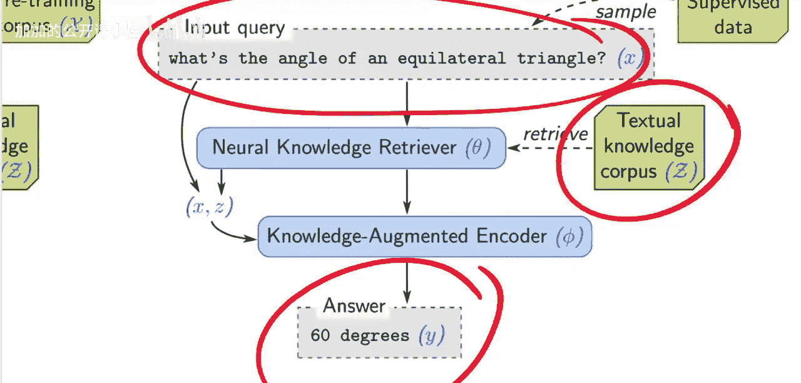

Much more common you would provide the question and then one document and you would sort of guarantee that the answer is somewhere in this particular document。

 So even though the task was called question answering。

 it was more like it was more a machine reading task because you knew okay all I have to do is I have to find the answer somewhere in the document to this particular question So the task was more kind of a pattern matching sort of approach。

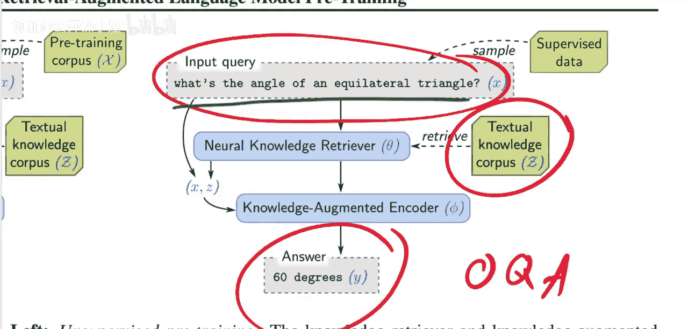

Here， the it's really the task really comes close to what humans understand as question answering。

 namely， you get a question。 you want an answer， and it's open in the sense that you can the machine can go with the question to like a search engine。

 I have no clue how to draw a globe。 to a search engine。

 Get multiple documents that would help it kind of rank them and so on。

 It's basically able to use the search engine and then answer the question from there。

 So that's what we're going to look at today。 there has been a lot of work。

 I'm not not saying this task is new。 but there has been a lot of work in open domain question answering。

 And this is one of the latest incarnations of it。 The paper is called realm or realm。

 I'm really not sure how to pronounce this。 The word would be called realm。

 I guess It's retrieval augmented language model pretraining by Kelvin Gu Kenton Lee Zora tongue。

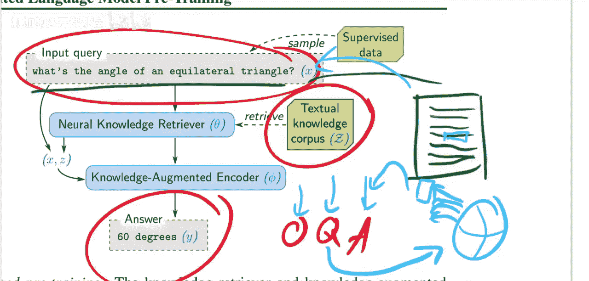

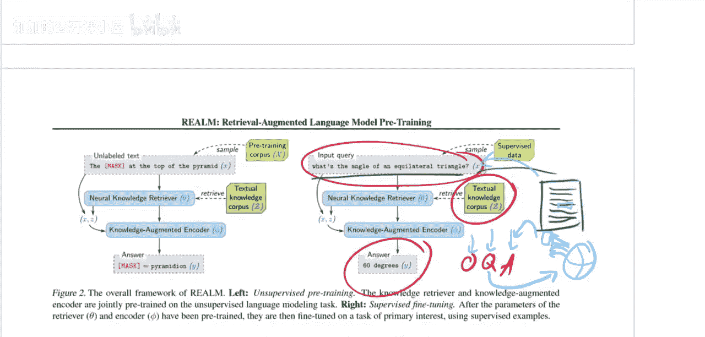

Pop Pg puzzlepa and Ming Waichang so。The paper is first and foremost about a pretraining method。

 as you can see right in the title， so the entire system that's presented here has sort of been explored in papers before。

 like other papers have already done this， or we retrieve other documents and in this particular case。

 as you'll see， the documents are retrieved using inner product search through a pre embeddedd through corpus。

 which is usually Wikipedia。

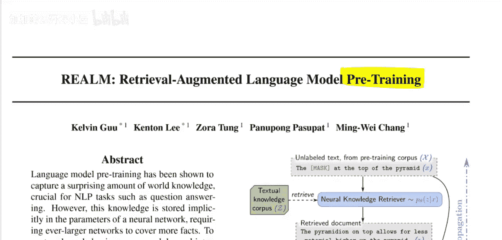

So you'll see all of this the new thing about this paper just to make this clear is the way that the pretraining works for these systems we're going to look at the entire architecture。

 but just you know such that you're aware of what's really coming from here and what's gathered from what's kind of conglomated from what worked so far so the improvements here are pretty stunning that they achieve with this new pretraining method which is pretty cool considering that its you know the new thing is a pretraining method so we'll look at this we'll look at the architecture。

 the pretraining method， the kind of hacks that you need to get it to work and finally the results。

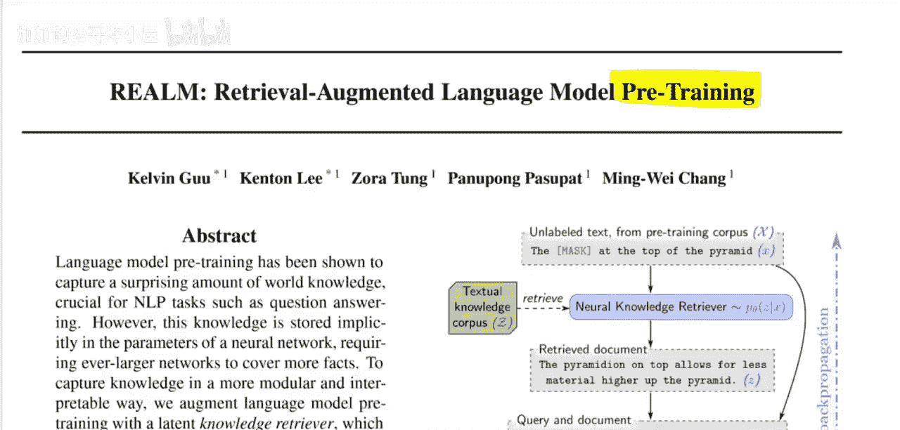

As always， if you enjoy content like this， don't hesitate to share it out and subscribe if you are not already and with that。

 let's jump in。

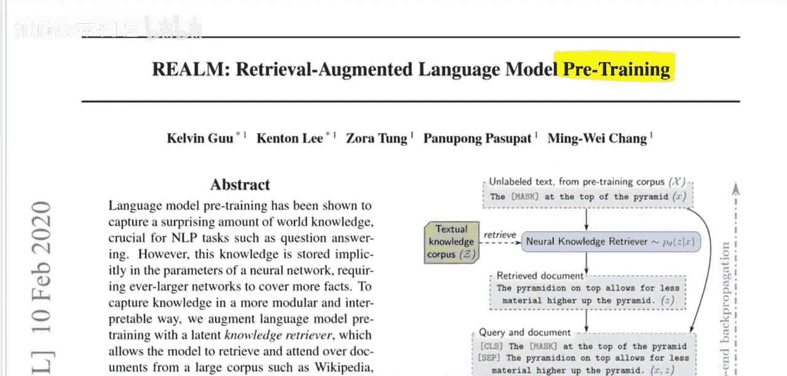

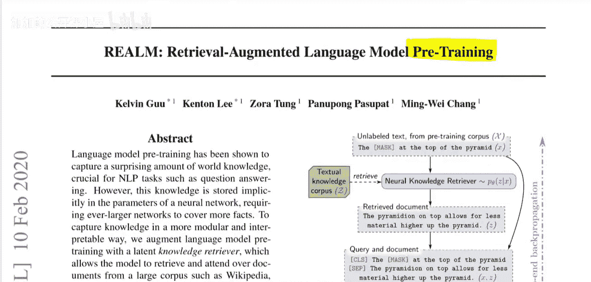

So the abstract says that language model pretrain has been shown to capture a surprising amount of world knowledge。

 crucial for MLLP tasks such as question answering。 And here again， we do。

 we say question answering is kind of the broad category of anywhere where you have to answer a textual question。

 So what do they mean by world knowledge。 What they mean by world knowledge。

 they mean something like。

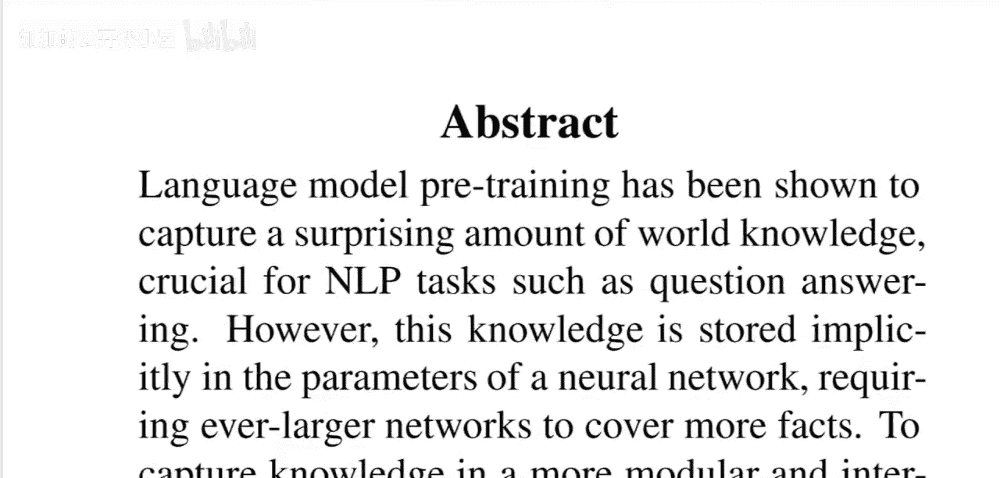

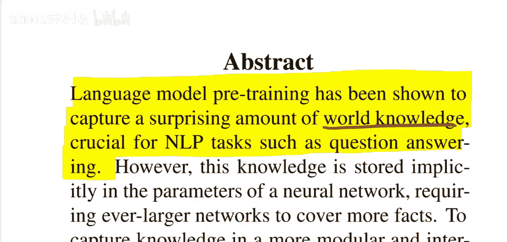

The question that we considered what's the angle of an equilateral triangle you can't from the question itself。

 you can't answer the you can't answer the the question it's not like a little math question where you just have to do the correct calculations or so on or which one is the longest words of the following words it really is additional knowledge that you had to have learned somewhere so that's what we call world knowledge and the fact that an equilateral triangle has 60 degree angles you need to have picked that up from somewhere now if you are GP3 then what you have done is you've taken these giant corpus right？

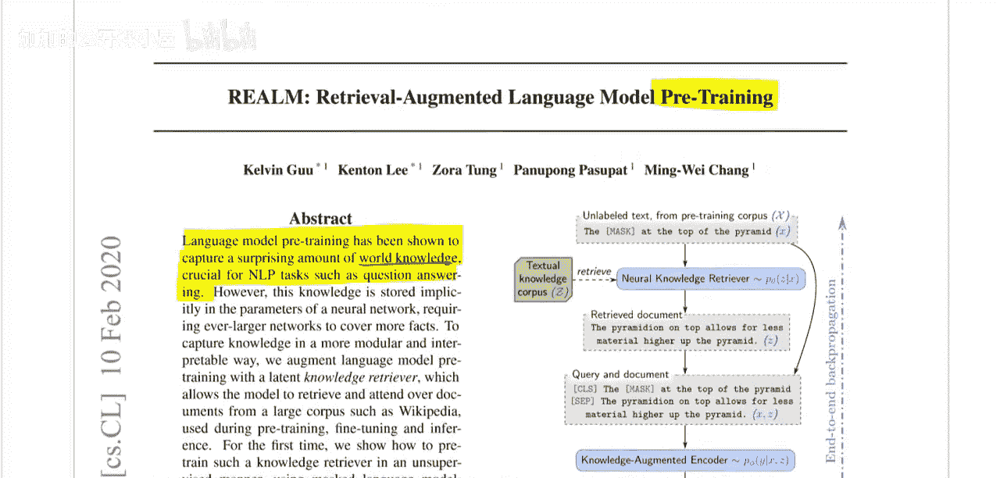

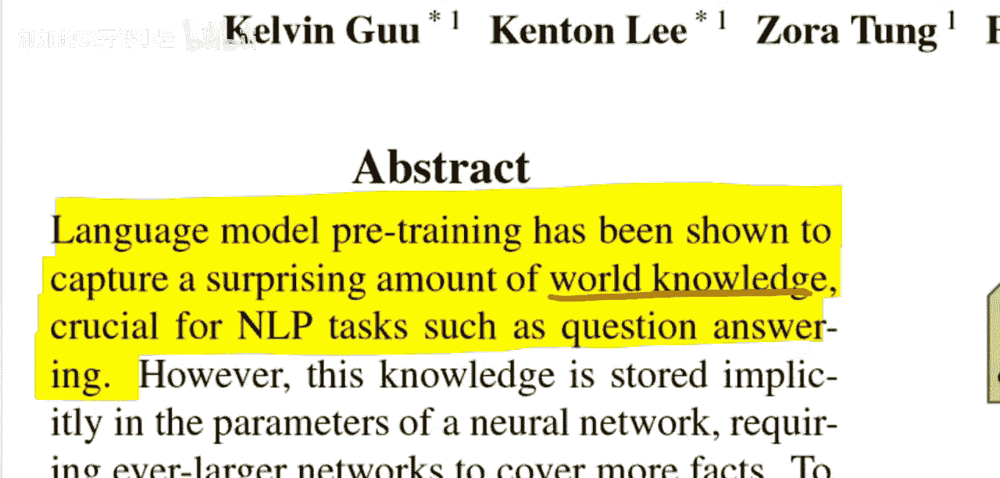

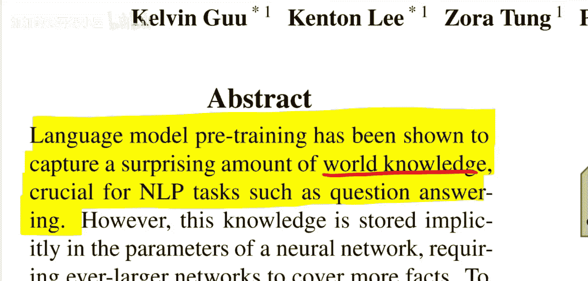

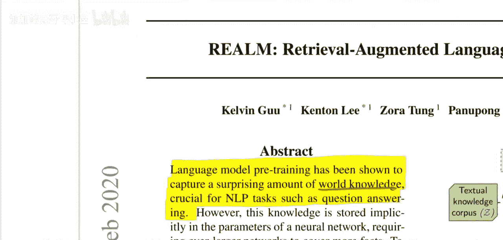

And you just did language modeling on it and that gives you GPT3。

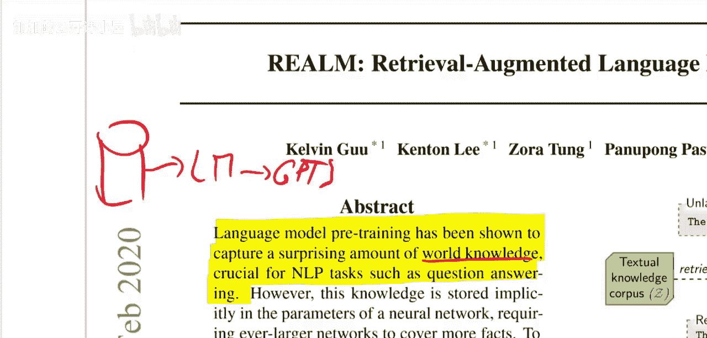

Now that means since G3 is so huge， that means that all the world knowledge that is contained in this corpus is baked into the model and can be sort of parsed out with good querying so if you provide the correct query。

 you can sort of parse out what's in the weights of the model。

 but it's very intransparly it's very intranspar in the weights of the model it's baked together with the language modeling they are criticizing not criticizing but sort of arguing against this right here。

 they say however this knowledge is stored implicitly in the parameters of a neural network。

 requiring ever larger networks to cover more facts。

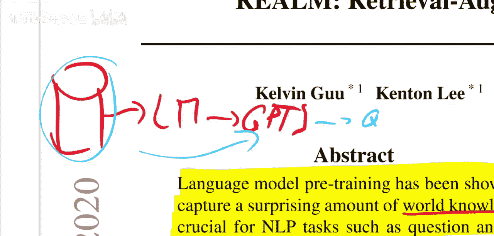

To capture knowledge in a more modular and interpretable way。

 we augment language model pretraining with a latent knowledge retriever。

 which allows the model to retrieve and attend over documents from a large corpus such as Wikipedia。

And sorry， used during pretrain， fine tuning and inference for the first time we show how to pretrain such a knowledge driven in unsupervised manner。

 using mask language modeling as a learning signal and back propagating through a retrieval step that considers millions of documents。

Okay so there is a lot of information here， so first of all。

 what they want to say is they want to say that in such a corpus。

 there are two kinds of knowledge right there there is language。

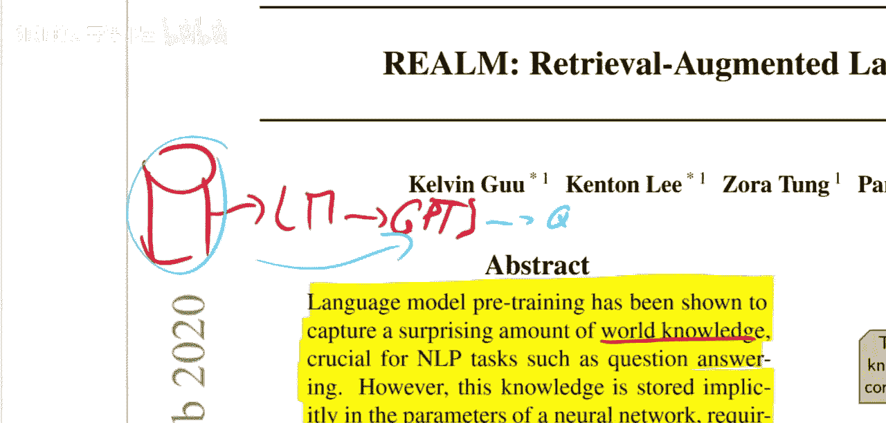

And there is this world knowledge Okay， and they want to make this sort of separate。

 So they want to have a model that can go to the corpus。

 retrieve documents and then use those documents， so。

Whereas previously the world knowledge has been joined with the language model。

 they want to savever this connection， say we want a model where we can simply teach it to go look for information。

 we can teach it to go search for things and then the searched things will inform its answering of the question okay。

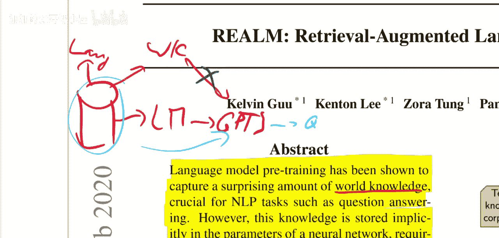

So that's what these systems are trying to achieve。

And saw that before we saw that before in the diagram。So。

They say we augment language model pretering with a latent knowledge retriever。

 which allows the model to retrieve and attend over documents from a large corpus。And also。

 they use this mask language modeling as a pretrain as a learning signal and back propagating through the retrieval step。

 Now this is the interesting part right here。 So what you'll have is you'll have a question。

And we can actually look at this diagram right here。

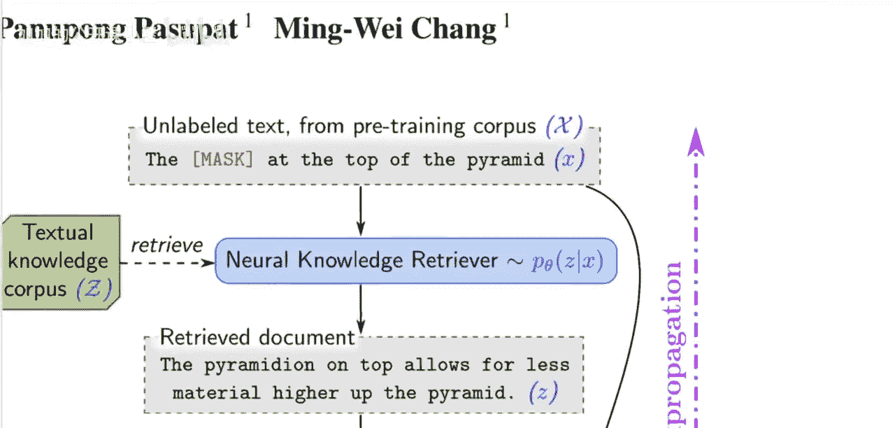

So the pre training is going to be masked language modeling， okay？

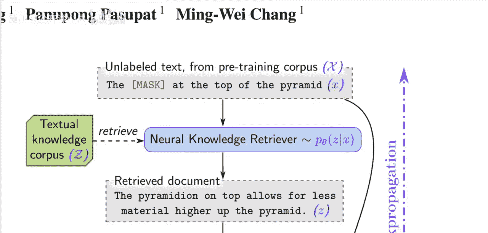

Ultimately， what you want to do is what we looked at before。

Ultimately what you want to do is question answering， so this thing right here。

Where the input is a query。And then you want to retrieve documents。

 and then you want to join them and let's actually draw this up。 So you have a query。

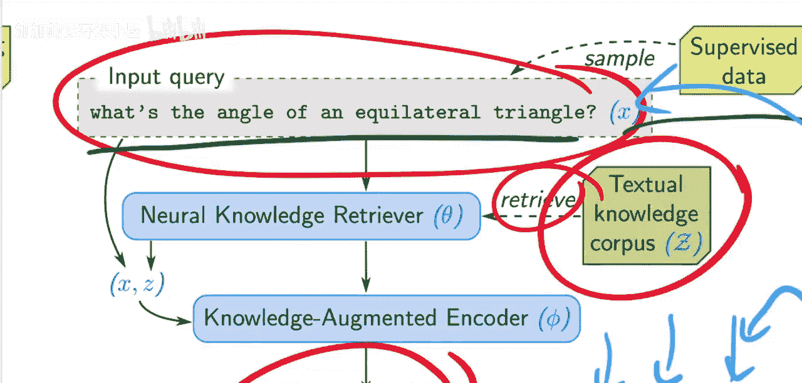

And you want to retrieve documents。 How do you do that， You train an embedding for the query。

 which is usually a you know a Bt model， Like that's the fashionable thing to do if you don't know what Bt is。

 I've made a video about Bt。 Well basically Bt can take a piece of text and then it will output a vector or multiple vectors for it。

 In this case， we just need one single vector for the entire query and then you have a bunch of documents in your corpus。

 So in your corpus right here， you have Z1 Z2 and so on。

 what you want to do is you want to embed all of those。 So you want to have B of Z1 and B of Z2。

Okay， you want to em。