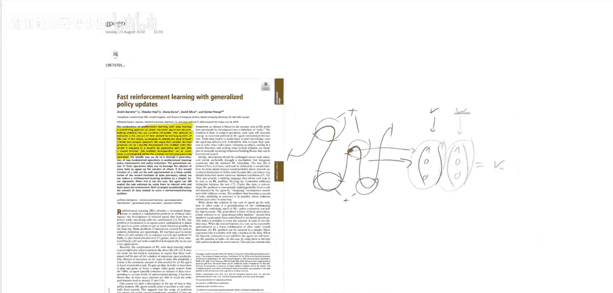
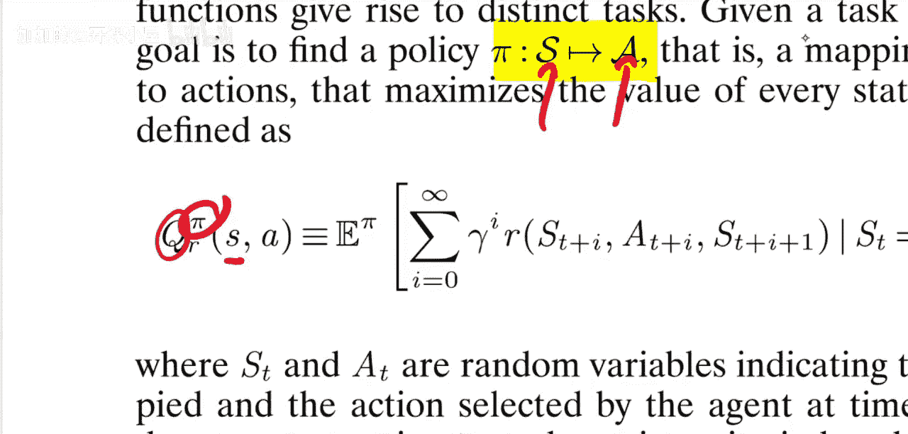
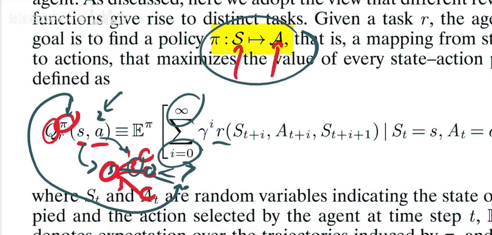

# YannicKilcher【中英⚡AI经典论文领读(全203篇)(上)｜Papers Explained】 p72 P93 广义策略更新的快速强化学习（论文解析） [BV1o3xLznExj_p72]

Hi there。 Today we're looking at fast reinforcement learning with generalized policy updates by Andre Barreto。

 Shabo Ho， Diana Borsa， David Silver and Dona Preub。

So on high level this paper proposes a framework for reinforcement learning where you have many tasks at the same time and they propose a framework where they learn many policies at the same time that can or cannot correspond to these tasks and then their argument is that if you now have a new task that you haven't seen before you can easily construct a solution to that task from your old policies。

 basically mixing what you learned about your old tasks and it's pretty general framework and we're going to look at it in my opinion it's pretty cool for certain settings however I think it kind of breaks down the more general you go which I guess is expected of such a framework but as you can see it's kind of math heavy but we'll get into the examples and what it's potentially useful for。

Alright， so that was it on a high level， if you like content like this。

 don't hesitate to subscribe to the channel and share it out。

 leave a like and tell me in the comments what you think I'm still reading all of them so I will see it。

Cool， let's dive in So they say the combination of reinforcement learning with deep learning is a promising approach to tackle important sequential decision making problems that are currently intractable。

Well， they're taking they're talking about， you know， things like。

Mostly these game playing AIs like go and things like this。

 So where this combination of deep learning with reinforcement learning has really shined or shunned。

Whatever one obstacle to overcome is the amount of data needed by learning systems of this type。

 So again， if you look at these systems like Alphago。

 they need a simulator and they need to collect enormous amounts of data even more so with systems like the dota AI。

 the Open AI 5 dota or starcraft playing Alpha star。

 I think it's Alpha star they need so many ss in order to learn about the tasks because they always start from scratch。

In this article， they say we propose to address this issue through a divide and conquer approach。

 We argue that complex decision problems can be naturally decomposed into multiple tasks that unfold in sequence or in parallel。

 by associating each track task with a reward function。

 This problem decomposition can be seamlessly accommodated within the standard reinforcement learning formalism。

Okay， so what are they saying right here， They are basically saying that if you have a task。

Let's say you want to get W the from here to here。And that's very complicated。

 Let's make it complicated， super duper complicated。

You can basically subdivide that task into multiple subtasks， right， so here is like left turn。

 right turn， go straight， left turn， go straight， right turn and so on。 And each of these subtasks。

 you can see the two right turns here。 might share a lot of common information。

 there could also be tasks that are at the same time。

 like you need to go forward and jump can be decomposed into going forward and to jump。

 Now they're saying is if each of these tasks now has its separate reward function in the environment。

 Like for some reason， the environment tells you this， by the way， is task task one。

 and you're going to get a positive reward if you do a right turn。And this down here is task2。

 the the left turn task。 And you're going to get a positive reward if for that task。

 So the entire task state can be decomposed into a vector。 So in our case here。

 we have maybe a vector with three elements。 Okay， the three elements correspond to turn right。

Go straight。And turn left。And now your this this right here is your reward vector。

 So we're no longer talking in this framework。 we're no longer talking about just a reward。

 We're talking about a reward vector。 Now each of these tasks is going to give you its own individual reward。

 So let's say you're here and you're actually turning right。

 This is going to give you a reward of one for this task， but rewards of0 for the other task。Okay。

 so the environment will somehow tell you which tasks you get reward for。Now。

 there is a notion where you can map this back to a single number。

 and that is the second thing they introduce here。 So the second thing they introduce here is this thing they call W。

 So W is going to be a mixing vector。 W is going to be a vector。I will call W right here。

 This is the reward vector。 W is going to be the vector that tells you。Your final reward。

 So here we're going to do an inner product。 So we're going to transpose this and multiply by W。

And W。Mixes these rewards and comes up with your final reward right here。

 So this this is maybe the reward vector。 This is the reward number。

 How are we going to call this reward number。So in this case。

 W would have to look something like this。 let's say this is an example。

 So the task right here would be to only do right turns。 Now， this is not a really nice example。

 We're going to see some nicer examples later on。 but you can see that now the environment is specified as a vector of rewards。

 And you can create a specific tasks like turning right。

 simply by adjusting how you mix these different things by this vector W。

And this is going to be the key ingredient here。 So they discuss your general reinforcement learning reinforcement learning lingo。

 and I think we've gone through this a number of times just very。

 very quickly in reinforcement learning。 you're given these transitions。

 you are in a state you' taken action and。

That leads you to get a reward， or prime and。You get into a state S prime in the next state。

 They say the reward is given by the reward function。

 So the reward is purely a function of where you are and what you do and where you get to。

 Now most reinforcement learning problems， you can actually kind of forget about this part right here because well。

 it it is it is kind of important， but you could。Most reinforcement learning problems。

 the reward is simply a matter of where you are and what you do， and this can be a random variable。

 there can be randomness， but maybe it's easier if you for now think about the reward simply as a function of these two things so what you want to discover is a policy pi where you input you input where you are and the output is going to be what you should you do in that situation that is a policy。

And associated with each policy is this thing called a Q function。 So you can see right here。

 the Q function of a policy。Is going to be a function of where you are and what you do。

And this is a bit confusing， but it basically means that you are in state S。 so you are here。

And you have， let's say， three options， action 1， action 2， action 3 to do。 Now。

 the Q function tells you。The Q function， this is S and the A's are the numbers。 Okay。

 so let's say we plug in the state S and for a， we plug in number2。

 What it will tell you is if I am in state S and I perform action number 2。

Then how valuable is that for me and value is defined by all the reward that I'm going to pick up from now until the end of time or the end of the episode。

 It depends。 But let's say until the end of time， well。

How much how much reward I I going to pick up from now until the end of time is a bit of a vague。

 not a vague question， but a difficult question。 I can tell you how much I could estimate how much reward I'm going to pick up。

In the next step， because I know what action I'm doing I'm performing action number 2。

 But what happens after that， Who knows。So that's where this policy right here comes in。

This policy right here says， so the full definition of the Q function is。

 if I'm in state S and I perform action A right now and after that。I follow policy pi。

What is my reward going to be Well now it's well defined。 So right now you do action A。

 and after that， you do whatever action the policy tells you in that specific situation。

 Okay so that's the Q function。 And you can pretty easily see that if you have a Q function。

 right if you have an accurate Q function。 you can get a good policy by simply always going with the action that gives you the highest Q value。

 because it's because the returnscurnce。

