# YannicKilcher【中英⚡AI经典论文领读(全203篇)(上)｜Papers Explained】 p73 P94 放射性数据：贯穿训练过程的追踪（论文解读） [BV1o3xLznExj_p73]

Are you tired of other people training on your data， That annoys me every time it happens。

 I'm mad about this。 If only there was a way to somehow mark your data。

 And when other people train on it， their computer would explode。

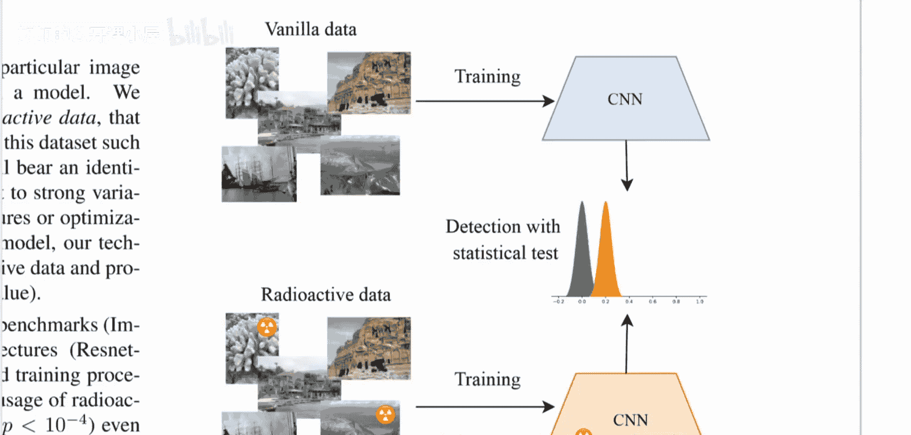

Well， this paper is a little bit like this， not entirely the explosion part I think they're still working on on a followup paper。

 but in this case， in this paper called radioactive data tracing through training by Alexander Sa Mats Dus Goddelia Schmidt andjigu。

 they develop a method that at least you can detect if a given model was trained on your data or not on your data and they call this process radioactive marking or radioactive data for short。

 So the overview you can see it's pretty easy paper actually the concept is pretty easy and it's a nice concept and。

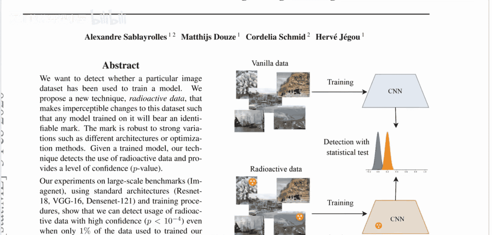

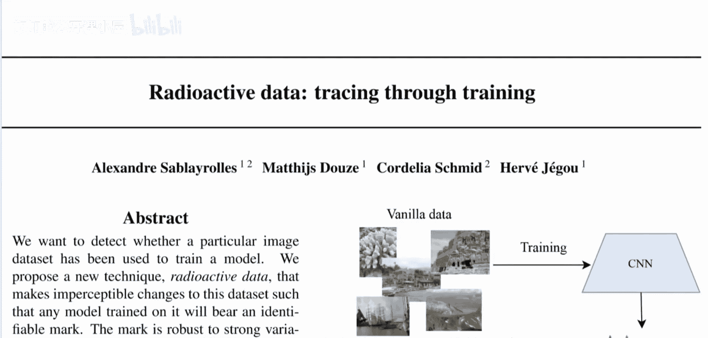

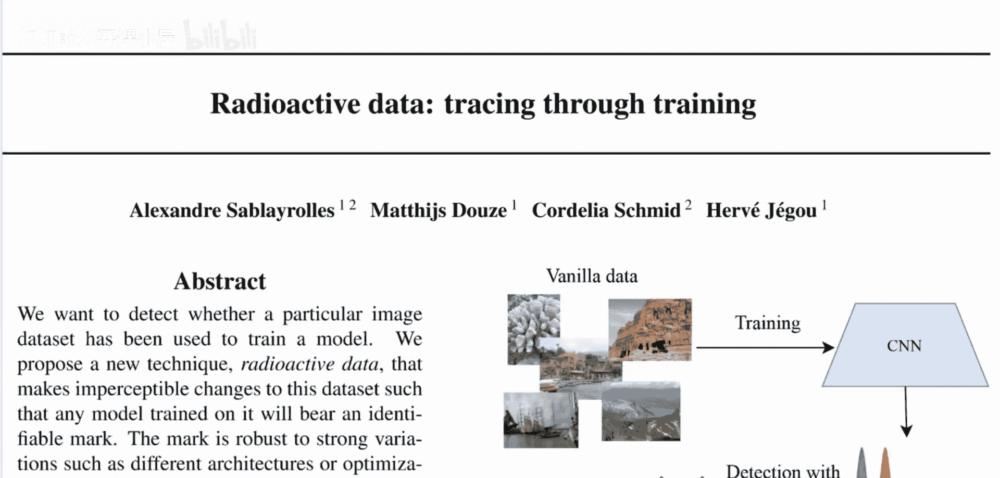

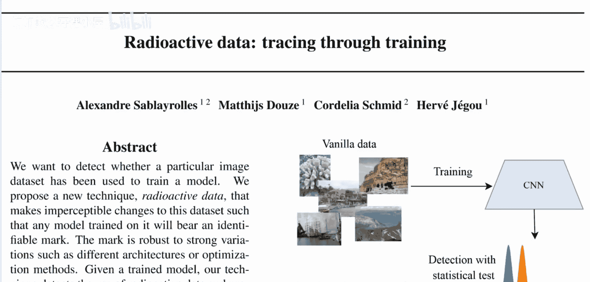

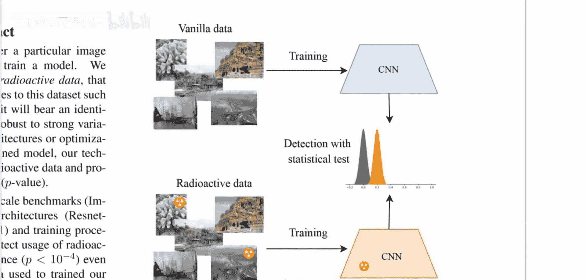

It's been around in one form or another。 It touches on adversarial examples。

 it touches on differential privacy， but in essence， it works like this。

 if you have if you suspect someone else training on your data or if you just have a data set that you want to protect what you do is you market。

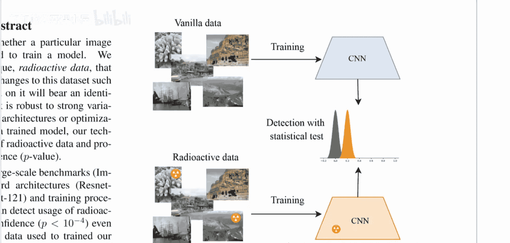

You mark it with this mark and they call this like a radioactive mark。

 but essentially you just distort your images a little bit。

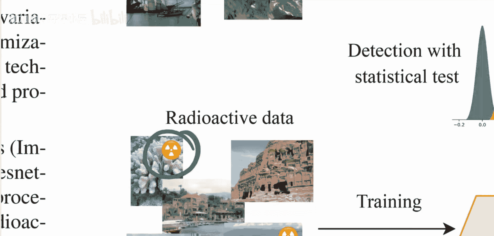

Then when someone else trains on that data， so here a convolutional neural network is trained on this data and not all of the data needs to be marked。

 they can go as little as like one or2% of the data being marked。

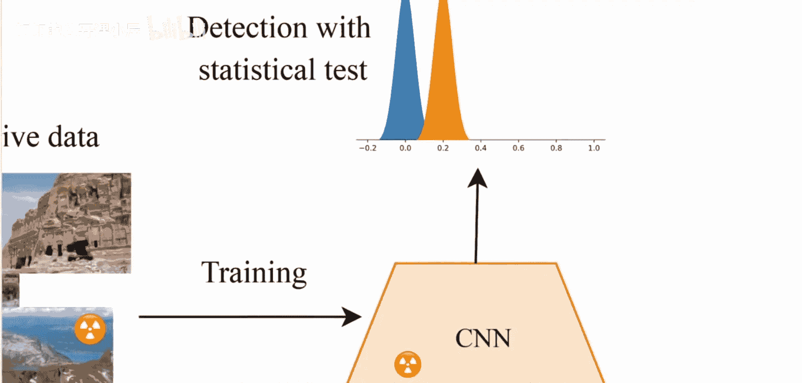

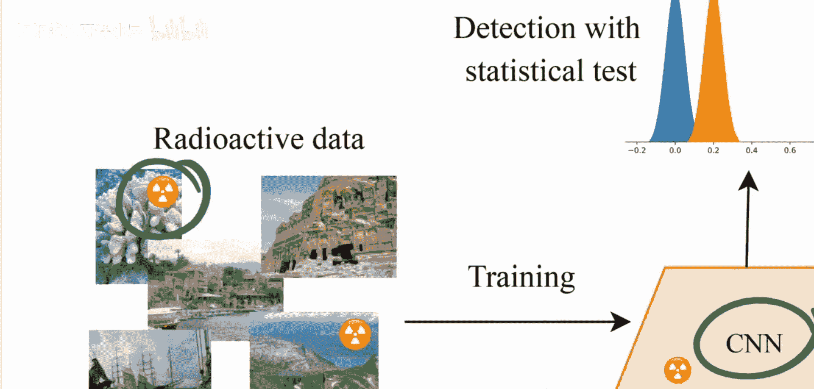

Then from the output of that network or from the inspecting the network itself。

 you can then test whether or not this network has been trained on this radioactively labeled data。

 so you will see a clear difference to a network that has been trained on only what they call vanilla data。

 so data that has not been marked。

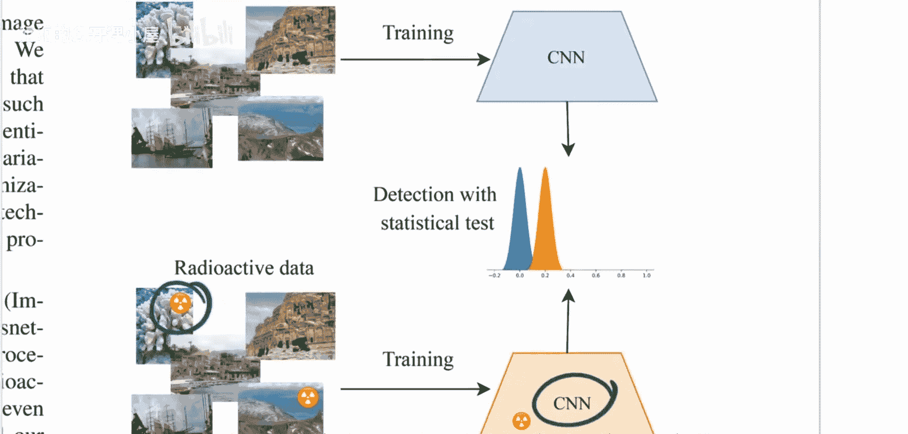

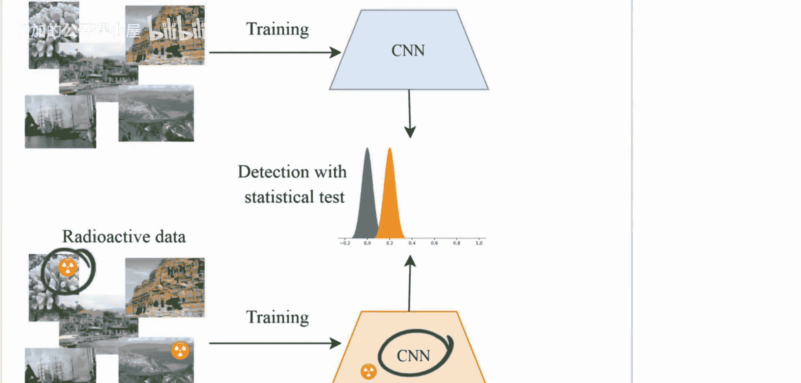

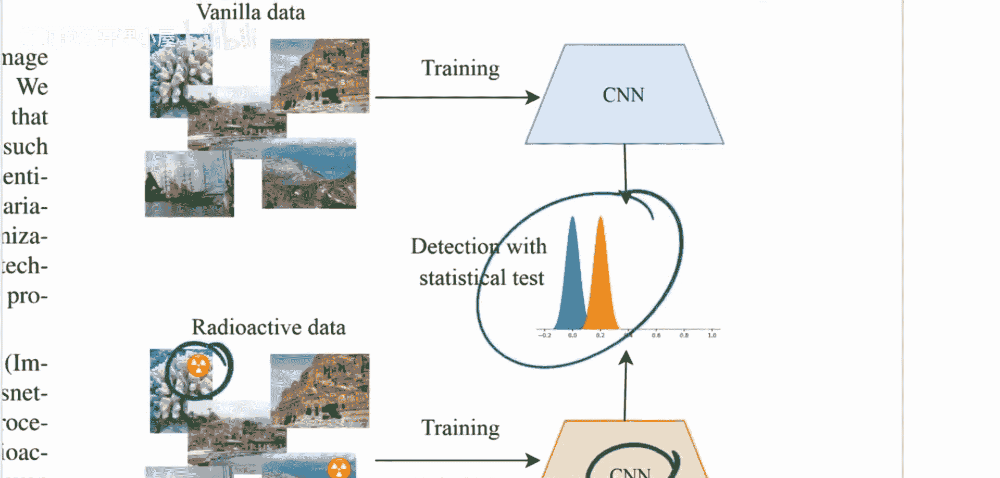

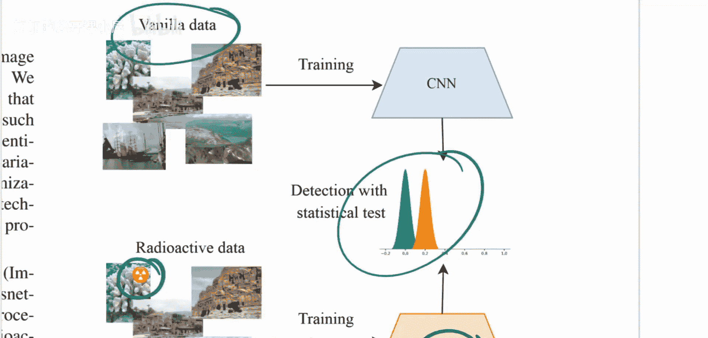

So I hope that's that's clear what you do， what you do is you train。 sorry， you mark your data。

 what the kind of what Bob does， No， what's the attacker's name， I don't know。 but what Eve does。

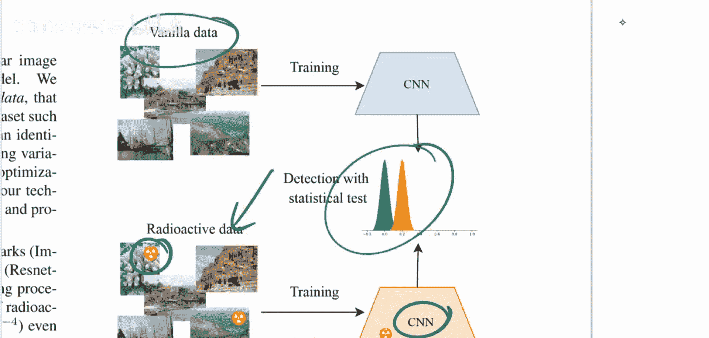

Is train here a network on data， and you don't know whether it's this or this。

 and then you do a test to figure out which one it is。

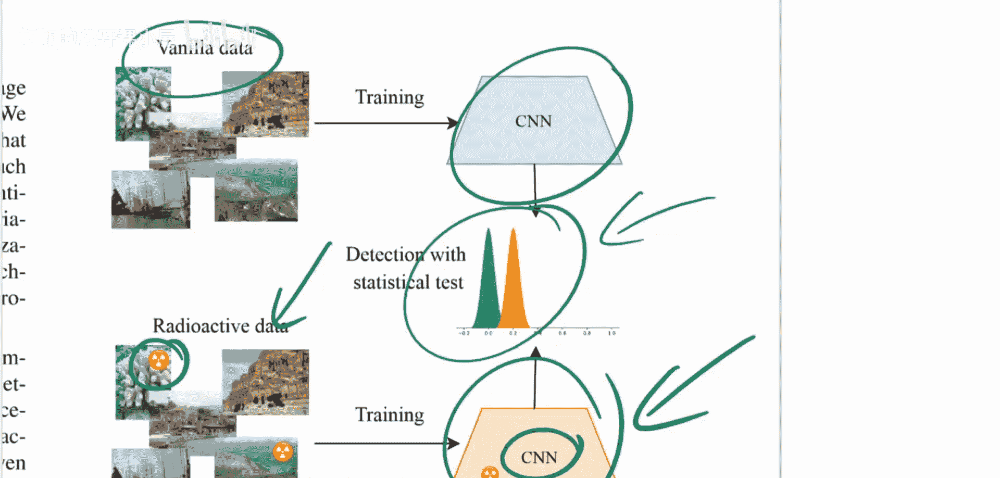

Okay， so we'll dive into the method and look at how well this works。 pretty， pretty simple。

 but pretty cool。 So their entire method rests on this kind of notion that。😊，These classifiers。

 what they do is if you have a neural network， like a convolutional neural network。

 you have your image， your starting image of your prototypical， I don't know， cat。

And you input this into many， many layers of a neural network as we are used to。

But the last layer is a bit special， right， because the last layer is the classification layer。

 If let's， let's just assume this is a classifier。 So if this is C for 10， for example。

 there are 10 different classes that you could output and so 10 of these bubbles right here。

 That means that this matrix right here is a。😊，Number of features。 let's call it D。By 10 matrix。Okay。

 so the network， this part right here， we would usually call a feature extractor。

 something like this， So the bottom part of the network basically does this its nonlinear transformation and so on extracts D features。

These are latent features， and then those features are linearly classified into 10 classes。 Okay。

 the important part here is that that last layer is actually just a linear classifier。

And we can reduce this actually down to a two class classifier。

 so the phi function would just put points here。In somehow， you know， I。

 let's just make them two classes， the x's and the O's and so on。So if the phi is good。

Then the last layer has a pretty easy job linearly classifying it right here。

 You can see here the file is not very good。 we can't linearly classify this data， so。

By training the neural network， what you do is you make phi such that。It will place， hopefully。

The one class somehow on one side， the other class on the other side。

 and you can pretty easily linearly classify that data。Okay， the exact slope of this line right here。

The exact location of this line and direction of this line。

 That's what's encoded ultimately in this matrix right here。

 So this matrix now not only for two classes， but for 10 different classes。

 it it records these hyperplanes that separate one class from the other class。

 And these are in dimensional space。 So you have dimensional10 D dimensional hyperplanes。

 separating the space of features linearly into the classes。

So what you can do is you can actually think of this D。 sorry， of these。

D dimensions here as features， right， This is a feature extractor， so it provides features。

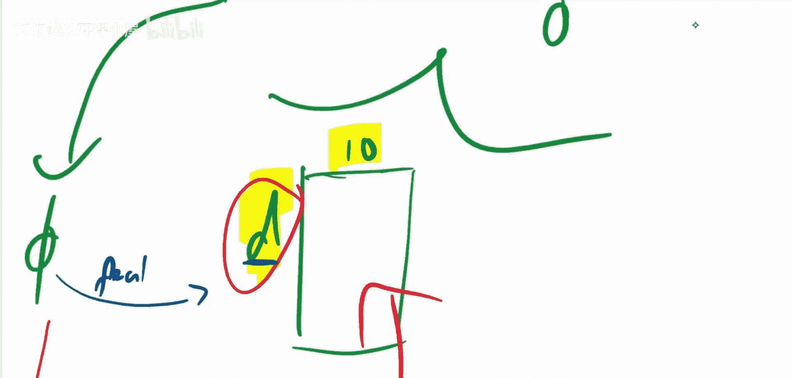

To a linear classifier。Now， what this method does is when it radioactively marks data points。

 it simply adds a feature， okay。

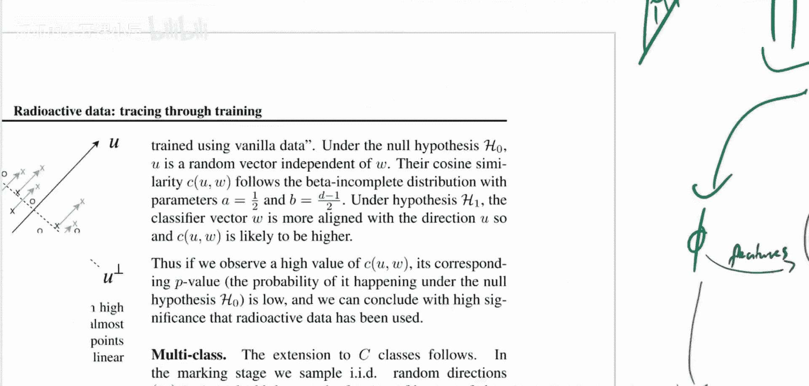

So how do you think about these features？ So， for example。

 let's say this is actually this animal classification example。 And if you。

Or if you are asked to classify cats from dogs， from horses and so on， one feature could be。

 does it have whiskers。With skirts， one feature could be， does it have fur， right。

 You can maybe distinguish cats from turtles and sort cats and dogs from turtles。

 Does it have how many legs， So the number of legs。And so on。 So you have all these features。

 and the last layer simply linearly classifies those features together。 What this method does。

 is radioactive method that it's， it adds a new feature per class， so。Down here。

 I would add a new feature that says like， this is the radioactive feature。

 Can I draw the radioactive symbol。 This is the radioactive feature。For the class。cat。😡，Okay。

 and then， of course， I also have one for dog and and so on。

 so it would add or basically would you you don't change the dimensionality， but in essence。

 you add one feature per class。

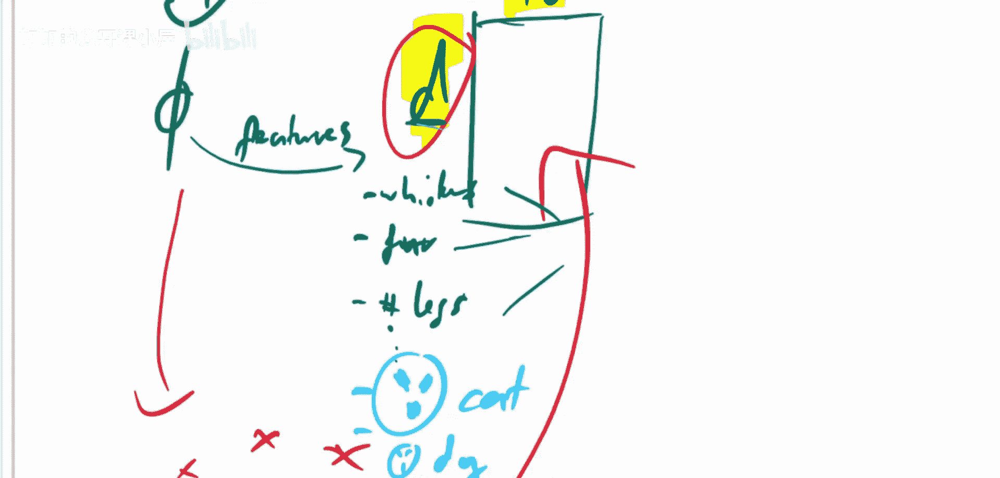

And that's what they mean here by this direction U。

 So in this high dimensional space that is spanned by these D dimensional vectors and。

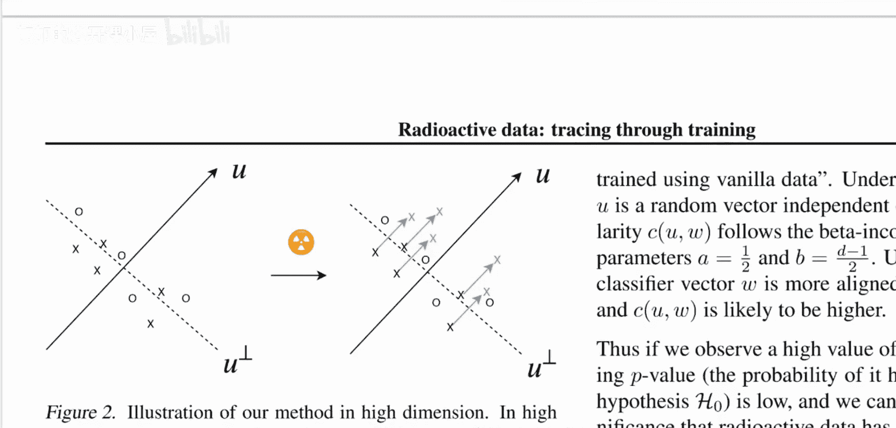

You can。So this thing here， Okay， sorry， I'm switching back and forth。 This thing here。

 you can sort of， if D is equal to 2， you can imagine it as 10 vectors in a space in this feature space。

 Okay，10 of these vectors。And whenever you get a point， thats is a8 I'。 When you get a point。

 you simply look at。 So if you get a data point right in here goes through here。

 you come here and you look。With which class does it align more the most。

 and that's how you classify it okay？

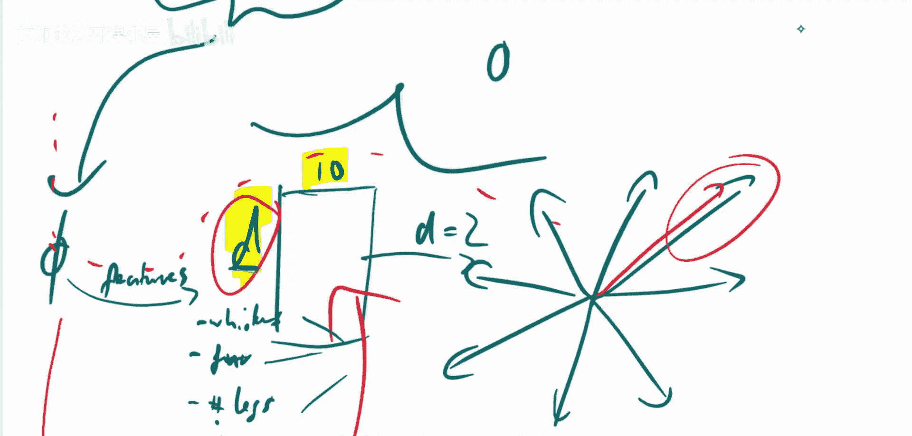

So。If you think of this， then。

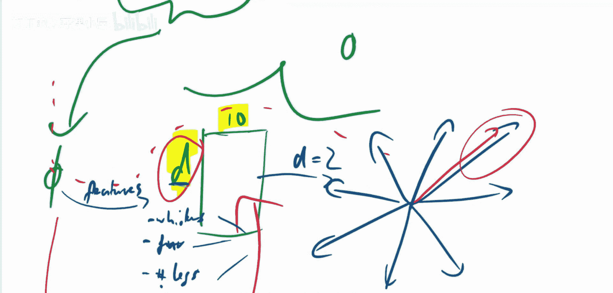

What you want to do is you want to add a feature。

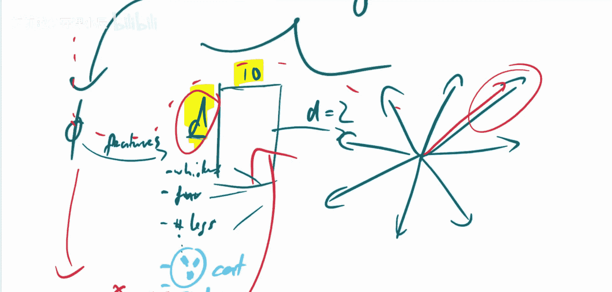

Here， such that。This is one per class， I'm having trouble articulating this。

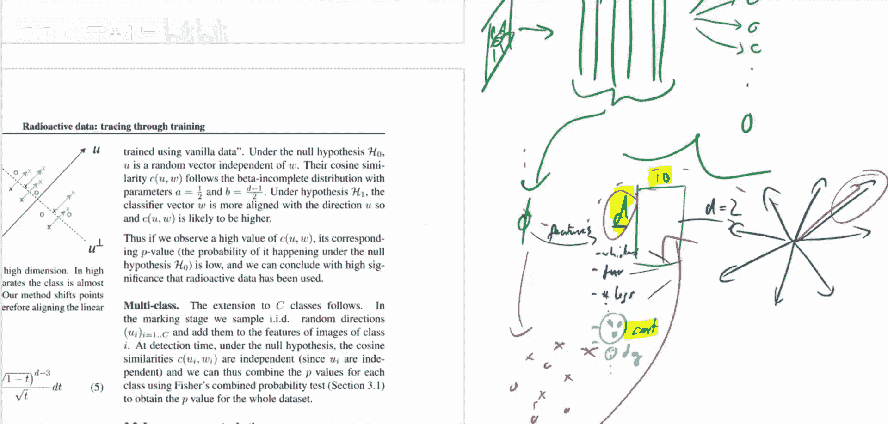

And you want to change your data points here， you can see your data points。 And for this class X。

 we make this radioactive feature right here， which is the the blue thing。

We shift the data into the direction of this feature。 Okay， so basically， we add the feature U。

 which is just a random vector in this high dimensional space。 We choose one vector per class。

 But then we shift all the data for that class along this feature。

 So what we are doing is we are introducing fake， a fake feature that we derive from the label。

 right， So we， we kind of cheated。😊。

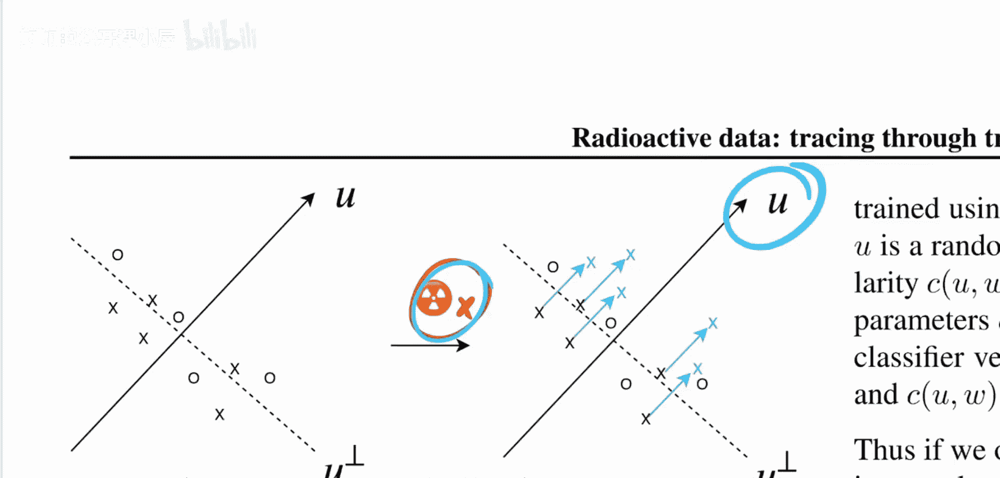

Here we have X， and you're supposed to tell y from it。 And that's your training data。

 But then we cheat。 we look at y and。We modify x with the feature of that particular class。

 So what does that do，Ultimately， we have we end up with U1， U2。

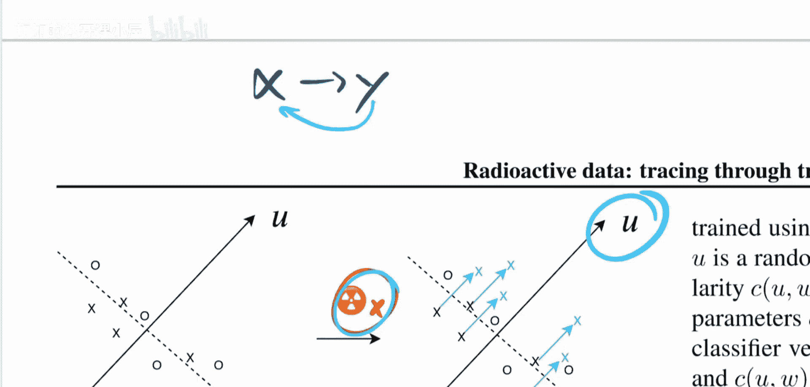