# YannicKilcher【中英⚡AI经典论文领读(全203篇)(上)｜Papers Explained】 p75 P96 自分类MNIST数字（论文解析） [BV1o3xLznExj_p75]

Check this out。So what you're seeing here is neurocellular automata that are learned to communicate with each other what digit they compose。

 so every pixel you see is like a little cell and communicates with its neighbors and only its immediate neighbors about kind of its surroundings and by doing that all these cells that are connected components have to agree as to what digits they compose and here you can see the seven symbolized by gray and the three symbolized by green reach in agreement。

There are some interesting properties about these cellular automata。

 namely here you can see that half of this thinks it's a2 and the address thinks it's a0， however。

 let's see when I complete this knot it's too smart for this。

Well look at that now it thinks of it it's an eight so you can clearly see there's like some message passing some evolution going on across the state right here it doesn't work perfectly。

 I found it thinks a lot of times that it is in fact a zero。😊。

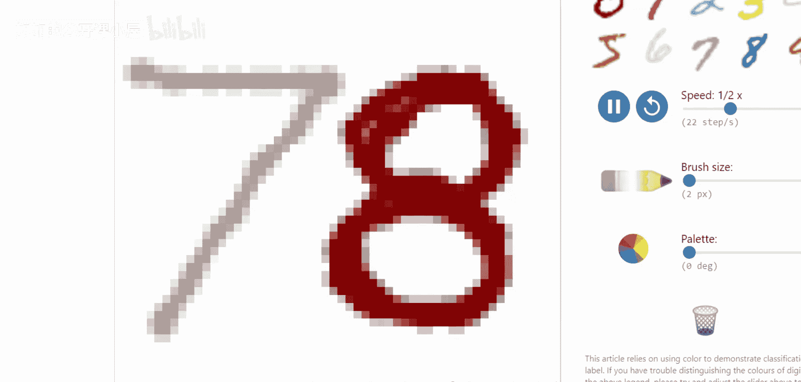

嗯。As you can see right here， but so the goal is that this direction of research。

Isn't about state of the art in digit classification as you might be able to determine right here。

 it's about neuralcellular automatop and I highly recommend if you don't know yet go watch my video or read the previous article in this distill pub journal about growing neuralcellular automatop this paper here is a follow up it's called selfclassifying Mnes digits and it's by Etorreonadso Alexander Mort Vf。

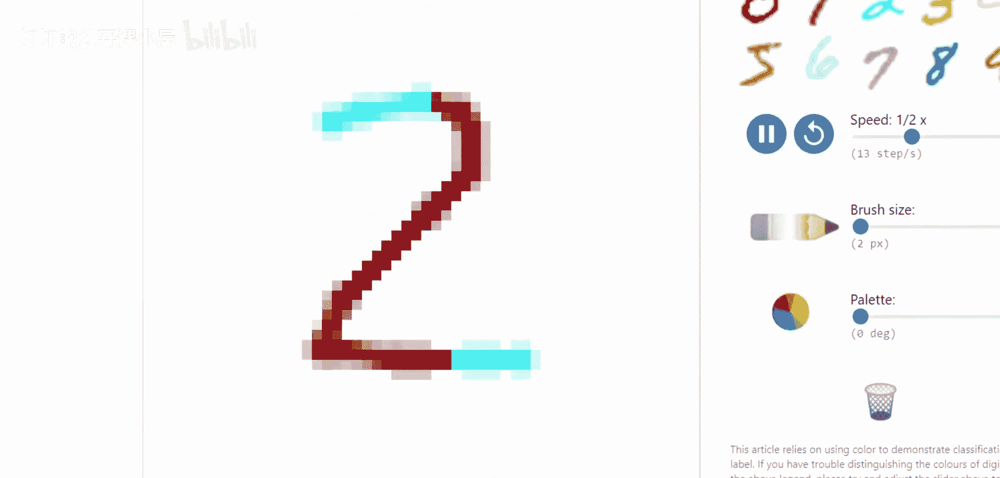

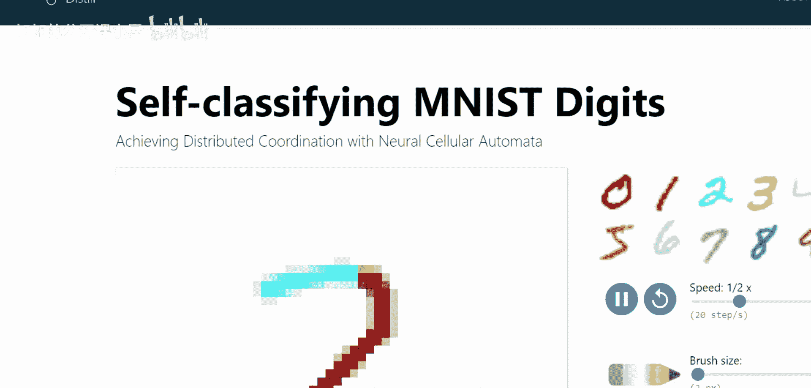

Edwin Nicholason and sorry， Edwin Nicholasson， Michael Levin and Sam Gradenus。So。😊。

This paper is an evolution of the previous paper， and I'm going to switch back and forth here between the website and the thing where I can scribble on。

 so bear with me for that。

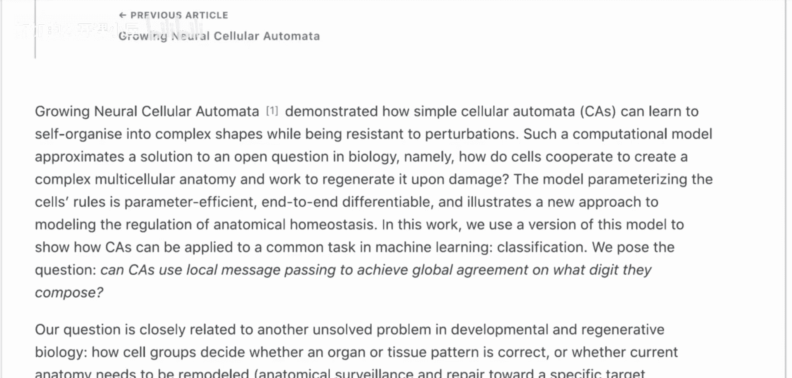

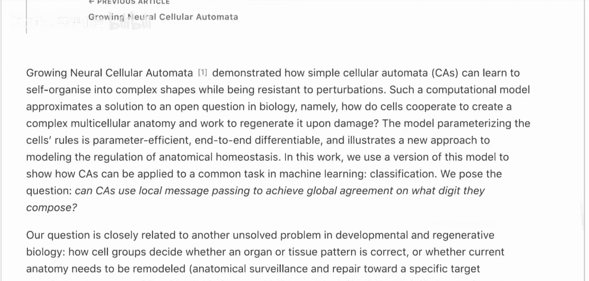

There saying that growing neural cellular automata demonstrated how simple cellular automata can learn to self organize into complex shapes while being resistant to perturbation。

 so that was last paper。Such a computational model approximates a solution to an open question biology。

 namely how do cells cooperate to create a complex multicellular anatomy and work to regenerate it upon damage。

 also from the last paper。The model parameizing the cell's rule is parameter efficient and differentiable and illustrates a new approach to modeling theregulation of anatomicalostasis。

In this work we use a version of this model to show how cellular automata can be applied to common task and machine learning classification we pose the question can cellular automata use local message passing to achieve global agreement on what digit they compose？

So that's the question right here Now again I've done a video on cellularmata but really really briefly what you saw above is that there's an image and its rasteroid of course reststerized in two pixels and each pixel represents one cell so you can think of this as basically nodes in a graph and each cell is connected to its immediate neighbors so each cell let's take this one is connected to all its immediate neighbors like so。

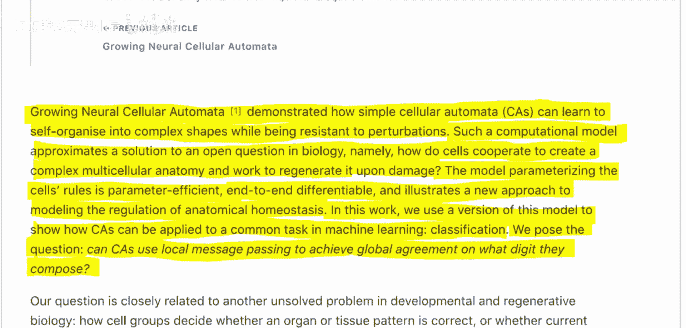

And of course， each cell， each other cell， again， is connected to its immediate neighbors。

Now all they know is。Basically。TheSo if I draw something on this canvas， let's say I draw。

 let's take this。 I draw a two。

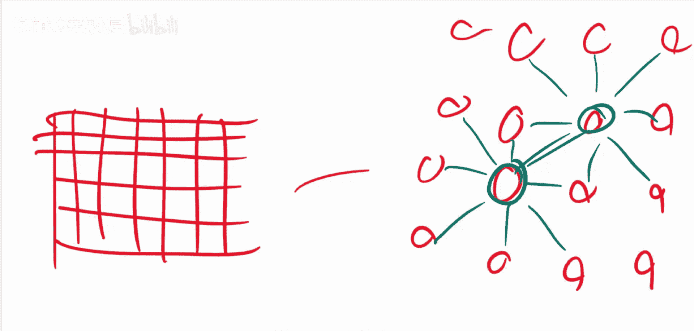

Okay， then you look at this cell right here。 and of course， the cell， this is going to be。

Its the line would be thicker， so it's either going to be on or off。

 it's either going to be I painted on it or I didn't paint on it。

 and it can be in different variations like there is an alpha level。

 but ultimately each cell can only register whatever was set painted on it So each cell can be dead or alive。

 and dead cells， they will not send around any messages and dead cells is everywhere where there is no color at all。

 So this would be a dead cell。 This would be a dead cell。

 this one wouldn't be a dead cell because there is a little bit of color。

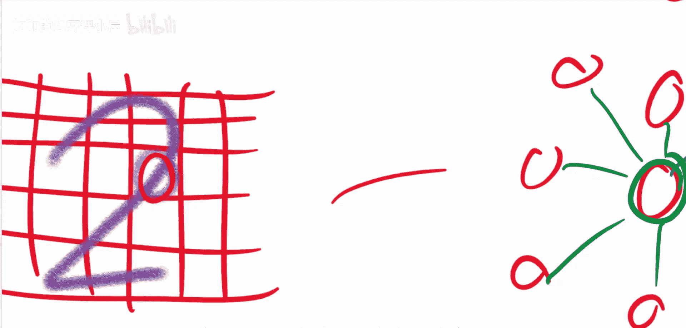

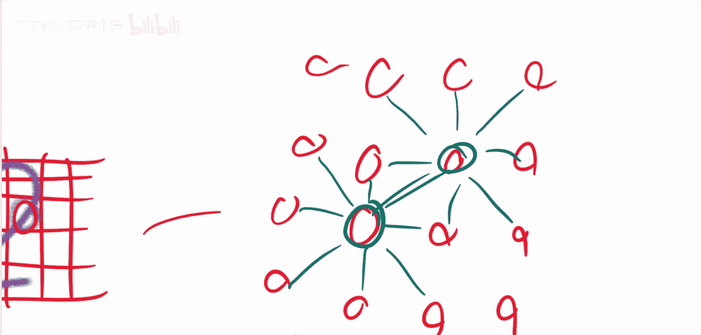

This would be a dead cell right here。 So with this。

 So you can see that most cells here are actually dead。 Now， the cells that aren't at they。

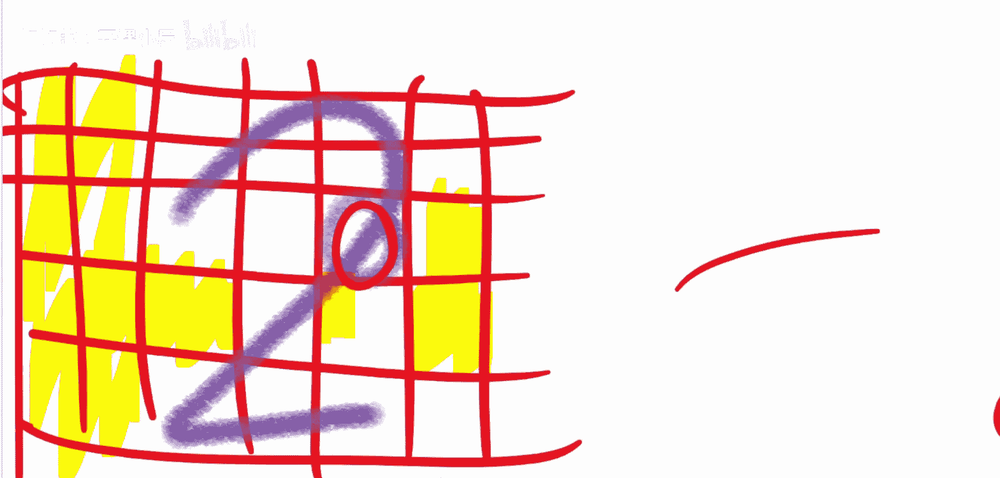

Register whatevers painted on them like this cell or this cell or this cell。

 and then they need to communicate that to each other。

 And the goal is that all these cells that are alive， like these cells right here。

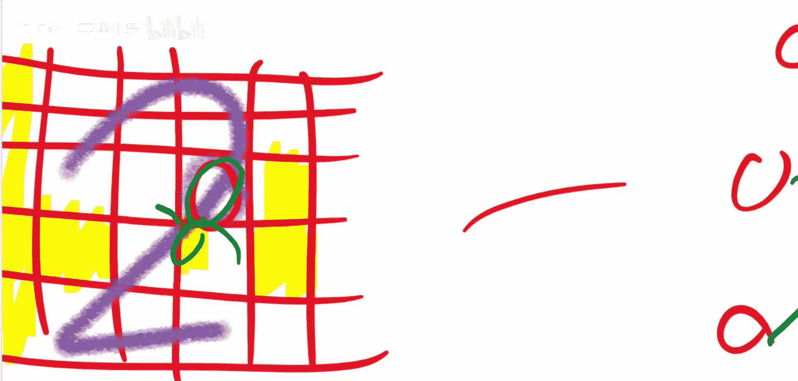

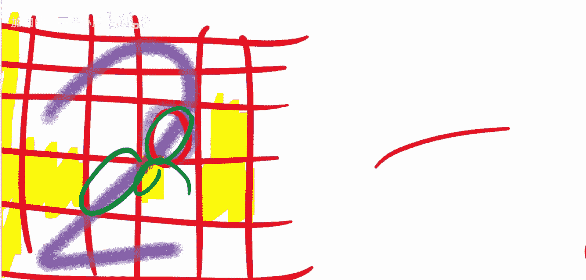

All the cells that are alive， they pass messages to each other。

Such that they all come to an agreement， what digit they compose right if you imagine you're this cell right here。

 all you see is that there is a bit of purple on you right there is a bit of purple and it could be alpha level 200 out of 255。

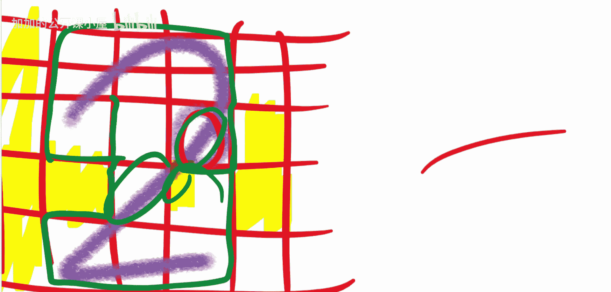

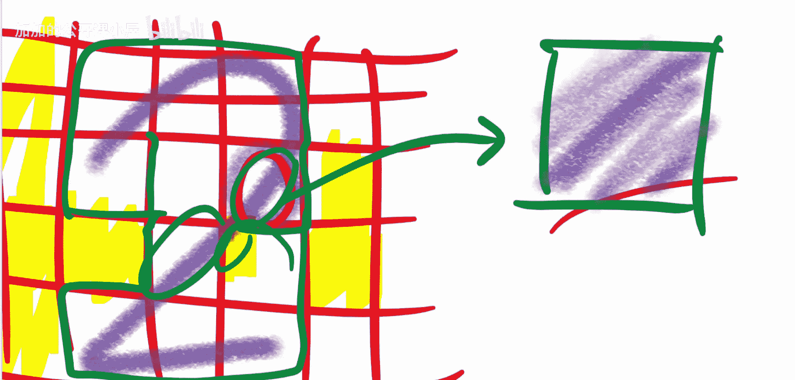

And only by registering this and communicating this to your neighbors and receiving messages and then passing on those messages to other neighbors。

 all of these cells need to come to an agreement， So how do these cells agree each cell in fact has a cell state so each of these cells。

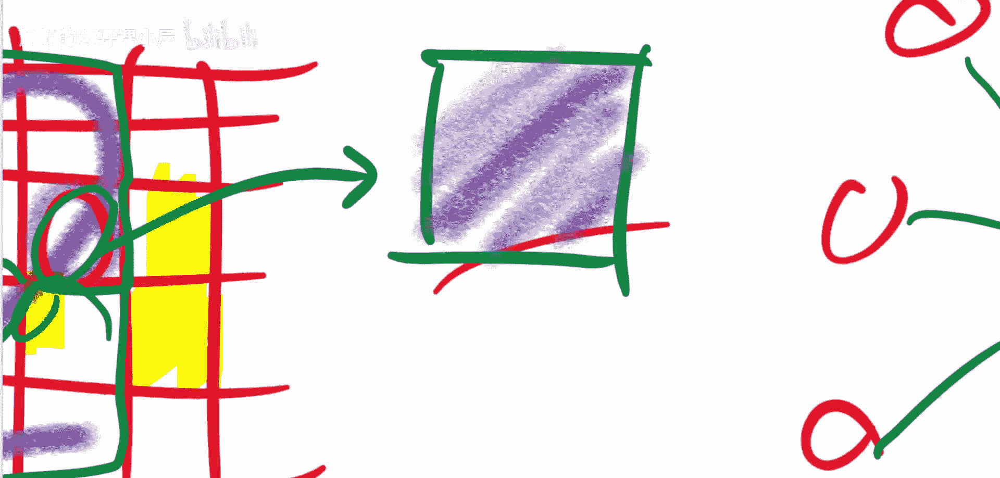

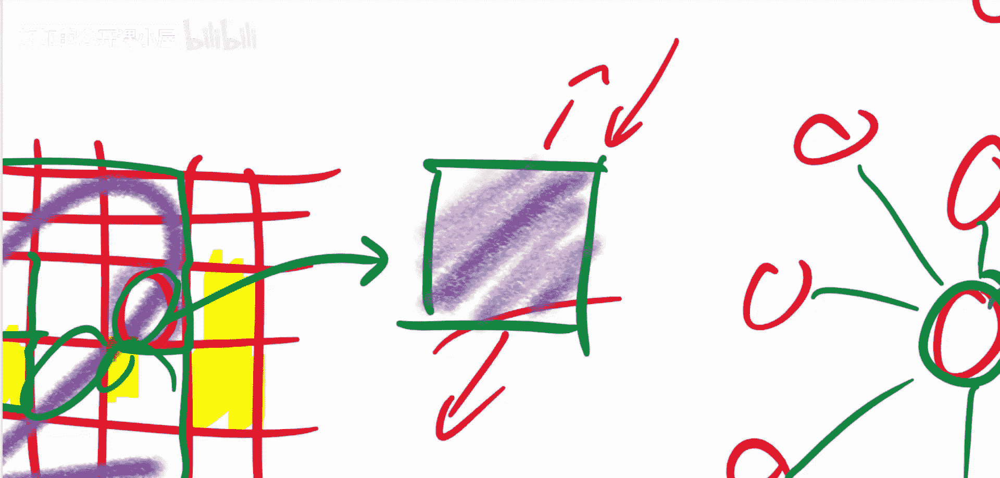

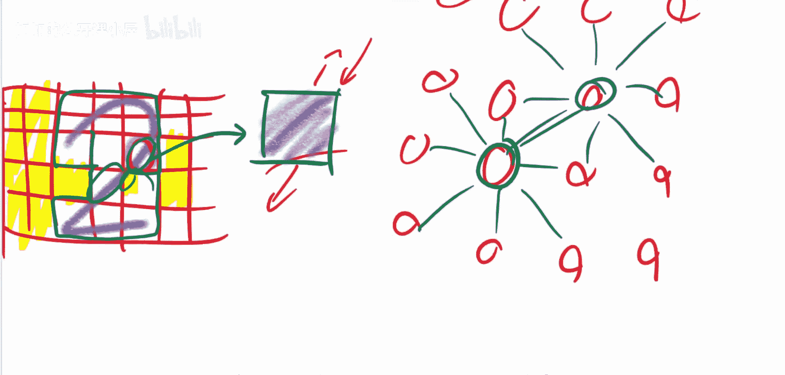

Has a cell state and that cell state first and foremost is composed of 10 different slots。

 one for each class， so what does it mean to agree on something at the end of this procedure or over time each cell in each round of communication can update its own cell state。

And whatever number is highest right here。 So this could be a high number。

 This could be a low number。 wrong sideway histograms。 whatever one is the highest right here。

 That's what the cell believes the class is。 So you immediately see a bit how this is going to be trained。

 So this is going to be trained by these authors taking an Mnes digit。

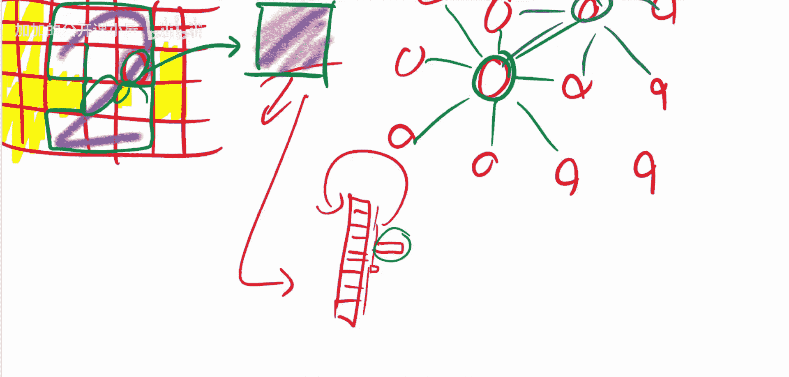

Plaing that on the cells， letting this whatever procedure run。

 if the procedure is differentiable you let it run for a number of time steps， and in each time step。

 you basically impose a crossenttropy classification loss on these 10 entries in the cell state that way you train the cells to output the correct digit。

Now each cell has to do that by itself， so the goal is to devise a communication algorithm such that each cell communicates with each other cell such that at the end。

 all the cells will be updated as to what the global state is as is what the digit comprises。

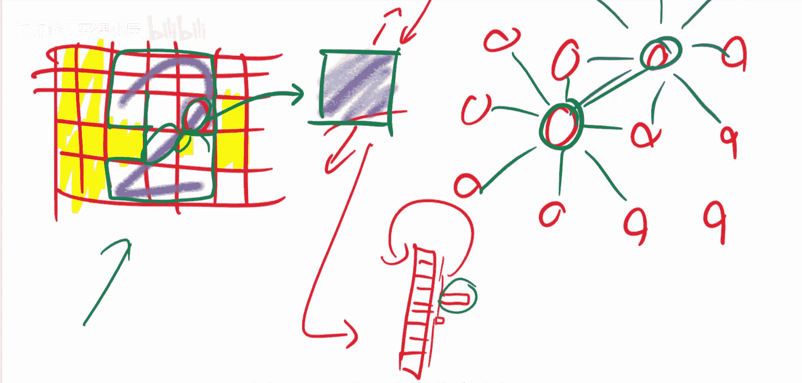

Okay， so。What is this message passing right here and for that I think we need to first of all。

 imagine what is actually passed around here。 So if you see this sample above right here and you imagine let's say we are actually in this configuration on the left and there is a slight bend let's say here where in this part of the number two。

 there is a slight bend right here， so what you can see maybe let me draw this a bit more clear is that for example。

 this the blue cell real register will by message passing it can it can register that there is an alive cell right here but this a alive cell will also register that there is no there is a dead cell next to it right so。

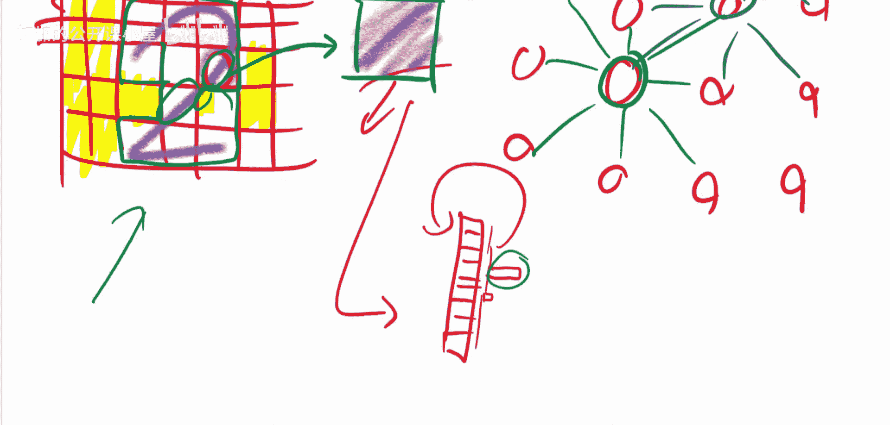

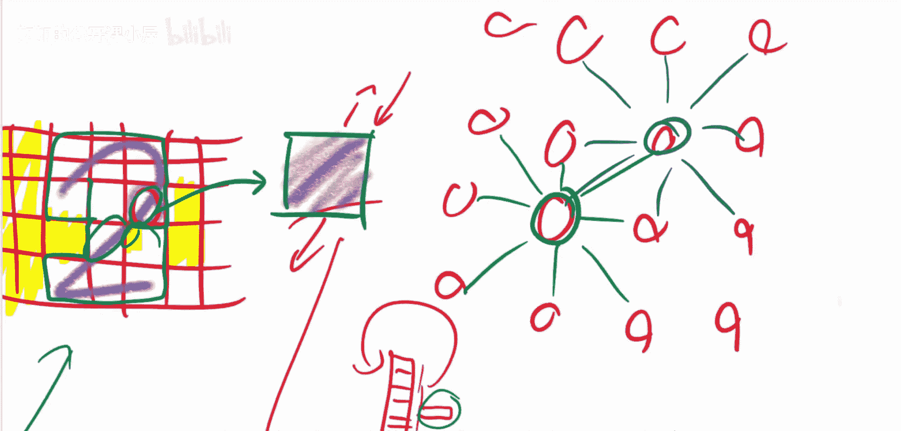

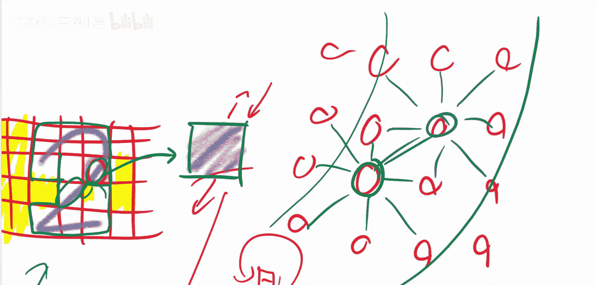

It can pass on that message to the blue cell， and the blue cell will sort of know that there is kind of a border over there。

 Then also diagonally to the blue cell， it will register itself。 Wow。

 there is a dead cell right here。 And that's right below this alive cell above。

 So there must be some kind of a bend right here。 So you can already see how through this sort of message passing it and this cell right here。

 Of course， will its neighbor is also dead。Through this message passing。

 these cells can kind of figure out together the kind of more global shapes and they will recognize a。

 there is a bend， it's something like this， right？And then other cells maybe down here will figure out。

 well， there is actually a corner right here， okay， and then other cells on top here。

 they will figure out， well， there is actually a bend like this。

And then they can communicate this to each other so these cells right here that have the corner。

 they will at some point receive this integrated message that there is a bend on top and then they can make sense of that writing and say。

 well we are a corner and there is a bend on top and there is so there must be a digit that's something like this and you can already see that at that point they can be fairly sure that this is a2。

So you can see that the combination of message passing and kind of。

Think if each cell thinking by itself can give rise to this kind of each cell coming into global agreement。

 not only agreement， but correct agreement so the message passing itself again describe。

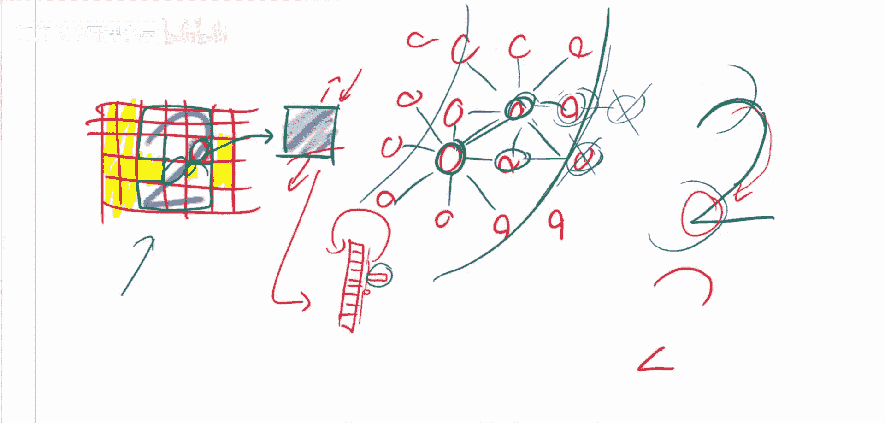