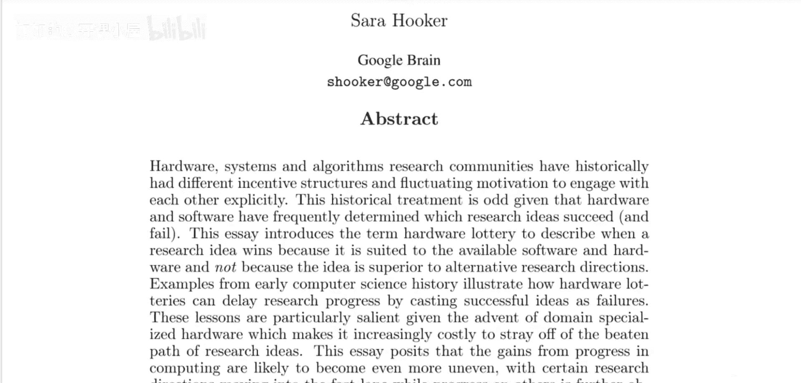
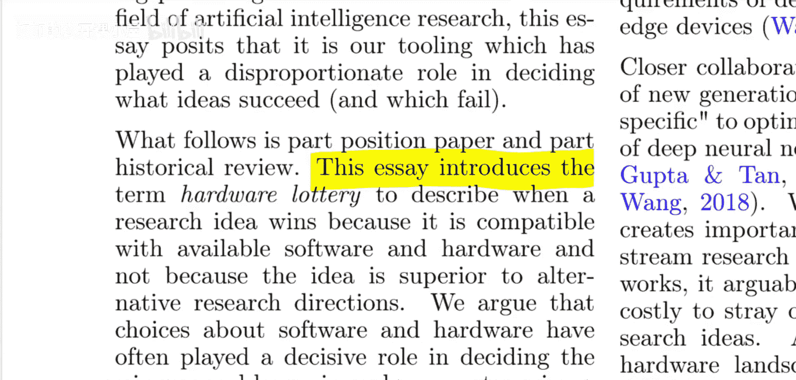
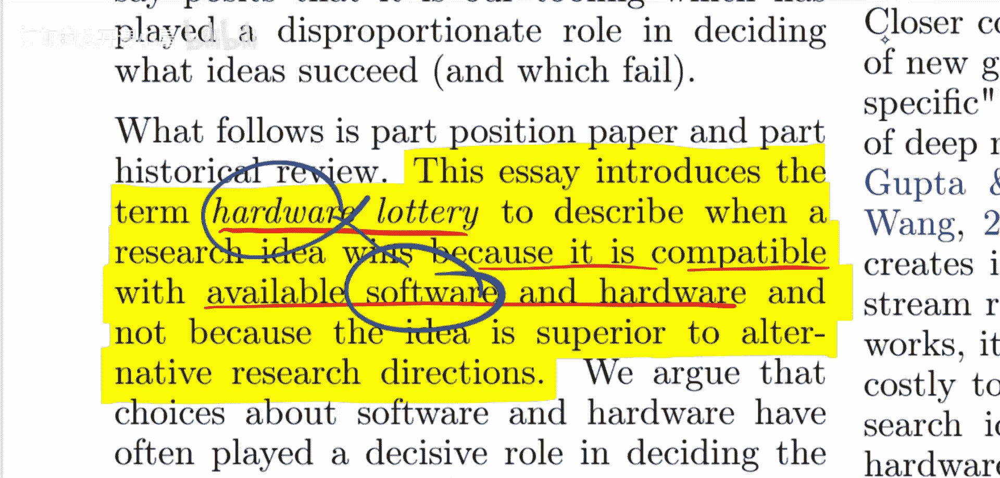
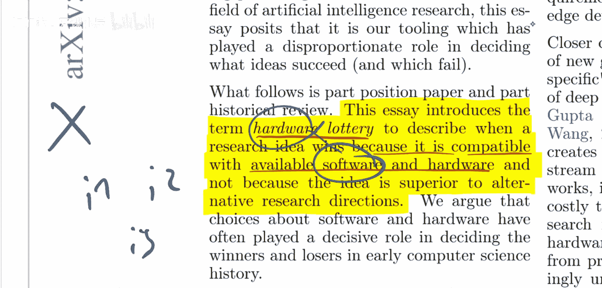
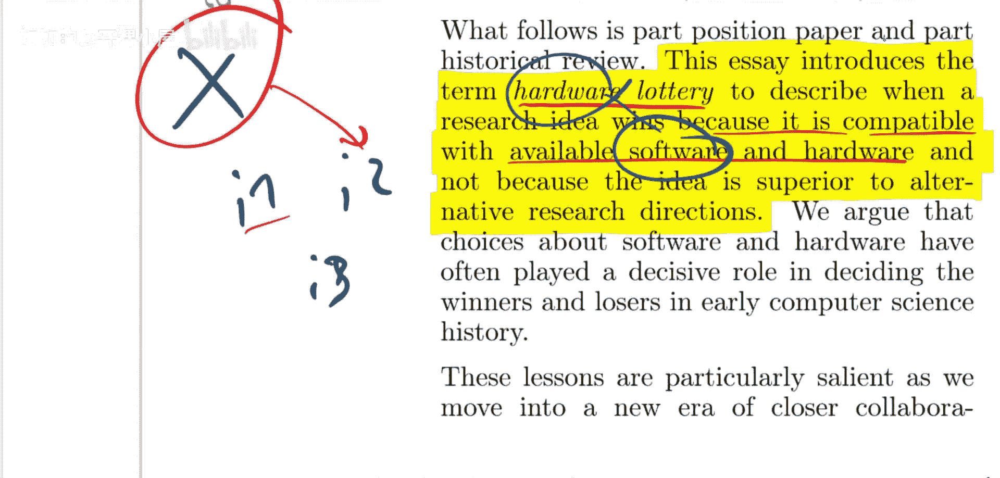
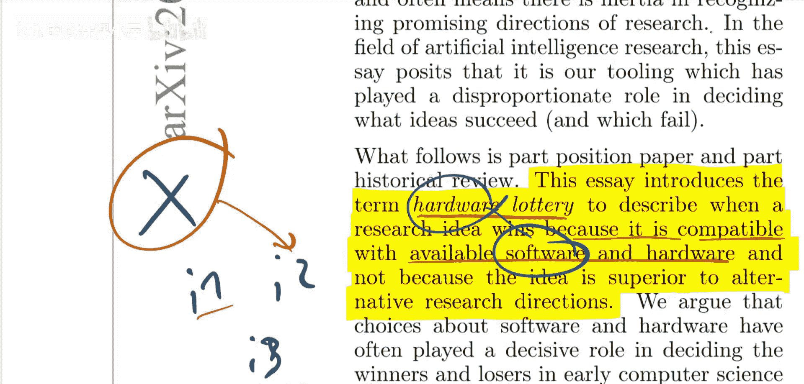
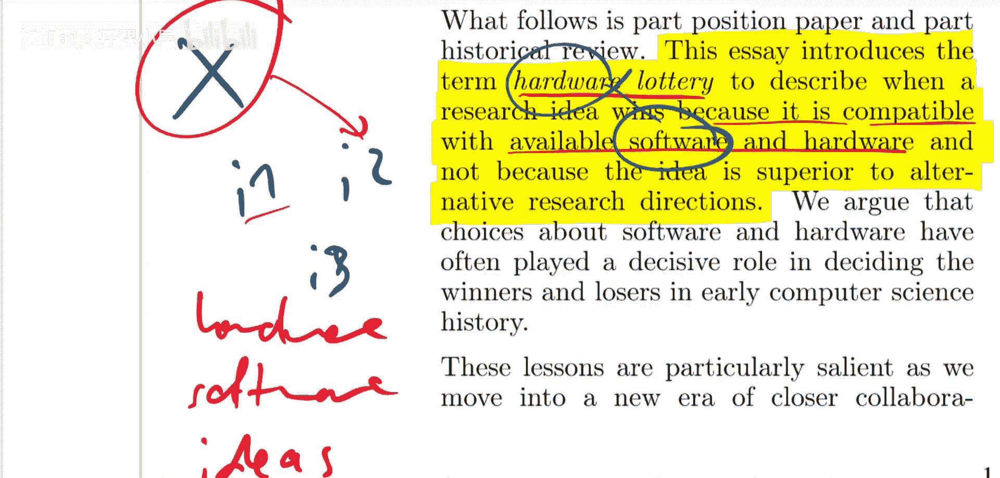
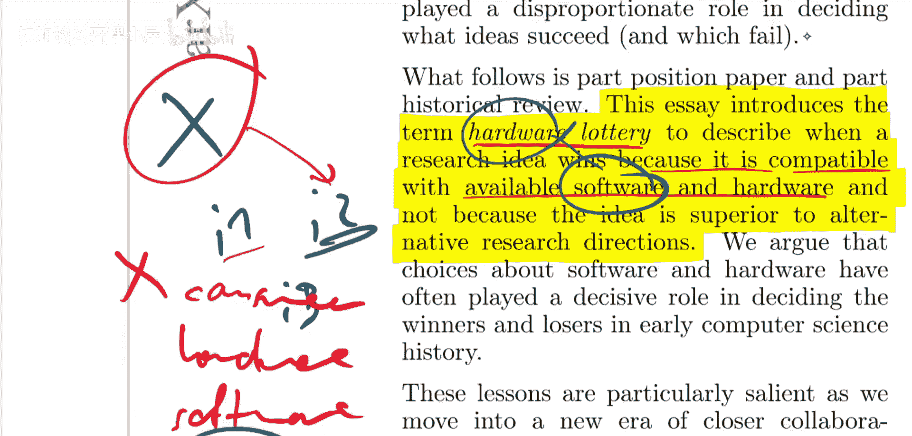
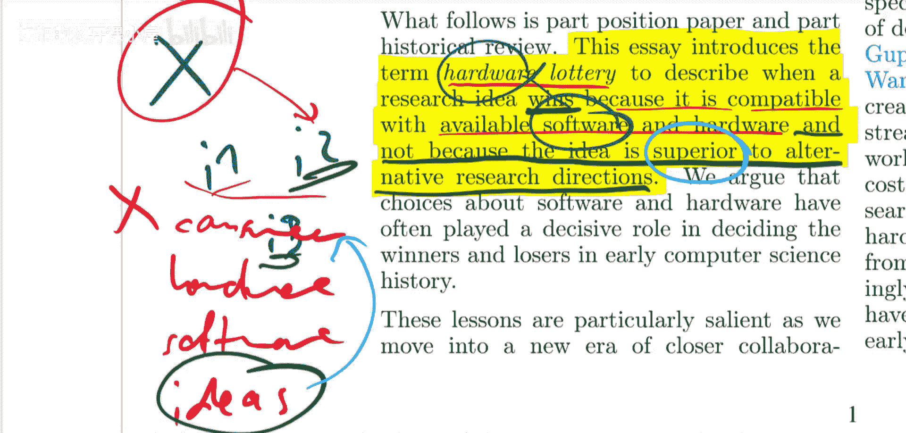

# YannicKilcher【中英⚡AI经典论文领读(全203篇)(上)｜Papers Explained】 p77 P98 硬件抽奖（论文详解） [BV1o3xLznExj_p77]

Hi there。 Are you interested in winning the lottery。 Then let me tell you this video is not for you。

 This video is not about winning the lottery。 Okay。

 I've done enough videos with lottery in the title only for people to be mad at me for not telling them how to win the lottery。

 this is about computer science research and very unfortunately the author of this paper has decided to put this word in the title。

 So if you're here because you want to win the lottery。

 This is not for you a's something completely different for everyone else today we're looking at the hardware lottery by Sarah Hooker of Google Brain。

 This paper is it's kind of a mix。 It's part of a historic look back at hardware and software developments in machine learning and it is a analysis of kind of the current situation and an outlook and sort of an opinion。

P of the way forward and how hardware and software should mix and what we should focus on in the future。

So the basic principle is quite simple in this paper it introduces this term the hardware lottery。

 this essay introduces the term hardware lottery to describe when a research idea wins because it is compatible with available software and hardware and not because the idea is superior to alternative research directions。

Okay， so right off the bat， I think this is a statement。

Where I think many people can agree or I think almost everyone will some agree with this statement in to to a certain degree。

 but certainly to a high degree， right we are all aware that， of course。

 we have the hardware we have。 hardware is very inflexible。 It's expensive to develop and so on。

 So any sort of software development， any algorithmic development may simply succeed because it is suited to the hardware that we have。

So that was my first reaction when I read this paper。s it's a very gut feeling of yes， of course。

 this is the case， but then。The historic analysis is also nice but I was wondering what is there a deeper reason to kind of go into this。

 and we are going to see some pros and cons that I think in this paper right here。Where it。

I'm not exactly entirely sure what specific point is's trying to make the overarching point I completely agree with。

 the fact that， of course， what hardware is here is important and may lead to certain ideas succeeding。

 but I have I have a trouble with the narrower points。

 And I'm going to try to illustrate this in this paper。 while also telling you what the paper says。

 So first of all，Here the term is called the hardware lottery。

 but off the bat you already see that it says a research idea wins because it is compatible with available software and hardware。

 so the hardware lottery right off the bat is is means that also the software is there so it's technically the hardware end software lottery and the bigger the bigger question I would have to someone arguing that really the hardware lottery is an important concept to have is。

Why what does what distinguishes the hardware lottery。 Let's， let's even say it's just hardware。

 What distinguishes the hardware lottery from any lottery， Like why can't I say， okay。

 there's the X lottery and the X lottery is is any circumstance。

 any circumstance that that surround a research idea right we have idea 1 idea 2 idea 3 and they all depend on many circumstances and X is one of those circumstances and it just so happens that the circumstance in the world favors idea 2 and a different circumstance would actually favor idea 1 what's so special about hardware other than it's more expensive than software to。

To illustrate this further， let's say， okay， you have， you have hardware and you say， well。

 hardware is expensive。 but then again。

You can sort of build a hierarchy where okay， down here， there is like ideas。

 they depend on software。Like software frameworks that we have such as Tensorflow Pytorch。

 these again depend on particular hardware。But， and you can say， okay。

 the hardware is much more expensive。 So we were， we， we are not as flexible。

 and the ideas might just succeed because of the hardware。

 but then you can go even step further and say， well， up here is sort of the consumer。

If you don't like the market term， then maybe say the society， the end user and so on。

 because the hardware ultimately is directed towards what humans in society need and。

That changes over time as well。 So， and， and it's， it's way more expensive to change the needs of human society than to change the hardware。

 So I can just。Also claim， okay， X is now society。 So the one particular research idea down here might win simply because it is more suited to the current societal needs and that kind of carries over and you you might say。

 well， make doesn't that make it a good idea， doesn't that make it preferable to idea。Idea 2。

 preferable to ideaea 3 over here that would just optimize for a different society。

 which leads us to the question， what does it mean to。

First， what does it mean to win。Here it just says a research idea wins， and you might have an idea。

 So I've， I have an idea。 It's， it's not clearly defined here， but。

Maybe winning means that a lot of researchers actually research in that direction。

 And the other question is。Here。And not because the idea is superior to alternative research directions。

 And here， my question would be， what does superior mean。

 what does it mean for an idea to be superior， As I said here。

 certainly if an idea is more incongruent with current societal needs。

 you might claim it's superior and someone else might say well。

 if societal needs were different then a different research idea might be suited better。

 the same way someone could say， well， if hardware was different than a different research idea might be better。

 maybe you can say if hardware was different， a different research idea might be better suited to the current needs of society。

 but then I'm pretty sure I can go to，3，4 levels up here。

Again， so these， these terms are a bit vague。 I think we can all the， again， the initial。

 the initial sentiment when reading this is absolutely in favor， right， I absolutely agree。

 I don't wanna wanna trash this。 I just want to sort of。

I try to think a bit deeper about what is actually said here and this is where sort of my troubles start。

So let's dig a bit into the historic part。 And I think the point the paper is sort of trying to make is that not。

that there are specific hardware choices that were made at one particular point and because it's so expensive to change hardware。

That means that a lot of researchers simply go along with whatever ideas work on that particular hardware that's available and other research ideas are neglected simply because the hardware isn't available。

 which again， this is a sentiment that I think we can we can all agree with。 So the first part here。

 the paper is is in the in the following sections。 and this is been important to keep in mind as a red thread because I feel。

One can get lost in the details of the paper， so in the first section section two。

 we ask what has incentivized the development of software hardware and machine learning research in isolation？

嗯。We need to read this first。 This essay begins by acknowledging a crucial paradox。

 Machine learning researchers mostly ignore hardware。

 Despite the role it plays in determining what ideas succeed。 So the argument is that we。

 we develop ideas independent of hardware， but。Also， we don't。

 It kind of makes it a double double point。 It says that we think we just think about ideas。

 but the ideas we might think about may be shaped by the hardware that's available。

 And if we are not aware of that， we might not， we might not see other ideas as viable。

So section 2 asks what has incentivized the development of software。

 hardware and machine learning research in isolation。

 so where does this come from that we don't think about the hardware that's at the end。

Section 3 considers the ramifications of this siloed evaluation with examples of early hardware and software lotteries。

 so this is the kind of historical look back。