# YannicKilcher【中英⚡AI经典论文领读(全203篇)(下)｜Papers Explained】 p02 P102 LambdaNetworks：无需注意力的远距离交互建模（论文详解） [BV1j8x5zJEvx_p2]

Another day， another state of the art result in machine learning land on imagenet this time coming from a thing called Lambda Resnets。

 as you can see here， it outperforms efficient nets and resnets right here not only in terms of top one accuracy but also in terms of the tradeoff between accuracy and training times。

 So here it says Lada resnets are about 4。5 times faster than efficient nets and substantially improve the speed accuracy tradeoff of image classification models across different scales。

 So this is something new that we have not seen in recent times in recent times we've seen like transformers take over image classification and so on but it came either with down sampling the image like this 16 by 16 patches and so on or just throwing massive amounts of data。

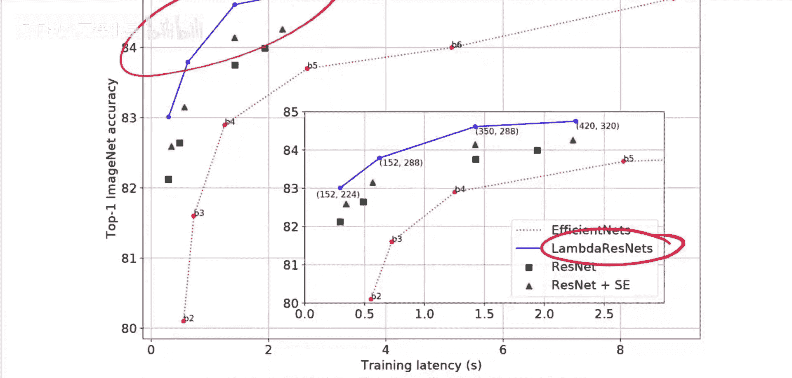

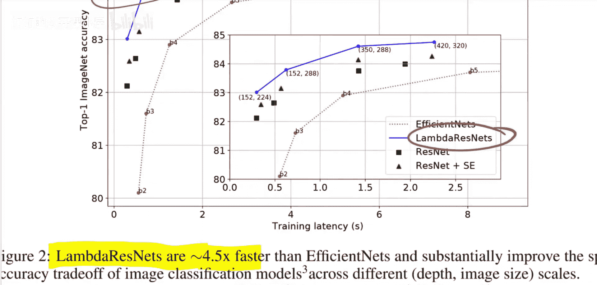

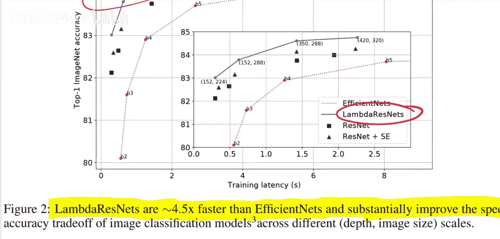

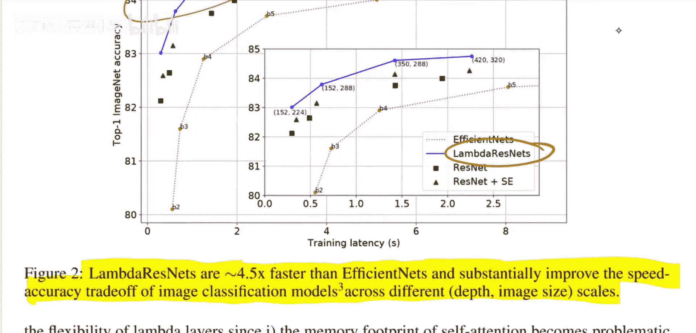

Or massive amounts of compute。 This paper here promises that they have something that's more efficient and it can reach good accuracy。

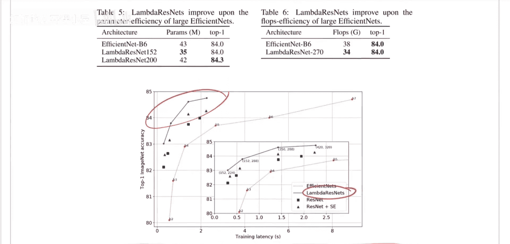

Or for the same efficiency can reach better accuracy。 So today we're going to look at this paper。

 Lambda networks modeling long range interactions without attention by anonymous authors。

 It's under review at IClar 2021。 I'm not going to deanonymize this paper well mostly because this one is a bit harder and would require a bit of research。

 but also because I think I've made my point remain that doublebld reviewing isn't really what it's set out to be in the ideal case。

 but let's actually look at this paper because the paper itself eats it's quite hard to understand。

 and I still don't know if I understand it correctly。

 but we'll just go through it and I will talk about what I understand。

 and then we I guess we can have a discussion for a discussion always leave a comment if you want join our Discord。

 There are many。

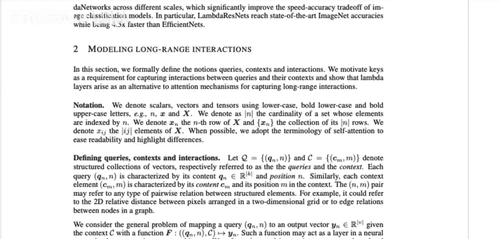

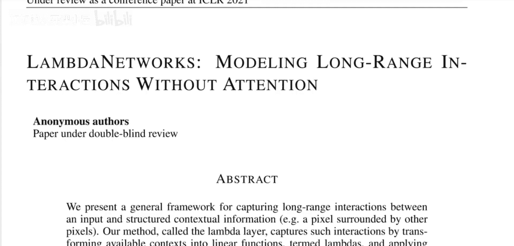

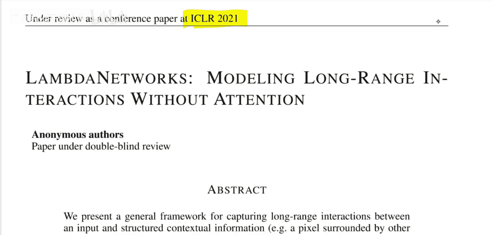

Many competent people there that have opinions。Way better opinions than I do so。All right。

 so they say we present a general framework for capturing long range interactions between an input and structured contextual information。

 EGia pixels surrounded by other pixels。Our method called the Lambda layer captures such interactions by transforming available context into linear function。

 termed Lambdas， and applying these linear functions to each input separately。

Lambda layers are versatile and maybe implemented to model content and position based interactions in global。

 local or mass contexts。 So as you read this， there are a number of of things right here that we are going to blatantly disregard while reading this paper。

 So first of all， they present a general framework。 Like， let's like screw screw a general framework。

 They're going to apply this to image classification。 We'll look at it in the context of， Well。

 first of of。Sequence classification and then of image classification because it comes out of the kind of transformer area。

 So then the transformers classically have been applied to sequence or set classifications。

 So we're going to look at it in in that framework like general framework blah or D blah right Okay。

 so for capturing long range interactions between an input and structure contextual information。

E G a pixel surrounded by other pixels。 Okay， so when you hear again。

 this long range interactions immediately， you should think of something like a transformer like an attention mechanism。

 that's exactly what they're going for here。 And they， they're trying to frame this into this。

 this like lambda layer。 The fact that we build a linear function termed Ladas from lambda calculus。

 And we apply these linear functions to each input separately。 Now。

 anytime you multiply a matrix by a vector， that's what you're doing。

 But the framing here is and we'll see why the framing is like this。 but。It sort of makes it。

 it introduces a new terminology。Lambda layers are versatile， yada yada yada yara。

 and the tricky part or the important part here is as they bypass the need for expensive attention maps。

 Lambda layers can routinely be applied to inputs of length in the thousandsth。

Enabling their applications to long sequences or high resolution images。

The resulting neural network architectures， the Lambda networks are computationally efficient and simple to implement using direct calls to operations available in modern neural network libraries。

OkaySo they have a bunch of things here。 They now get into the framework of okay。

 it's kind of like attention， but we do not need these expensive attention maps and they're going to show why they do not need the attention maps that an attention layer would compute and we will look at what's the tradeoff here like there's always a tradeoff the attention is kind of a very。

 very general computational framework it's super general it's like dynamic routing of information and they don't do that So we're going to see where the tradeoff is and what they gain is。

 of course， if they don't need to compute these expensive attention maps which know that the limiting factor is memory in transformers it's also a bit time。

 but we can just let it run for longer， but memory we can't really just wait too long and then we get more memory we have the memory that we have So since they don't have。

That they can take inputs and lengths of the thousands。 You know。

 they can apply these things to high resolution imaging。

 we're going to see that applying these things to high resolution images， that is， let's say。

 that is shaky。 Let let me just say they can't do that without going to what's called local attention。

And what I mean by this is， so attention mechanisms extremely briefly， extremely briefly。

 if you have a a sequence。And you transform it into another sequence。

 That's what an attention mechanism is for。 The attention mechanism looks at a。Looks at。From each。

Top part here， it emits a query Q。 Wow， that's a big thing。Each top part emits a query queue。

Each bottom thing emits a key K。 and then it builds what's called an attention map。

 So an attention map in this case is just a matrix， a in this case， a five by five matrix。

 and this matrix specifies how each of the inputs is routed to the outputs。

 So this five by five matrix， as you can see pretty clearly， if I make the sequence here longer。

 then this like one of the aes is gonna get longer。 And if I make this sequence longer。

 the other aes is gonna to get longer。 And normally or in what's called self attention。

 these sequences are the same sequence。 So you'll have the sequence paying attention to itself。

 And if you have an image， what that means in an image is that so an image is already a matrix。

 but it it's kind of a collection of pixels。 What you would do is you would see the image as a collection as a sequence of pixels。

 And then each pixel needs to attend。To each other pixel。

 So you can see pretty easily if the image is like something like 200 by 200， that's what 40000。

So you'd have a your matrix up here would be 40，000 by 40，000。

 which is impossible right so that's the trouble here。

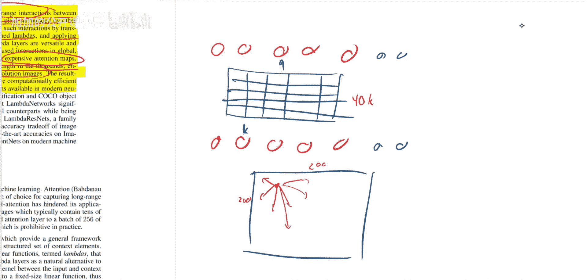

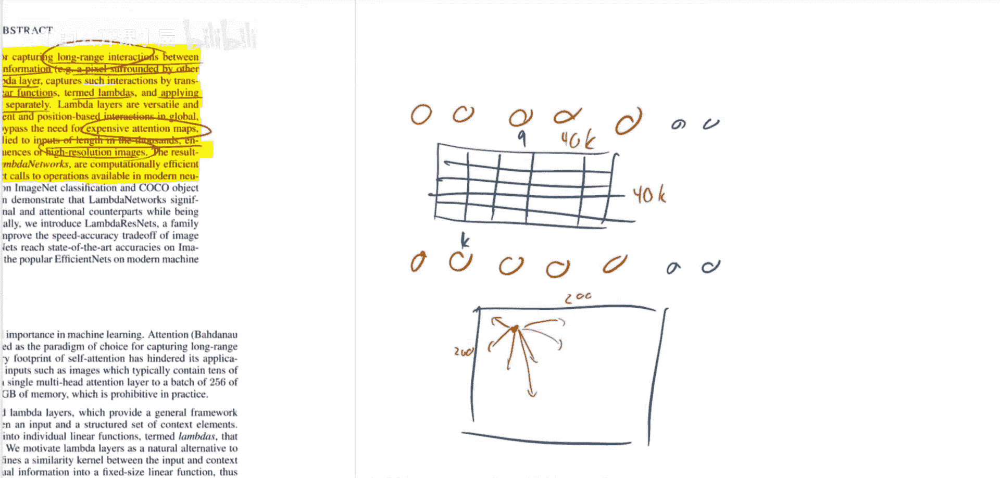

Now， people have gotten around this by doing what's called local attention and local attention means like。

 you know， you pixel， you don't need to pay attention to all of the other pixels。

 You actually only need to pay attention to the pixels in your neighbourhood， which is sort of。

It's a convolution， right， A convolution is usually this。

 but local attention is a dynamic convolution。 So usually in a convolution。

 you have a fixed convolutional kernel， Local attention is simply a dynamic convolutional kernel like global attention is a dynamic feet forward layer instead of a fixed feet forward layer。

 Local attention is a dynamic convolution instead of a fixed convolution。😊。

They are going to do something similar here to process high resolution images。

 they are going to restrict their context to a local kind of local field of view around the pixel that they're interested in。

So just， so you don't get super hypveed by， by the。By the abstract right here。

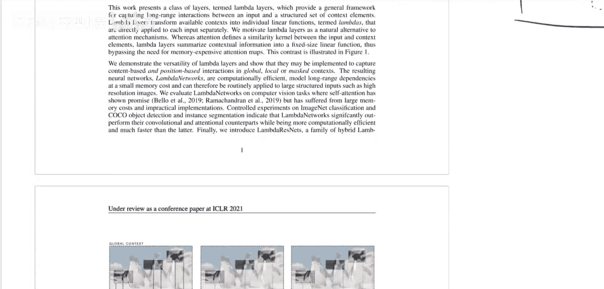

So we'll go into what these lambda layers do。 And I'm going to jump a whole bunch of things in the paper just so we get to the kind of the meat of the thing。

 So they say。

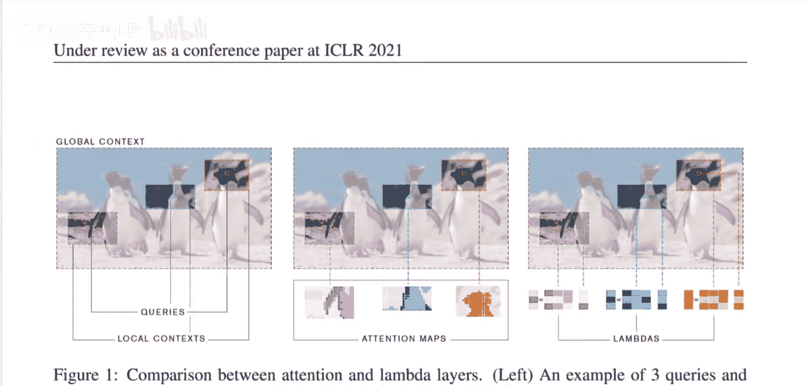

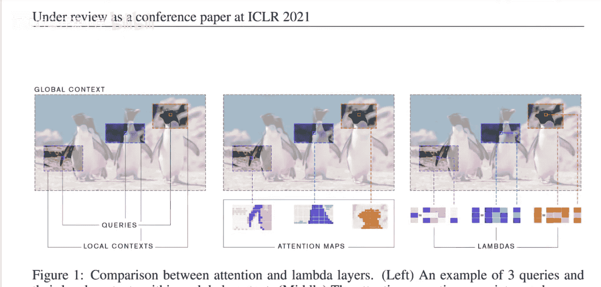

Look at these images。 And we we just， we just set this， right。 So usually you have a。If。

 for each pixel， you wonder， how should I transform this to the next layer。

 So you imagine your neural network as having layer， layer， layer， layer， layer。 and in each time。

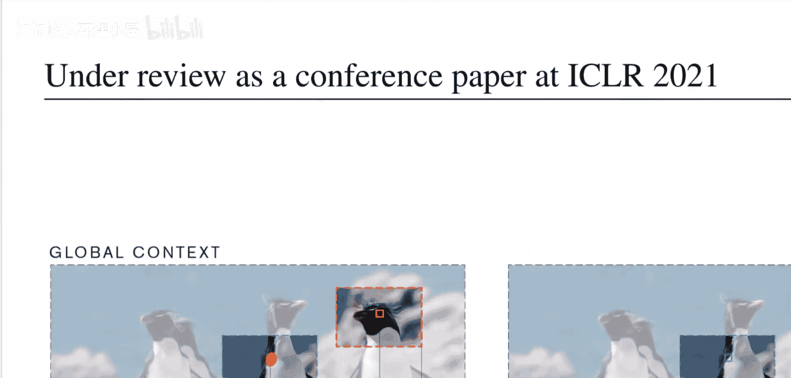