# YannicKilcher【中英⚡AI经典论文领读(全203篇)(下)｜Papers Explained】 p03 P103 重新思考注意力机制：Performers模型详解 [BV1j8x5zJEvx_p3]

Hi there。 Today， we'll look at rethinking attention with performers by researchers of Google。

 the University of Cambridge， Deep Mind and the Alllan Turing Institute。

 This paper is yet another paper in the quest to make transformers more performant and what better name to give to a technique than the performer。

 So theer performers are a new kind of class of models。

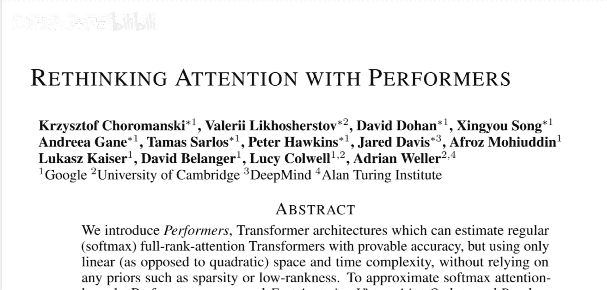

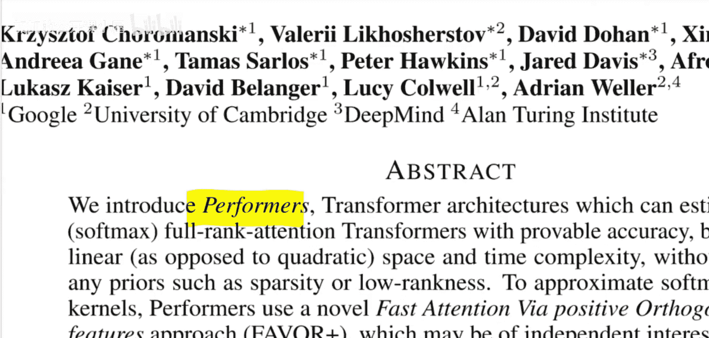

They try to approximate the transformer。If you don't know what a transformer is。

 I've done like a ton of videos on transformers on attention mechanisms。

 and you can there's more than enough material to look that up today willll talk about perers and the performers。

 as I already said， they approximate transformers and they do so without running into the classic transformer bottleneck。

 which is that the attention matrix in the transformer has space and compute requirements that are quadratic in the size of the input。

 and that limits how much input you can put into the model。

 So it kind of limits how long of text you can input if you work with text or how big your images are that you can work with this is all kind of bad when you use transformers。

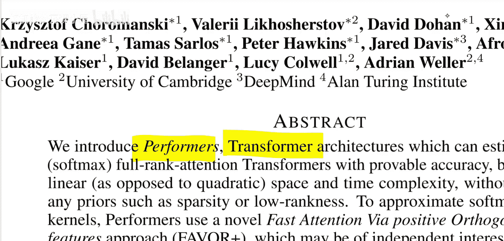

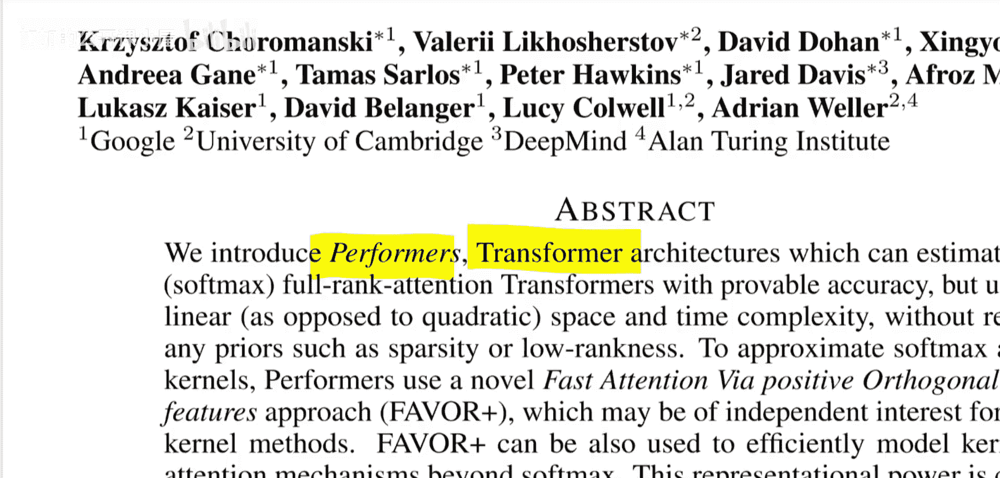

So the performers get around this by this technique。

 they call fast attention via positive orthogonal random features abbreviated favor plus they use this favor plus to get around it。

 And what's interesting is that the favor plus， I'll just call it favor， this fast attention。

 it it is potentially useful beyond transformers， So it's apparently been here developed in the realm of the transformers。

 but they say which may be of independent interest for scalable kernel methods。

You'll see what they do is they approximate the attention matrix by decomposing it。

 but they do it in a special way。 and they do it in the in the way。

 if you know what random Fourier features are， maybe you can kind of think。😊。

Think ahead a little bit。 If not， well， we'll get into it for sure。 I think honestly。

 this might be one of the enabling one of the next mini breakthroughs in in deep learning。

 not big breakthrough， but kind of mini breakthrough。

 I remember a time when we used sigmoid and 10 H nonlinearities， Bel it or not。

 you young kids at the beginning of deep or not the beginning of deep learning。

 But before deep learning really took off it was the sensible thing to use softm and 10 H non nonlinearities everywhere in your neural networks。

 because， well， first of all， they were like differentiable。 So that was cool。 And then。😊，You know。

 it was sort of how nature does it with the step function in like it was an approximation to the step function in the true neuron and so on。

 And it was just kind of well motivated。 So people thought that must be the way to go。 But then。

 of course， turned out that relus are much easier， much more stable。

 give much better results and so on。 Don't saturate all of these cool things。

 This here is kind of the it see it feels like the same thing because right now。

 we're doing this softm thing in attention。😊，And it's very important because it normalizes the attention matrix。

 right， It gives you kind of this thing that comes out is kind of a distribution over the input and so on。

 So it's well motivated。 and you might be able to see。 but also as the sigmoid it is。

 it kind of has this exponential thing in there。 And the favor algorithm is going to approximate this softm thing。

 but it can be used to approximate much more。 So maybe you know。

 we're going to find that if we swap out the non nonlinearity in there。

 we might be able to build much better transformers。😊。

Or whatever the model will be called performers， I guess they already do this here with relus in this very paper。

So。The。Pperformer is going to be fully compatible with regular transformer and with strong theoretical guarantees。

 unbiased or nearly unbiased estimation of the attention matrix。

 uniform conversionvert and low estimation variance。

 So the difference of the performformer here is going to be that there have been methods before that decompose the attention matrix into low rank matrices。

 but those either don't work or they kind of rely on on priors like the you're assuming that your attention matrix has a certain structure。

 if it doesn't it sort of fails。This method here is going to be an unbiased estimator。

 and it's going to sort of converge to the attention matrix。

 if you add more of these random features。 Okay， this is fed here。

 like provably not relying on any prior fully compatible with regular transformers。

 which means that you can take a transformer checkpoint and sort of plug it into this framework。

 and then you just have to fine tune a little bit to。

Sort of use the checkpoint of a regular transformer， which is pretty cool， right。

 So we'll go through the paper。 It's quite a heavy paper。 It's quite a math heavy paper。

 We won't go through all of it。 I just kind of want you to get the idea of what these performers do。

 what the reasoning behind it is and how you might be able to kind of work with them or extend them where it's where it's going from here。

😊，As always， if you like content like this， don't hesitate to share it out and tell your friends about it。

 alright。So the problem with attention or the problem with transformers is like I've done this a million times。

 and you can go look it up。 But if you want to map a sequence of layer L into a sequence or a set or what not of layer L plus one。

 and you need to compute these attention weights， right。

 So the attention weights are going to be from each token here to each token in the next layer。

 you're going to compute one of these weights。Right， so there is there is this matrix is called a。

 The attention matrix and a is going to be of size L by L。 And that is a problem。

 If you have long sequences， right， you can already see this。

 So the way that this a comes to be is that。Conceptually， the upper layer。

 like it's all the same layer， but conceptually， the upper layer emits something that are called queries。

 and the lower layer emits something that are called keys and values。 Now， the keys and the queries。

 they go together into matrices。So it would multiply the keys and the queries。Then。

You run this through， and this is the problem。 You run this through a soft maximum linearity to basically get a distribution。

 and then you multiply it by the values。 So the query key matrix， this attention matrix。

 it will tell you how to aggregate the values。Alright。If it weren't for the softm。

So you can think if these the dimensions of the queries and keys and values， let's call it small D。

 then the dimensionality here would be something like here you'd have L by D。

 here it'd have D by L for the transposed， and then here you'd have L by D。So。

Because you have to do the softm， you have to compute this first， which gives you this L by L。

 which is the terrible thing。However， if you could， if you could。

If somehow decompose the softm operation， you could first do keys and values。

 which will give you a D by D matrix， and then you could multiply it by the Q matrix。

 which would be much， much， much more easy if D is smaller than L。

 Certainly it wouldn't grow quadraically an L， it which is grow linearly。

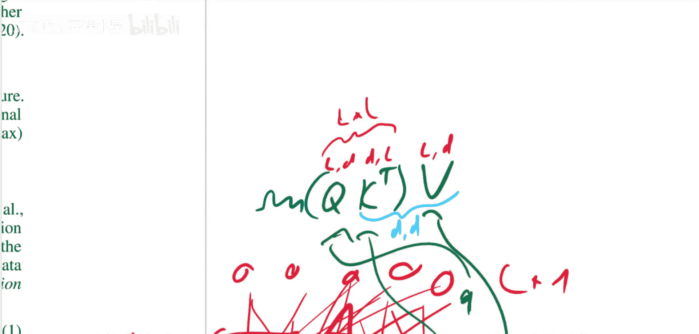

In in space and time。 So here this is formulated out the attention mechanism right here。

The attention mechanism is made of queries， keys and values。

 and it's given by this formula right here。 Now there is a bit of a technicality。

 I wasn't exactly correct in what a is。 So here they they say they。I called this thing here， a。Okay。

 they are very specific what they mean by a by a。 They simply mean the exponential function of the normalized queries times keys。

 And then to get the actual soft max you have to normalize by。

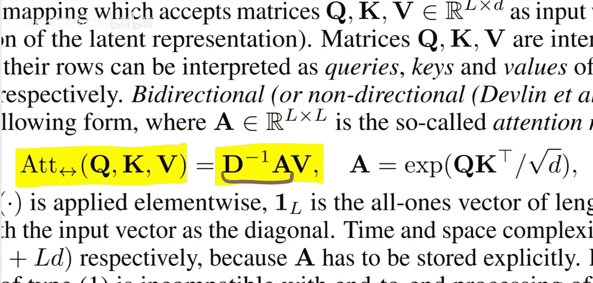

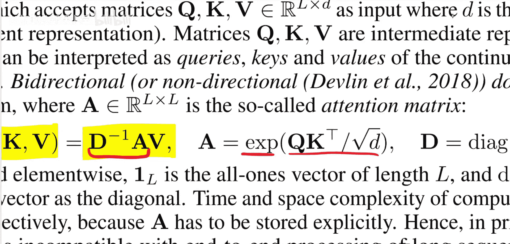

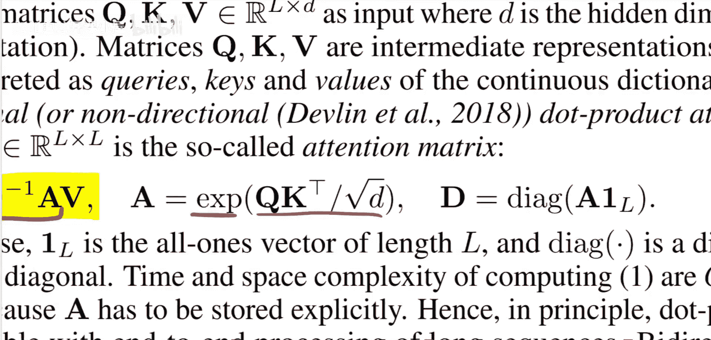

Here， so D， which is so you see the inverse is made here。 D is constructed from a and normalizes a。

 but the normalization is of secondary importance。 The important part here is that this exponential。

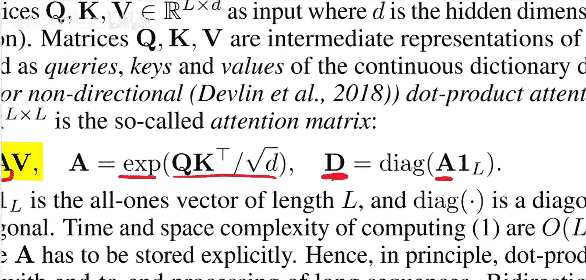

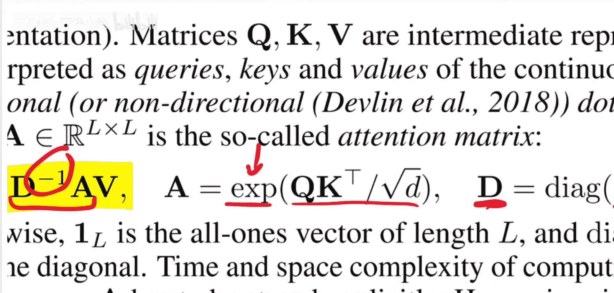

Cannot be easily decomposed， right， It's， it's not like you can decompose the inner multiplication into two exponentials or something otherwise。

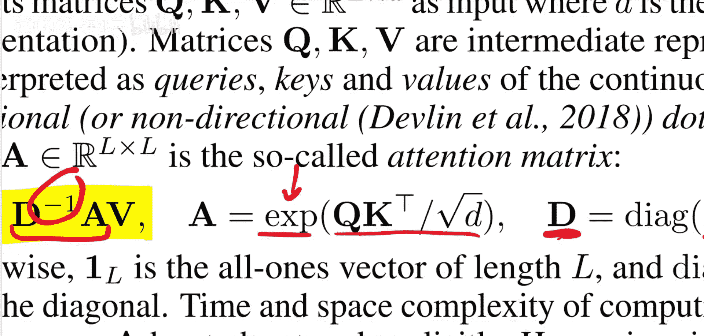