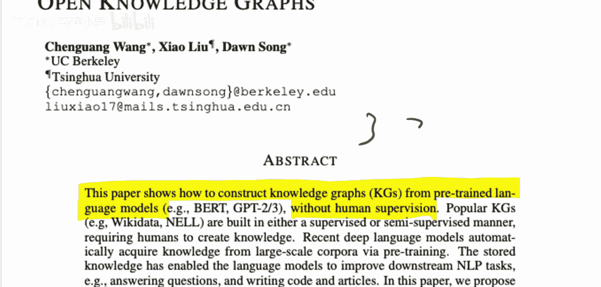
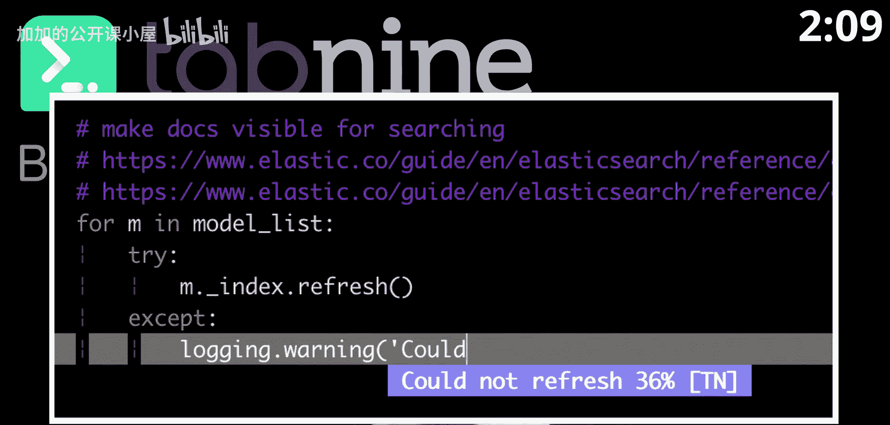
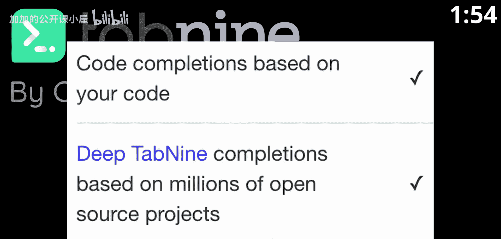
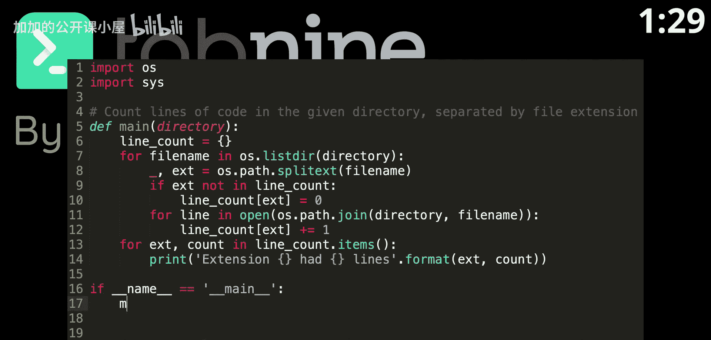
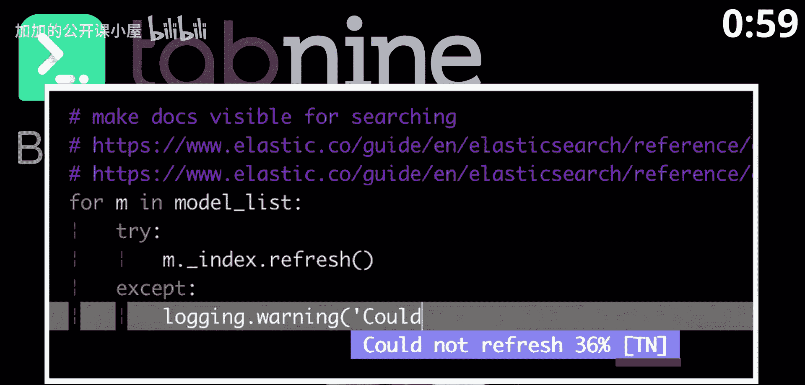
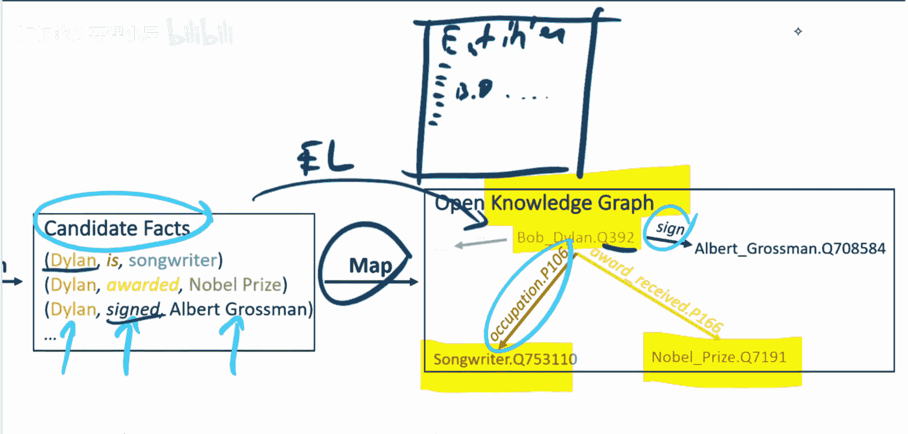

# YannicKilcher【中英⚡AI经典论文领读(全203篇)(下)｜Papers Explained】 p04 P104 语言模型即开放知识图谱（论文解读） [BV1j8x5zJEvx_p4]

Hi there。 Today， we'll look at language models or open knowledge graphs by Cheng Wang Wang Xiao Liu and Don Song。

 This paper on a high level proposes to construct knowledge graphs。

 which is a structured object that's usually built by human by experts。

 either fully manually or semi manually with heavy human involvement。

 It proposes to construct knowledge graphs automatically。

By simply using a pretrained language model together with a corpus to extract the knowledge graph from the cool thing about this paper is that there is no training involved。

 So there is no model that learns how to construct a knowledge graph。

 The entire knowledge is simply extracted from running the corpus once。

 So one forward path through the corpus through the pretrained language model。

 And that constructs the knowledge graph。 So that's kind of the the core message of this paper。

 they say this paper shows how to construct knowledge graphs from pretrained language models without human supervision。

 And it turns out the way they do it。 It works pretty well on kind of standard knowledge graph construction benchmarks。

 So that's the the paper in a nutshell will go through all of this including I have a bunch of criticisms。

 but it is a preprint。 Remember this。😊，🎼And yeah， so usually I'd say at this point。

 if you like this content， don't hesitate to share it out and so on。 Today。

 we're gonna try something different in321 stop It sponsor time This video is sponsored by tabab 9。

 Tab 9 uses deep learning to help you write code faster。 what could possibly go wrong。

 if you do that， No， I'm joking， I'm joking。 Take a look at this piece of code here。

 I was trying to refresh some elastic indices。 And as you can see here。

 all I said was could and tabab 9 completes it to could not refresh because above I was trying to call a refresh method。

 This is something that I haven't seen any other completion engine do yet compared to a regular coding engine。

 Tab 9 is trained on lots of open source projects and it combines this with your code and it predicts what you want to do compared to。

😊。

🎼Predicting what's possible， which is what a classic engine does。

 Tab 9 it uses a G based model and it downloads that model onto your machine。

 So the code never leaves your machine。 There is an opt in feature where you can run that in the cloud and that will just give you a bit of a better beam search and better quality predictions。

 and it saves you a bit of Ram As you can see I myself use T 9。

 I just have it on by default and I'm pretty happy with it。

 I use it through COC integrated into my neoovim， but you can also get it in sublime atom Intellij Vs code。

 even like Jupyter notebooks and you can use it together with classic completion engine so you can really get the best of both worlds。

 So whenever you see me code in a coding video look out for this TN marker next to the completions。

 That's the completions by Tab 9。 It doesn't only work for Python。

 It actually works for pretty much any programming language that isn't。

🎼Completely obscure If you go to this link within 72 hours of when this video is released you'll get three months of tabab 9 professional for free The professional version removes the project size limit of the free version and it also gives you access to that sweet sweet cloud inference After the three months you're automatically kicked out of the pro version there's no auto sign up there's really nothing to lose I mean。

 the only bad thing here is that tab 9 itself is written in rust if that's the worst thing about an offer it's it's a pretty good deal again I use this myself and I'm pretty happy with it So again if you sign up at tab 9 co s promotion slash yaic culture within 72 hours of when this video is released you'll get a free three months of tab 9 pro no strings attached and now enjoy the video Thanks all right I hope that was fun let's get back to the paper let's get into the paper So first of all What is my first criticism。

Of this paper。This， the title， there are some disturbing trends in the last few years in。In。

 in machine learning papers and the disturbing trends can be maybe encapsulated with the phrase is all you need。

So。People have sort of since attention is all you need， since this paper。

 people have discovered that if they just append this to whatever their paper is about。

 then the paper will get much more notoriety and the same thing I think is a bit at play here with this with the R because in recent times we've kind of seen a bunch of papers that show equivalences between models such as famous example is that the transformers are hop field networks in some kind of in some regard and these papers are pretty cool right even if the two things are not exactly equal all the time。

 if you can say look there is a setting， there are you know under these assumptions under these settings in this situation these two models actually are the same。

 That's a pretty cool recognition， pretty cool thing to show。

And it's very useful for academia and and practice。 I believe。 However， I believe the R keyword。

 the iss keyword should be sort of reserved for when two things are equivalent。

 whereas here in the very first， at least they're honest， right in the very first sentence。

 they show， they say， well， we show how to construct knowledge graphs from pretrained language models。

 So essentially， they're going to use a language model to approximately construct a knowledge graph。

 And they're also going to use a bunch of other auxiliary models that come all pretrained， but still。

😊，They do not show an equivalence of language models and knowledge graphs in this paper， not at all。

 So I would sort of I see that you can get somewhere with these titles， but yeah。

 maybe people will be disappointed kind of if they read the paper， which it is actually a cool paper。

 believe me， all right， so as I said。What we have usually is a corpus。 Okay。

 A corpus is simply a bunch of text pieces。 You can think of maybe just the text in Wikipedia。 Okay。

 here， you know， the the Wikipedia page you have Bob Dylan。

 Bob Dylan is a songwriter was a word that Nobel Prize signed Albu Grossman。

 These are easy sentences， right， there， there can be sentences are usually larger and longer and so on。

 And what you want to do is you want to extract a knowledge graph。

 So the knowledge graph has two distinct things。 It has entities。

 and one entity here would be kind of Bob Dylan， Songwriter is an entity。

 Nobel Prize and is an entity。 You can sort of think of them as nouns。 Okay。

 and then the second part in knowledge graphs are the relations。Here， occupation， sign。

 a word received and so on。 So the the relations connect to entities。

 There is always what's called a head of an of a of a triple。 So a head of a fact。

 which in this case， is Bob Dylan three times。 Then there is a tale。

 which is sort of like the object of the verb。 And then there is the relation which is described by the verb。

 now。Here you can see there are two stages of constructing such a knowledge graph。

 any system that does this。Probably goes through these two stages。 So first。

 you extract a set of candidates， which it's not the knowledge graph yet because these are still strings。

 right， You extracttract a bunch of string triplets， as you can see here。And as we said。

 as the sentences get more complicated， it gets more and more difficult to extract these kind of triples。

 and then the second part is that you need to map it a to a sche to a schema and these schemas are usually defined by humans。

 So here we're still going to rely on humans to define the schema So there is one list that says entities。

And the entities there are just the entities are listed， okay， by the humans。

 and at some point it says Bob Dylan， Bob Dylan。And it has a bunch of mentions of Bob Dylan associated with it。

 And it has a clear I D。 In this case， you see， the I D is Q3，9，2 in that knowledge graph and。

The system not only needs to extract these facts， but then also map these facts to the correct entities。

 Sorry， map these facts to the correct schema entries。This second stage right here is a。

 a bunch of standard tasks。 So especially mapping something like the the word Dylan in its context to this entity。

 Bob Dylan， which you can think of it as like the Wikipedia page of Bob Dylan， right。

 That's how the systems usually work。 That is a task called entity linking。 Okay。

 entity linking and similar tasks exist for for sign like the relation awarded mapping this to。

