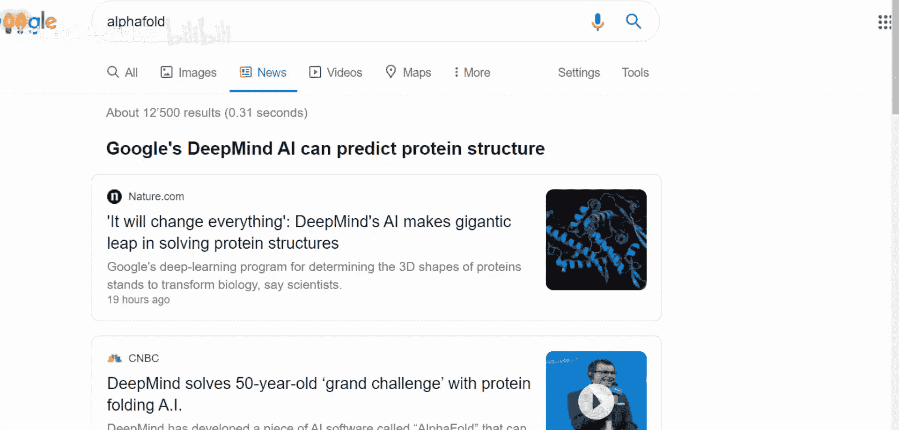
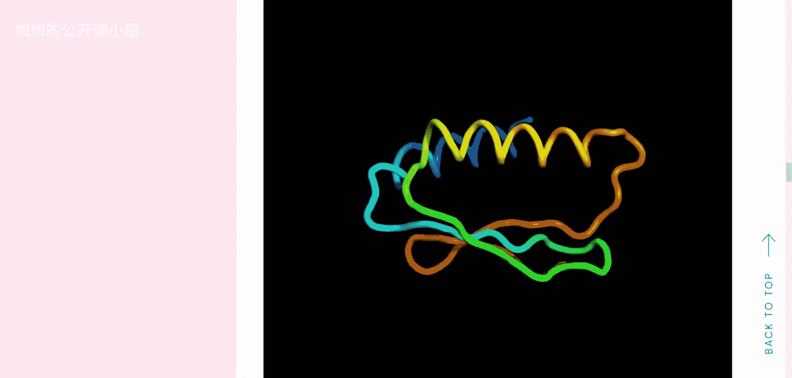
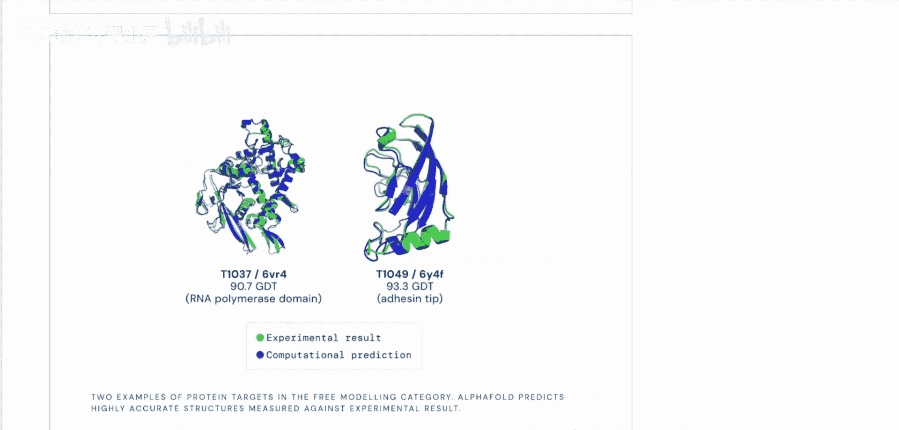
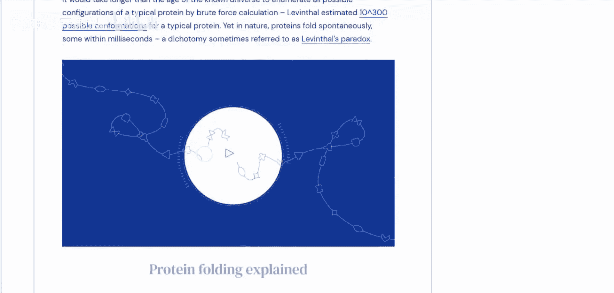
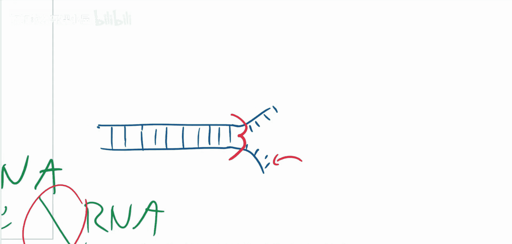

# YannicKilcher【中英⚡AI经典论文领读(全203篇)(下)｜Papers Explained】 p08 P108 DeepMind AlphaFold 2全面解析！蛋白质折叠的AI革命！已知与未知全透视！ [BV1j8x5zJEvx_p8]

It will change everything。Deep Mind solveve's 50 year old grand challenge。 The game has changed。

Deep Mind's latest AI breakthrough。Achieves historic new milestone helps solve how diseases invade cells。

 improve protein folding prediction。 AI breakthrough， it also wipes your bot automatically。

 It is the newest。Deep mind， big publication。 Actually， it's not a publication yet。

 But so what happened， And I'm sure you've heard this is that。

Every year there is this competition of protein folding prediction。

 so proteins are the structures that fold in a given way and we'll go into that in a bit。

 but basically every year there is this competition and the results of this year's competition came out and they looked something like this。

 namely every entry here you see is a team participating in that competition of protein folding prediction and there is one team which is Deepminds system。

 Alpha fold2， which completely dominates all the others。

 to the point where the problem is now considered to be solved now solved in in this case simply means that you past a certain number in in this test set and if you're past that certain number。

 your predictions are useful enough so that other scientists can basically。

Take them and base work on them， so that's what it means for this protein folding problem to be solved。

Now we don't have much information on Al fold2 yet other than it's really good and like a blog post and a bunch of advertisement videos by Deep mindd。

 they are writing a paper on it， but today I want to go into this blog post maybe parse out what we can gather from that blog post and I also want to go actually through the Al fold1 paper so as you can see the performance here increased drastically with Al fold2。

 but you know guesses are high that the system is going to be somewhat similar to Al fold1 of which we do have a paper so today we'll go into Al fold1 we'll go into some speculations of Al fold2 I can already give you my speculation。

 its transformers， its attention that all of a sudden made this big jump together with probably a few other improvements。

To the alpha fold1 system。Basically， transformers continuing to dominate the entire field。

So where do we start it's probably best， by the way， if this is not a great meme template。

 I don't know what is just saying， just saying yeah so。

Let's actually start with the problem itself Eric I realize if you're here。

 you're probably a machine learning person might not know too much about protein folding。

 so these things here are computer representations of proteins。

 they don't really look that way but sort of similar a protein essentially is a chain of amino acids。

So an amino acid where do we have this right here amino acids are these what they're called basic building blocks of life since the proteins proteins are what make the cell do things。

 so protein are sort of the workers in the cell， they are used as signaling molecules， receptors。

 they are parts of your muscles that actually the parts that move are proteins。

 so they are all the workdoers。Whenever something needs to work in a cell do mechanical or work proteins are involved and amino acids are the building blocks of proteins。

 so each amino acid has a given certain common structure and there are 21 of them。

 so all the proteins in the world are simply made out of chains of these 21 amino acids。

And these chains they are formed in， so there's always this sort of body that can link up to other bodies of amino acids。

It's very similar if you maybe know how DNA is structured。

 it's a very similar concept except in DNA there are four different bases here there are 21 amino acids and each amino acid is a little bit different in each amino acid has like a tail that hangs off so the tail can be look like this or it can look like this like with a side chain or there is there one where it's like maybe a cyclic one I'm not sure maybe it can look out here or it can have sort of no tail at all I think that's the cane case for glyin。

So the important part is depending on this tail， the properties。

 the chemical properties of the amino acids are different and then what happens next is really interesting once this amino acid chain is built in in this so this is the central dogma of modern biology is that you have DNA。

And DNA is translated to RNA， sorry。And then it's translated to so it's read off copied to RNA。

 which is sort of a DNA clone and then the RNA is translated into the amino acid chain and there is always three three pieces of DNA map to one amino acid This is very it's like a compiler notably the interesting part is that these steps right here。

 these compilation steps are done by proteins。 So there are proteins that do these things So nature in a very real sense is its own compiler So this here you can see as like the binary and this here is like the source code but what happens once you build this chain of amino acid and you set it out into the cell because of these different properties of these side chains they' are also called residues this chain begins to fold and so this is if you no bit of chemistry you might know that。

These are these are sort of atoms that are linked with covalent bonds in this case。

 and it can be that part of this chain is rather like electrically negatively charged and here part of this chain might be like electrically positively charged in a given place over a given other place and it also depends on the surrounding medium of course。

And that means that in this case， for example， these two things will attract。

 And so if you release this amino acid chain， what you're going to get is sort of a bend where now the。

The chain sort of bends and these two this chain right here， this tail goes like here。

 this tail goes like here I'm sorry if there is no if there is no there is no I don't even know what to call it pyine rings or something like this。

 if there isn't an amino acid with that I apologize but the point is that these two things attract and sort of form this shape and this shape is very important。

 we know that proteins and proteins consist of it can be hundreds， thousands。

 tens of thousands of these amino acids in a chain。

 the proteins function is interestingly largely determined by its structure by its 3D structure。

 not necessarily by the actual amino acids So technically you can substitute amino acids for each other。

 So this amino acid here can be could be substituted for another amino acid that may be。あ。

Isn't the same， but is has the same properties of its side chain。

 such that if the structure is still the same， the protein would perform the same function。 so that。

That is very special property of proteins namely their 3D structure largely determines their function。

 so for example， in this step here， when you read off the RNA to the DNA。

 as you know the RNA is sorry the DNA is like this double strand of connected base pairs。And。

In order to replicate the DNA or to read it off， there is a or let's call it。

 there is also this step of DNA replication right where you copy the DNA in mitosis。

In order to do that， you need to split off the two strands。

You need to split it up because you want to get like a protein needs to get here to actually read it off for that。

 there is a protein， a specific protein that will insert right here to split up the DNA。

 which is called a helicase。And that。Really is very important how that protein is shaped so shape。

