# YannicKilcher【中英⚡AI经典论文领读(全203篇)(下)｜Papers Explained】 p10 P110 从大型语言模型中提取训练数据（论文详解） [BV1j8x5zJEvx_p10]

Hi there Today we're looking at extracting training data from large language models by what appears to be a big collaboration between corporations and academic institutions there are almost as many affiliations here as their authors。

 so this is joint work between you as you can see many。

 many sort of institutions and it is a pretty cool paper。

So the high level topic is that these authors take large language models as the title says right here。

 and train large language models specifically， and they're able to extract training data just from the trained model。

 in fact just from the black box access to the training model and not only are they able to extract training data they are able to extract pieces of training data。

 sort of verbatim that have appeared only very few times in the training data。

 that's what they call form of memorization。So they're able to extract these with a kind of pretty clever attack。

 So if you look at this prime example right here， they are able to query G2 in this case。

 which is one of these large language models to output this piece of text and the black stuff here is by the authors to protect the sort of privacy of this individual right here is though this is a real piece of text that they actually got out and you can verify that。

 So they're able to extract this just from GP2。😊，And。

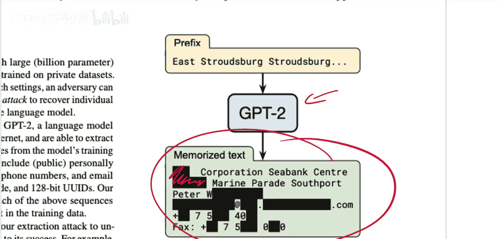

Needless to say， this has consequences for security and privacy and so on because if you train one of these models with。

 let's say internal or private data， user data and so on。

 you have to be worried that these models are going to just output that data again。

 on the other end and potentially leak information this of course has not been a problem that much so far if you know once we just train image classifiers and so on。

 but here especially with only black box access， this seems like it has some some consequences。

 So we'll go over the paper will go over the attack or the technique， the author's device。

 which is I think pretty clever will go over sort of the results that they get from using this on a G2。

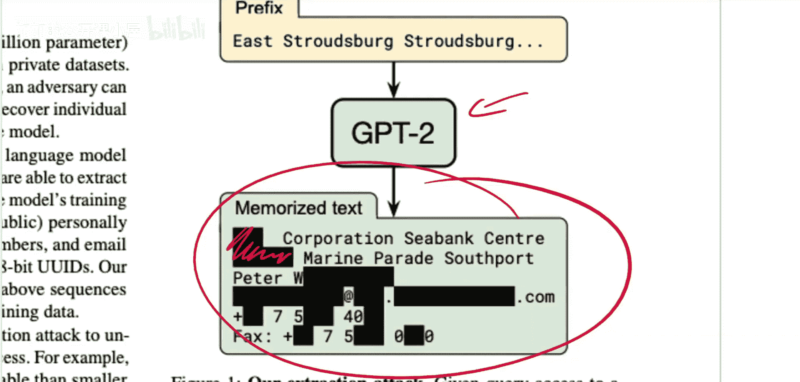

And we'll go over my opinion of the paper， which I can already tell you。

 my ultimate opinion is that the， the tack is cool。 The concerns are valid。

 but the paper is probably written a little bit more scary than it ultimately seems。 In fact。

 I find the， the results， the， the actual results of this paper， fairly okay， like fairly。

Promising and and and sort of straightforward and not that scary。

 And also the paper is interesting from another perspective。

 namely from the perspective of what it tells us about these language models and how they work。

 and it sort of strengthens a number of hypotheses that I've put forward in my video about G3 about how these models work。

 and and that's also fairly cool to see in this paper。 So we're gonna to jump in here， and as always。

 if you like content like this， don't hesitate to share it out or subscribe and subscribe。

 I should say， if you're not yet。 alright。😊，So。😊，They say it has become common to publish large。

 so billion parameter language models that have been trained on private data sets。

 This paper demonstrates that in such settings， an adversary can perform a training data extraction attack to recover individual training examples by querying the language model。

 right， So we we have， we already have quite a bit of information right here。

 So large language models have been， of course， trending with， you know， especially since G3。

 but at least since。

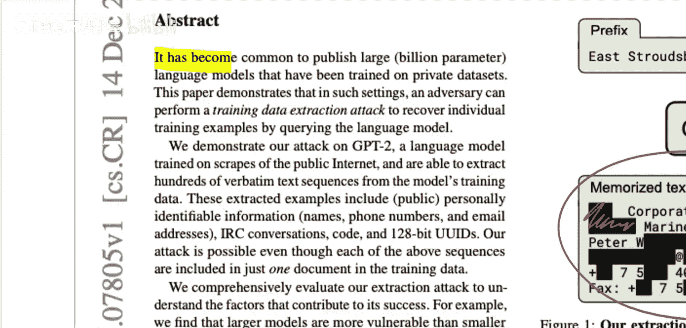

Since the the advent of the transformers， Bt and so on， though Bt isn't exactly a language model。

 So language models are models that per given a piece of text predict the next word。

 Let's let's it's so easy as that or they predict a probability distribution over the next word。

 So if you say a cat sat on。So that's the input the language model would give you a probability distribution over the next word。

 so the next word might be V or the next word might be a or the next word might be next because of next two and so on and it will sort of give you a probability distribution over each of these words that kind of looks like a face。

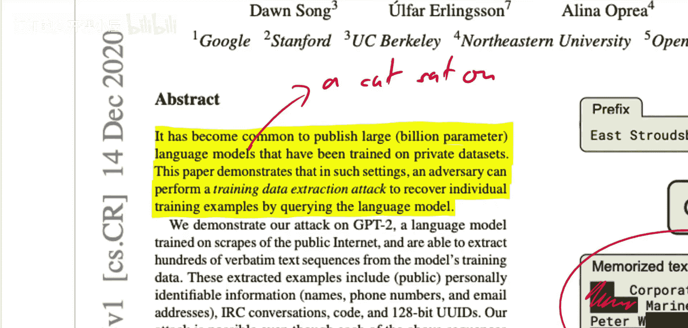

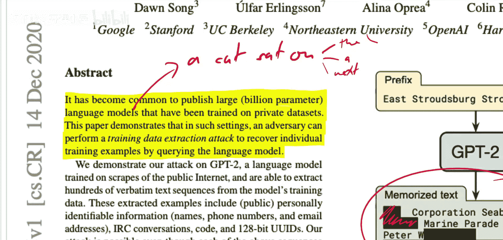

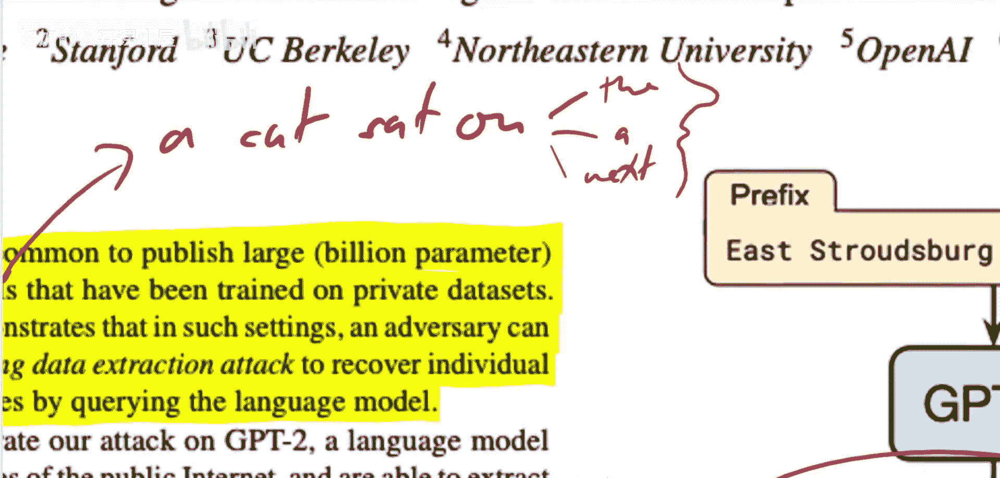

It will tell you how likely each next word is and so on。 And then you can sample from it。

 You can sort of choose one of those words and then go on。

 and you can evaluate the likelihood of entire sequences and so on。

 So G3 is one of those large language models。 and these large language models， they've been。

 of course， since they are large。 We know that they also need a lot of data to be trained on。

 So a large language model would take like a giant piece a database of training data， which is。

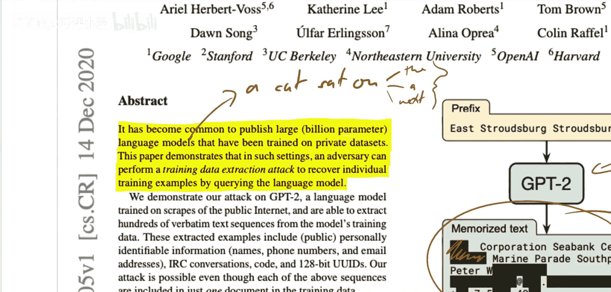

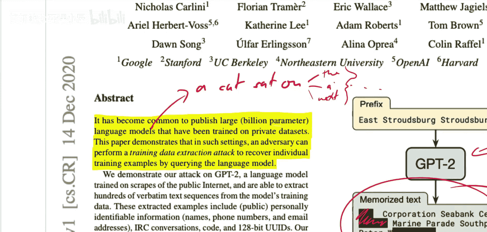

Scrape from the Internet， usually。 so this is。Too much to simply be curated by humans。

 They just let scrapers run over the internet。Then they use this to train the model。

 whatever that is in GP， GPT2 in this case， and GPT2 will then be a trained model。

 so you sort of throw the training data away and you simply say this is our model now。

 we're going to publish this right。Now， the problem is。

 if there is a piece of data in here that is kind of secret。 and you think， well。

 it's just one piece of data。 like how much can， how much can go wrong。

 right The problem is if I can inspect G2 and recover this exact piece of training data So that G2 will output that exact piece。

 that is is a problem。 Now they， they make some good points here。

 this notion of a piece of training data and what it means to memorize a piece of training data and what it means to extract one is fairly fuzzy And they go quite a bit deeper in this paper。

 So they have kind of strict definitions。

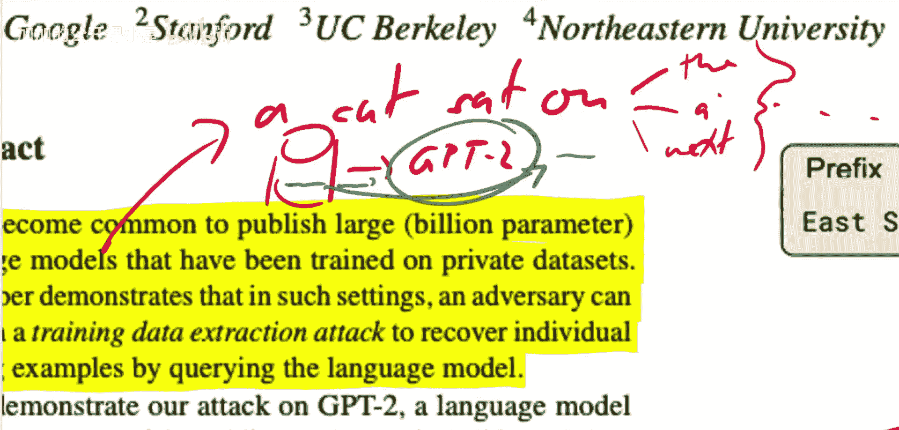

They say we demonstrate our attack on GP2， a language model trained on scrapes of the public internet and are able to extract hundreds of verbatim text sequences from the model's training data。

These extracted examples include public personally identifiable informations， so names。

 phone numbers and email addresses， as you saw on the right here。

IRC conversations code 128 B U U I Ds and so on。 So。

 so they are able to extract all of these things from the trained model， right。😊，And。This。

 you can already see that how， how this can become a problem。 They say our attack is possible。

 even though each of the above sequences are included in just one document in the training data。

And this notion， this notion of memorization here and when it is dangerous。

 they correctly say that this is only dangerous， of course， if the training example is contained in。

 let's say only one piece of training data because if something is contained in thousands of pieces of training data。

s you know， it's okay to memorize that right， if a name of like some famous person is memorized and maybe that the address like like the president of the USA lives at the White House that it is not a secret right so it is okay if your language model remembers that because it probably occurs in many training data points。

However， if something is contained in just one document right and the modeler remembers it。

 then that is， you know， kind of true memorization。 it it is not maybe or you know。

 is probably not learning anything from that data point。

 is simply memorizing it to make its training loss lower。So that's the case on the right right here。

Though I have to say this， as I said， it's written a bit more scary。

 So they don't exactly say that this name and phone number is contained in just one document。

And they， they also say like this is， of course， this is this is on the public Internet。

 GP T2's training data was scraped from the public Internet。

 So here is sort of my first investigation into this。 Of course， you can Google this。

 and you'll find it。 you'll find this。 And even though， you know。

 the blacking out here also is a little bit of， I think it's a little bit gimmicky because I don't see a problem with disclosing this particular piece of information。

 And I'll show you why。 So when you search for it， you'll find the Nist homepage。😊。

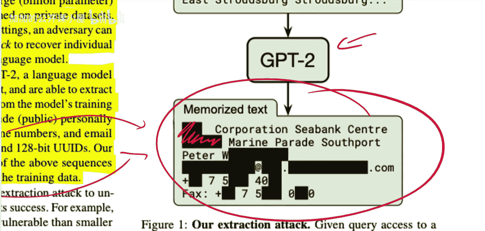

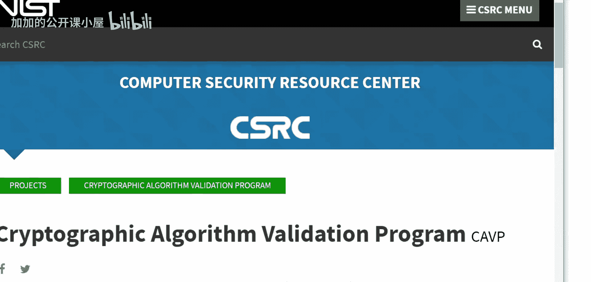

Find a cryptographic algorithm validation program， and you'll find that this is a description of a software implementation。

 And here is the personally identifiable information you can see。

This is a corporate address。 So this is the address of a。

