# YannicKilcher【中英⚡AI经典论文领读(全203篇)(下)｜Papers Explained】 p11 P111 OpenAI DALL·E：从文本生成图像（博客文章解读） [BV1j8x5zJEvx_p11]

A sphere made of Swiss cheese， a sphere with the texture of Swiss cheese。

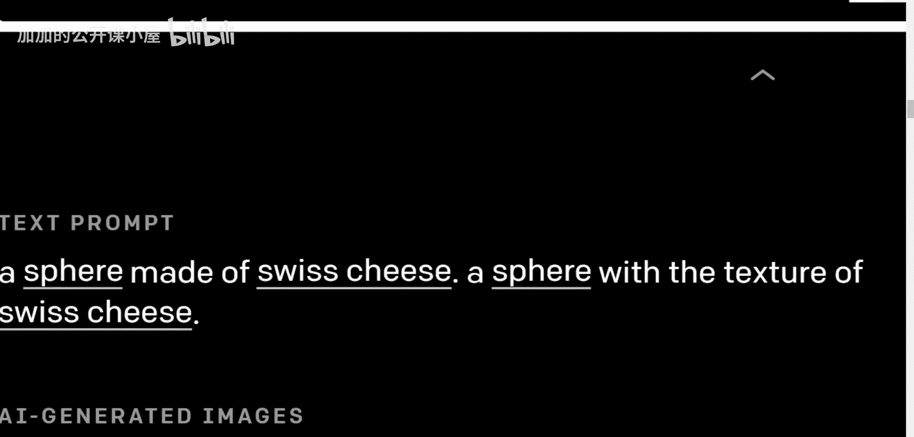

And there you have it beautiful， very appetizing Swiss cheese balls。

 My Swiss heart had just just skipped a beat out of this monstrosity。😊。

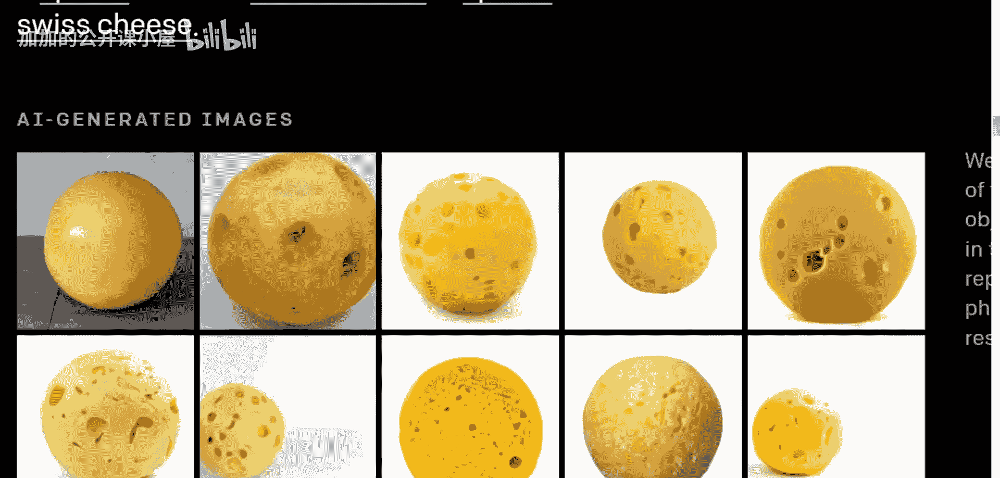

What's even cooler than a sphere made of Swiss cheese is a taurrus mate。

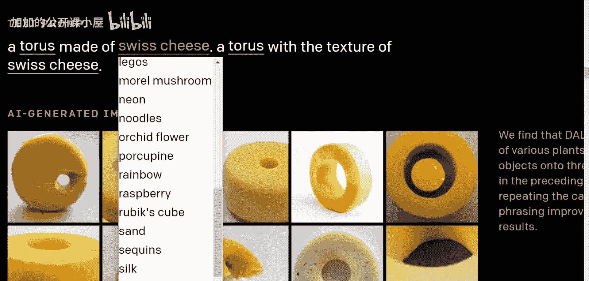

Of denim。These images are so cool， a Toras made of denim and the point here is that these images aren't photosshopped or sort of human created。

 they are AI generated and they are generated by this new model that open AI released a blog post about it's called Dolly。

😊。

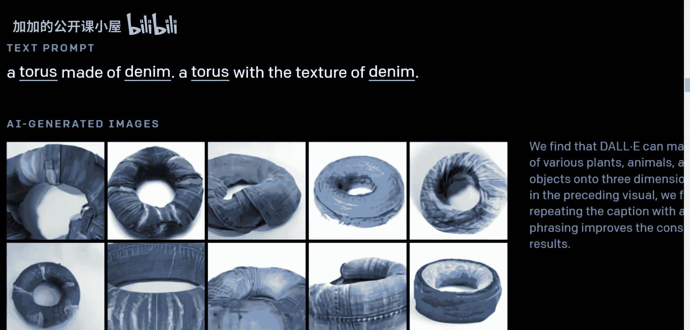

And what it can do is it can take a piece of text such as the one on top here。

 the fact that I can select is simply the fact that they don't give you access to the model。

 they just give you access of a bunch of things that they've tried but the model can take any piece of text and it can output a picture that matches that text so here you got a taurus made of toothpaste。

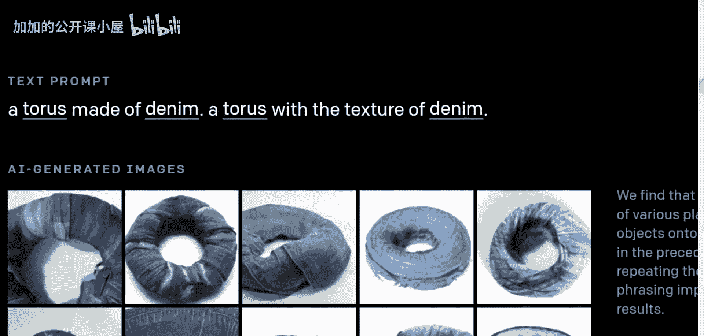

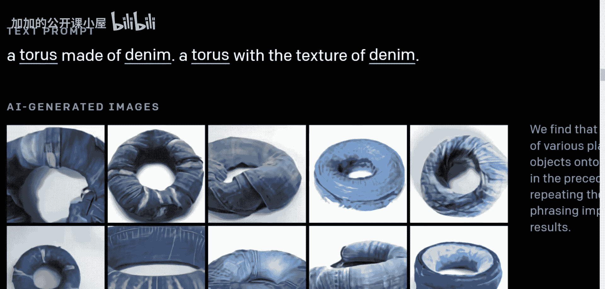

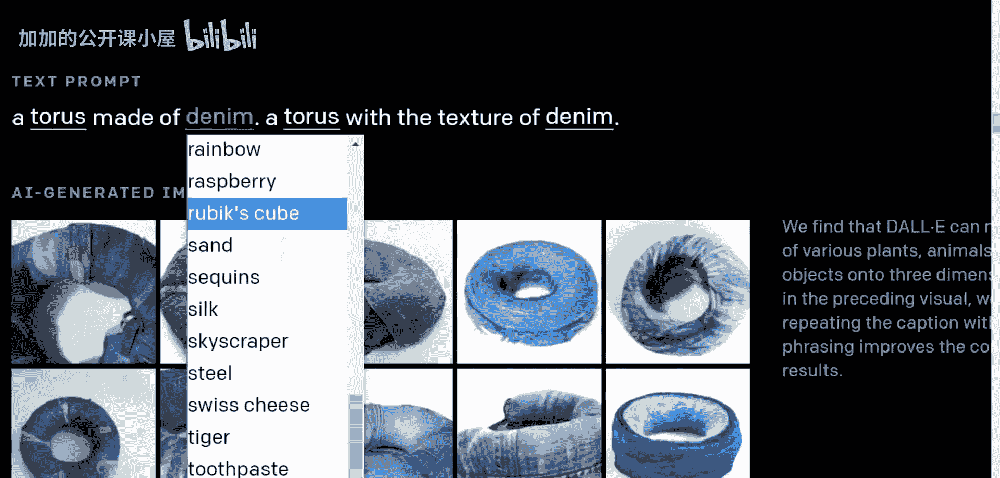

And the quality of these images is super astounding and what's even more astounding is sort of the range of capabilities that this model has。

😊。

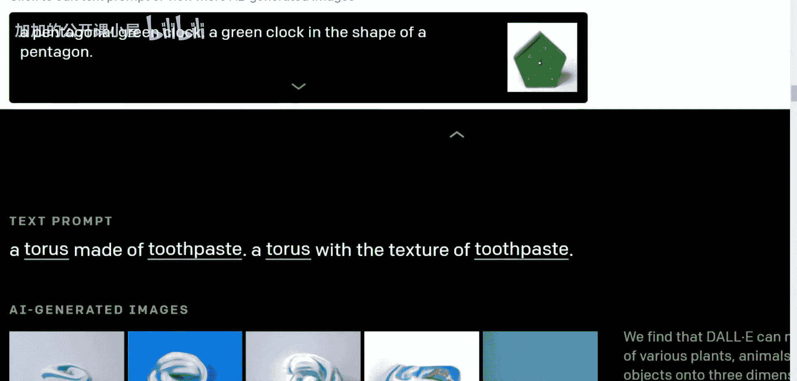

The model can do various things such as so in here the input is an illustration of a baby Don radish in a tutu walking a dog and you see an illustration of a baby Don radish in a tutu walking a dog and the outputs are just adorable these are generated by the AI the same for an armchair in the shape of an avocado a storefront that has the word open AI written on it I've tried reverse image searching some of these images and I could not find on the internet so it's definitely not just a model sort of outputting an image it found somewhere these are actually generated images and the astounding thing is that it's the same model that outputs all of these different images it's not one model here trained on illustrations and one model trained on chairs it's a single model that can take in a piece of text and option。

Part of an image or none of an image， and it will output the image。

 either it continues the image you already give part of， or it just generates the image by itself。

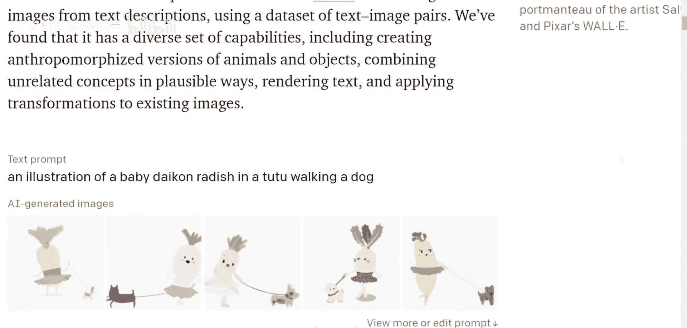

So a model is called Dlly and this is just a blog post for now by open AI。

 They say they'll follow this up with a paper and if the paper。

 you know brings substantially new things。 I think I'll make a video on it。

 but today we're just going to look at what this model can do， how it works， how it probably works。

 and we can take some guesses of what we can read in the paper once it's out。 In fact。

 Open AI has brought out two new models along with this Dli model。

 they've also released a blog post and a paper about a model called C。

 which is more of a sort of a classifier， not exactly classifier。

 It's sort of a it connects text and images in a different way。 It's not a generative model。

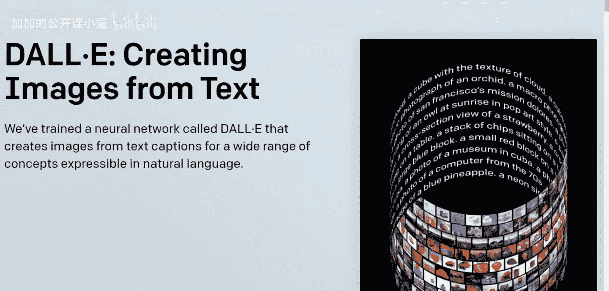

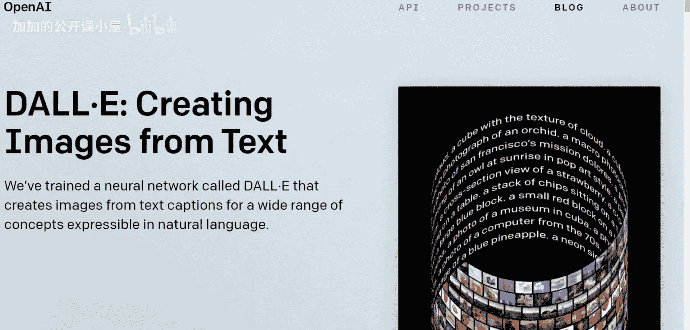

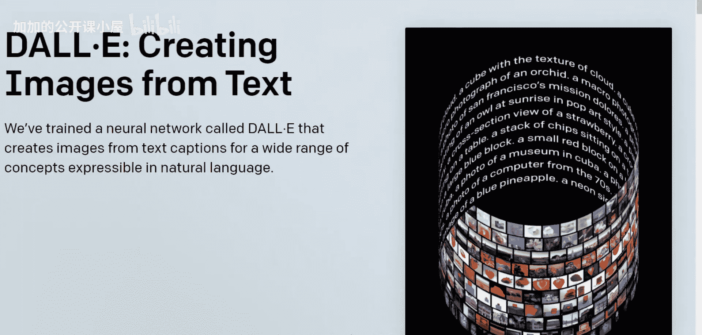

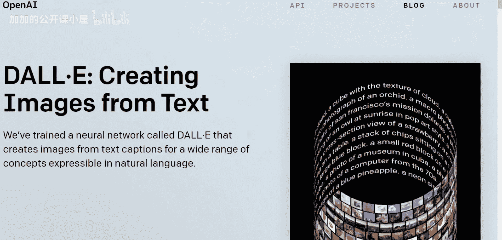

And we're going to look at that in a different video。

 but you can see the clear trend right here is that OpenI is looking into connecting text and images。

 So they say Doli， which is an this is a an I think an homage to Salvador Doli and mixed with the character Walley。

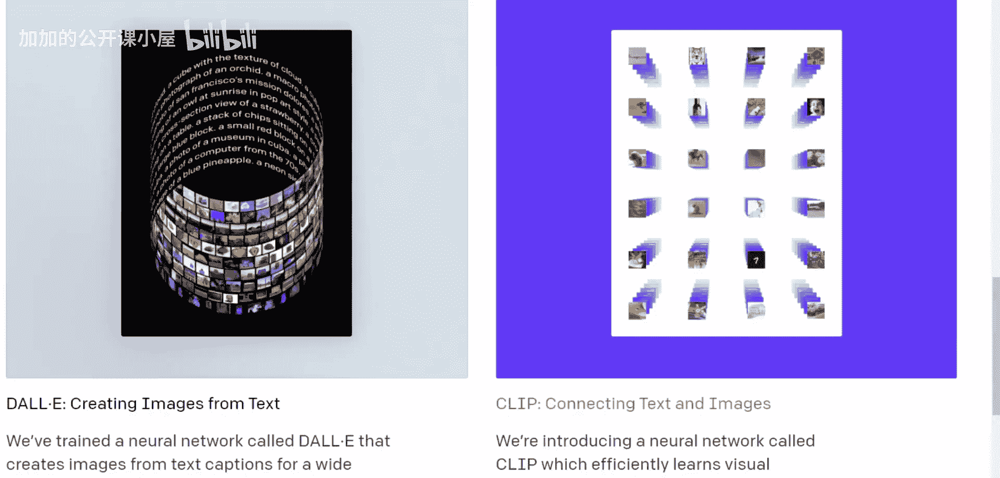

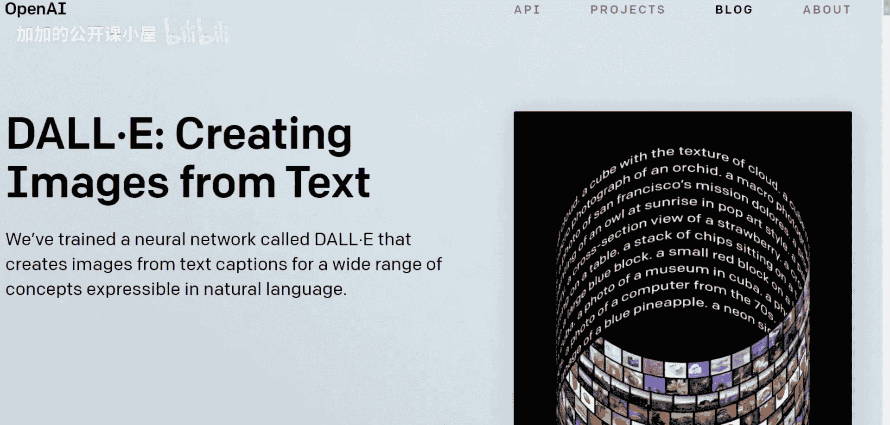

So they say it's a 12 billion parameter version of GP3 so you know it's more like not GP3 that was more than 10 times larger。

 but it's a 12 billion parameter version of GP3 trained to generate images from text descriptions using a data set of text image pairs we found that it has diverse set of capabilities including creating anthropomorphized versions of animals and objects combining unrelated concepts in plausible ways rendering text and applying transformations to existing images so。

A lot of the things they don't tell us here， especially the data， like how they get the dataset。

 Nobody knows they don't say this， they simply say it's a data of text image pairs and they sort of allude to the fact that they have large pieces of data。

 especially in the clip then they allude to the fact that you can just find data that connects text and images on the internet and it's true if you search。

 if you scrape the correct websites and do it in sort of a smart fashion。

 you can find a lot of data where there's an image and there's a piece of text describing that image and we have to assume that they sort of scrape the internet for something like this。

 I don't think they have a lot of human explicitly human labelbeled data for this type of thing。

So we'll just assume that they have like a huge data set and of course they train a huge model on it。

 a 12 billion parameter version of GPT3， GPT3 is the famous model。

 the famous text generation model by Open AI。And。You can sort of see the same things right here。

 So G3， my hypothesis was is that it sort of smartly mixes the training data rather than remember the training data。

 it sort of remembers it and then smartly interplays between it。 And I think you can sort of see。

The same kind of things right here in that these are all definitely pictures that you could imagine in the real world。

 but they have， you know， they have， for example， their changed to open AI in here。

 There are surely chairs that sort of look like this。

 So it just kind of mixes a chair with an avocado in a plausible way。

 I'm not saying this to denigrate the model。 I'm saying that I mean。

 this is seriously cool the fact that it can do that。😊，So。

They say like GPT3 Dully is a transformer language model， now this is very。

 very interesting the fact that it's a transformer language model。

 it receives both the text and the image as a single stream of data containing up to 1 1。

280 tokens and trained using maximum likely to generate all of the tokens one after another。Okay。

 this training procedure allows Dolly not only to generate images from scratch。

 but also to regenerate any rectangular region of an existing image that extends to the bottom right corner in a way that is consistent with the text prompt。

And they say a little bit more here on the right and they also say a little bit more down on the bottom。

 So I'm going to try to take a stab of explaining how this model works with the full knowledge that I might be wrong once the paper comes out。

 And for that we have to go back a little bit and look at the models it draws from namely the VQ VE。

 So the vector quantized VE literature。 So VQ VE。We'll consider this to be sort of the inspiration of。

Or one of the necessary ingredients of this model。 So if we combine VQ VE with something like G3。

We get dulllly。That's my， that's my hypothesis for today。 why combining these two models。

 So GT3 is extremely good at modeling language， right， So if I have a piece of text。

Let's go down here for a minute。 And let's say I have a， a cat set on。The mat。

A transformer will be very good at understanding this sentence and being able to complete it。

 So if I cross out this and ask a transformer to continue the sentence。

 it will be able to continue the sentence just fine。 if it is， if it is trained well。

 And that's exactly how G 3 works。 Now， imagine that I don't have a piece of text。

 But I have some sort of a description of an image， right？ Let's say I have。I have a box。

Here is a box。And the box， which is going to be A VQ V AE， can take in a。

Description of an image in words， but not exactly words that human humans understand。

 But let's say there is an image language， sort of like a programming language。 Okay。

 and you input symbols into the image。 Let's say it's a bit like Egyptian hieroglyphs， maybe。

 So here is the， here is the this， this hieroglyph thing。 And then there is the sun。The sun thing。

 and then there is the tree， the word for tree， like the hieroglyph for tree。

 and I input that here and the output will be an image where I don't know the sun is shining。 Yes。

 I draw some like a child。 It has a little smile， okay， deal with it。And there is a tree。

 maybe not exactly the tree from the hieroglyphs， but like some sort of， some sort of tree that fits。

 And then there is some human in the scene。 Maybe the human sits here。

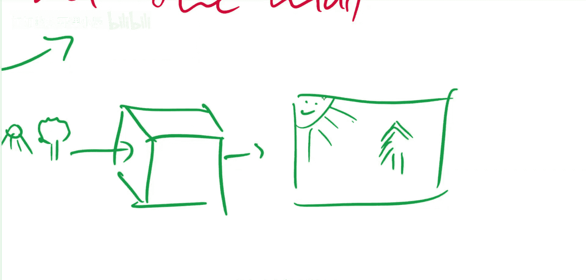