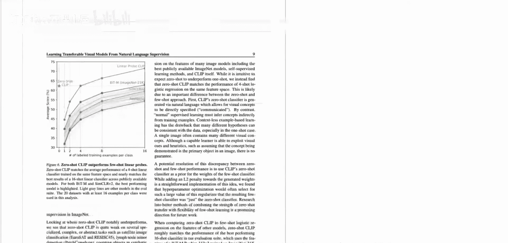
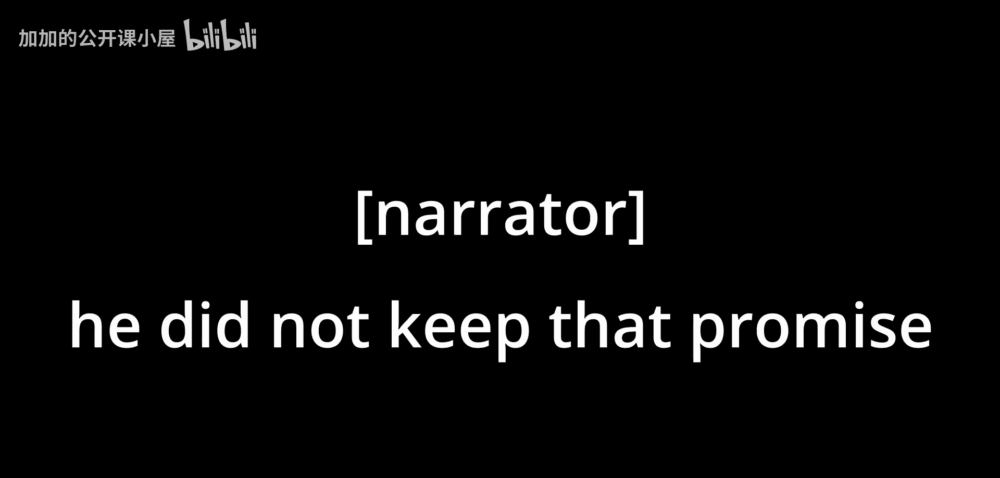
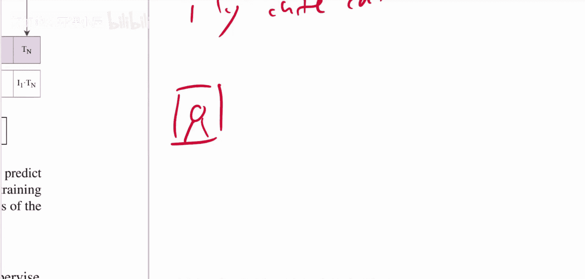

# YannicKilcher【中英⚡AI经典论文领读(全203篇)(下)｜Papers Explained】 p12 P112 OpenAI CLIP：连接文本与图像的桥梁（论文精解） [BV1j8x5zJEvx_p12]

So here you see a classifier that takes a look at this image and assigns one of many， many labels。

 actually one of 101 labels as you can see here， and one of the labels is a photo of guacole。

 a type of food and it assigns a really high probability to that as opposed to like the second prediction which is civiche。

嗯。So you know classifier pretty good okay take a look at this classifier out of 397 labels it correctly identifies that this is a television studio you can go on right here and so this is a photo of an airplane whenever there's a green bar at the top it means that the respective classifier has this correctly whenever there is an orange bar。

 it's an incorrect label with the green bar being the correct label so you can see here these classifiers perform sometimes pretty well on these examples and sometimes not but what you can distinctly see is that these are all from different data sets so different tasks there is a satellite image there is a car and you're supposed to classify which car it is not only that it is a car。

So。Very diverse set of tasks。 And the interesting thing is that this is all the same classifier。

 So this classifier is it's not even fine tuned。 It is a zero shot classifier that handles all of these different training dataset sets。

 sorry not training dataset sets， all of these different test data sets in one go。

 So that's already pretty cool， but what you may have noticed is that the labels aren't labels that you would usually see in a classifier。

 So you know these 101 labels here。 they are it say is it here， guacamole， that's the label。

Interestingly， the label the classifier assigns is not just the word。 It's the a photo of guacamole。

 a type of food。 Okay， that's the label the classifier assigns。

 and the second highest label is a photo of civici， a type of food。It's not always a photo。

 though it is often a photo。 But here， you can see， for example。

 the label that the classifier assigns is a centered satellite photo of permanent crop land where the。

The correct label here is the annual cropland， which is down here。 Again， the label is longer。

 So there's something interesting going on here。 It's the same classifier。 It's zero shot。

 So that means the classifier is not trained on these data sets。

 It's not trained to fulfill these tasks yet。 still， it seems to perform okay。

 and the labels are quite weird。 so this is。This is a new paper by Open AI。

 which we're going to look at today。 you can see it's a pretty long paper， but we'll cut it short。

 I promise。

And it's called learning transferable visual modes from natural language supervision。

 and the model colloquially or or also in this paper is referred to as clip。

So this is the model has been released along with the Dolly model。

 which you can do the chair made of avocado and so on。

 The Dolly model is a generative model that generates images clip is a more of a I I want to say discriminative model but clip is a model that takes in images and text and connects them in a nongenrative way。

 So we're going to see what that entails It's by Alec Raford and Zhg Wu Kim and others。

 as I said of open AI。So the idea here is to connect text and images。

 and this has been done in in a number of ways previously， even in this way。

 it has been done in one fashion or another， I find the introduction and discussion of related related works in this paper to be very very thorough and and superb。

 So they do assign a lot of credit to people who have had the various ideas。

 So the goal here is that。We want to get a model that can represent images and text really。

 really well。Okay， so how do we connect images and text。 First of all， what， what if。

 what if we have a data set of images and text， Okay。

 so they construct a new data set where there is an image like something like this， a cat and a text。

 a little piece of text to it like my。My cute cat。Images and text like this you'll find on you know for example。

 social media， you can scrape that Pinterest， whatnot flickr people write descriptions along with their pictures。

 so it's pretty easy to get these pairs of images and text from the internet without having to label them right so one motivation of doing this kind of work is if we train a image classifier model we always need labeled examples into you know into a very predefined set of classes So an image we have1000 classes or 22000 respectively in MNist we have 10。

However， if we could just somehow learn to connect images with the text that comes along。

 we wouldn't be bound by the classifier labels and we could get very good representations。

 So the original idea or one of the original idea is we take the image and we predict， predict。

The text from the image， of course， Dolly goes the other way so。

Dolly somehow goes the other way of taking the text and predicting the image。

 But the idea is if we can take an image and from it predict the text。

 what we get out of it is not only a model that can label images。

 but what we hope to get out of it is this process right here maybe be very。

 very good representation。 So if this is like the image goes into a neural network with a bunch of layers and then out comes you know the text my cat and so on。

 then somewhere in here in the intermediate representation of the neural network。

 there must be a pretty， pretty good representation of what is in the image。

 So not not only you know the pixel values， but there must be actually some kind of representation of the concept of cat because otherwise it could not predict the word cat at the end so。

The idea is to get a really good representer and then you could take that representation and fine tune it to other tasks and so on。

 So that's one of the ideas that we're going to work off here。And it turns out this is pretty useful。

 There have been papers before predicting the simply predicting the caption of images。

 but it doesn't work too well。 So what this model here is going for。 and we're will simply。Well。

 simply。Let's look at this graph right here。 So they tried first to predict the text and。

You can see that。0 shot and we're going to to look at what exactly zero shot imagenet accuracy means in this context。

 but you can see here that they had some success with using a transformal language model to predict the text in images and evaluating that on imagenet。

However， they seem to have more success by using just a bag of words prediction。

 So what that means is you're not trying to predict the exact words。

 You're simply trying to predict which words occur in the description。

 So you see the photo if you predict cat and my and cute in you know any non non-ordered。

 you're already correct。 and that already gives a sort of a better efficiency。

 You can see the models here。 They tend to go up， but it's questionable if that will ever reach the orange line。

And with their new objective with what this paper suggests， you can see right here。

 the contrastive method。You get a way bigger performance。

We'll look at what this zero shot accuracy means and why it might be that these simply predicting the text from an image might not be a good enough idea。

So。Let's say we have a model that can do this。 We have a model that can take an image and it can predict the the text that appears in it right Most of the time。

 this model right here is also going to give you something like a probability Okay like a likelihood。

 So if this is a transformer， you can you can ask you know for its logs and then you can compute the likelihood of a given label。

 So if you have such a model， what you can do is exactly what。What they allude to right here。

 If you have an image task， right， and you have a， you have a model that can predict the。

The text of an image。 You can take that image。And you can run this sort of through your image and through your encoding。

