# YannicKilcher【中英⚡AI经典论文领读(全203篇)(下)｜Papers Explained】 p14 P114 SingularityNET——一个去中心化的AI开放市场与网络（白皮书解读） [BV1j8x5zJEvx_p14]

Hi there Today we'll look at Sity net， the global AI marketplace as it is advertised on their website specifically we're going to look at the singularitynet White Pa 2。

0 as it appeared in 2019 So it's version version 2 version1 I think appeared in 2017 so Sity net is a as it says a global AI marketplace。

 but it is also kind of an effort。 it is a foundation。 it has blockchain in it， it has AI in it。

 it has symbolic computation has graphs it has all the things all the buzzword you could possibly want so the highlevel summary of this system。

 is that it is a marketplace for As basically on blockchain where either humans or As can call other As and pay them for that service and the goal list。

To sort of get a network going of APIs that call APIs that call APIs and。

Sort of have that build into a global AI， not only marketplace， but like as itself， a global AI。

 This is backed by the singularity net foundation。 and they do a whole bunch of development of the platform。

 but also research on the platform。 and we'll look at all of this today。 So it is a white paper。

 which is not a research paper as we usually look at。 that means a bunch of things。 first of all。

 as you can see， it's quite long。 And we're going to skip most of it。

 actually but also I have maybe it's just， it's just because it's a white paper and that's usual。

 but all of this is it's sort of marketing and it's it's sort of never fixates on one level of analysis like it goes into this and then a bunch of buzzwords and then super detailed。

 And then it talks about， you know， what kind of cash do we need for the database， but then。

It goes back and it just references a bunch of stuff without explaining it to just kind of beef it up for investors。

 I guess， I don't know。 In any case， we're going to go through it。

 we're going to go through what the marketplace looks like， how it works。

 what it's good for some of my criticisms， the the central components， as I said， are the APIs。

 but also a rating system， and。It is also decently governed。

 so the goal is to have the community govern the network and lastly。

 the goal is to have all of this be beneficial for humanity。So。

We're going to see how this all ties together。So what's the， the current。

 the current situation and what the singularity net want to do？

 So let's say you are this external software。

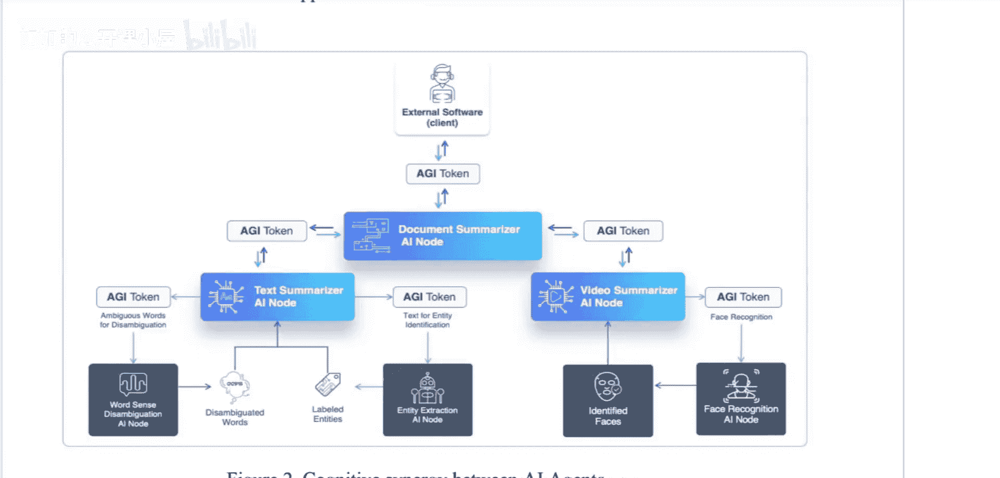

You're a person， okay， and what you want to do is you want to summarize a document。

 The view that this system has is that you could give this to a document summarizer。

The document summarr， however， looks at this and sees， oh， what are you giving me， You're giving me。

 And in this case， it might be， you know， an article of the New York Times that has both text and video。

 Okay so you give it。 you see an article。 It has like a title。 It has a bunch of text。

 And here it has like a little video to go along with it。 And you simply say summarize this to me。

 So this document sumr。 All it does is it looks at the document， and it sees up。

 there is a bunch of text。 And there is a video here。

And I'm going to so in order to summarize the document。

 I need to summarize the text and I need to summarize the video。

 so it will take the text and it will send it to a node that's dedicated only to text summarization and then it will send the video to a note that's only dedicated to video summarization the video summarize summarizer in turn could do stuff like call face recognizers and call some databases in order to sort of get who is in the video or what's in the video it could call object detection and so on the text summarizer in turn。

 it could call some word sense disambiguators， it could call entity extractors to also realize what is in the document and then these nodes will send sort of so every node。

Can call other nodes in the network。 And at the bottom， you'll have these sort of AI primitives。

 like face identification。Entity， extraction and so on。

 And they are not to be meant to be called by you directly。

 They're meant to be called by higher level nodes that sort of aggregate them。

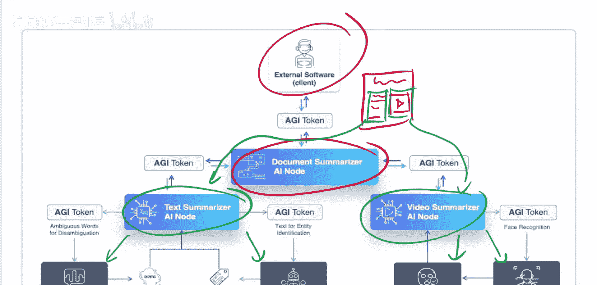

Okay， and this， now， if you look at this and if you are a software developer， you。

 you think of libraries like you think， of course， you know， this is， this here， this stuff here is。

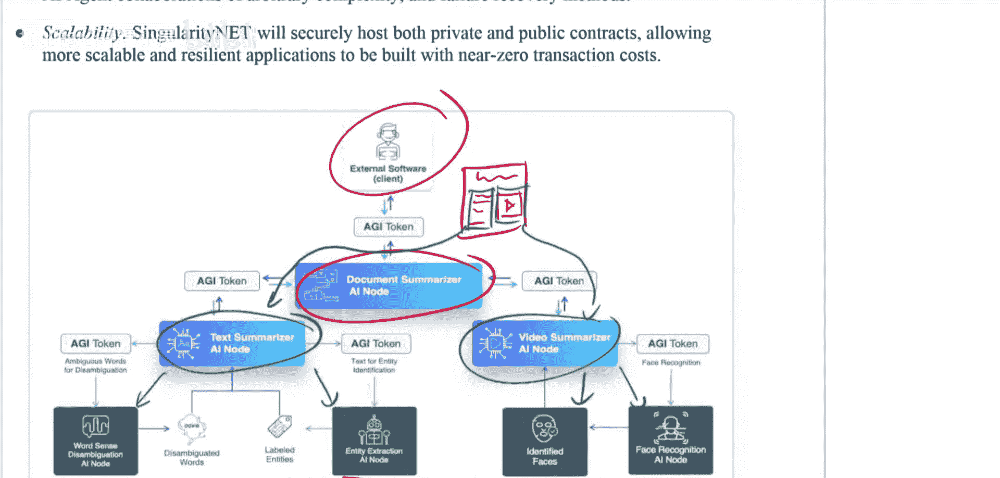

Maybe that's huggging face。 and this stuff here probably in spacey。 that exists， right。

 if you are a software developer， you know， if you have to do subtasks。

 someone probably already solved that subtask， I can just call a library。

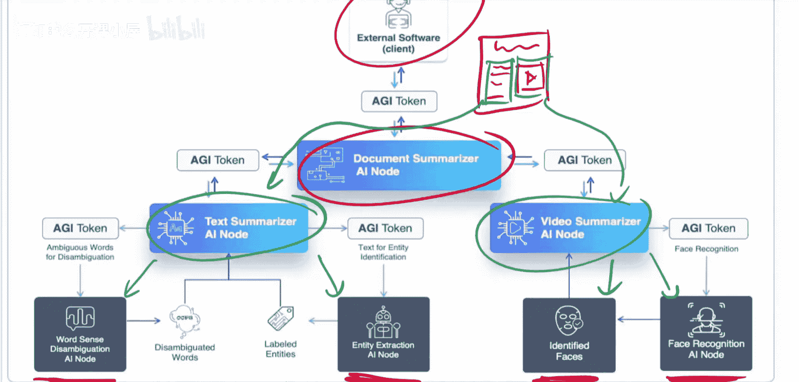

Now， the view of singularity net is that。

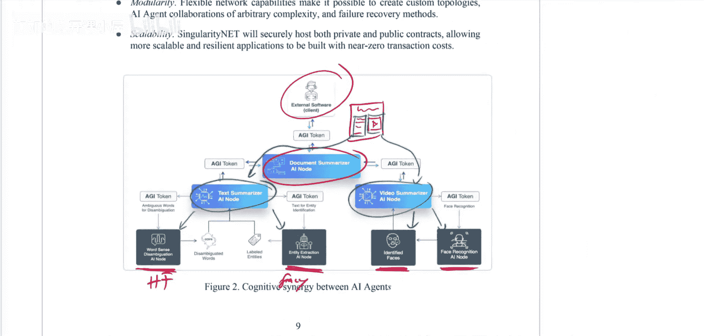

No， maybe you don't want to call a library。 maybe you don't know yet what's the best。

 So their view is a marketplace And why is a marketplace better for AI than for regular programs because。

 you know， for regular programs， we don't need a marketplace， We simply call a library。

 Why is that not good for AI and I'm you know I'm trying to。

 I'm trying to sort of make sense of this right here。

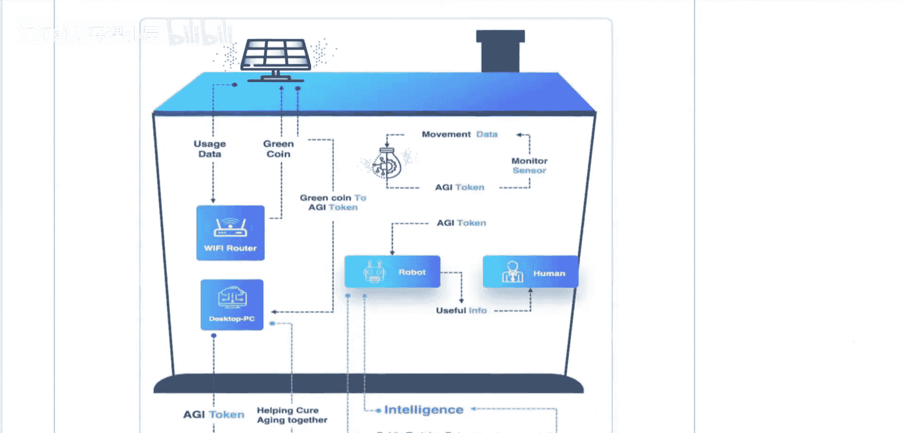

I am not convinced by this system either， but I'm sort of trying to make the best case for it that I can。

 So if you are this， let's go back to that graphic。

 if you are this text sumr and you need to do you need to do entity extraction right you might have a lot of lot of choice so there might be。

 you know， entity entity extractionor。

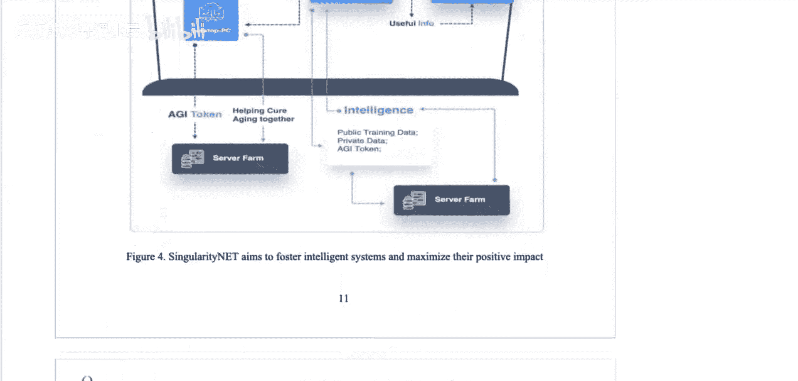

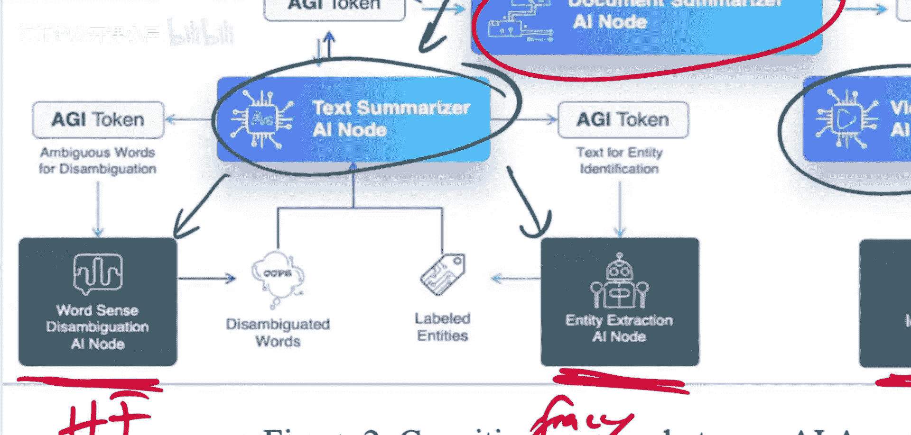

A， there might be entity extractor， B and so on。 There might be many of these entity extractors。

 and then a new paper comes out， right， and then entity extractor F is somewhere on Github you know。

 but so what you need to do every time a new entity extractor comes out is released， you know。

 someone makes a paper maybe put some code， The code doesn't really work。

 You have to go fetch that code， You have to look you have to plug this into your system， right。

 You have to test against your dataset sets and you have to decide。

 is this better than what I had before， or is it worse， is it worth including and so on。 So。

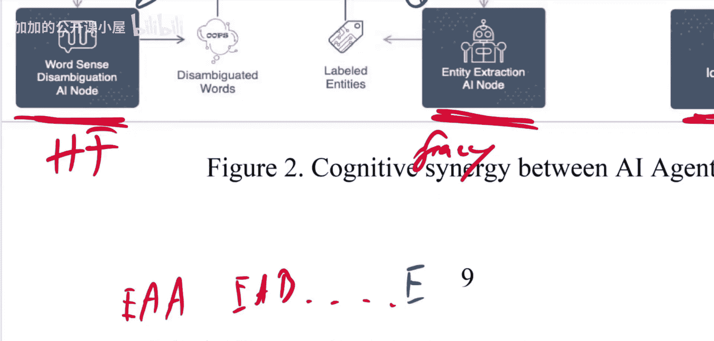

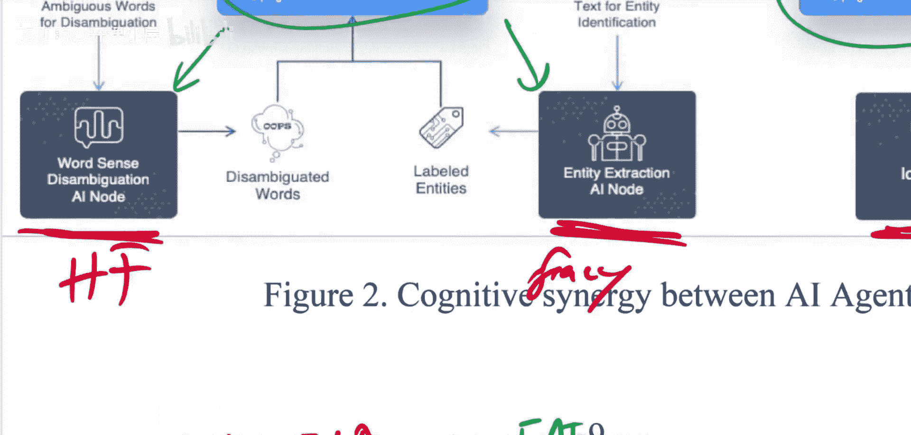

It is in the classic software world。If you have a library that does something， it does that thing。

 right， it cannot necessarily do it better or worse。 However， in the machine learning world。

 it can definitely be， you know， that this thing here is like 90% accurate， which is already good。

 But then something comes out with 95% accurate。 and that's better。

 And you would like to sort of switch to the better thing or the thing that meets your needs more。

 The thing that works on your test data set and so on。

 So that's sort of the case to be made for an AI marketplace。

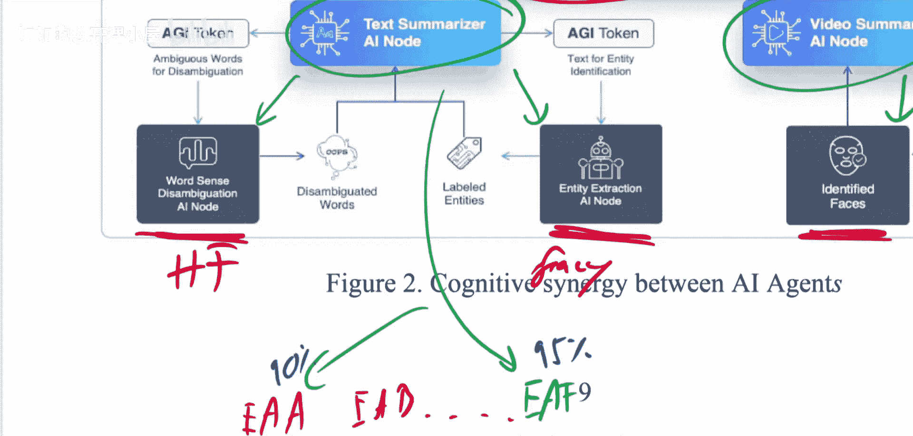

Now， this singularity net's vision is that let's say Im a researcher。

 I come up with a new entity extractor right I have my so I have my paper here。 I have it written。

 I have maybe a bit of code somewhere what I can do is I can plug this into singularity net and then I am say here here I am entity extractor X and you can advertise yourself to this network and then all the other nodes like this text sumr node。

 but know many other nodes could then come and sort of in an automated fashion test some sort of test data set that they have against you they test it against your system and they can evaluate you and then they will switch to you to using your code if you are better than the competition for them or maybe if you're cheaper right and for that if you're a researcher and。

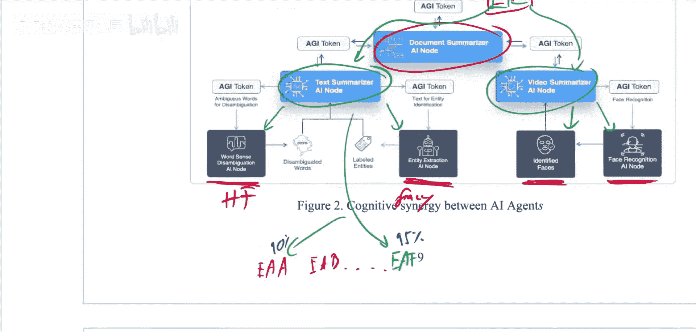

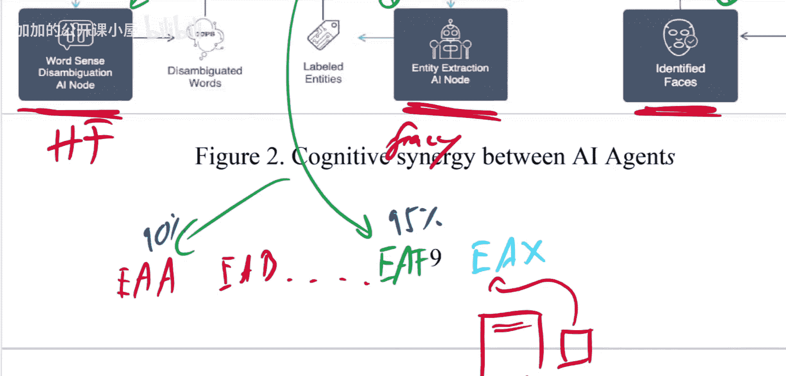

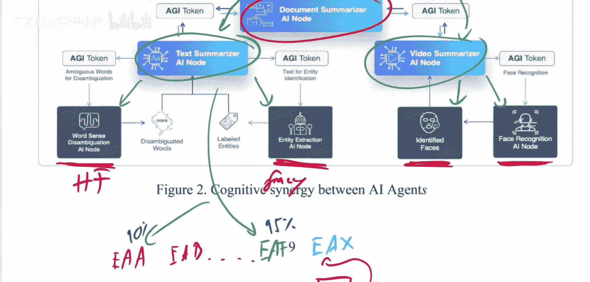

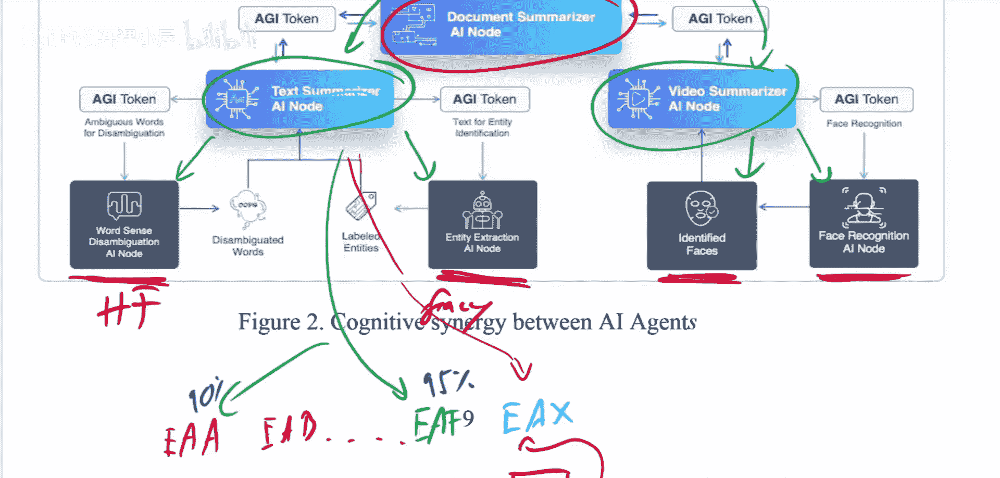

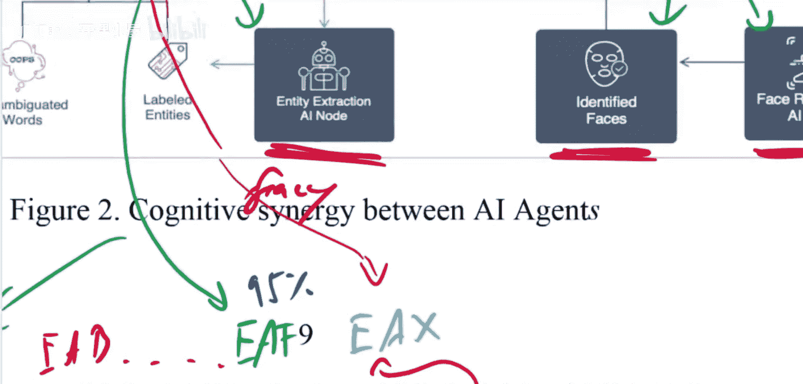

for that， you would get money because every time a node calls you。

 they're giving you some money for analyzing their data。

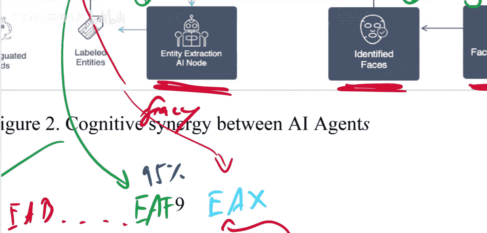

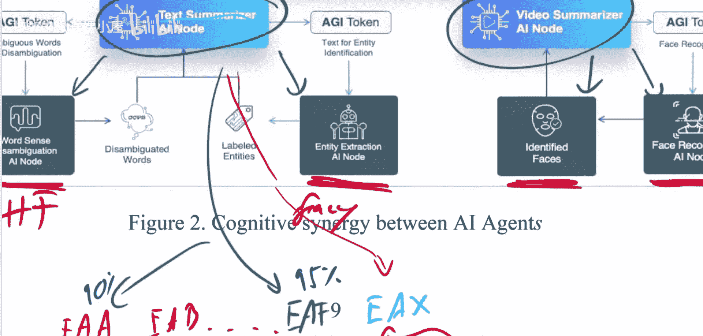

So that is the， that is the， sorry， that is the。

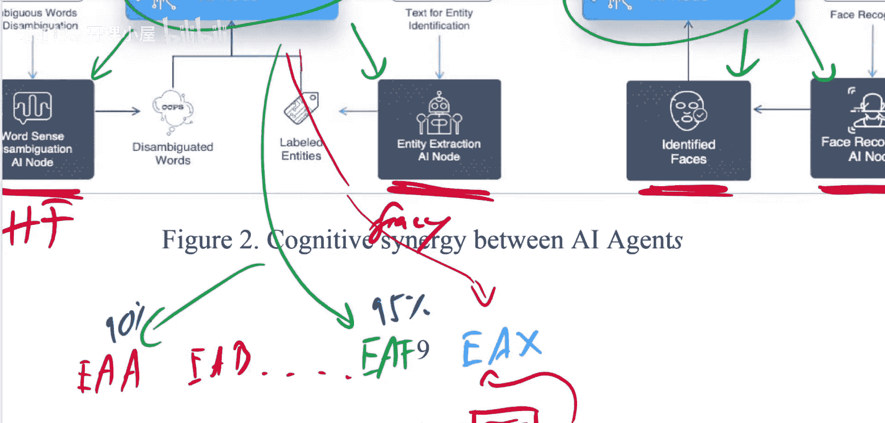

The core idea behind the AI marketplace right here。

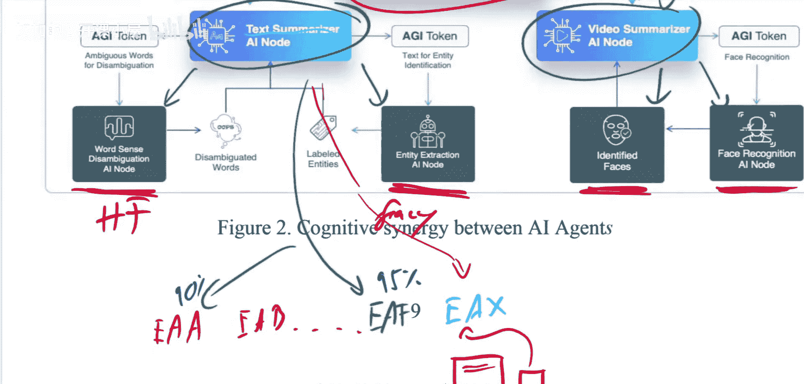

So the AI marketplace as a whole looks something like this。And there's a lot of stuff here。

 but we'll go through it sort of one by one。It is so this， this here。

 it mixes kind of conceptual and technical and so on。But ultimately， you have。

Is there a way I can draw this more easily。U。Yeah， maybe。 okay。 So you have consumers。 okay。

 and consumers can be people。

