# YannicKilcher【中英⚡AI经典论文领读(全203篇)(下)｜Papers Explained】 p15 P115 反馈式Transformer：用反馈记忆解决Transformer的若干局限性（技术解析） [BV1j8x5zJEvx_p15]

Hi there。 Today we're looking at addressing some limitations of transformers with feedback memory。

 also known as feedback transformers by Angela Fun Tibo lail Iwaavula and Sunbiar soapbaar of Facebook A research and Loier on a high level this paper as it says in the title it addresses some limitations of transformers specifically of decoding transformers that are trained with causal masking and the problem is that these transformers they don't make use of all of the information they compute。

 even though they technically could make use of that information。

 but they sacrifice it in order to train in parallel and we'll see what that means to alleviate this this paper introduces these feedback memories and thereby they arrive at a model called the feedback transformer that takes into account。

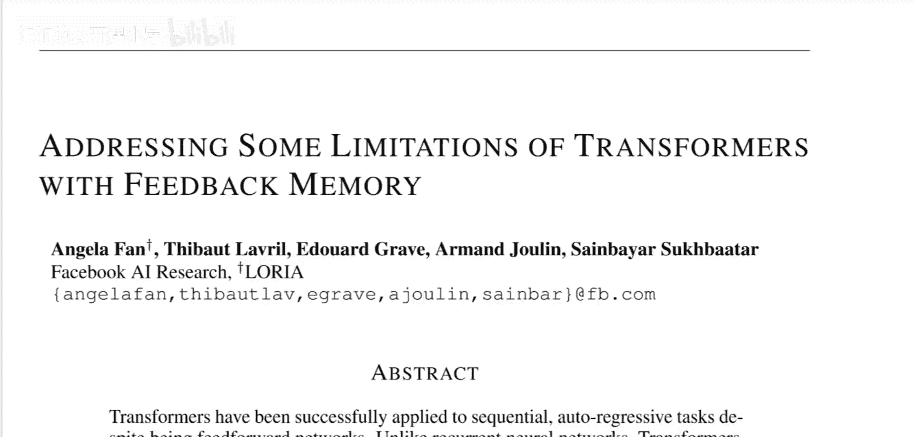

All of the available information Now this new model it can't train as fast because it can't be trained in parallel as the old model。

 however， you can build models with this technique that are significantly more shallow so less layers and also the models will remember things for longer and this is especially helpful when multiple steps of reasoning are required and it has to be done over kind of a longer sequence。

 so we're gonna to see some tasks from reinforcement learning and kind of other sequence tasks where these feedback memories really make a difference。

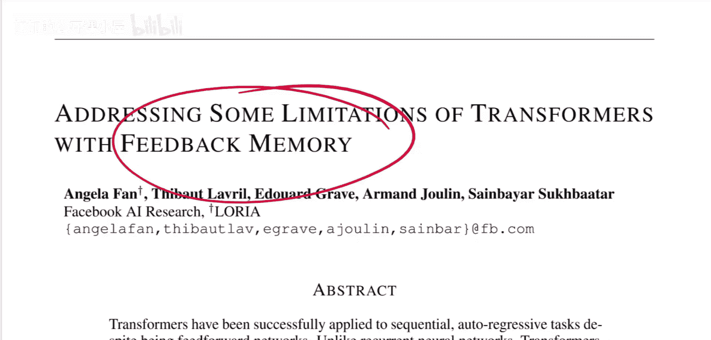

In any case， if you like content like this， don't hesitate to share it out and tell all your friends about it。

 that would be awesome。

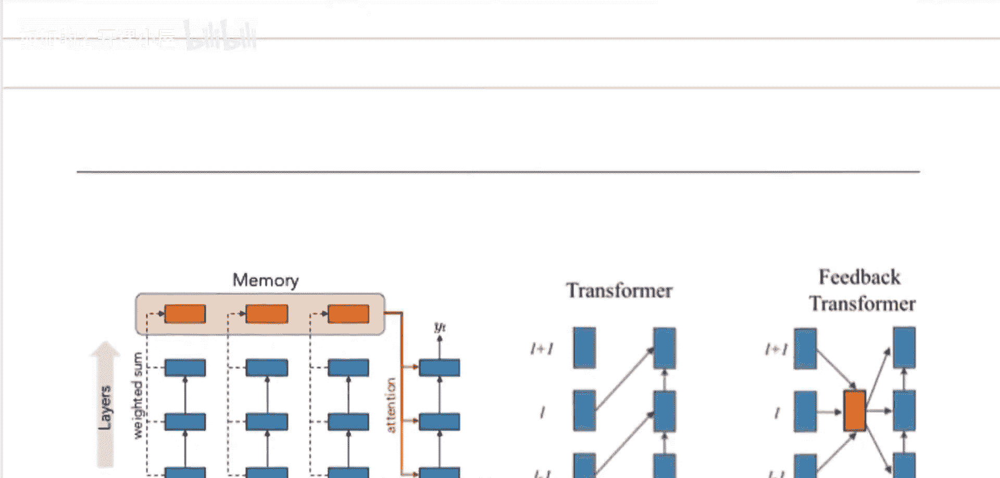

All right， so what's？What's the deal with transformers， What are they doing wrong， As already said。

 we specifically are in the case of this sort of decoder only transformer right here。

 These graphics here， they are a bit confusing on first site。

 I I found I had to dig into the paper and read the paper。

 It was not necessarily clear from these diagrams。 So I'm going to try to sort of build up what's wrong。

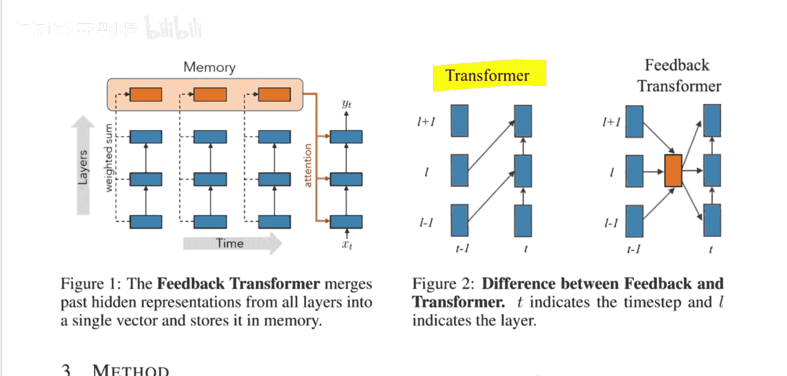

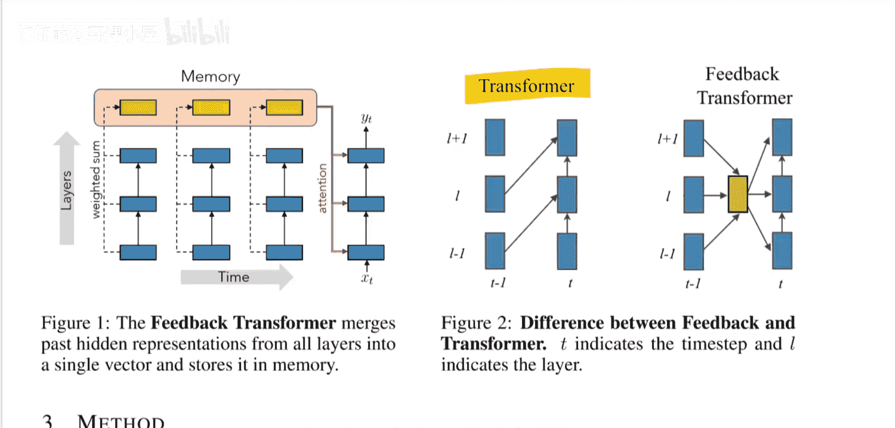

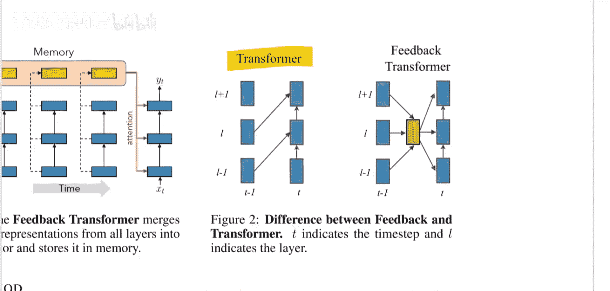

So what we're trying to do is we're trying to do something like language modeling now it's not only language modeling。

 but in any case we have a sequence of inputs which I'm just going to represent as circles and what we want to do is we want to predict whatever the next the next circle is so these could be steps actions to be performed in a reinforcement learning world。

 these could be words of a sentence right up to here and then you are supposed to predict the next word that's called the language model many things are fall into this category。

So for example， GP3 is trained in exactly this way in order to do this。

 you have to have a model that somehow takes all of these things and somehow builds a representation that then outputs this thing right here okay。

And。That's good in itself。How did we usually do it， So the first attempts at this， of course。

 were sort of recurrent neural networks。 and I'm going to go over them here because they are going to be important。

 even though you probably already know what they are so。

For actually for all of the models we're going to look at today。

 what they do is they build representations of this input data。

 so I'm going to represent this with little boxes。What they do is they build these latent representations right here。

 so the data in a recurrent neural network flows like this。

The inputs go up each time into a hidden representation。

 this is a neural network layer that does this， and then the hidden representations are transformed into each other so。

The the first input is input here， then it is sort of forward propagated to the next time step at which point the next input is consumed and then it is merged with the previous hidden state and that is propagated forward into the next time step and so on at the end you take this representation and you output whatever the next label is and I'm going to purposefully draw this now up here to say so the data flow is something like this。

There has been improved versions of R N Ns that do multiple layers of this。

 So the next layer would be here。 And this is a multi layer R N N。 So if you。

It like this could be an LTM。 This could be a plane or an N and so on。

 What they would do is they would。Do the same thing here。

 but then each hidden representation goes into the next hidden representation like this and these hidden representations they are also connected with a recurrent connection over time like this building sort of like a grid。

Rightright， so。The way you have to think about and then， of course。

 here in this for So the output of the last top right one goes into predicting the next token or action or whatnot。

 because the top right one， as you can maybe see， all the information flows up and to the right in this in this case right here。

What。This is what an R and N does。 Now， you can see this is very well connected information。 However。

 if you， if you think about this in terms of information flow， if， for example。

 this thing right here。And this thing right here need to communicate somehow。

 Imagine they need to communicate to solve a task。 So what could this be， This could be， for example。

 a name， Frank。

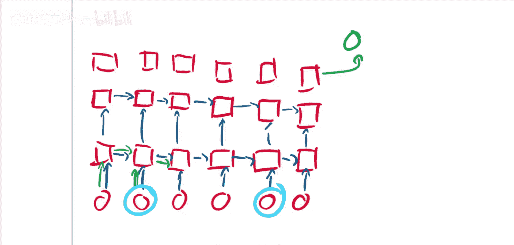

And this could be an like an article referring to Frank like he okay and you know it's out of order so but in order to know who he is。

 you somehow need to these two tokens somehow need to communicate。 I hope that's sort of clear。

 Now they here can communicate by means of transferring information， you know。

 from kind of step to step like over here maybe like this right and then in this hidden representation。

 the information can be combined， but you can see the number of steps that the information has to travel is fairly large。

 It can also be combined here if the information flows first up one layer and then over and so on。

 this is the drawback of returncurren neural networks very often the information has to flow along many steps of computation in order to be combined with something else。

A different approach is a transformer。 So a transformer handles sequences in a very different。

 not a very different way， but in in a。Different enough way。

So what a transformer does is whenever it builds the representation for the next layer， for example。

 this representation right here， a transformer will aggregate all of the information from the previous layer like this。

So every one of these representations right here， Also this one。

 it will aggregate all the information from the previous layer。 Let me draw this in blue， right here。

So all the information。Now， that's a lot better because now every node can communicate with every other node in a matter of a single computation step and not just and and not like as many computation steps as the two nodes are apart Now you need to help the transformers a it with positional encodings。

 but in essence， this is a more powerful way of interpreting sequences。

 and you can do this in many in many layers。 So the next layer will have access to even more in like。

So this representation right here， it will draw information from all of the previous representations right here。

 and this is by means of an attention mechanism and if you don't know what an attention mechanism is。

 I watch my video on attention is all you need， I explain how this works there。

 but suffice to say the information is aggregated over the whole sequence layer by layer。

There is a kind of a fundamental reason why this is important。

 namely if we want to do very complex computations and by complex computations。

 you can maybe look at an example right here where they have examples of such a complex computation。

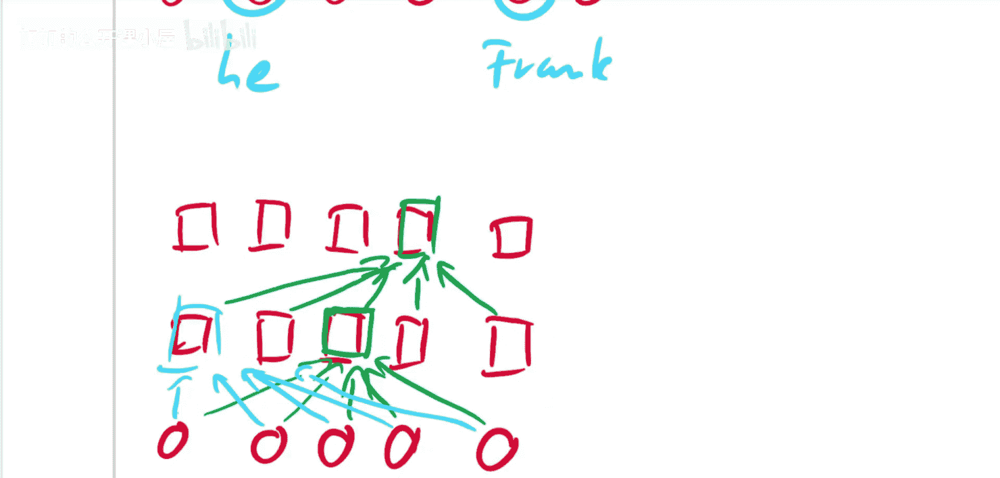

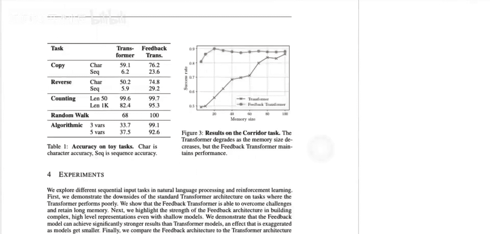

In the appendix here， they give this example of code interpretations。

There it is。 So what they give the program， sorry the model to do is this piece of text right here。

 and the the pro， the model is simply to。

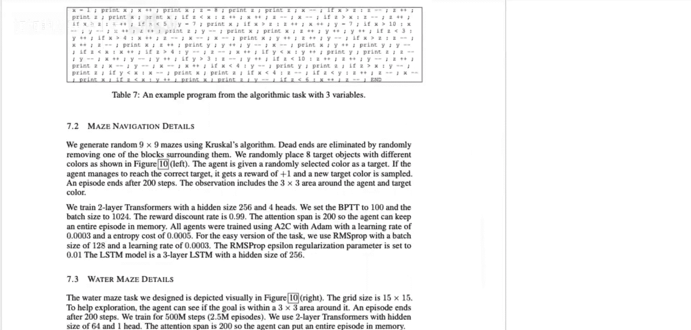

Go over this code and decide what the output is。 So you can see right here。 it has print statements。

 and the model needs to decide what， you know， what the output of the entire program is。

 You can see right here， it has， if statements。 So it has conditional statements as variables。

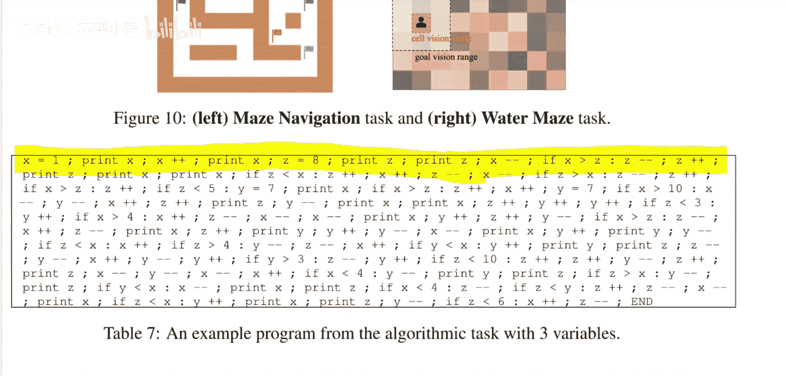