# YannicKilcher【中英⚡AI经典论文领读(全203篇)(下)｜Papers Explained】 p18 P118 NFNets：无需归一化的高性能大规模图像识别（机器学习论文解读） [BV1j8x5zJEvx_p18]

Hi there。 Today we're looking at highper large scale image recognition without normalization by Andrew Brock。

 So on day Samuel L。 Smith and Karen Simonmonian of deepmind。

 This is otherwise known as NF nets normalizer free networks。

 So the point of this paper is to build networks in this case specifically convolutional residual style networks that have no batch normalization built in and will get to why in you know during looking at this paper。

 But without the batch normalization usually these networks are performing not as well or cannot scale two larger batch sizes。

 However， this paper right here， builds networks that can scale to large batch sizes and are more efficient then previous state of the art methods。

 So if you compare them to something like an efficient。

 And I called it I called it you shouldn't call your。

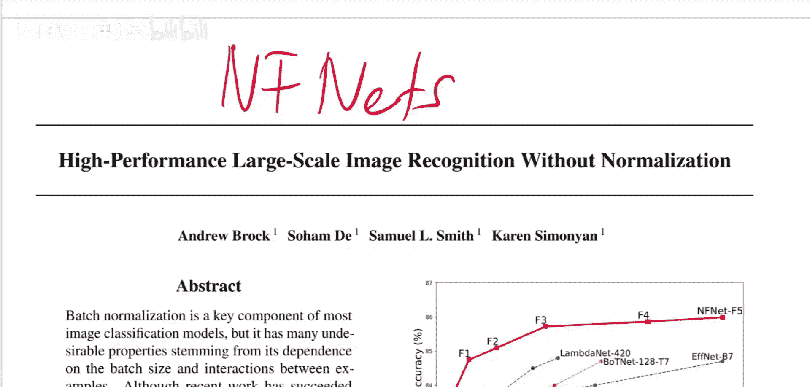

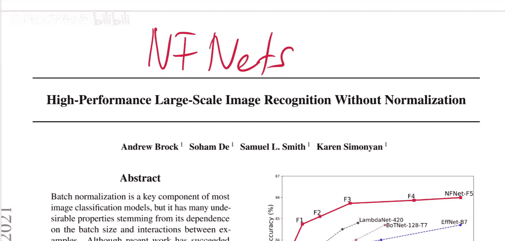

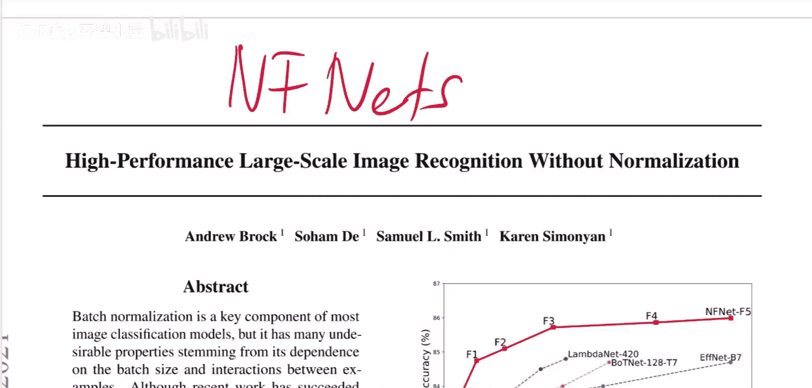

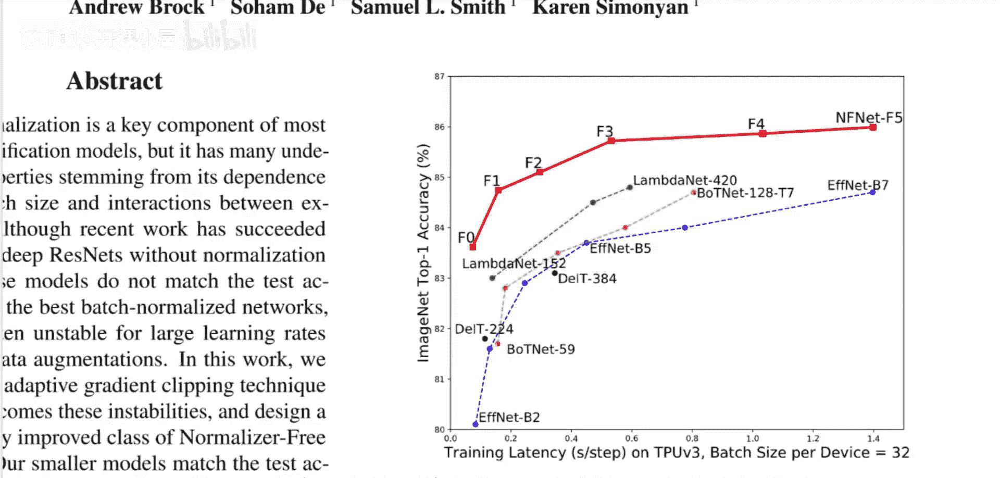

Model efficient net， because a more efficient model is going to come around。

 So NF net are now officially efficient term net， okay。

Yes you can see right here to reach the same accuracy as an efficient at B7， you need。

 I think they say they have an over。

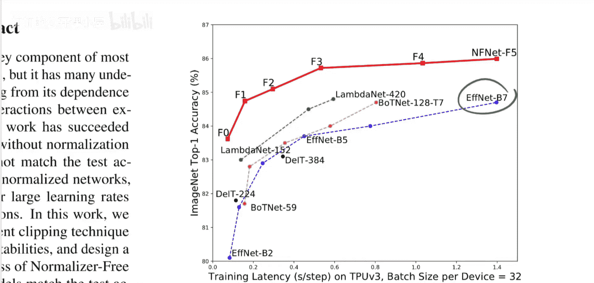

8。7 x speed up。 If you look at the training latency and that's gonna be important while looking at these experiments in a second and if you train for as long as the efficient net V7 you can reach a higher performance。

 This is imagenet top one accuracy and this model is a new state of the art without additional training data and it is also a new state of the art transfer learning and it is the currently ranked number two behind a method that uses semisupvised pretraining with extra data。

 So in the kind of global leaderboard， It's number two， but it is number one in various categories。

 The imagenet has now become you know like speed running。

 there is there is glitchless the equivalent is like additional training data less and so on。

 In any case， we'll go through the paper will' discuss what the tricks are to get the normalizer free networks to work。

 I do have also a。

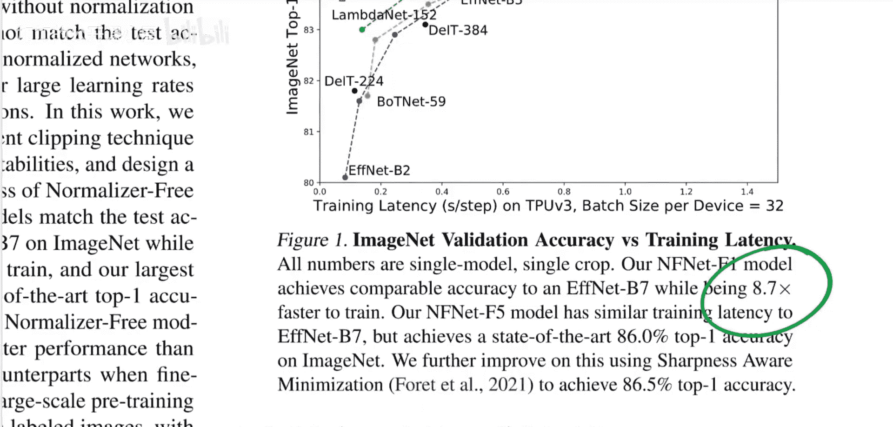

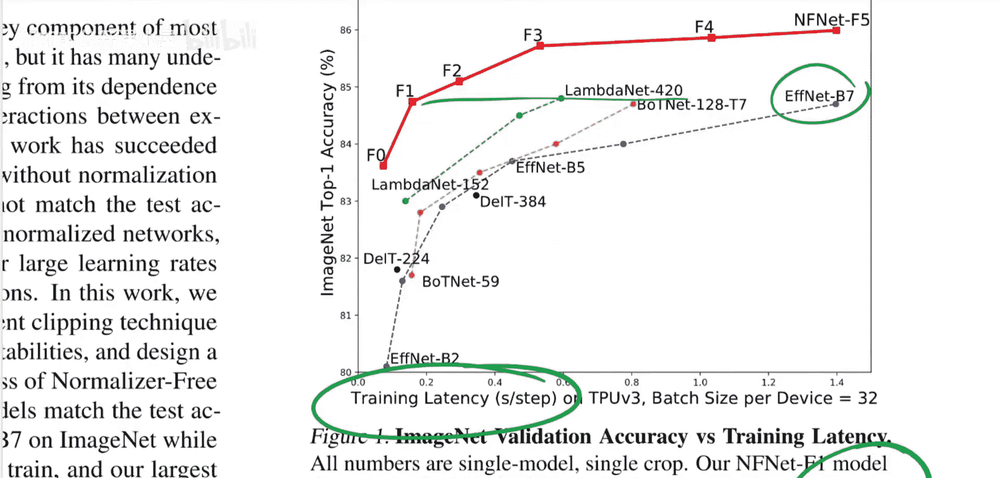

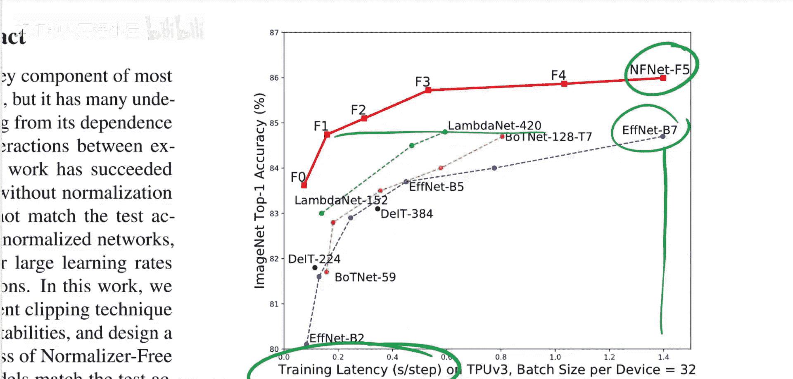

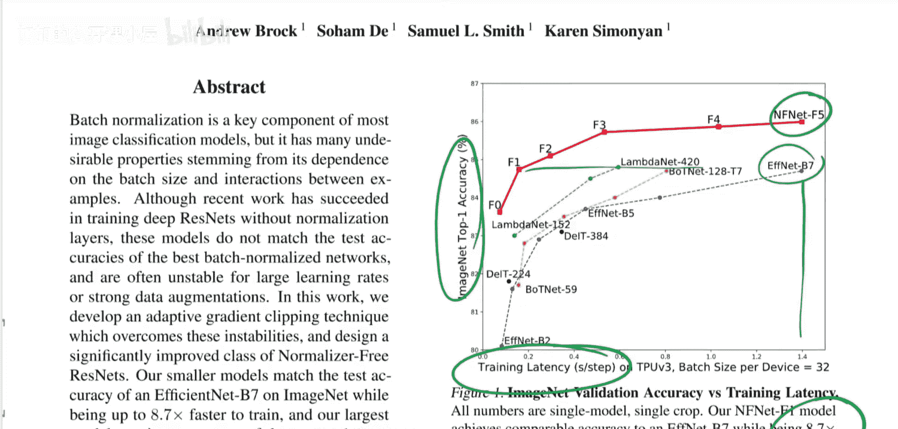

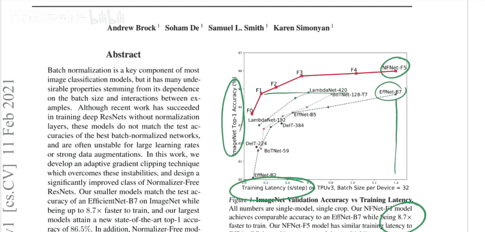

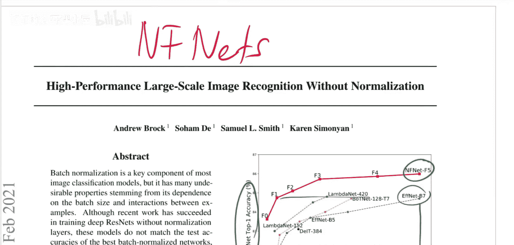

A bit of let's say， criticism against this paper right here。 But in general。

 it's a pretty cool paper。 The code is available。 I'll of course， link to the code。

 you can try it out yourselves。 and that's， you know， it's pretty cool that the code is available。😊。

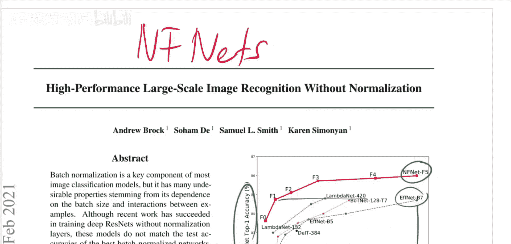

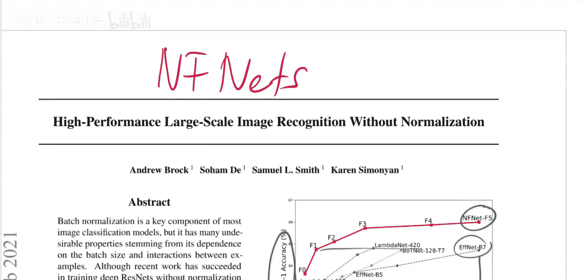

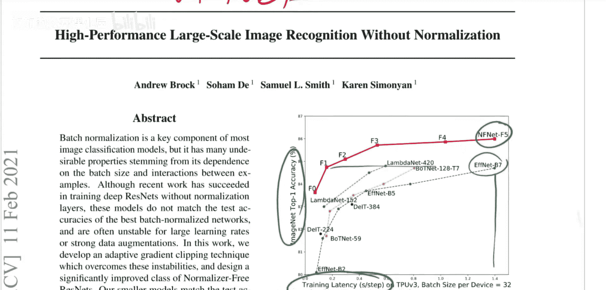

All right。If you like content like this， as always， don't hesitate to share it out。

 Consider subscribing。 Let's dive in。 What's the problem with batch norm， batch norm。

As you might know， I've done a video on batch normm。

 but essentially what it says is that if you have a data point that goes through a network， you know。

 it will experience various transformations as it goes down the layers， however。

Some of these transformations are quite unfortunate if you built the network a little bit in a wrong way。

 So what might happen is that your initial data distribution might be， you know in machine learning。

 it's good practice to center the data and around the mean and kind of you know scale it to unit variance or something like this。

 But then as you progress through the layers and especially if you have something like raillu layers。

 they only extract the positive part of the signal。 So with time。

 it can happen that the intermediate representation right here， for example。

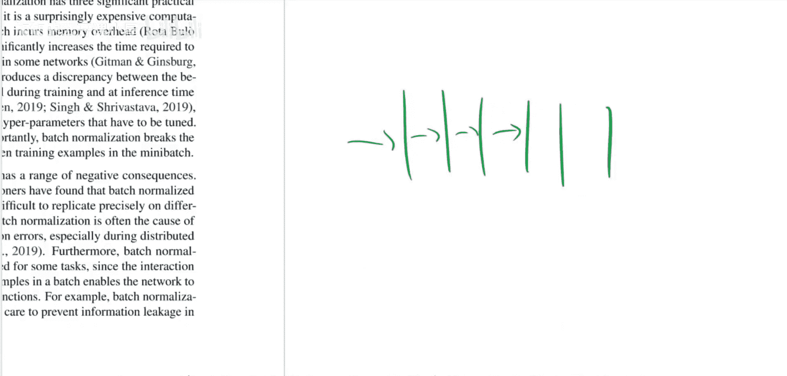

Is something like this， so it's very skewed， it's not centered and so on。

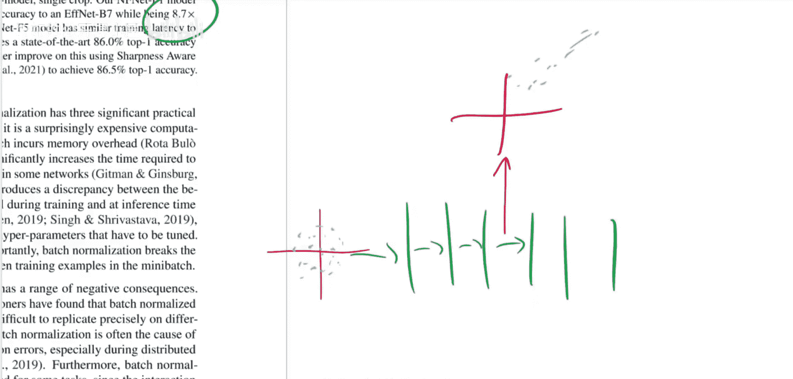

The， the current methods we have in machine learning。

 they just work better if your data is sort of well behaved has a nice condition number is centreed and so on。

 So what batch norm does is every layer it comes in。It looks at the current batch of data。

 the current mini batch and it centers and rescales it。

 So what it would do is it would transform this data by a simple standardization procedure into a well behaved data set。

 Of course， remembering the transformation for a back and then feeding that data to the next layer。

 That's batch norm， and it has several disadvantages。 So the disadvantages of batch norm。

 This paper identifies three。 batch normalization has three significant practical disadvantages。

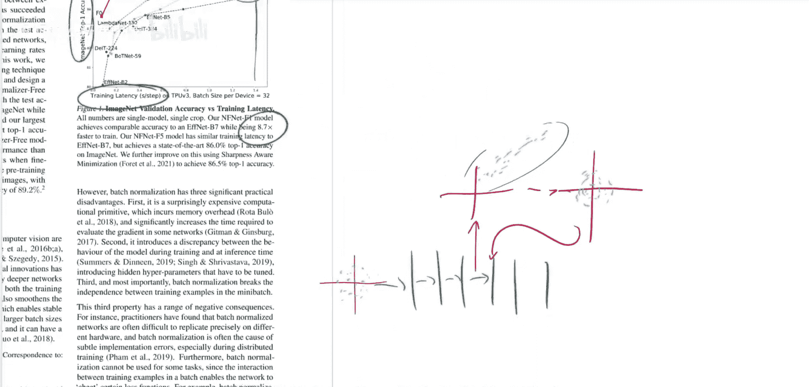

First， it is a surprisingly expensive computational primitive， which incurs memory overhead。

 which is， you know you need to compute these means and these scalings and you need to remember them for the back prop。

All right。Second of all。Sorry， significantly increases the time required to evaluate the gradient in some networks。

 I mean there is， yeah， there is some back you have to do through all of this standardization。Second。

 it introduces a discrepancy between the behavior of the model during training and at inference time。

 which is also true because at inference time， you don't want this kind of batch dependence。

 you want to be able to feed a single data point and the result should always be the same irrespective of the other data and people usually do this by so at training time。

 you simply calculate this mean shift right here and the scaling that you have to do and what you would do is you'd have kind of a database。

 a special buffer where you save these things for every batch and then at test time。

 you simply look at your buffer， you can build a mean a moving average over your training data and you'll simply use those shifts and variance so you have a discrepancy between training data which just looks at the current batch and inference which looks at your mean。

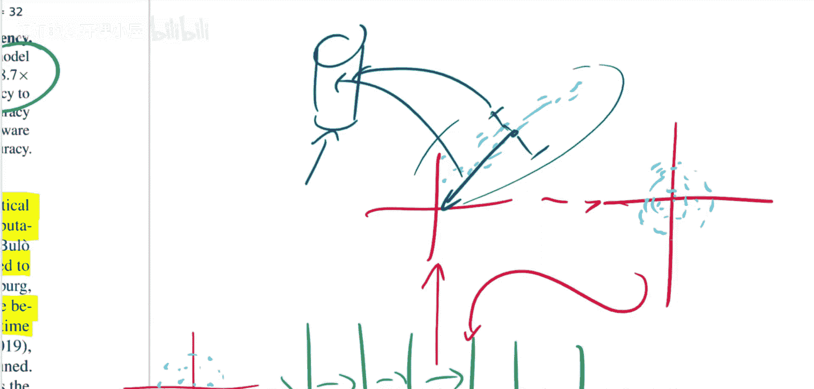

Over the last few batches。

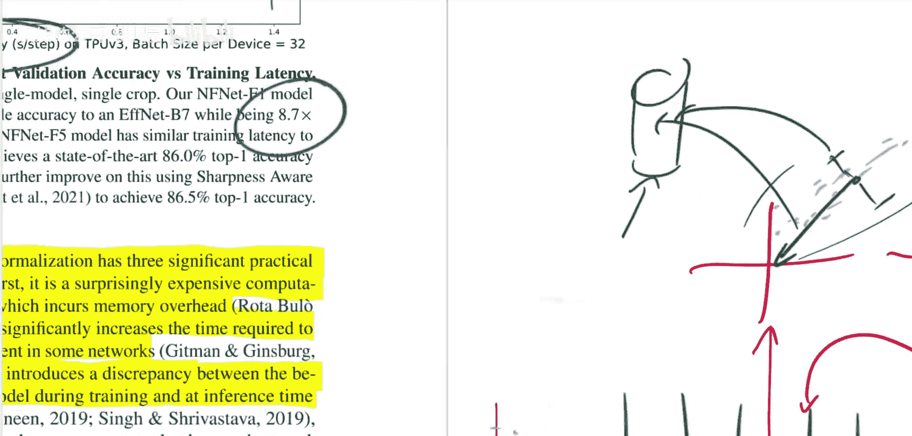

And third of all。 and this is the， so this introduces hidden hyperparameters that have to be tuned。

 which is kind of how fast the mean decays in your database。 And third， most importantly。

 so most importantly。Batch normalization breaks the independence between training examples in the mini batch so not it now matters which other examples are in the batch and that has two consequences。

 so the first consequence。Is that batch size matters。 So batch size matters。In batch normalization。

 if you have a large batch， you can compute these means of the data。

 they are a much better approximation to the true mean of the current data set at this particular representation。

 then a small batch so if you just have three examples。

 the mean is going to be a very noisy approximation whereas if you have a large batch it's a good approximation。

 So batch size matters for batch norm and second of all， so distributed training。

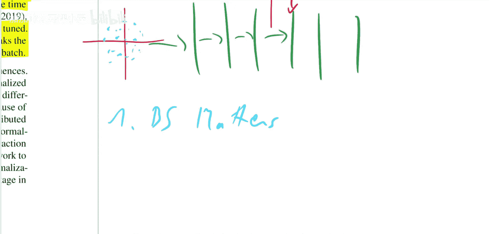

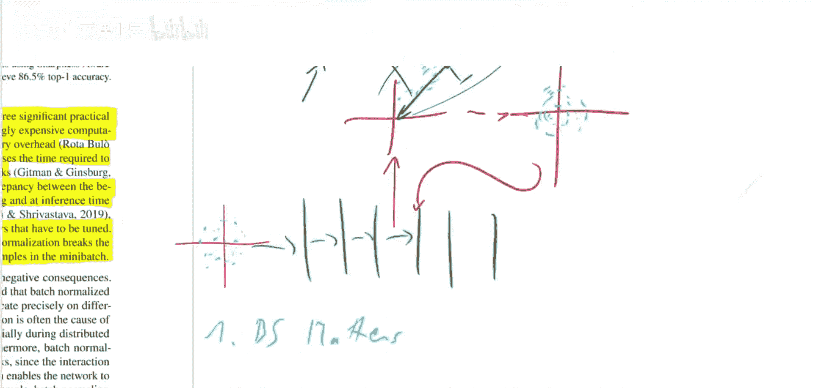

distributedistried training。 Yeah， yeah， yeah。Distributed training becomes extremely cumbersome because if you do。

 for example， data parallelism， which means that here you have your batch of data and we know for some applications that large batches are pretty favorable for training。

 they stabilize training， you can do larger step sizes and so on。

 So what people do is they split the batch， they shard one batch。Into， let's say。

 three different parts。 and they have the network on three different machines。

 So the same network is on three different machines。

And what you would like to do is you would like to forward propagate。

All of these batches through the network。 sorry， this whole batch in three different shards through the network。

 and then back propagate and sort of communicate the gradients around。

 But now imagine if you have a batch norm layer。 So if you have a batch norm layer right here。

 it's going to be the same here。 and it's going to be the same here。

 you would have to do technically is you have to forward。

 propagate the signal right here to the batch norm layer。

 And then you'd have to communicate these batch statistics between the batch norm layers。

 because otherwise， you don't have the mean and the variance over your whole batch that you feed in。

 right， you can opt to not do this computation。 But then again。

 you run into the problem that usually these。

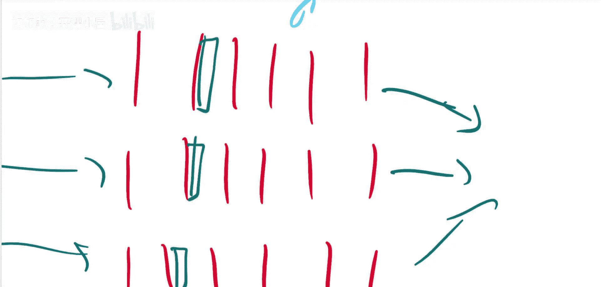

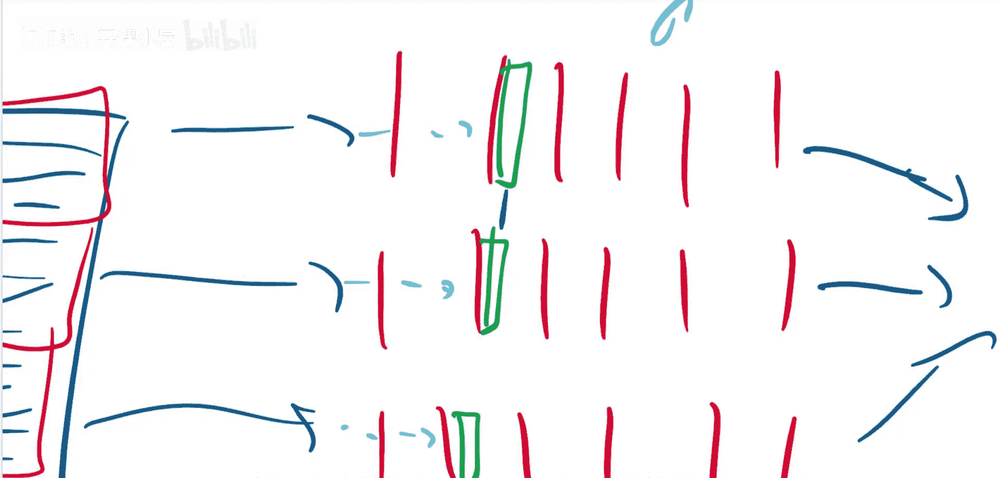

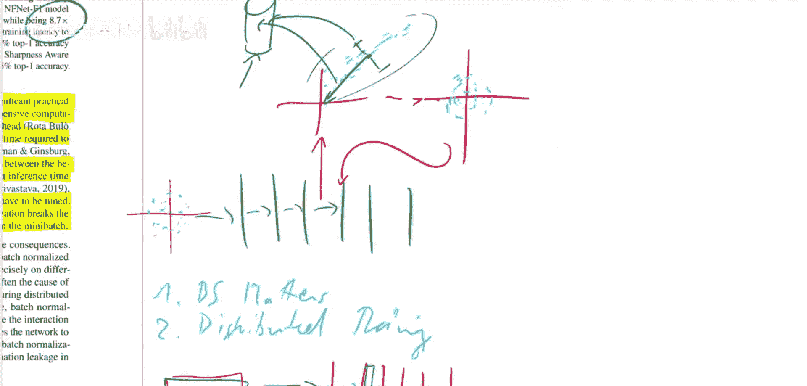

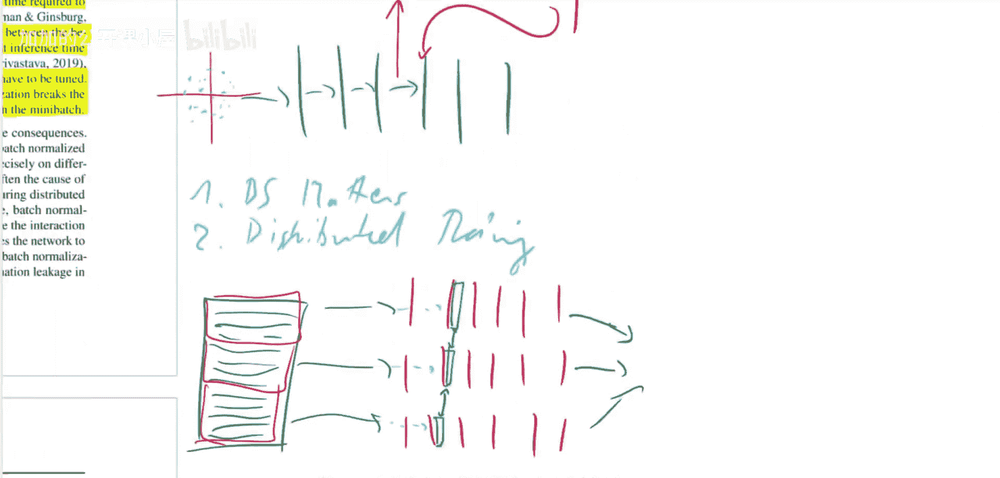

The number of samples in the shard is fairly small， and you have a bad approximation so。

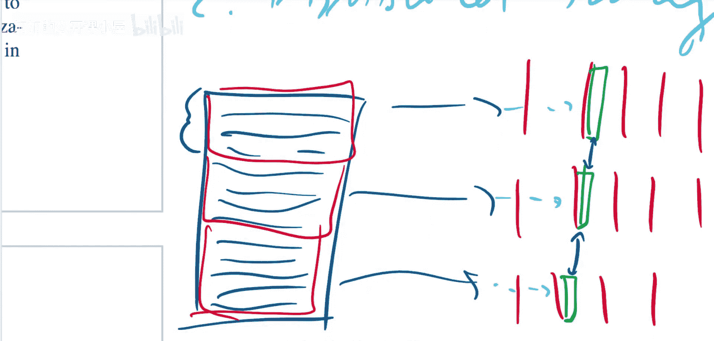

Bacheor just kind of makes certain things complicated right and this interdependence of training data points is one of those things and they call it the most important things so they say this third property has a range of negative consequences practitioners have found that batch normalized networks often difficult to replicate precisely on different hardware batch normalization the cause of subtle implementation errors。

 okay well yeah， especially during distributed training。

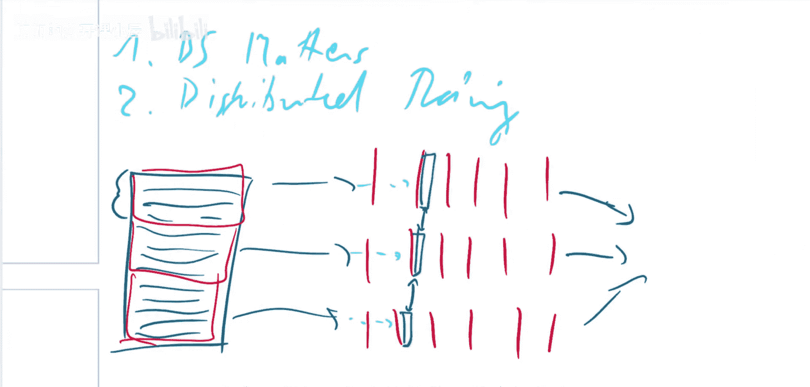

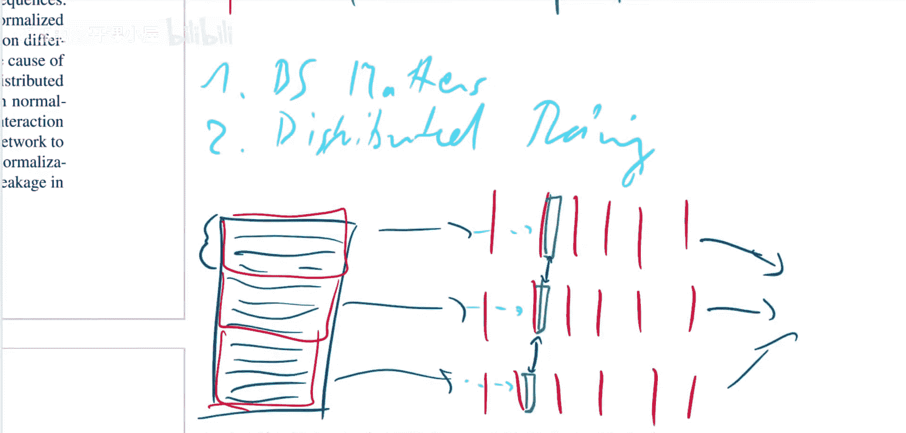

And then it cannot be used for some tasks since the interaction between training examples in a batch enables the network to cheat certain loss functions。

 So this is。

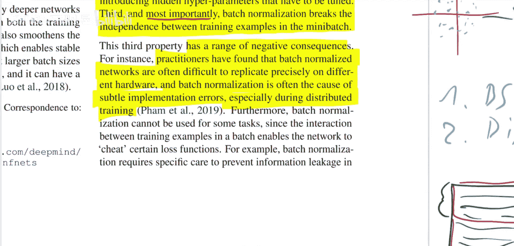

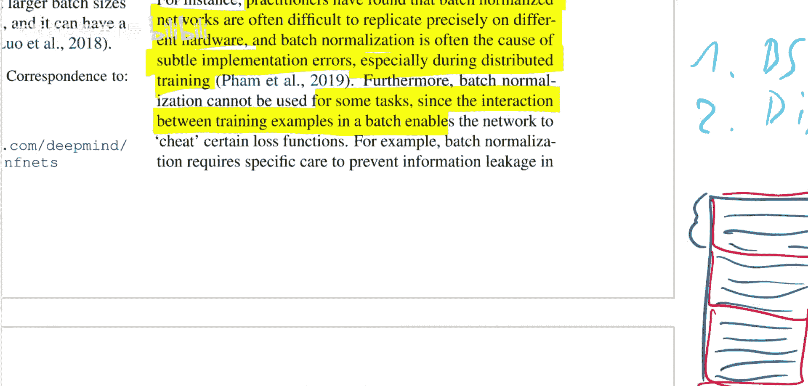

let's say you have a like a time series prediction， right And in a time series prediction。

 So you have your your time series and you want to make training samples of it。

 So what you usually do is you say， well， this is my input and this is my goal and then and this is my input and this is my goal。

 So it's kind of it's like language modeling if you do that。 So you want to slice one。

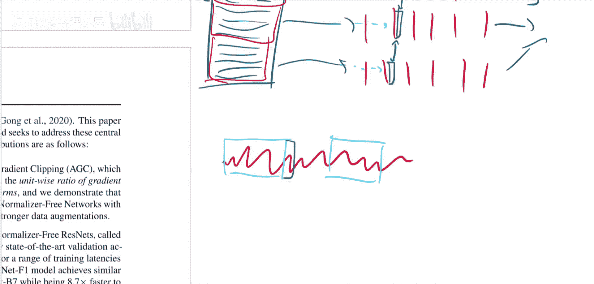