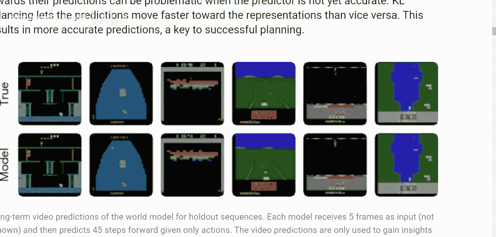
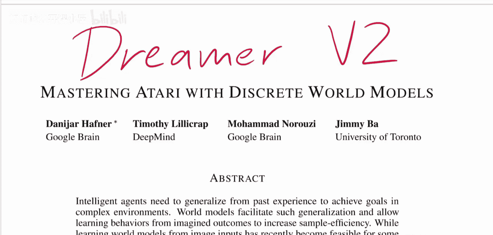
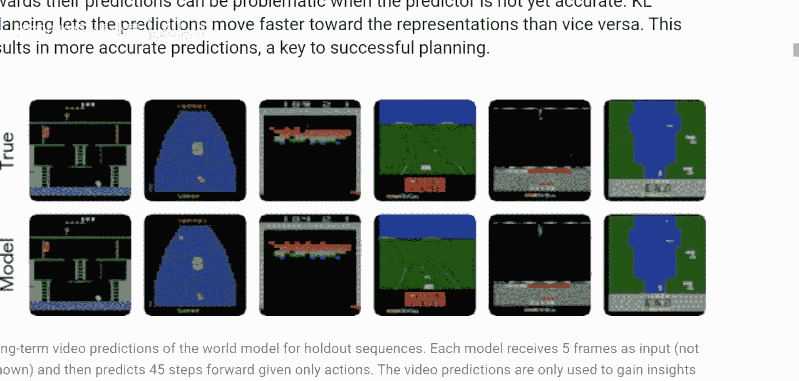
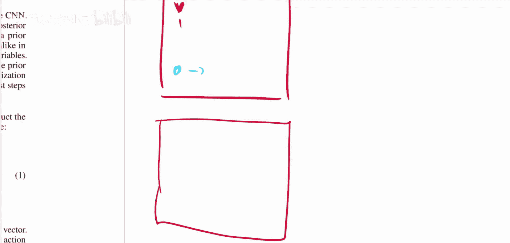

# YannicKilcher【中英⚡AI经典论文领读(全203篇)(下)｜Papers Explained】 p20 P120 Dreamer v2：通过离散世界模型掌握Atari游戏（机器学习研究论文详解） [BV1j8x5zJEvx_p20]

Hi there。 What you're seeing here are predictions by world model learned for Atari reinforcement learning。

 On the top， you see what really happened during an episode of play。 And on the bottom。

 you see the predictions of this world model。 The world model just gets five frames at the beginning。

 which you don't even see here。As a conditioning and then it predicts 45 frames of gameplay。

 it's astounding how accurate it is， not only in terms of how the game evolves。

 but also in terms of what the agent will actually do So the world model。

 the specific world model you see here is part of the dreamer V2 algorithm from the paper mastering At Tori with discrete world models by Dani Ja Hfner。

 Timothy Lilyk， Mohamma Nausi and Jimmy Ba of Google Bra Deep Mind and the University of Toronto So this kind of world models they enable you to do very quick reinforcement learning once you have the model。

 you can use it to imagine yourself playing the game instead of actually playing the game and therefore you can do much more efficient reinforcement learning and this paper details how to get an accurate world model for Atri which was sort of out of reach until now。

 especially。😊。

That they only do single GPU reinforcement learning。 So the result， as you can see here。

 is going to be an algorithm that is the top single GPU agent right now competing outperforming other so here is dreamer V2 outperforming other algorithms such as Rainbow IQN and DQN and the special thing here is that Dreamer V2 is a model based algorithm。

 whereas the current or the previous best ones， especially single GPU best ones were model free algorithms。

 and you can see the next best model based algorithms where are not really competitive in Atari。

 right this is specifically Atari So Dreamer V2 is an evolution of Dreamer V1。

 which worked well for things like continuous control， but Atri still seemed a bit out of reach。

So the difference between model based reinforcement learning and model free reinforcement learning is that model based reinforcement learning first learns a model of the world。

 It learns how the world acts。 and then it uses that model to。Learn what actions to perform。

 whereas model free algorithms， they simply act in the world and they learn to predict the best actions as they act in the world。

 So there's your difference and how does dreamer V2 do that on the high level it has two stages stage one is learn a world model from past experience and then stage two is use that world model as we said for reinforcement learning and the reinforcement learning here is going to be just actor critic learning。

Very straightforward， theres a little modification with a pass through estimator。

But the real difference is going to be in how the world model is learned and the novel contribution or the main contribution here is this latent state which consists of this stochastic latent state。

 which other than other world models which model the latent states as something like Gaussian random variables。

 this paper models the latent state as categorical random variables and that turns out to work pretty well for Atari。

So that's step one， learn world model， step two， do reinforcement learning in the model。

 so not using any data anymore， and you can repeat those two steps as many times as you want。

 so you start out with a set of data then you learn an actor and then you use that actor to collect more data and so on until you have a really good actor and the world model is really accurate for that actor。

So that's the overview and you know it's going to turn out as we already saw to beat other at least single GPU models by quite a bit。

So we'll go through the paper through the individual steps and discuss what's new and how it all works。

 the code is also available， I'll link to it and the blog post I've shown you here has some more explanatory graphics。

If you like content like this， as always， don't hesitate to click like and share it with all your friends。

 especially the Atari gamers， because they are outperformed， as you can see here。Alright， so。

World models pretty quickly in reinforcement learning， you， as you all hopefully， or maybe know。

 you have an agent that is interacting with an environment and the agent can。

 so the environment always provides the agent with an observation。 Oh， here。

 which would be an image in an not game， and the agent decides to do one of many available actions in response to receiving the observation。

 The environment then responds。With a reward for that action。 So either you die。

 which is like negative reward or you collect a coin， which is positive reward， or you win the game。

 which is like  a000 reward。 and it also gives the agent a new observation the next observation and the agent again responds by performing another action and so on。

 So you have this cycle and the goal of your reinforcement learning agent is usually to maximize all the rewards that it collects during playing with the environment。

 and you want to repeat that many times for many episodes to have the agent learn to get as to do the actions that are as good as possible in terms of reward。

All right， now in classic， let's say classic in model free reinforcement learning。

 one way to do this is to take this right here as you play the game。As you play the game。

 you collect data， right， So let's assume we collect data as we act in the world。 and from this data。

 we we can learn something。So model3 learns from the raw experience。

 So an episode will always be a series of images right and actions you have performed。

 So here is an image and I've performed action 1 and then came an X image and I've performed action 2。

 So what classic reinforcement learning would do as it would say， okay。

 from this transition doing this action。 I have gotten5。5 reward。

And from this transition in this action， I've gotten negative3 reward。

 so I'm going to have to do this action1 more often because it gave me a lot of reward after I observe this thing here the combination of this thing I need to do action one more And when I'm in this situation I need to do action2 less and so on so you're simply trying to put this image that you get into a neural network that tries to predict action1 as often as possible and you want the same network when you input this next image to not predict action2。

 So anything but action2 so that's going to be that's kind of the logic between of the classic model3 reinforcement learning usually this is implemented in a sort of an LSTM fashion or it's one way of doing it So you have an LSTM that tracks a hidden state Why do you need a hidden state。

You might not see everything in the image there is right this is not necessarily more Coviion。

 so there might be information that you need to remember for a long time like when an enemy leaves the screen and then comes back you want to track it do you have an LSTM or some kind of RNN and then you want to feed。

The images into that one by one。 And then you simply so with an encoder。

 which is usually kind of a convolutional neural network。 I'm going to draw it like this。

And then you try to predict here the good actions and here you try to not predict the bad action and so on。

 so this is a simple classifier ultimately it's an LSTM with a classifier on top and the classifier simply tries to either predict a class of action1 or not or predict anything else right so。

And you train it via back propagation through time。And that's it。

Now here is a little bit different so why， why。Is this maybe not a good idea。 Well。

 all you have is the signal of the reward for given actions。

 and that means it is it is fairly hard to generalize in these kinds of things so。

When you imagine you have your screen right here and， there's an opponent kind of here。

There's an opponent here and you are down here and the opponent shoots， right。

 You have to move out of the way。 You have to move over here。 Now。

 orl is completely capable of learning that。 however， take the next situation。Over here。

Now the opponent is here， shoots and you。