# YannicKilcher【中英⚡AI经典论文领读(全203篇)(下)｜Papers Explained】 p22 P122 线性变换器实为快速权重记忆系统（机器学习论文解析） [BV1j8x5zJEvx_p22]

Hi there Today we'll look at linear transformers are secretly fast weight memory systems by Imanol Schchlug。

 Kaazuki Ari and Yogenshmiduba on a high level this paper makes a connection between linear transformers which are transformers that linearize the attention mechanism such as the performer and fast weight memory systems which is a bit of an older concept where fast weights refers to one mechanism producing weights for another mechanism。

 so like a neural network producing weights for another neural network。

 the first neural network will be called the slow weights and the produced weights would be called the fast weights。

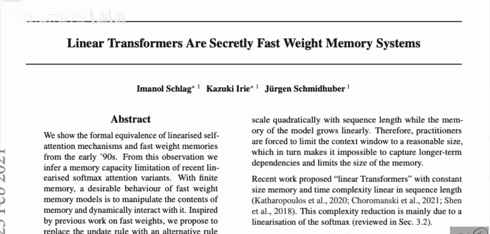

So the paper makes a connection between specifically autoregressive linearized transformers and these fast weight memory systems and looks at it in terms of how much memory are they able to store in these weight matrices and it analyzes it and proposes a new update mechanism for autoaggressive transformers and then demonstrates kind of the effect of that in experiments we'll go through the connection they make and look at their new method。

 their new proposed linearized attention and we'll look at the experiments and that will be the paper so if you like content like this。

 please share it out to all your friends。

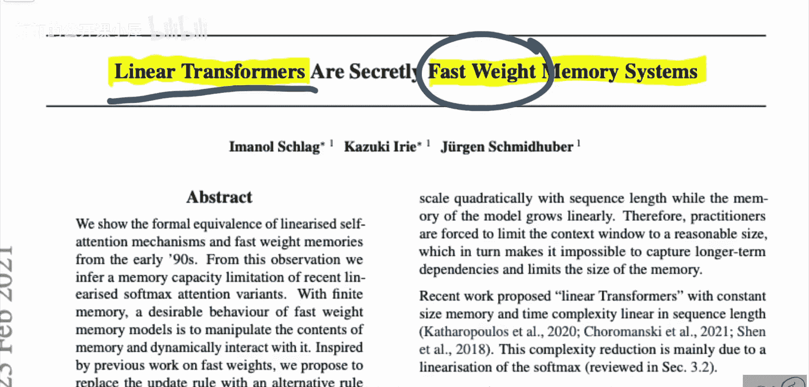

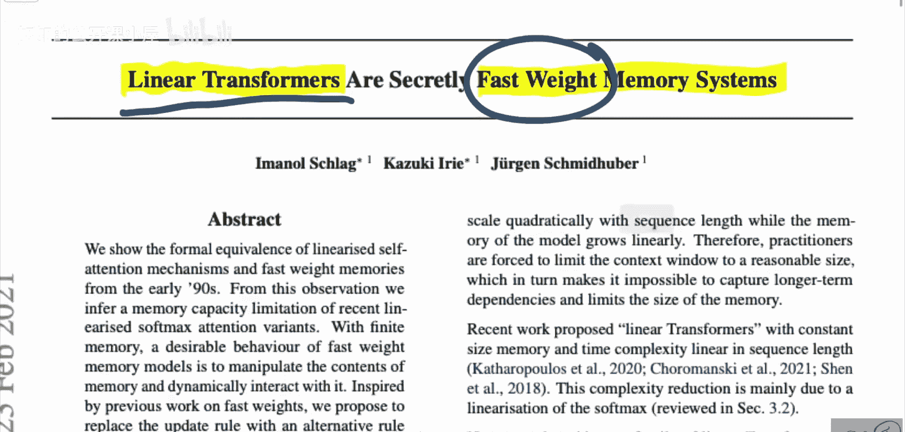

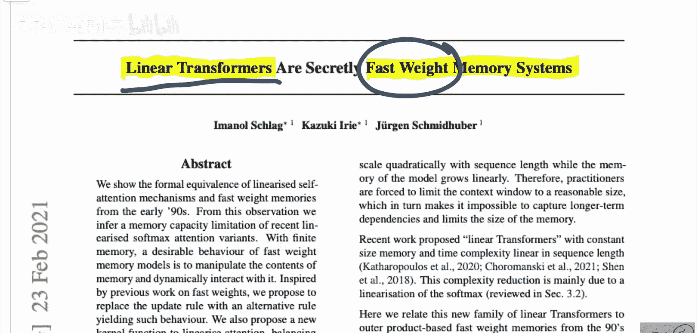

And enemies， because love is， okay， I'm becoming Lex Frimen。What are fast weight systems。

 Fast weight systems， as I already said， is when one neural network or one mechanism produces weights of another neural network。

 So the fast network would not be learned per se， but it would。

Get its weights from the slow neural network。 And this here is an example of that。 By the way。

 new new new recording set up。 Thank you for your feedback very much。

 So I have extended the screen here to cover the entire area。Please more feedback。

 I know this is still pixelish。 If anyone knows how to make one node not do pixelish Pdfs。

 please tell me。 All right， So here is one of these fast weights mechanism。

 So a slow net with slow weights continuously generates fast weights for a fast making the fast weight effectively dependent on the context。

 Simply put the slow net learns to program its fast net。

 And here in these papers by Schmid Hoberry proposes these outer product fast mate weight systems。

 And here is how it works。 So imagine you have a sequential input。 So X I is going to be X over time。

😊。

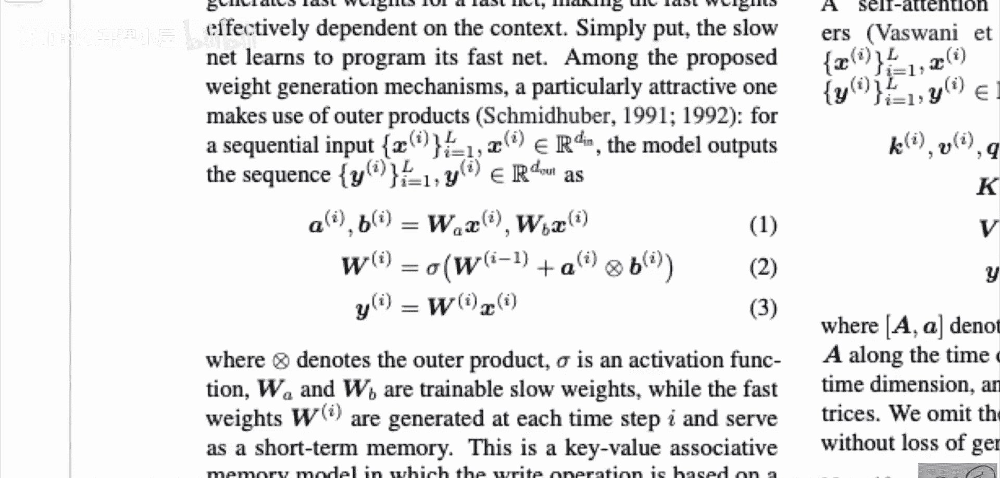

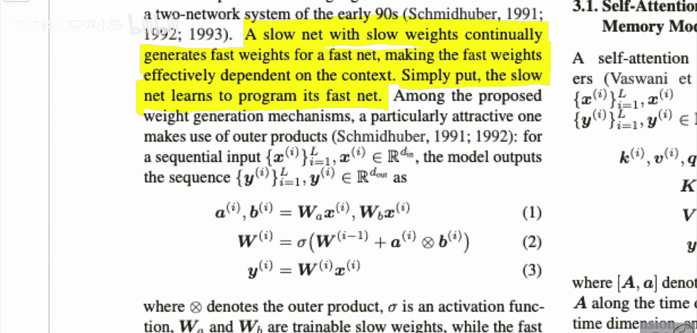

Remember we're in the autoaggressive setting， so the autoaggressive setting is where you have a sequence as inputs and then you're from that sequence you're trying to produce the next element of the sequence。

 for example in language modeling and then in the next steps you take that next element into your context and you produce the next next element and so on so that goes on and that is the autoaggressive setting so we are wondering how do systems produce in these autoaggressive systems produce their outputs and one way is this fast weight system。

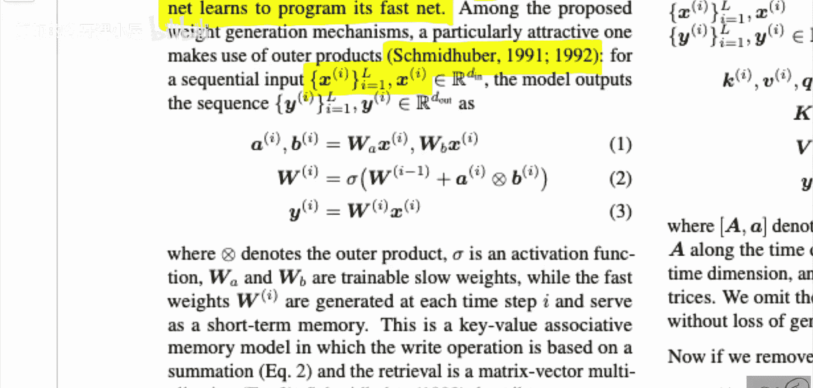

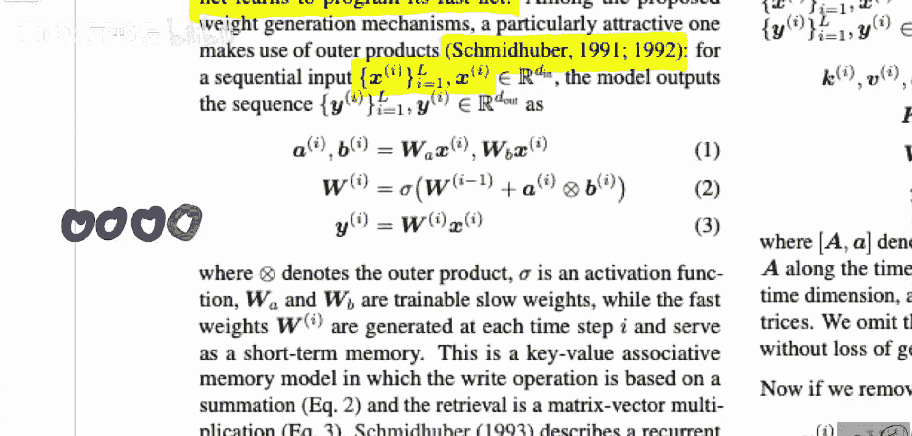

So imagine you have these x's here， which are the input sequence。

 So going in terms of an input sequence， how do we produce the y that is。 So this is the。

How do we produce the next input or specifically in a more general setting？

We have an input sequence and an output sequence。 And at each step。

 we kind of want to produce the corresponding output。 So in the first step， this。

 and then a second step， we already have two inputs。

 and we produce this output and in the third step， we have three inputs。 we produce the third output。

 Sorry， we have three inputs。 and in a fourth step， we all have all four。

 we produce the fourth output。 Of course， in the other aggressive setting。

 we would every time take the output and plug it in here at inference time， not a training time。

 Allright， so。

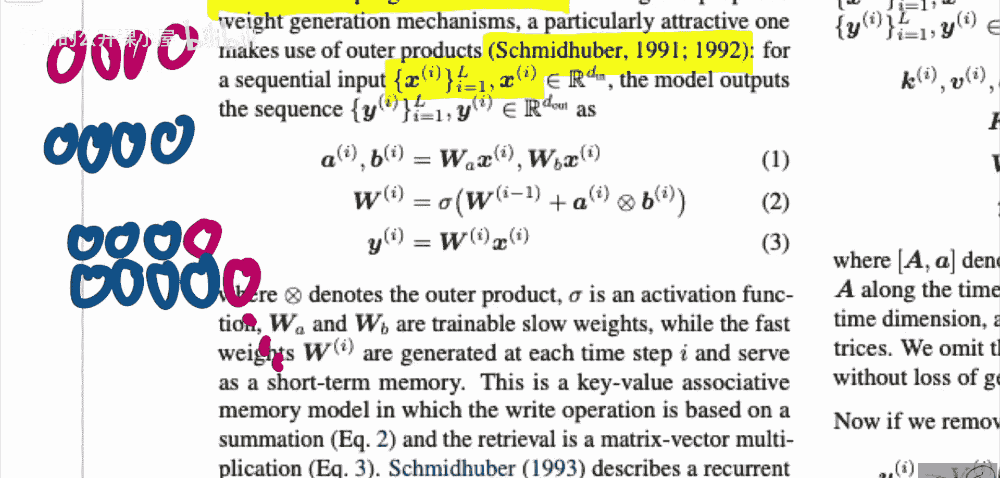

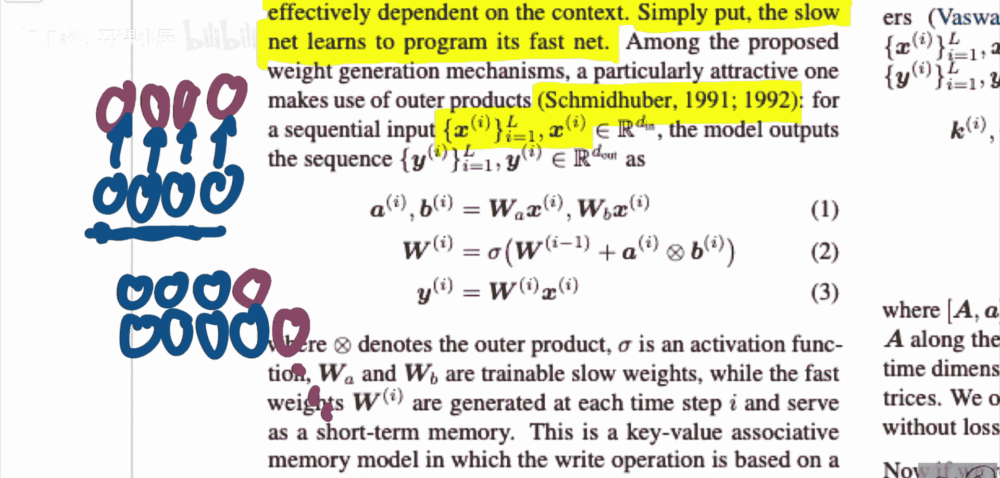

I input sequence and output sequence。 how does each step look such that we produce the corresponding output。

 Well， here's what we do。 We have these specifically， we have these matrices called W。

And the W matrices are these fast weights。 And you can see the output is simply produced by taking the current input and multiplying it in a linear fashion by the fast weight matrix。

 so right now， if you just look at this， this is simply a linear transformation。 The magic happens。

 If you consider how these weights here come to be。

So these weights are now going to contain the entire context of the past inside the weights。

 so other than it is a bit like a recurrent neural network where you have a hidden state。

 except here the weights themselves are the hidden state。

So how do you generate hidden the weights here， these fast weights。

 well these fast weights are produced by updating the fast weights of the last step you can see right here and here is where the recurrence comes in so the fast weights of the current step。

That's not supposed happen。 The fast weights of the current step are produced by。

Adding on top of the fast weights of the last step， there is an linearity involved right here。

 But essentially， you take the last fast weights and add something to it。 Now。

 what is that something。That something is here， this outer product of these vectors A and B。

 which are themselves constructed。By taking the input and running them through their own neural networks or just their own linear transformations right here。

You can see that this mechanism will continuously produce weights。

 so there is a few few intricacies here like why do this is the outer product between the vectors and that's needed because in every step you want to produce a valid weight matrix right and this is how you produce a valid weight matrix by taking the outer product if now you accumulate those outer products essentially in these fast weights which。

Has some other interesting properties and the paper is getting to those properties later here when he talks about tensor product representation theory。

 but essentially。

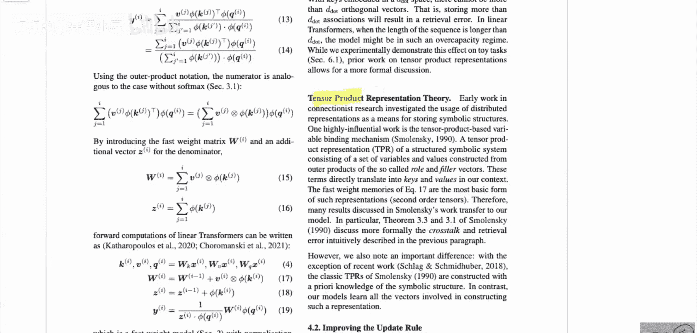

This is how you， how people store information inside of matrices。 It's a bit of magic。

 But imagine you have。😊，Keys and values。 And you want to store those keys and values。

 like in a database， But you want to do it in kind of a continuous manner。

 So this comes from a time when people were trying to bridge the symbolic world to the neural network world。

 Let's say。 So they were trying to。Put discrete things or objects and symbols into distributed representations like vectors。

So if we want to build a database， what we have to do is we're going to have to have keys and values that we store。

 right， key 1， value 1， key2， value 2。 This goes all into a database。 key 3， value 3。

 and if we then come， and we query the database with one of the keys like okay。

 I have now key 2 is my query。 I define my query as key 2。 and。I go to the database。

 The database better give me value， too。How can we implement this as a distributed representation database？

 So first of all， imagine we are going to have keys and values。 They are all going to be vectors。

 So the keys are going to be represented as vectors and the values are going to be represented as vectors。

 Okay， the key， maybe this， this vector and this vector here。And the values， this vector。

 this vector and this vector。 Okay， it's， we can， we can do symbols to vectors by doing embeddings。

 So we know how to obtain that。 But now how do we implement the database， Well， if。

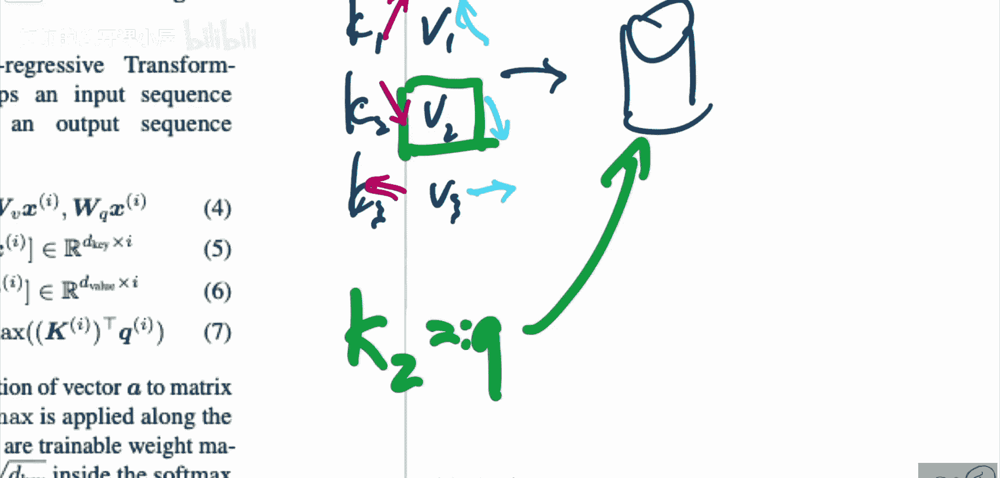

Im， I'm just going to show you what I can do。 How do I build the database。

 I'm going to build the database as follows。 I'm going to take key1。

 and I'm going to do the outer product 2。 That's， that's a plus。

I want to do the outer product between key1 and value 1。

And then I'm going to add to that the outer product between key2 and value2。

 And I'm going to add to that。Q 3。Value 3， okay。So。Why。

 why does that give us a database So that gives us a database And what we want to do is we want that if if we go to the database and we query it with the query and this is going to be a matrix multiplication right the database is going to be a matrix we want and let's say the query is key to we want that we get value to。

 it's magic right， I can just add these things to the database with a plus and you can see I can also update that in the future by simply adding to the database。

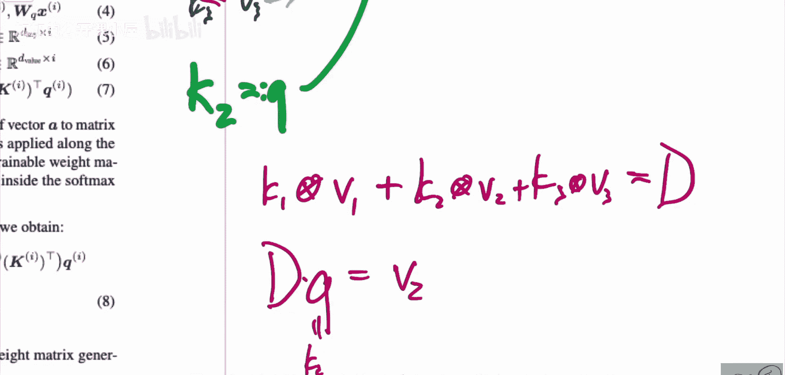