# YannicKilcher【中英⚡AI经典论文领读(全203篇)(下)｜Papers Explained】 p23 P123 GLOM：如何在神经网络中表示部分-整体层次结构（杰弗里·辛顿论文解读） [BV1j8x5zJEvx_p23]

Hi there。 Today， we'll look at how to represent parthole hierarchies in a neural network by the legend himself。

 Gerey Hinton。 He describes a system also known as Glom that is a new approach to processing visual information。

 using neural networks。 And interestingly， the papers starts off by saying this paper does not describe a working system。

 So this is an idea paper。 Gerey Hinton's suggestion of how we should go about solving vision or furthering vision in the AI community。

 He says openly， these are just ideas。 please prove me right， proveve me wrong。

 Try them out and so on。 And I absolutely welcome this。

 idea papers is a thing that I think we have lost as a community because everything needs to be state of the art and so on。

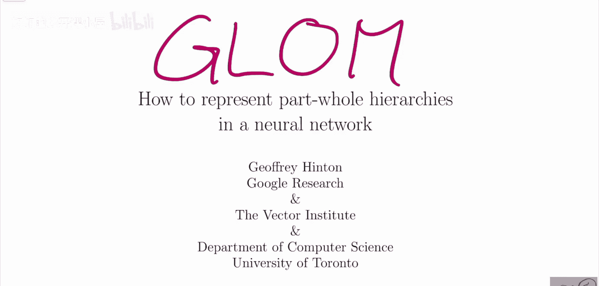

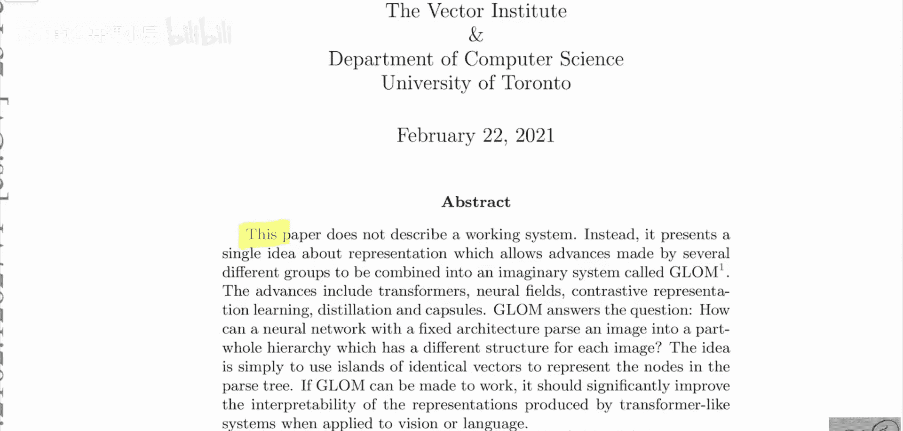

This is super cool。 And I encourage more people to do it。

 I'm not saying you're gonna have the same kind of success with an idea paper as Jeff Hinton。

 He is banking on his name in large part with this。 but nevertheless， it's just an archive paper。

 Like， I see people complaining。 This would never be possible if it wasn't。 Yeah， it wouldn't。

 like people wouldn't pay attention。 but you're welcome to write your ideas and post them on archive。

 like。😊。

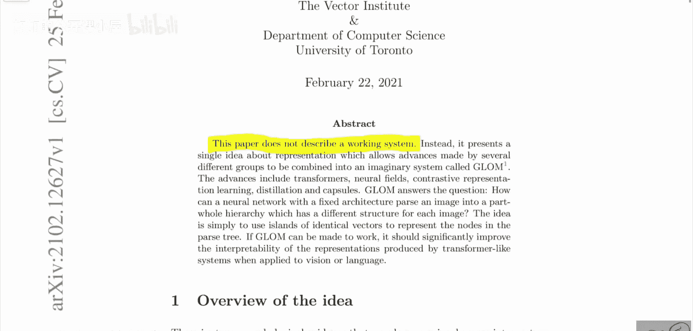

Or write a blog post， make a YouTube video。 anyone has opinions。 So， you know， go ahead。 yeah。

 so to the paper itself， gllom， columnlom， as you can see here。

 gllom comes from the is stems from agglomeration is a。

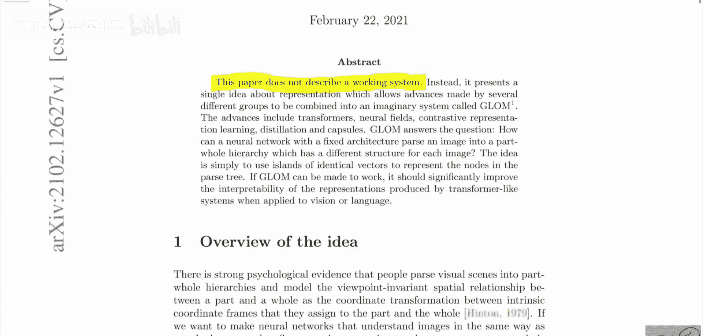

System that instead it presents a single idea about representation which allows advances made by several different groups to be combined into an imaginary system called GOm。

 the advances include transformers， neural field， contrastive representation learning。

 distillation and capsules。Gone answers the question。

 how can a neural network with fixed architecture parse an image into a part whole hierarchy which has different structure for each image。

 the idea is simply to use islands of identical vectors to represent the nodes in the parse3。

If Gloom can be made to work， it should significantly improve the interpretability of the representations produced by transformer like systems when applied to vision or language that's the abstract while dive into the system。

 we'll see what it's about， I think I can actually make a suggestion to improve it。

 but maybe I'm way behind other folks。

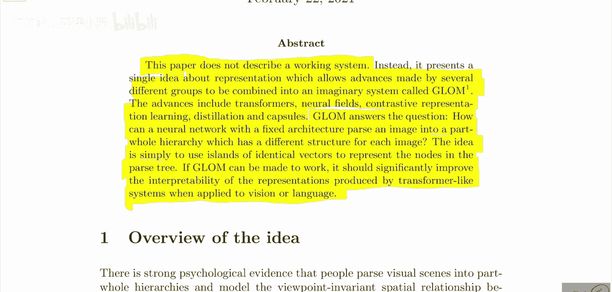

What is the Glom system and what are these parse tree about and why does it combine all of these things。

 And for that， we look at， so Hinton has two core diagrams here。 This is the first diagram。

 This is the second diagram。 And at first sight， they have little to do with each other。

 So let me try to go about it like this。 If you have an image。

 And Hinton looks at vision very much in terms of you have an image or a video。

 and you want to parse the image into kind of a tree。

 And the tree should be sort of like a tree of objects and their parts。

 So let's say it's an image of a car。

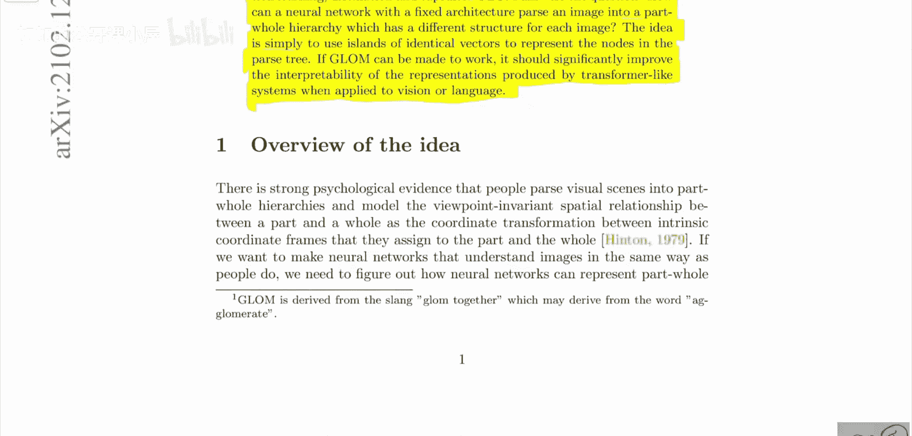

So the whole notion is very， very object centric。 So this is like my best attempt at a car。And。

A parse tree for this image would look something like this。 Alright。

 so this whole thing here is a car。 So that's going to be your top node in the parse tree。

 The car has different parts， namely， it has this。Cabin， it has a motor and it has wheels。

 So that is going to be。 those are going to be kind of。Downstream of that parse tree。

 Then the cabin itself is going to have two segments here， Windows。 and maybe here is the door area。

 So that is going to be window window door and so on。

 So you get that we what we want to do is we want to look at an image sort of create this parse tree over here。

 This is very much into the into the area of gophi good old fashioned AI people that want to understand。

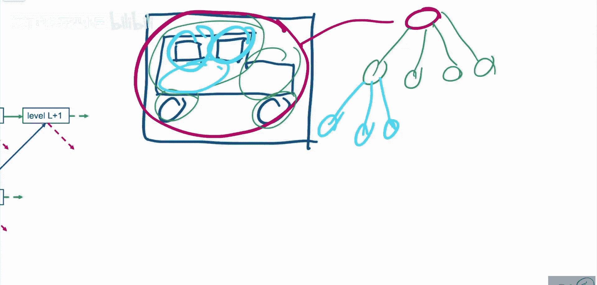

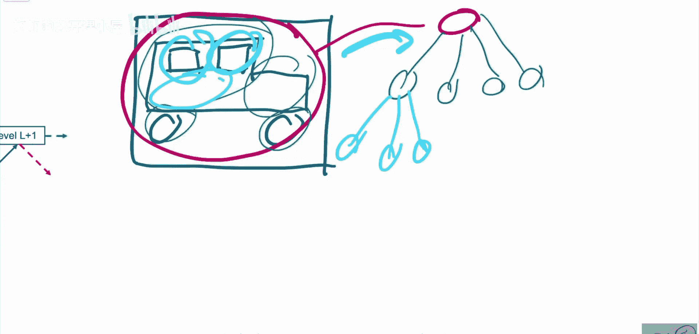

A the the world， in terms of their symbolic representations and relation of the symbols to each other。

 however。

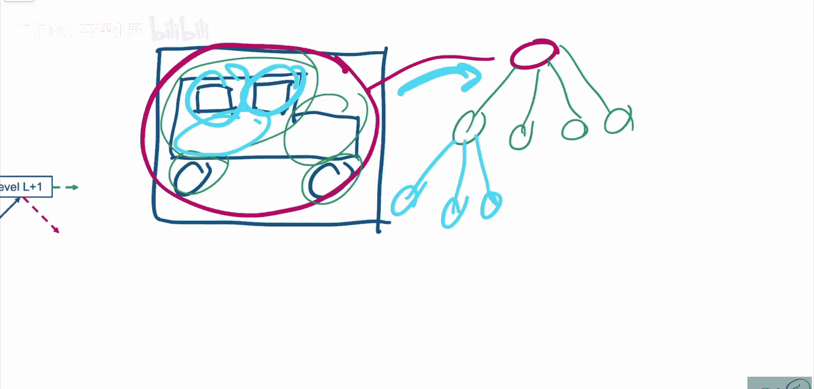

What Hinton is saying is that if you simply do this，'s， you know。

 you can't really do this with neural networks。 Ne networks are continuous and so on。

 So what would you have to do in in addition， we know that the brain doesn't reconfigure itself every single time you get a new input。

 So the brain， even though it has some neuroplasticity。

 while you look at the world and do inference in the world， the connections stay the same。

 So what we need to do is we need to come up with a system that when we input one image。

 you can give us one parse tree， but when we input another image。

 it can give us some kind of other parse tree。 maybe now there are two objects in the image and。

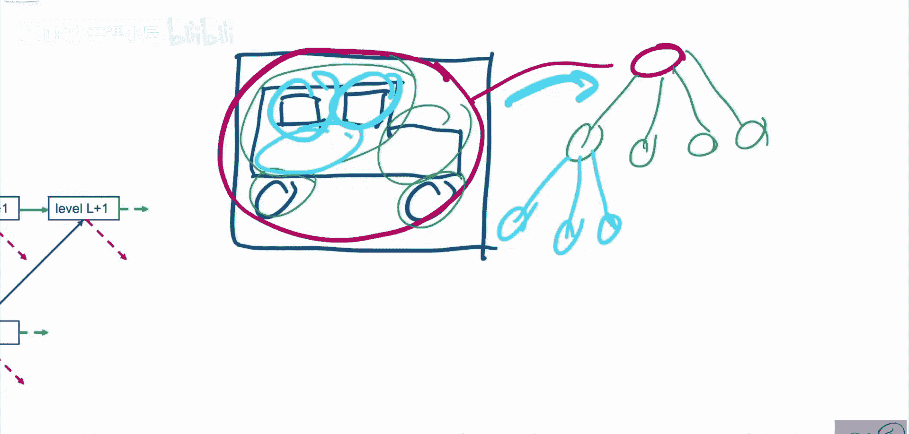

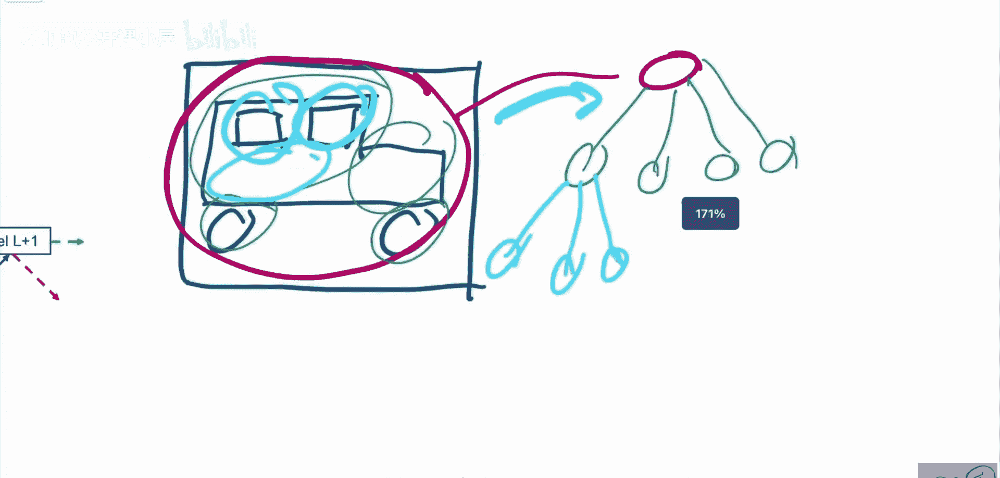

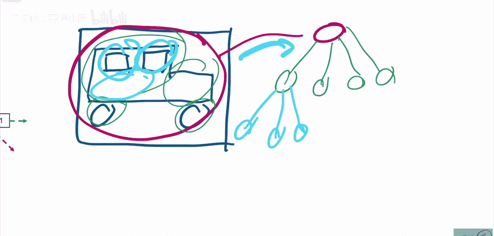

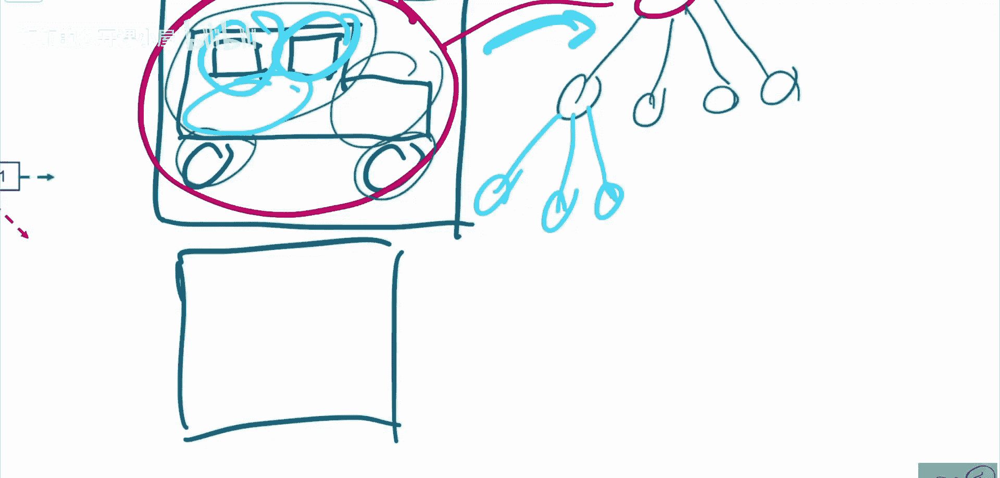

This one has one descendant only， which in turn has two descendants and so on。 you see the point。

 the tree structure needs to be different each time。 This。

 in part was addressed by Hinton's capsule networks。 So in the capsule networks。

 Hton's idea was sort of okay， I'm going to have these capsules here in different layers。

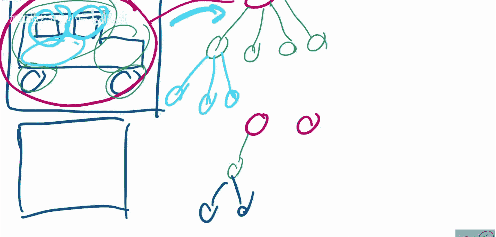

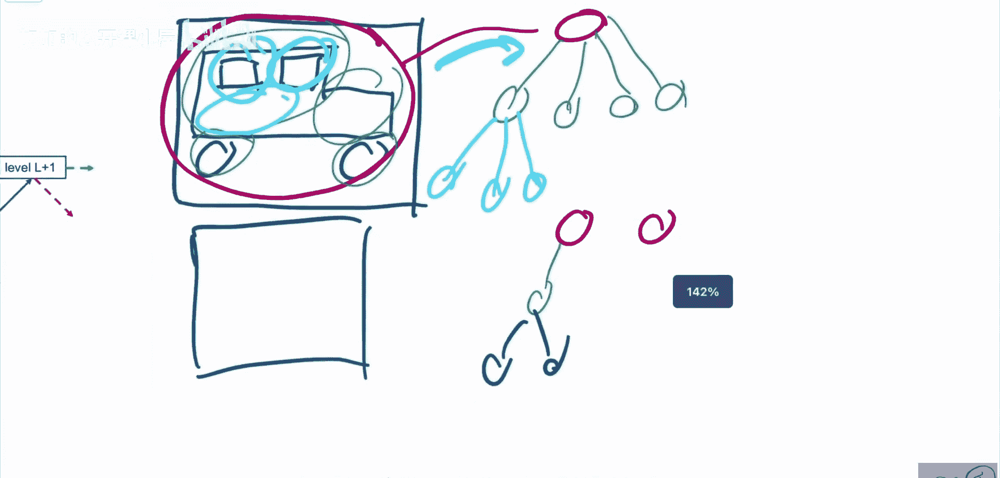

And I'm going to have kind of lots of capsules in these layers， lots of capsules in these layers。

 And I'm going over capsules because it's kind of important here so。

Hinton's idea with capsules was that。

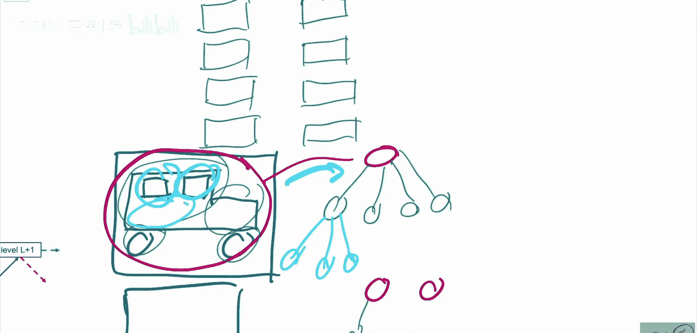

The first layer of capsules would sort of recognize the smallest parts。

 so this would be kind of the wheel capsule， and this would be sort of the window capsule。And so on。

 So there would be a single capsule for every part that could possibly be in an image， right。

 you already see the limitations because if you want to recognize the whole world。

 you need many capsules。 But nevertheless， this was the idea。

 So a capsule would be active if there was the given object in the image。 and then。

The next thing here， this would be kind of the the motor capsule， so the motor。Motor capsule。

 and this would be the cabin capsule and so on。 So the window would activate the cabin capsule。

 but the door capsule would also activate the cabin capsule and so on。

 And the wheel would maybe activate。 it would maybe activate。 I don't know。

 The wheel should probably be here as well。 wheel at this level would activate that。

 And then all of these things here would activate the car capsule， sorry。So， you can see that。

This parry here is generated dynamically， right these connections。

 this routing in capsules is generated every time different。

 so in the next image there could be a different object。

 different capsules are activated different things are routed together。

 The parry is different however， you need these many， many capsules for that。

 every one capsule per possible part in the image， and that was just infeasible and also the routing was very cumbersome in these capsules。

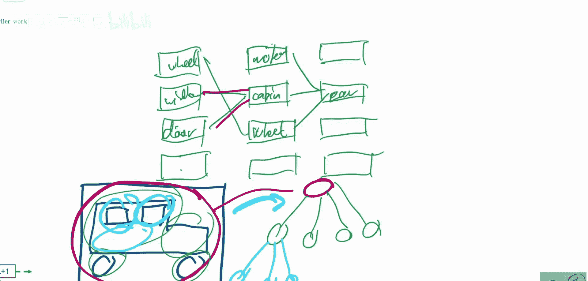

So here we go with a new approach。 and this new approach is what。

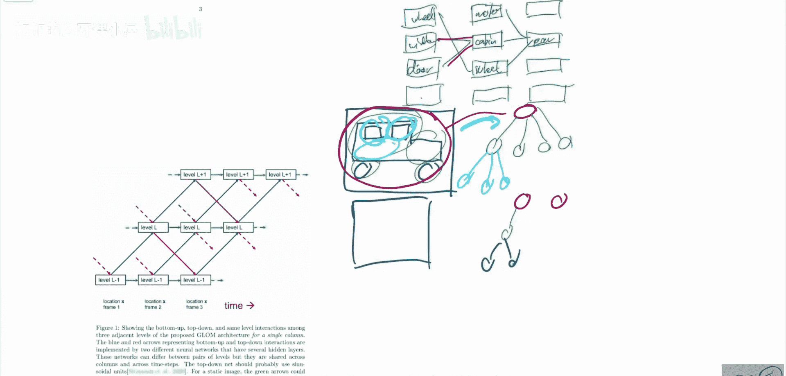

Hinton describes as the G architecture is composed of a large number of columns。

 which all use exactly the same weight。 Each column is a stack of spatially local auto encoders that learn multiple levels of representation for what is happening in a small image patch so。

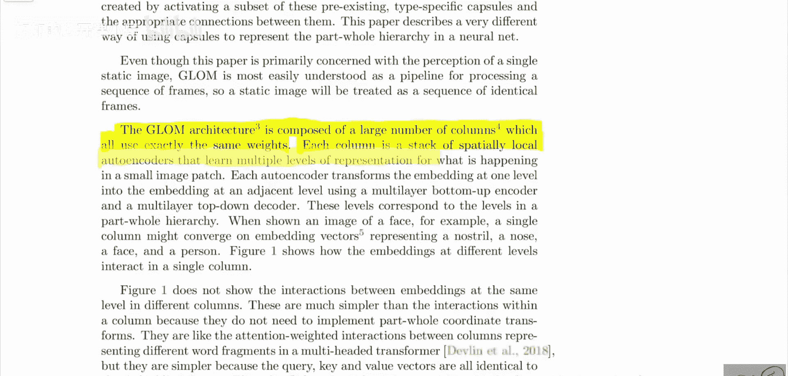

We're going to build up some kind of imagination here at the at the bottom level， we have our image。

 so our image is going to be lying flat on the ground。 Maybe you can see it like this and。

It is going to be divided into pixels or small patches， whatever you want。

 But these are would be called locations。 So it would be divided like this into different locations。

 I am not good at perspective drawing。 In any case， above each location。

 there would be one of these columns。 and these columns。 I can draw on here。

 These columns would sort of stack up like this。And these columns would be divided into multiple levels。

 so there would be a bottom level， which would be this， there would be a middle level， higher level。

 and so on， Hinton suggests about five levels should probably do。

And every single level of this column tries to。Represent the location at the image。

 right this location down here。In a different resolution。

 So the very bottom level might be aware that there is a part of a wheel。 Like。

 let's say this is actually， let's say this is a cat I。So。Here， there is probably yup， yup。Okay。

 so you can see。There is。

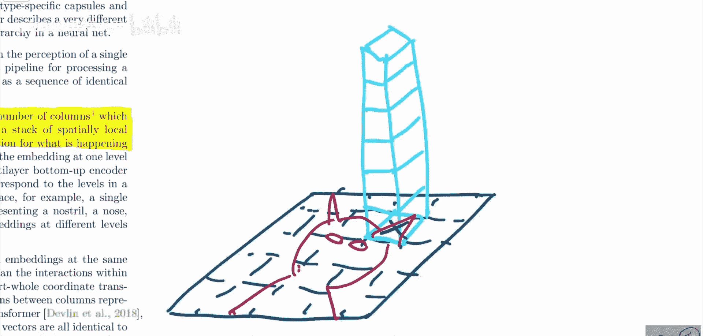

There is an ear or a part of an ear that states。