# YannicKilcher【中英⚡AI经典论文领读(全203篇)(下)｜Papers Explained】 p25 P125 杨立昆——自我监督学习：智能的暗物质（FAIR博文解读） [BV1j8x5zJEvx_p25]

Hello there。 Today we're looking at selfsupervised learning， the dark matter of intelligence。

 This is written by Janan Laun and Ian Mira of Facebook AI research， and it is not a paper。

 It is more a blog posts shared on the Facebook AI blog and it outlines the current state of self-supervised learning what it is。

 what it can do， why the authors think it is important。

 It goes over things like Bt goes over things like contrastive learning energybased models。

gans and so on， and at the end it gives a bunch of recommendations for the way to go forward on a high level the main recommendation is that we should build latent variable prediction models that are not trained contrastively and we'll go through all of what this means in this article so。

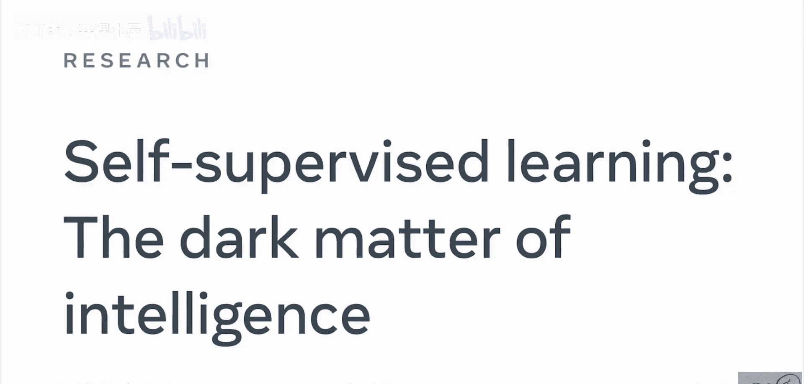

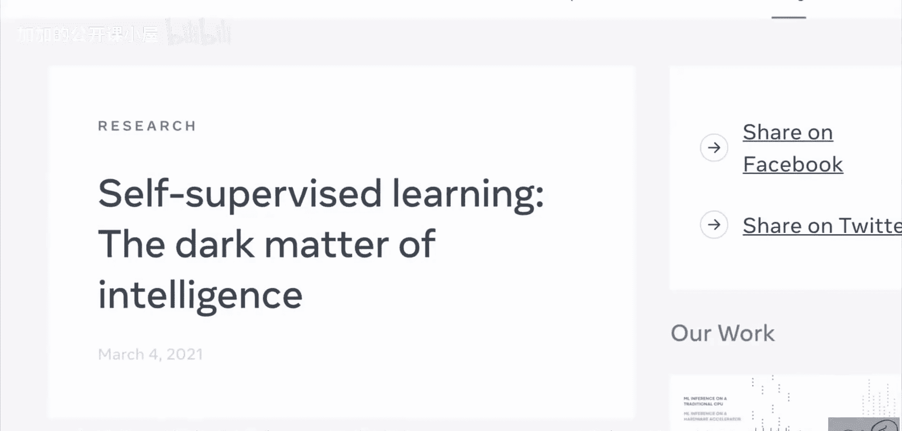

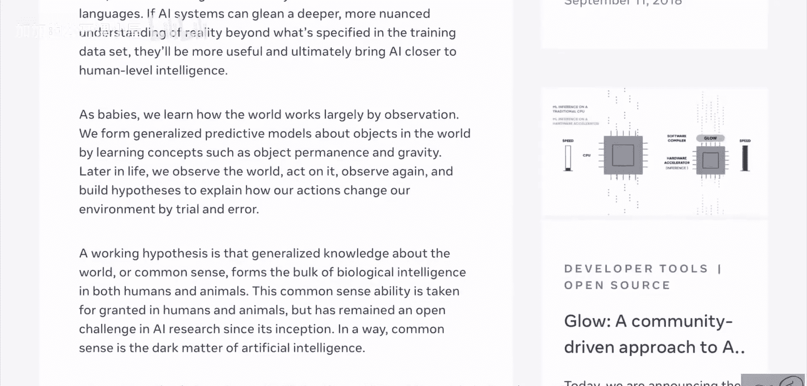

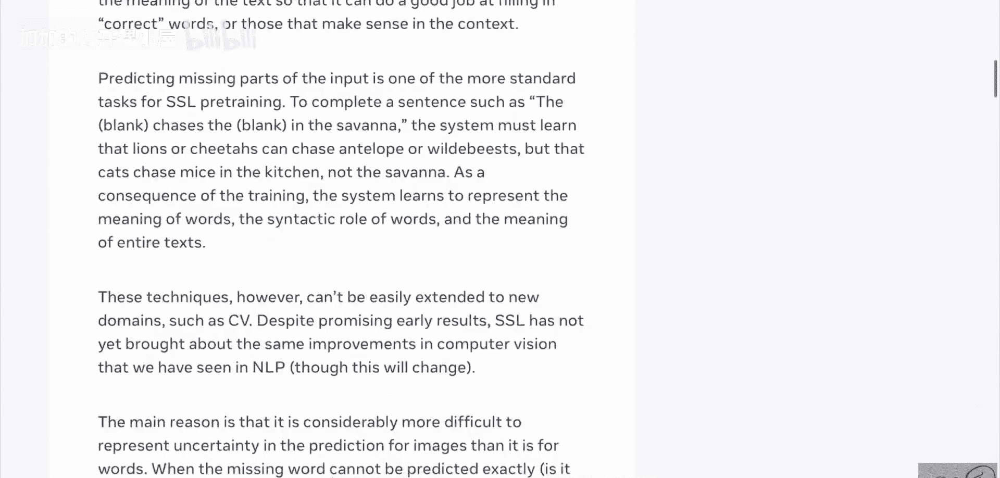

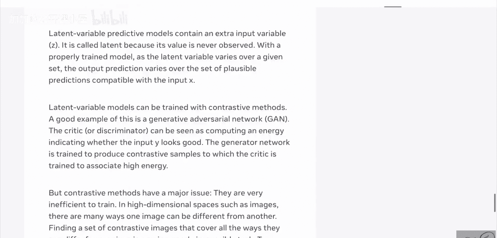

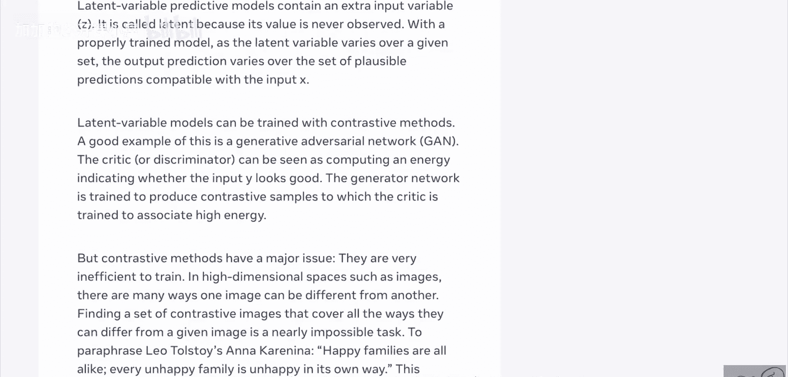

We'll go through the article I'll switch over to here where it's a bit of a more legible format and as always。

 if you like content like this， if you enjoy it， share it out。

 don't hesitate to tell a friend about it。Let's do it。They say in recent years。

 the AI field has made tremendous progress in developing AI systems that can learn from massive amounts of carefully labeled data。

 So the keyword here are massive amounts。 Yes， we got that but carefully labeled data。 Of course。

 we all know that supervised learning has worked very well if you have enough labeled data and that's exactly the problem in order to push machine learning to more to higher abilities。

 it seems like what we need is， first of all， bigger architectures which we can do by just building bigger computers。

 but we also need more data。The problem here is that we need orders of magnitude more data and labeling that data is going to be very。

 very expensive and therefore we're looking for methods that can do without labeled data that can learn most of what they learn from non-labeled data and then apply that to a little bit of label data in order to learn a task but this is not the only thing。

 so the need， the expensiveness of labeling is not the only thing that they criticize here。

 They say this paradigm of supervised learning has a proven track record for training specialist models that perform extremely well on the task they were trained to do。

So this is another criticism right here。Namely， that。

If we train something in a supervised fashion with labels。

 it will become or it might become very good， but it will be very good at that particular task。

 and it won't be super good at other tasks such as tasks that are relatively neighboring to the field that we're concerned about。

They go， they say that supervised learning is a bottleneck for building more intelligent generalist models that can do multiple tasks and acquire new skills without massive amounts of label data this isn't into the direction of Francois Cholet who defines intelligence as the efficiency with which you transform new data into new skills and this is reflected here in this article by Jan Le and I'm sorry Ian but Jan Leka just has the big name and unfortunately you're a bit in his shadow here but I'm fairly confident that Jan Leka is not just on this for the name because the arguments in this article he has raised in many talks that I've seen of him in the past few years。

 so it is really kind of a condensing of all of these talks in this here。But back to the paper。

 this acquiring new skills without massive amounts of labeled data。

 they say that has to be our goal because it is impossible to label everything in the world。

And there are also some tasks where there is not enough label data like translation systems for low resource languages。

So they make two observations right here。 First of all， they say， look。Here， for example。

 if we show just a few drawings of cows to small children they'll eventually be able to recognize any cow they see by contrast AI systems trained with supervised learning require many examples of cow images and might still fail to classify cows in unusual situations such as lying on a beach。

 what are you doing silly cow， don't lie on a beach。So this is another point， right these AI systems。

 they take so much more data than humans to learn new skills and they ask why the short answer is that humans rely on their previously acquired knowledge of how the world works so they make this they make this argument here that there is a thing like common knowledge about the world or common sense。

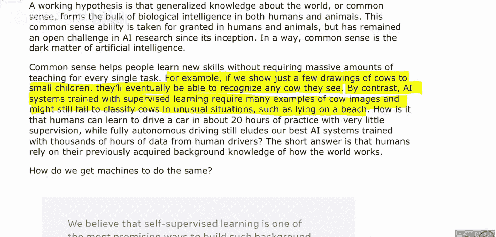

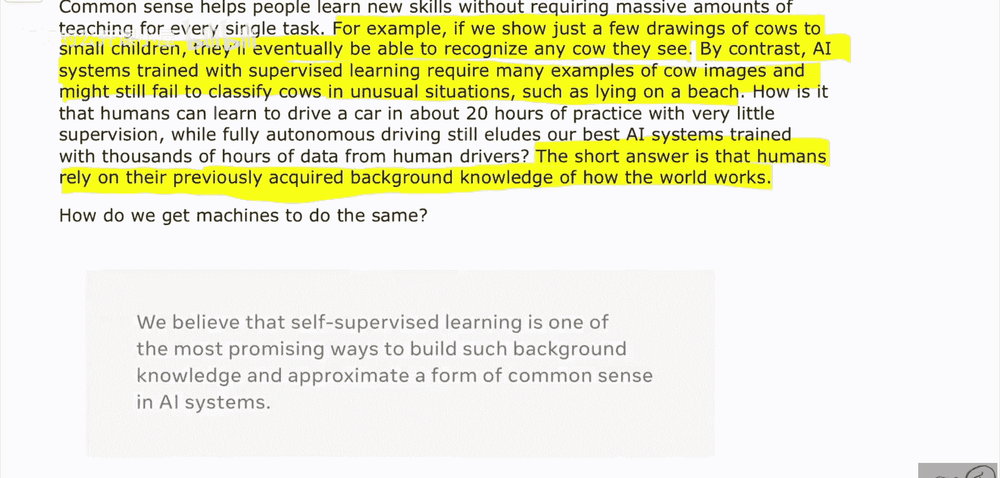

It formss the bulk of biological intelligence in both humans and animals。Humans are animals。Okay。

 this common sensibility is taken for granted， but has it remained an open challenge in AI research？

Common sense， they say， is the dark matter of artificial intelligence。

So they point out that you have this common sense that you learn simply by interacting with the world。

 they say as babies we learn how the world works， largely by observations。

 you form predictive models about the world， you learn concepts such as object permanence and gravity and later in life you even act in the world。

 now they're not going into this acting in the world， but their point is that，Throughout your life。

 you just observe the world and you built these predictive models。

 And that's how you learn about how the world works。

 I'm not entirely sure that things like gravity are learned in this way。

 I think there is some evidence that at least part of it is biological or at least you extremely biologically predetermined to learn about things like object permanence and gravity。

 but the point is taken that there is something built into you。

 either from experience or from biology that allows you that is kind of this common sense。

 and that allows you to acquire new tasks with extremely few additional samples。

 because you bring in this knowledge about the world。

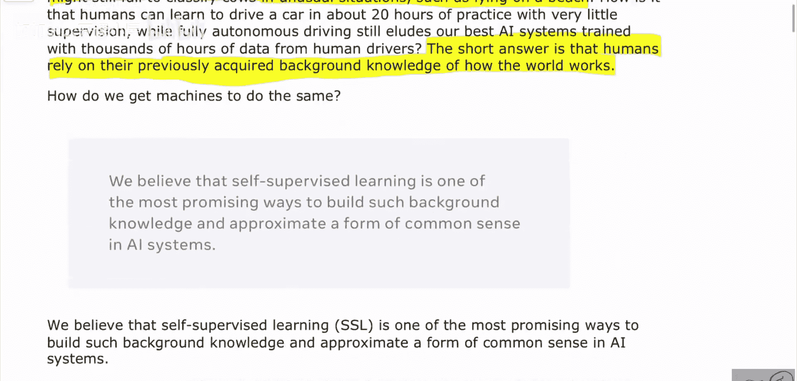

So their core claim here is that we believe that selfsupervised learning is one of the most promising ways to build such background knowledge and approximate a form of common sense in AI systems。

 they say the way we're going to get AI systems to also have this common sense knowledge is by doing self-supervised learning。

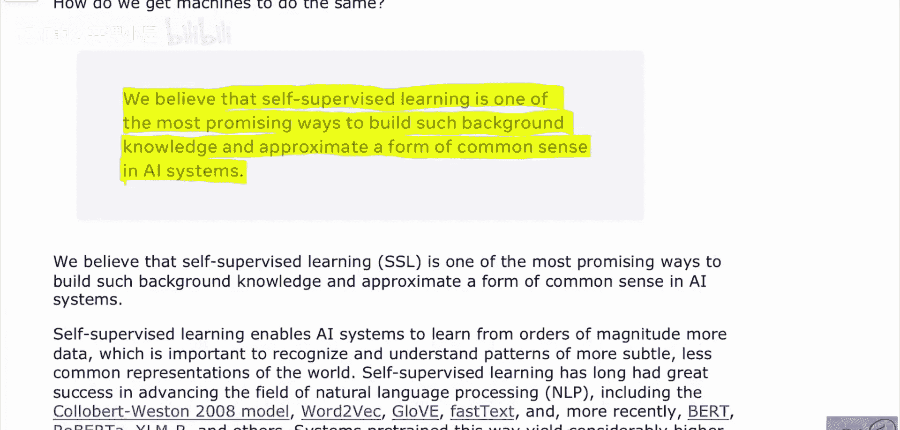

Right， so。They give some examples of self supervised learning。

 they also contrast it with unsupervised learning。Where。

The difference so they say unsupervised learning is a bit of a misnomer。

 learning is never really unsupervised。 Se supervised learning specifically means that you generate the label out of the data itself。

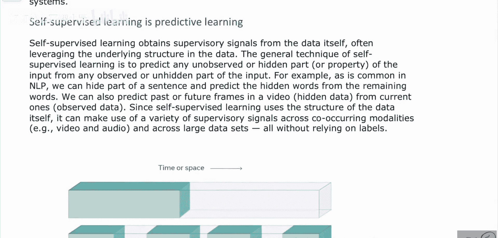

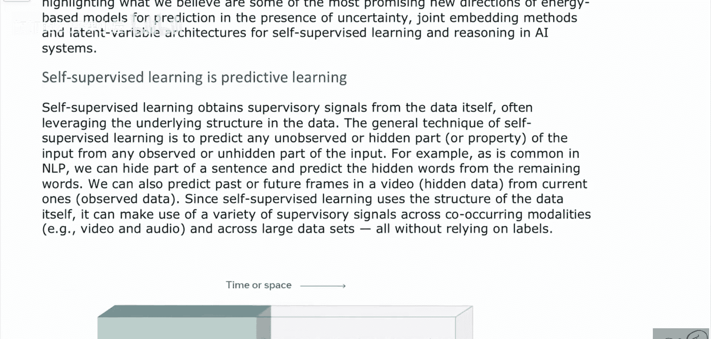

So。What could that be， You know， for example， in in Bert， the language model。

 you might have a sentence like this is a cat。And this is a sentence from the dataset set。 Now。

 in selfupvised learning， you would somehow need to come up with an input sample and a label for that input sample just by just using this text right in a supervised in a supervised data set。

 you would have some label associated with this。 And this could be anything depending on what the task is。

 like this could be labels could be。Annotations for what kind of words these words are label could be whether or not the sentence is a positive or negative sentence。

 but in self-supervised learning， you can do something like this。 And here's what B does。

 They cross out a word like this A。 So this now becomes the input sample X。

 And the label is going to be whatever。Was missing here。 So the label will be。The word A。

 Now the task of the machine learning system is given X。 figure out what is y Okay。

 so figure out that at this particular place in the sentence， there should be the word A。

Now BerRT does a bit more sophisticated things like it also replaces tokens and so on。

 but ultimately what you want is for any corrupted input for the system to output the uncorrupted output。

And thereby the system will learn about the world， it will maybe not about the world。

 but it will learn about language， if it wants to do this task correctly。

 it needs to learn that if you have this is construction。

 there should probably be some kind of specifier for what comes next right here。

 and then cat is some sort of an object or animal， so given all of this evidence。

 you only have very few possibilities like a。

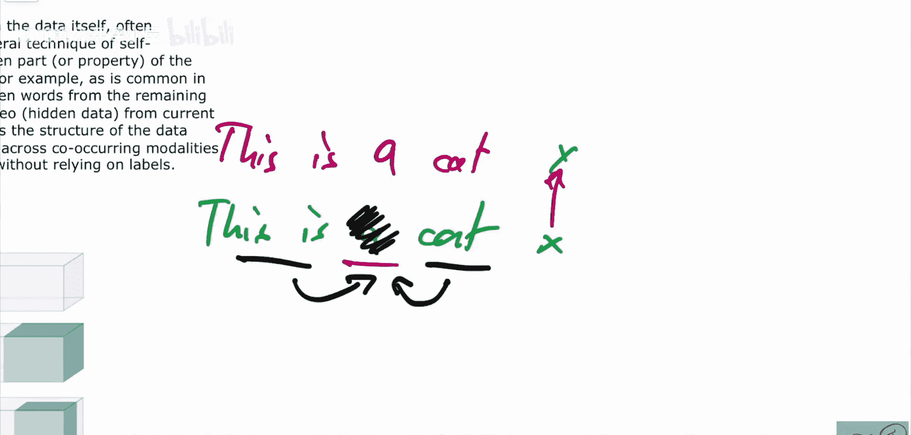