# YannicKilcher【中英⚡AI经典论文领读(全203篇)(下)｜Papers Explained】 p26 P126 预训练Transformer：通用计算引擎（机器学习研究论文详解） [BV1j8x5zJEvx_p26]

Hi there。 Today， we're looking at pretrained transformers as universal computation engines by Kevin Lu。

 Aita Grover， Pire Abeil and Igor Mordch on a high level。

 this paper argues that pretrained transformers specifically transformers pretrained on language modelling are doing something called universal computation。

 and the way they prove it is by transfer learning these transformers to completely new domains。

 So not language modeling。 they do things like X or tasks or C4 10。 So computer vision。

 they transferlear these transformers to these completely new domains。

 and they don't just do it in a regular transfer learning way。

 they freeze almost all of the parameters of that transformers。

 specifically they freeze all of the attention and all of the feet forward layers in the transformer。

 Therefore， they only fine tune about。

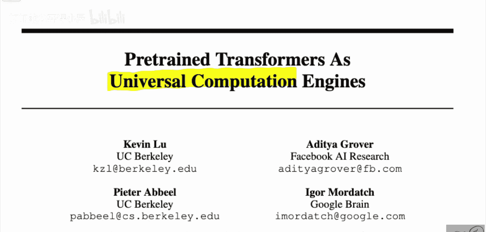

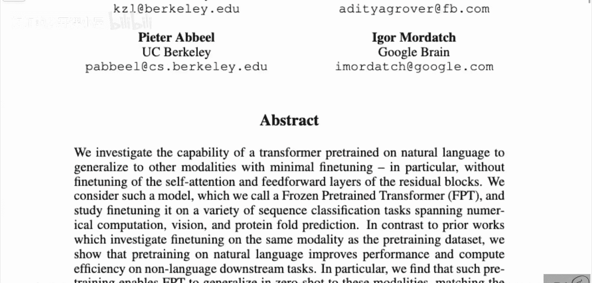

。01% or so or 0。1% of the parameters of the model and they show that on these specific tasks。

 these frozen pretrained transformers， as you can see right here。

 are competitive if not outperforming a transformer that is fully trained from scratch on these tasks and it also mostly outperforms LSTMs that are fully trained from scratch on these tasks。

 So this is pretty interesting and it gives rise to a number of sort of questions about what happens in these transformers。

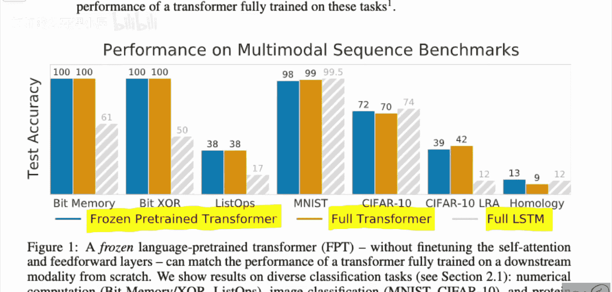

So we're going to look at what the claims are and what let the evidence brought forth by this paper is about why language pretrained transformers are universal computation engines and yeah I'll have some comments on my own。

 as always if you do like content like this， share it out。

 leave a like and tell me what you think is going on here in the comments。

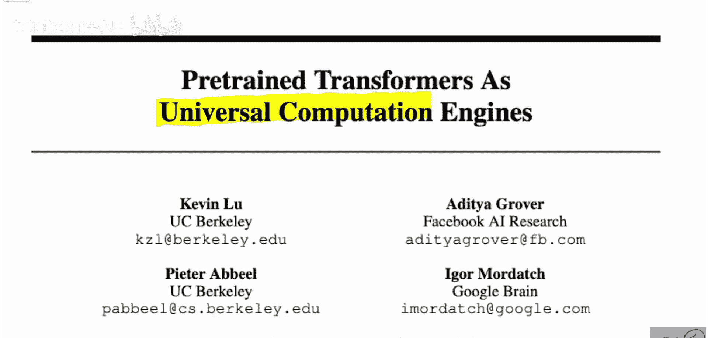

Right， so the abstract reads， we investigate the capability of transformer pretrained or natural language to generalize to other modalities with minimal fine tuning。

 and they say in particular， without fine tuning of the selfat and feet forward layers of the residual blocks。

 So as you know， or as you might know， a transformer is built approximately like this。

 So what you have， is you have input， So you have the positional embeddings and you have the input embeddings。

 Now， if it is a language model that is simply one vector for every word or word piece。

 if it is an image model like in the vision transformer in the VIT。

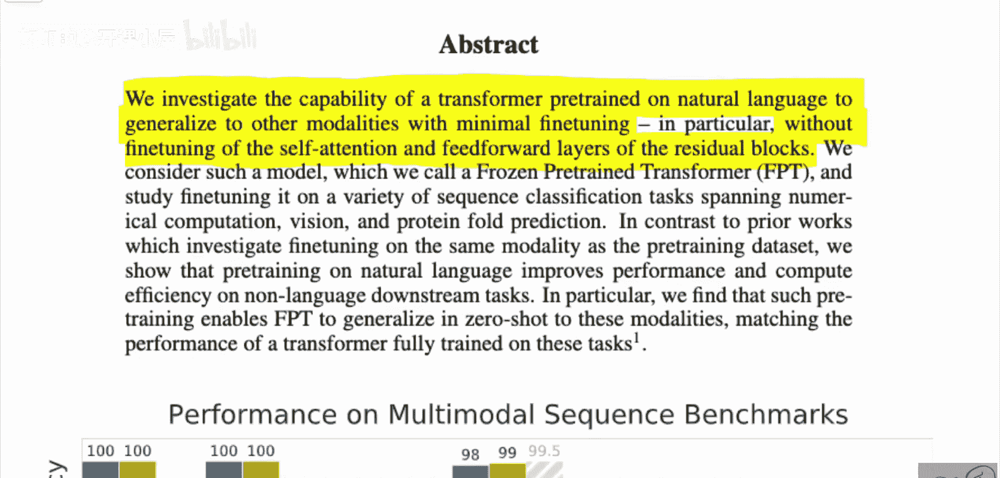

It is you simply take the image and you make it into these patches and then each patch。

 you simply unroll the patch into one long vector， so you simply unroll the pixels and that is a patch and that in the sequence of such patches is your inputs。

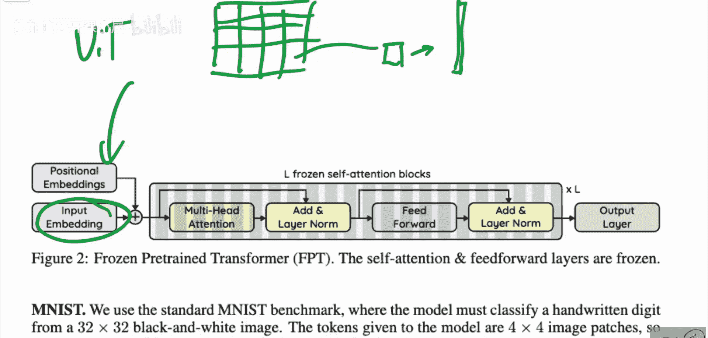

Now what follows is these selfattention blocks and this is the majority of the transformer is L times the selfat blocks。

 you always have a attention layer and if you don't know what an attention layer is I'm sure you'll find some video on YouTube that explains it this is followed by layer norm。

 this is followed by a elementwise feet forward layer and it is again followed by a layer norm。

 you also have the residual connections as you can see right here。

And then all of this is followed by an output layer and the output layer is very task specific in language modeling。

 it's obviously classifying into the vocabulary or into one of whatever the 30。

000 possible continuations in computer vision it might be classifying into the classes of the data。

 so for example an imagenet you'd have 1000 classes or 21，000 depending on which version you use。

So what they're saying is they are not fine tuning。They are freezing the multi head attention。

 and they're also freezing the feet forward layers。 Now。

 these make up like 99 some percent of the transformer。

 So what they get is they get a frozen pretrained transformers and frozen specifically refers to these parts I marked in blue in fact。

 they just keep the attention and they keep the feet forward layers as they come out of the of the language pretraining。

 and then they train the things on different tasks。 So these tasks are as follows。

 There's bit memory。

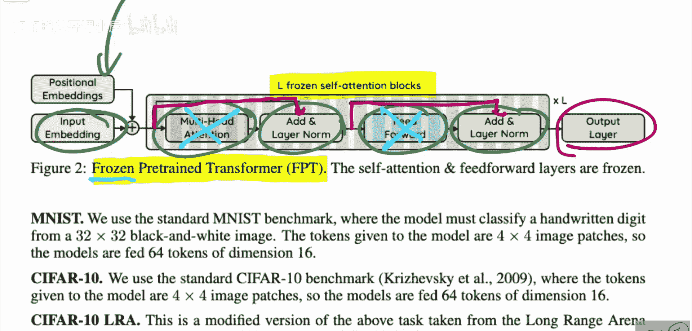

They consider a bit memory task where the model is shown 5 bit strings， each of length 1000。

 Afterwards the model is shown a masked version of one of the bit strings where each bit is masked with probability 0。

5 and a model is tasked with reproducing the original bit strings So you give you give it five bit strings in sequence。

And then you give it a sixth one that is kind of corrupted。

 and the model must figure out which one of these five it is。

 and then it must successfully reproduce that width string。

 So if it figures out it's probably numbered So the model has to look at the overlap between the strings。

 and then where there's the most overlap， it needs to copy over that string。

Or the non overlapping parts。 So this is a fairly complicated task for a model like this that is just trained with backpro。

 right， There is bits where you have two bit strings of length 5。

 and you need to compute the element wise X or this is a longstand。

 difficult task for neural networks。 We know that there is list ops where you get a sequence like this。

 And you must compute the result。 So it's acting a little bit like a calculator。

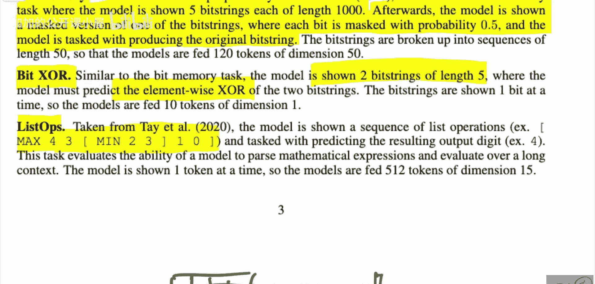

So now it turns actually out that if you think of the bit bit memory。

 that's already pretty similar to language， right， bit so maybe not list ops we're going to see that these models perform fairly poorly on the list ops task。

And then the last one is computer vision， so MN and C410 is the classic like vision transformer domain。

but still they take the transformer that's pre traineded on language and simply fine tune。

 the positional embeddings， the input embeddings， the output layer， and the layer norm parameters。

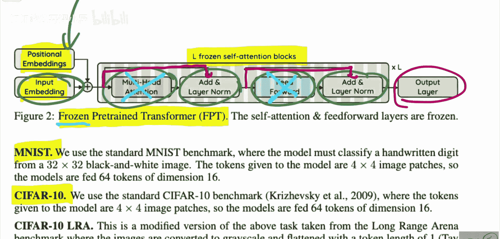

That's all they do and the last one is c410 from the long range arena where instead of forming patches like this in the long range arena task。

 you simply take every single pixel。Into as its own kind of。 so you don't do patches anymore。 You do。

 you unroll pixel by pixel。 That is significantly longer vector for the model to， to compute over。

 So it's going to make the task a bit more difficult because you completely lose all localization information。

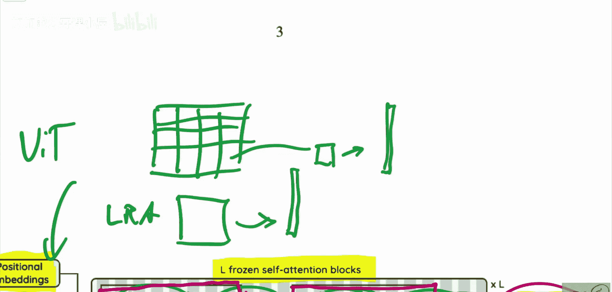

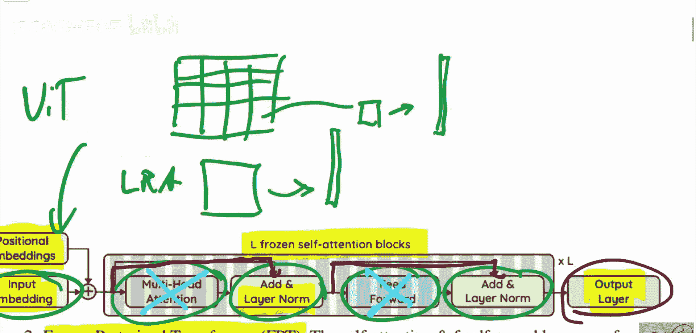

And the last one is this remote homomlogy detection。 It's a task from protein folding。Okay。

 so how do these， how do these things do， you've already seen this here in the overview。

 namely if you train these things on these bit tasks。

 or bit memory or bits or you can see that a if you the frozen transformer here。

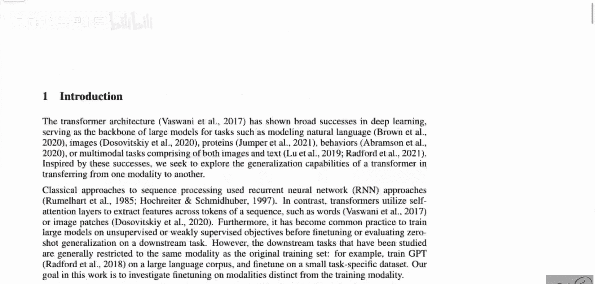

Reaches 100%。 so does the full transformer。 So what that shows you it's not necessarily which ones better。

 It's just that both are comp are able to completely solve this task。 Well， for example。

 an LSTM is not that we have no idea here what the size of the LSTM is。

 I don't think they stated anywhere。So the comparison with an LSTM。

 it is cool to see that the LSTM doesn't get this relatively simple task。

 but it also might just be a function of how large the LSTM is and how much rigor goes into training one。

 Nevertheless， the LSTM can't solve it。 And that's because the LSTM takes in a sequence as just one at a time。

 and it needs to sort of remember in its hidden state what the individual elements or and it can't go back right The transformer can always look back。

 The LSTM needs to remember everything And I think that makes it much harder to do these kind of sequence tasks。

 I already told you list stops。They all perform badly， but interestingly， they perform equally badly。

 so the full transformer here is no better than the frozen transformer， which is very interesting。

If you look at MNist and C for 10， actually all of the other tasks。

 you'll see that the frozen transformer is not worse than the full transformer。

 in fact it's sometimes better and that is going to be an interesting and interesting thing also to look at so the whole paper is actually just ablation studies into this phenomenon like why does this happen and it's very cool and。

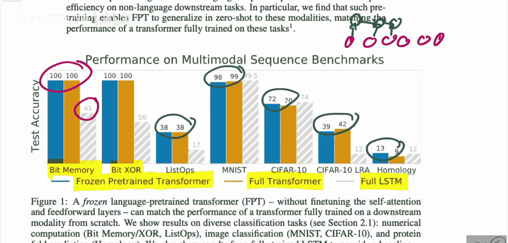

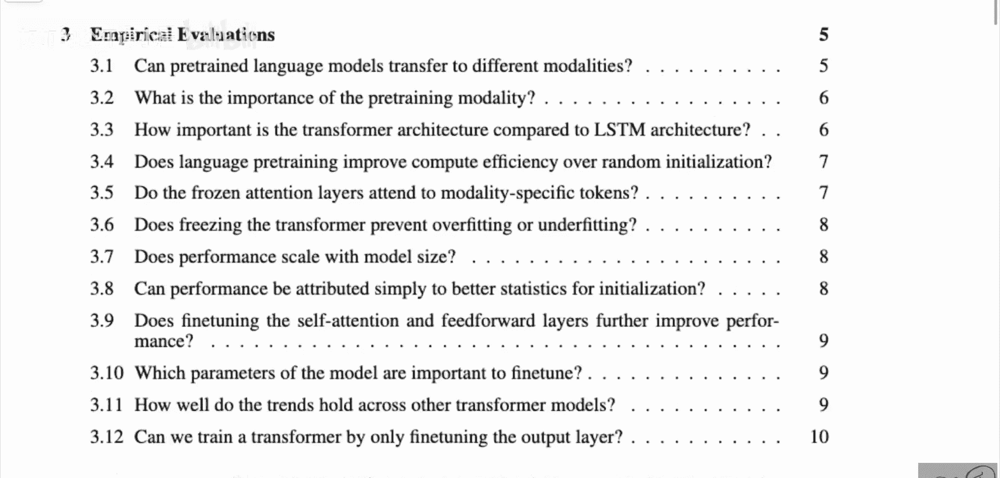

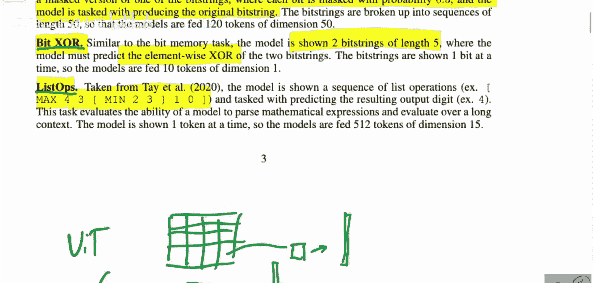

The result is going to be， so the authors claim that there is something special about language pre training that already primes the transformer to be receptive to these new tasks now。

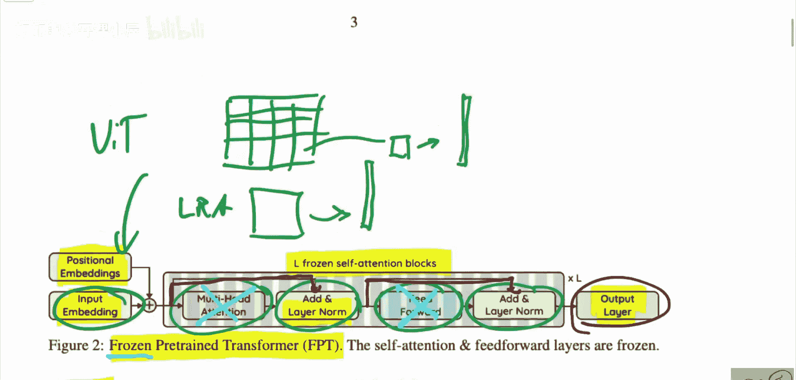

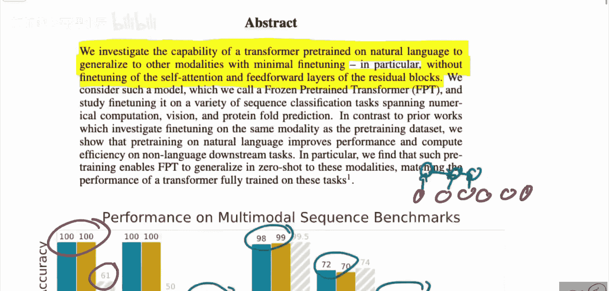

There are two different possibilities if you think what's happening here， actually。

 let's first go to the ablations and do the discussion at the end because one。

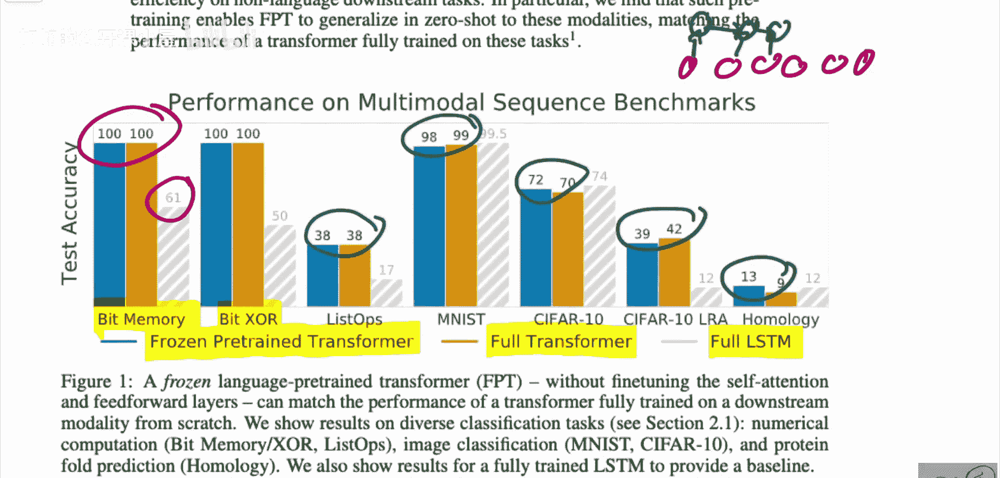

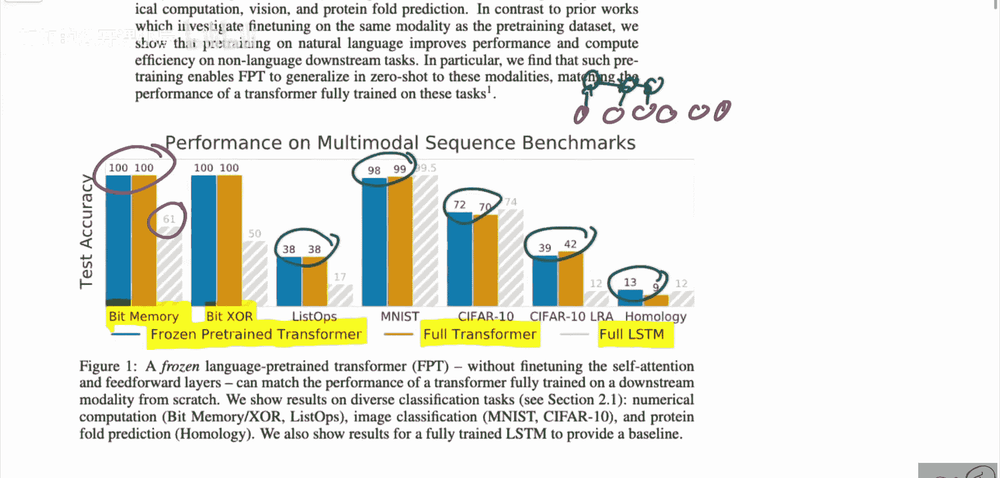