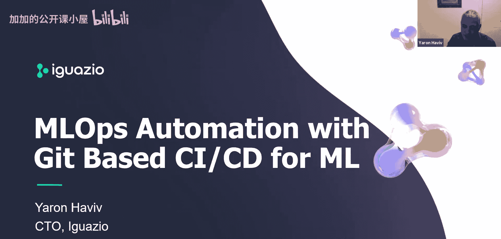
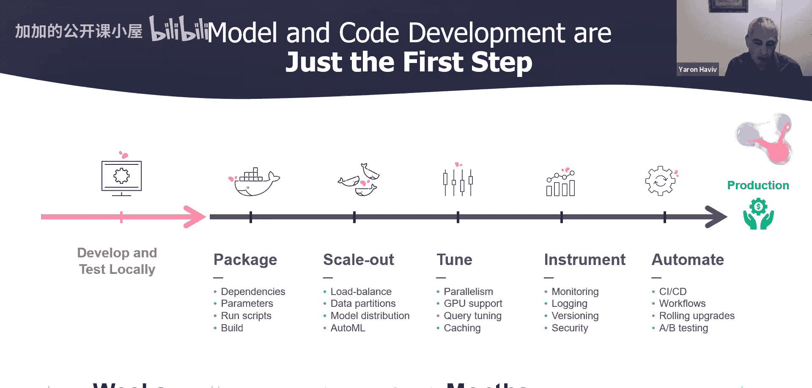
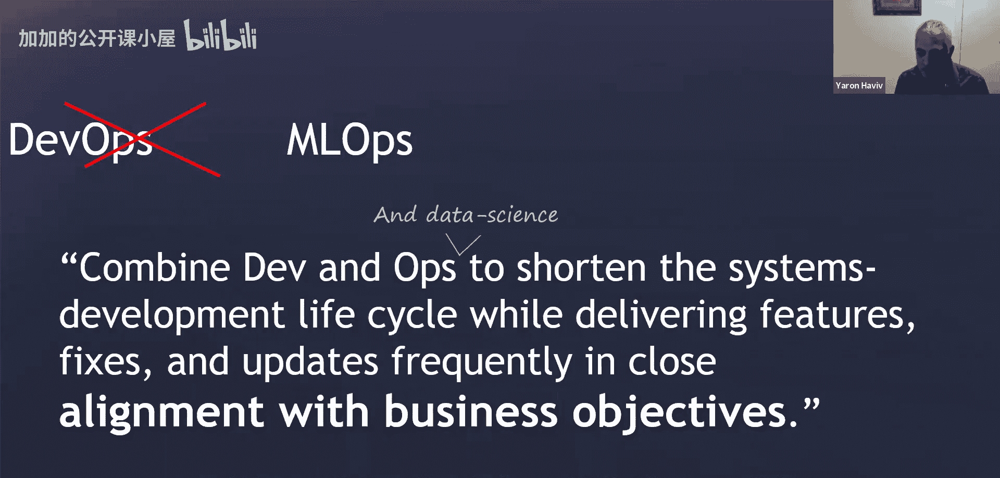
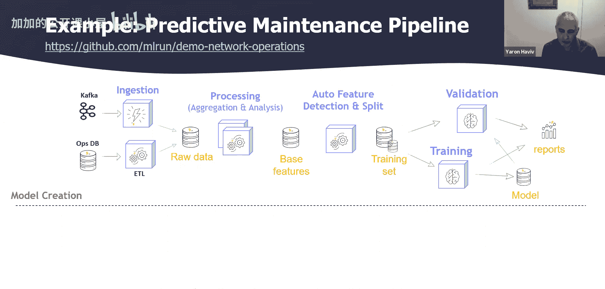

# YannicKilcher【中英⚡AI经典论文领读(全203篇)(下)｜Papers Explained】 p27 P127 网络研讨会：基于Git的CICD在MLOps自动化中的应用 [BV1j8x5zJEvx_p27]

Good morning good evening good afternoon depending on where you are in the world thank you for joining us today for today's CNF webinar MO ops operation with Gibased CicCD for M I'm Christty Tan I'll be moderating today's webinar we would like to welcome our presenter today your own heavy cofounder and CTO of Iwaio a few housekeeping items before we get started during the webinar you are not able to talk as an attendee there is a Q&A box at the bottom of your screen please feel free to drop your questions in there and we'll get to as many as we can at the end。

😊，This is an official webinar of the CNCF and as such if subject to the CNCF Code of Con。

Please do not add anything to the chat or questions that would be in violation of that code of conduct。

 basically please be respectful of all your fellow participants and presenters。

Please also note that the recording and slides will be posted later today to the CNncCf webinars page at CNncCf。

o/webinars with that I'll hand it over to your own to kick off today's presentation， take it away。😊。

Thank you and hi everyone I'm Yron I'm the cofounder and CEO of Iwaio Iquaazio is a very early member of CNCF and we've been active in variety of areas what we're going to speak about today is serve CICD and DevOs for machine learning what are the unique characteristics what you can do in order to again bring agility of DevOs and MLOps into your machine learning initiatives and obviously leveraging CNCF tools like Kubernetes and others and with that I'll just start with the presentation and again the slides will be available later and you can ping me in LinkedIn or Kubernetes or CNCF Slack and in both ways。

So first before we dive into the solution and what we're trying to solve。

 let's talk about the problem， the main problem today in machine learning is that once you've finalized the research and you develop something in small scale you extracted some data you ran some exploratory data analysis machine learning again in small scale in your notebook and evaluation you feel you're ready and now you need to create something that runs in production the production implementation usually is a reimple。

 it uses different frameworks， it's designed for scale。

 it's designed to be always on needs to be observed and all those things that signify a sort of a production environment。

 if you look at the diagram on the right you see that we need to feed data from real data sources from production data sources from streaming data。

 we end up with very large scale data so you have to analyze it in a distributed fashion。

Not within our notebook later on we need to run training and this training may run in sort of a CI manner in an automated fashion every time data changes or every time we change code or logic or models and finally we need to serve the models as well as monitor them and serving a model requires also having realtime data that is exactly the same like the training data just runs faster in a more interactive way。

 so usually when people build those solution they they reimplement in some cases they use Hadoop and sparkark and streaming technologies in some cases the leverage Kubernetes sometimes they change the code from Python to Java or rewrite the code to make it more hardened take into consideration security and other aspects。

One of the main challenges in that transition is that when data scientists implement code。

 they write it usually in sort notebooks data scientists focuses not on coding。

 they're not developer， they're data scientist so they focus on is on the best mathematics。

 the best statistics algorithms， the best learning or neural networks。

 and not necessarily on making their code robust， making their code deployable scalable and all those things that is a software developer or person you usually care about so the main challenge is how do you take code that wasn't designed for anything operational。

 usually if you look at a notebook it's not even divided it to functional building blocks you have the same notebook with training with data preparation with charting with sort of infferencing everything in one jumbo and notebook and at the end in order to run it in production we have to turn it into a set of microservices that will run。

On a cluster in a real time or batch pipeline。So that's the main challenge that we need to solve before thinking about how to operationalize or automate our data science pipelines。

So just looking into the various steps in productizing any artifact。

 in engineering data science or even traditional software， what when you're dealing with data。

 there are bigger challenges， especially around dataization and performance and others so if we take our code the first step but we need to do is package it in Docker and have scripts and make and command lines and all of that and you think it's trivial but for data scientists it's probably not trivial so we need to sometimes someone else will take the code and convert it into a Dockerized containerized workload and then you need to think about scaling out and scaling out when you're dealing with data requires various aspects not just load balancing or service matches sometimes you have to partition the data you have to partition your model distributed it maybe run autoMl or hyperparameter tuning which is running various。

With the same logic and different parameters Finally， when you've done that。

 you need to think about performance data code that was written for research usually doesn't have low latency。

 doesn't have high throughput and someone needs to start thinking about you know what maybe I need to cache queries maybe I need to introduce GPUs add parallelism。

 make it asynchronous instead of synchronous etc。 and all those things require engineering efforts。

 require developers， they do this engineering they could be developers。

 they could be data engineers depending on organization。

 sometimes they they're called ML engineers once we have the performance sorted and ready。

 then we need to think about all the instrumentation aspects monitoring logging instrument observability you know versioning security Now this goes beyond the traditional microservices and cloud native architecture because we're not。

Just monitoring the container where we have to log and monitor the data。

 we have to monitor the versioning of the data We have to apply security also for data access so this is more complicated。

 especially when there is liability associated with machine learning if our model doesn't predict things properly we may lose money we may annoy someone and he wants to sue us because we made some gender bias so everything we do in the pipeline our code。

 our data our models our algorithms， everything has to be version and control and finally we don't want to repeat the same thing over and over again so we have to apply automation pretty much like we're doing with other cloud architectures we need to apply CICD and automated workflows and rolling upgrades and canaries and A testing the main challenge here is that once you add the prototype up and running it may take a few weeks because。

Today machine learning is well understood you just take an X boost model and you feed it with some data and you get a model The main challenge today is that you take productizing the entire thing would take about 12 to 18 months from many organizations that I work with so the main challenge is how to automate that and also break the silos between developers。

 data scientists， data engineers and let them work on one ecosystem。

So first what is MLOP so we understand what is DevOs。

 DevO's role is essentially to combine the development and operations and think together how they can accelerate the business or how they can allow the business to deploy software faster in an operationalized manner。

 so MLOps is essentially similar just extends it with a lot of data and machine learning practices of data engineering again。

 building models， liability， observability of those aspects。

So let's take into account use case， a simple use case would be predictive maintenance pipeline so we can see that even in this pipeline we have many variety we have many different steps the first steps is to essentially bring the data in the data could come in different forms it could come in streaming data or just come from variety of databases or personal databases and we need to run some ETL we take all that data and throw it in to sort a pile usually serve of a files in a file system。

Later we need to run some processing， some analysis to combine different data sets， to dennormalize。

 to join， to aggregate and form what we usually call feature vector or a batch feature vector that feature vector essentially。

