# YannicKilcher【中英⚡AI经典论文领读(全203篇)(下)｜Papers Explained】 p28 P128 感知者：通过迭代注意力实现通用感知（Google DeepMind研究论文解析） [BV1j8x5zJEvx_p28]

Hi there。 How is everyone doing Today， we'll look at the perceiver general perception with iterative attention by Andrew Ygel。

 Felix Jimmino， Andrew Brock， Andrew Scissarman Oriole Vinys and Zo Carrera of Deep Mind。

 This paper on a high level describes a model called the Perr。

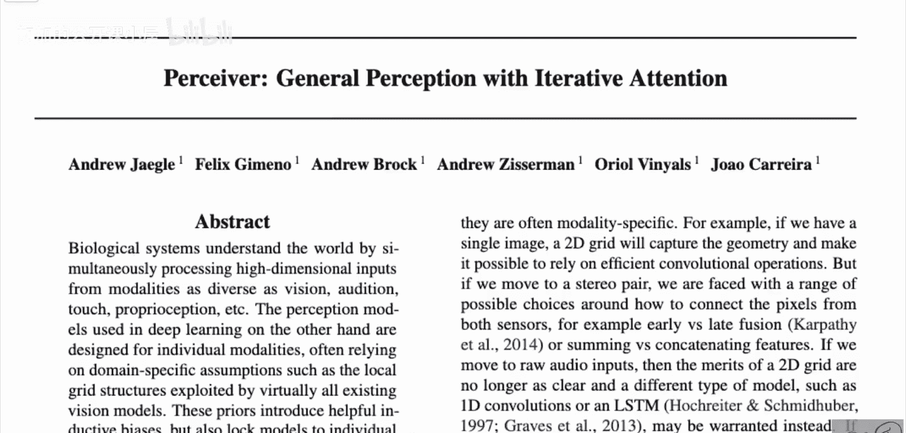

And what this model does is it interleaves a latent self attention mechanism。

With cross attention mechanism。 and so it is a transformer and the secret is that the data only enters the transformer through this cross attention mechanism that allows the model to have the latent array be of significantly lower size than the data array and this solves in part。

 the transformer's quadratic memory and compute bottleneck the。

Image comes in or the data rather comes in multiple times through this stack。

 and the weights can be shared， making it essentially a recurrent neural network。

 This model here works for any modality。 So the paper not only does images。

 but videos and audio and point clouds。 And you almost have to。

 you have to change pretty much nothing about the input in order for the model to work。

 So this is a pretty big step towards， first of all， making transformers more deep。

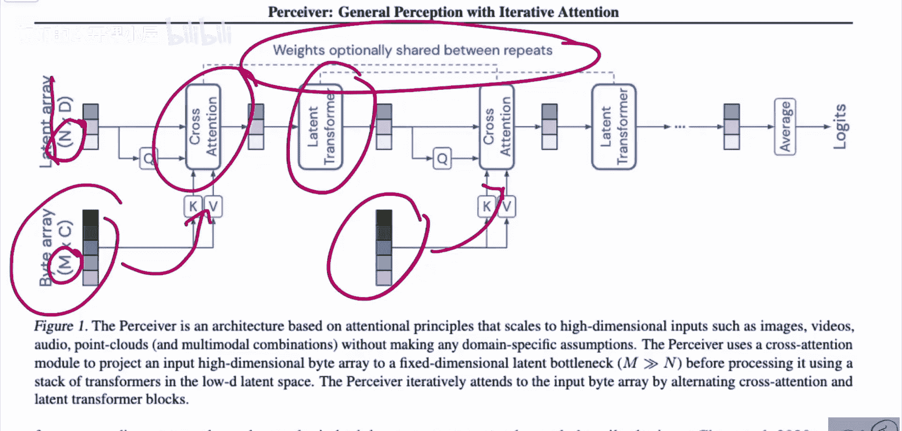

And second of all， applying the same models to very， very different modalities of data。

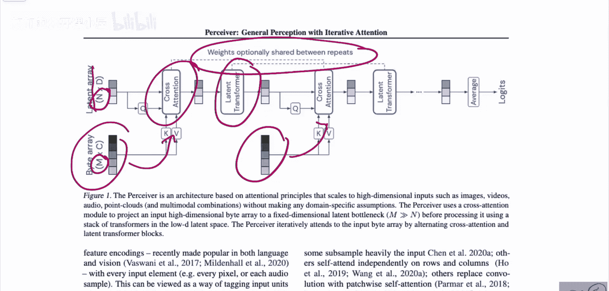

So we'll dive into the paper， we'll look at how it's done。

 it's actually a fairly simple idea so shouldn't take us too long。

 I always say that but maybe today we'll achieve it if you like content like this yeah tell me how you feel in the comments。

 leave a like， tell your friends about it and let's go。

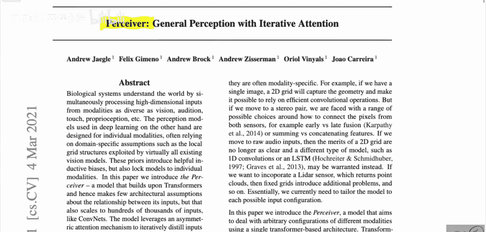

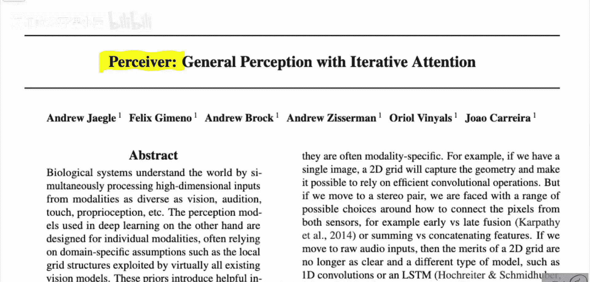

So they motivate the name， the name perceiver， it's not really tied to anything。

 they motivated by saying biological systems understand the world by simultaneously processing high dimensional inputs from modalities as diverse as vision。

 audition， touch， proprioception， etc。The perception models used in deep learning， on the other hand。

 are designed for individual modalities， often relying on those domain specific assumptions。

 such as the local grid structures exploited by virtually all existing vision models。

 So what do they mean they mean if we have an image and the image is of a not a cat a house。

 What did you think So the image is of a house and。If we have an image processing pipeline。

 usually what it will do is it will assume that the image is some sort of grid and that you can localize any pixel by its Xy coordinate and also that the pixel is in some kind of relation to the pixel around it。

 we usually build models according to that。 so a convolutional neural network very explicitly will slide over a filter over the image。

With all shared weights and therefore it directly says that what matters to a pixel is the pixels around it。

 and only in the upper layers and after some pooling do these receptive fields grow such that more and more information across larger distances is incorporated。

 on the other hand， something like a visual transformer like the VIT。

What it will do is it will do transformer like attention。

 but because it can't because the images are so large。

 because whatever 224 by 224 pixels are just too much to put into one transformer。

 it will simply subdivide the image into these patches。

 and therefore it also essentially says it will take each patch and make a vector out of it。

 So it also essentially says that whatever pixels are close together。

 they go into this one vector so they're treated as a group。

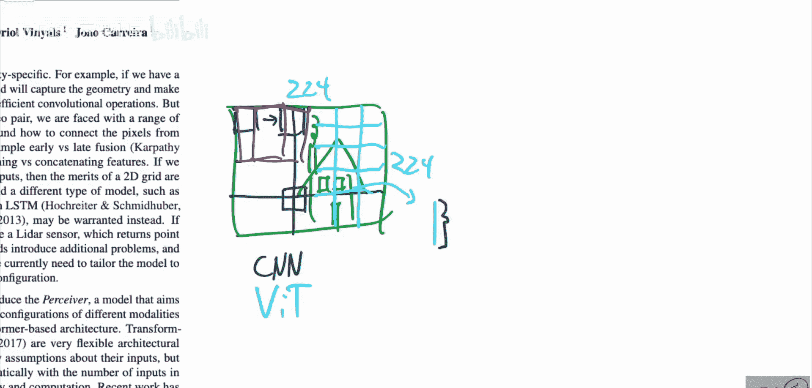

So this paper says that all the current architectures that deal with computer vision somehow have this built in。

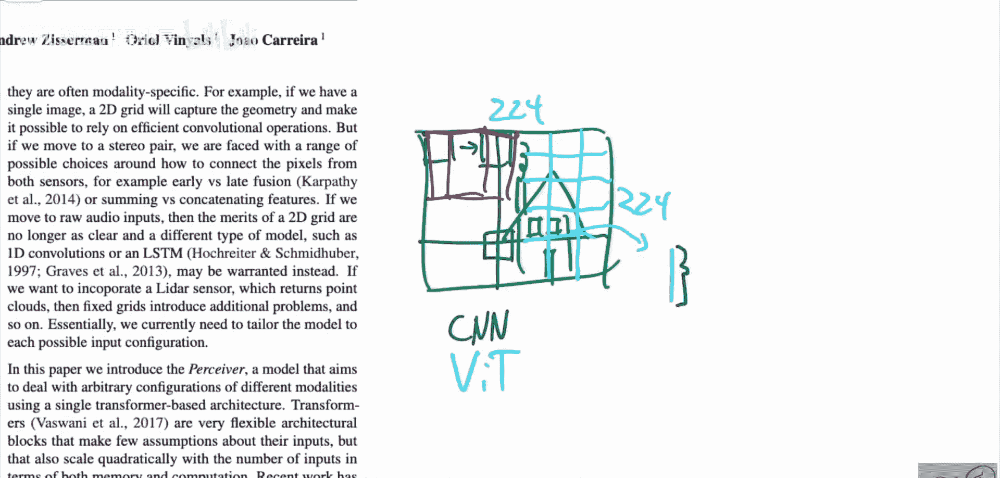

However， the。So other models have that too， other modalities like audio， video， and so on。

 and the perceiver here is supposed to alleviate that。

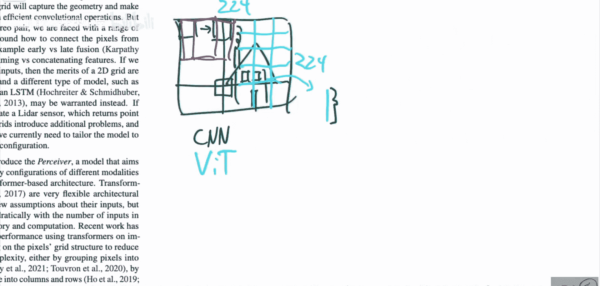

So they say it induces helpful conductive biases but also lock models to individual modalities in this paper we introduce the Perr。

 a model that builds upon transformers and hence makes few architectural assumptions。

About the relationship between its inputs， but also scales to hundreds of thousands of inputs like conves。

So transformers notably have or models that transform sequences to sequences or let's say sets to sets。

 so you have an input set。And what we've usually come to know as transformers are stacks of self-atten layers and in the self-at layer。

 what you would do is you would simply transform the input into an equally length output sequence and in the middle you'd have this attention mechanism and the attention mechanism essentially needs to compute the weight between every one of the inputs and every one of the outputs giving rise to an O。

Of let's call that M， I think they call it M squared。 So here you have M sequence length。

 So an O of M squared compute and memory requirements。 Now， if M is small， that's not a problem。

 But if we go into the range of NLP， usually So in in NLP。

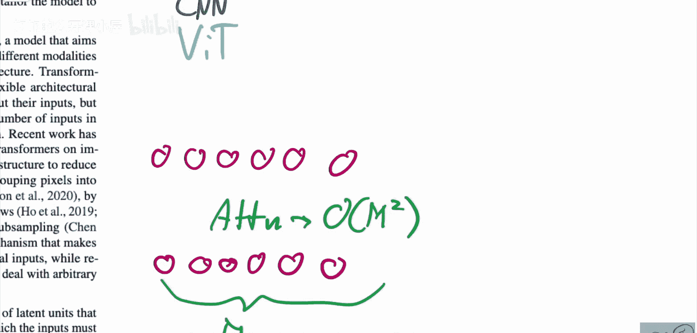

We usually deal with Ms in the order of， I don't know，2000，1000， let's say 1000。

So in the order of 1000， though， we would want more ideally， but in the computer vision。

 our M is easily something like 50 k， which is about 224 squared so。

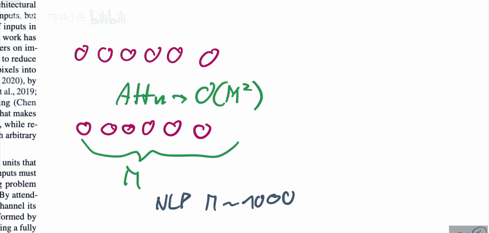

The M squared would be 50000 squared。 and that just blows the memory of our computers。

 maybe not the ones in the future， but certainly the ones now。 Allright so。

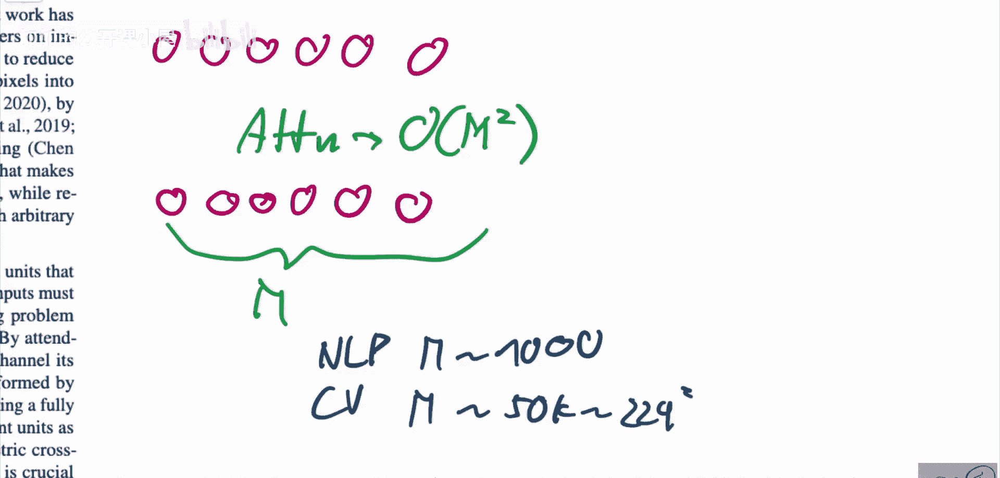

The problem here is that。These transformer architectures take too much memory。

 What this paper does is it goes ahead and it says。

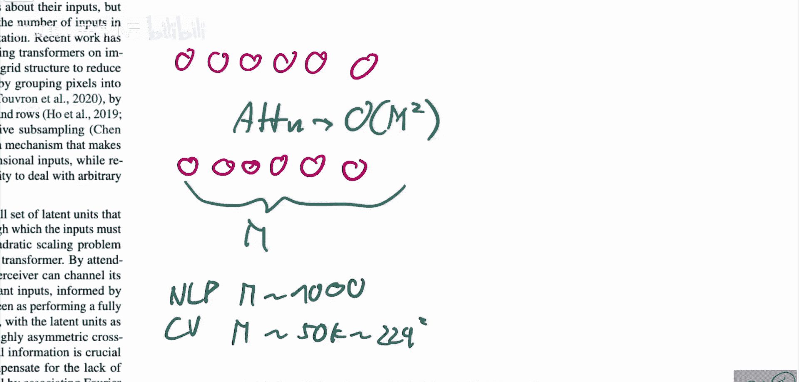

Couldn't we do a better job， So usually in a transformer layer。

 I'm going to draw this again here as two layers。 What you'll do is you'll compute queries。

 keys and values from the same input。 So you have your input。Right here。

 And what you'll do is you'll compute queries， keys and values from that input。

 and those get mingled together in the attention。And that gives you the next layer。

 and you'll produce queries， keys， and values again。Quries， especially are of size M by D。

 Keys are also of size M by D。 Now， if you multiply those two together and you transpose this。

 you can clearly see that gives you a matrix of size M by M。What this paper does is it says， okay。

 we can draw back actually on what the very initial transformers proposed。

 the very initial transformers if you remember and if you don't， you can go watch my video on it。

The very initial transformers were something like generative models that had an input sequence。

And they had an output sequence， so the output sequence。

 and maybe that wasn't fully completed yet right so you want to predict the next thing。

 but there was a clear distinction between sequence A and sequence B。

 Now sequence B would do self attention so they would have these stacks of self attention layers with the quadratic thing。

 and ultimately you'd want some kind of output here。Such that you know what the next word would be。

 this is sort of an auto regressive model。 However， the input did not use self attention。

 it used cross attention。So it was also a stack， but it used cross attention。

 so it went like sort of like this over。And the way that works is so by the way think of machine translation right so here is the German sentence and here is the half finished English sentence that you would want to complete so if you want to know what's here you need to attend to the English sentence so every part of the English sentence needs to attend to the English sentence。

 but also every part of the English sentence needs to attend to the German sentence that's why you have these paths going over。

But none of the German sentence necessarily needs to attend to the English sentence。

 it could make sense， but it it's a restriction where you say， okay。

 the information flows from the German sentence to the English sentence。

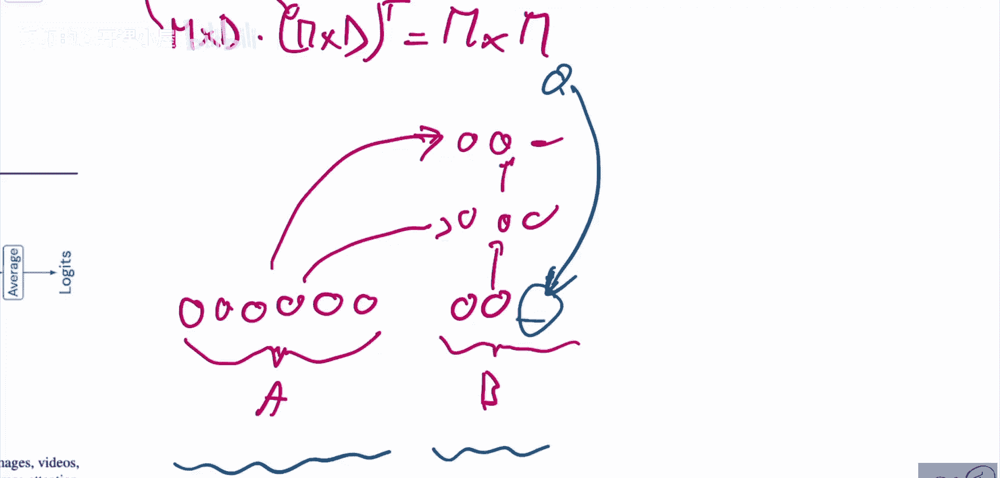

And that results in this cross attention where the keys and the value。

