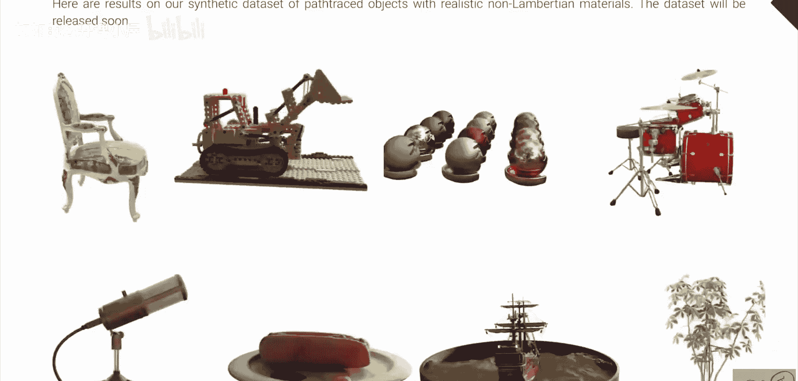
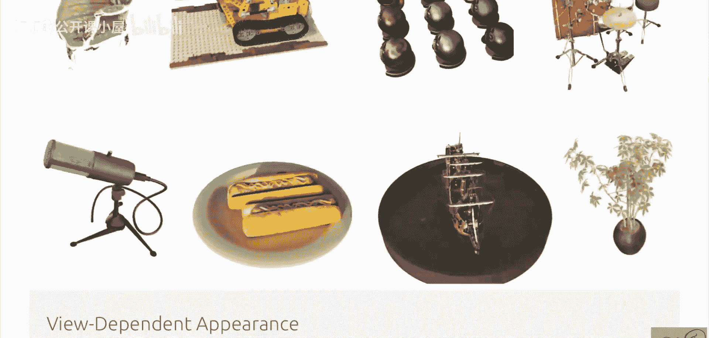
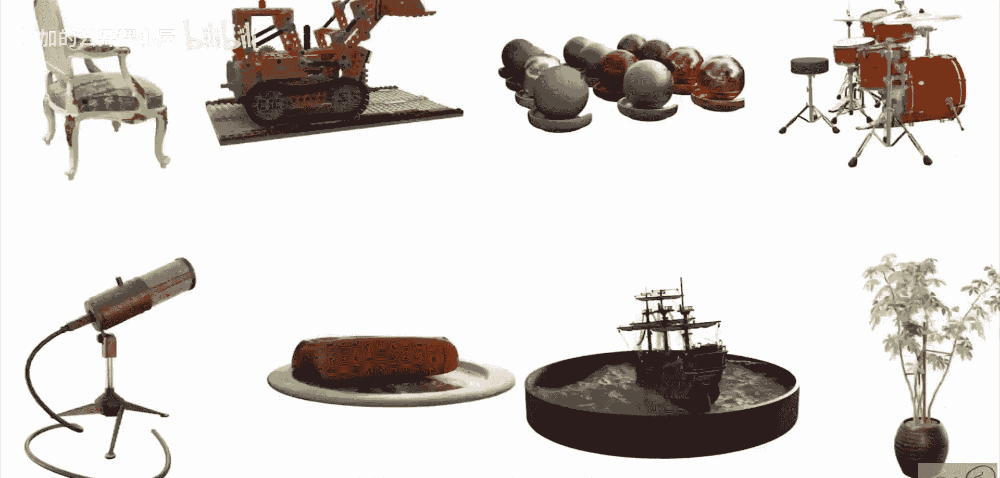
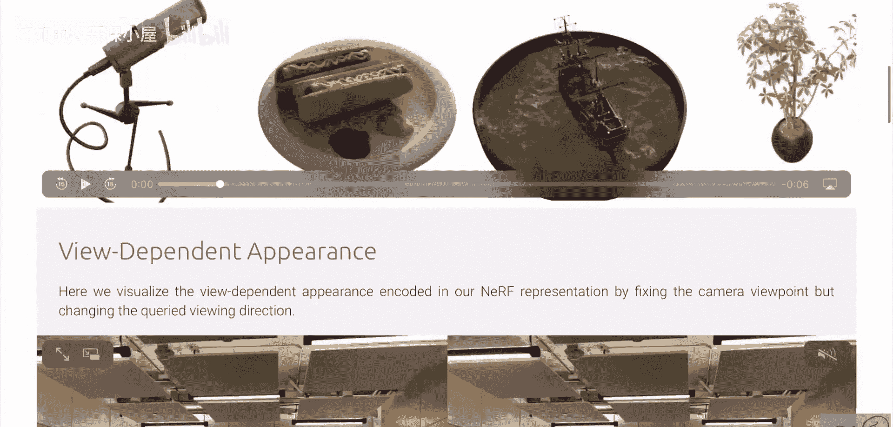
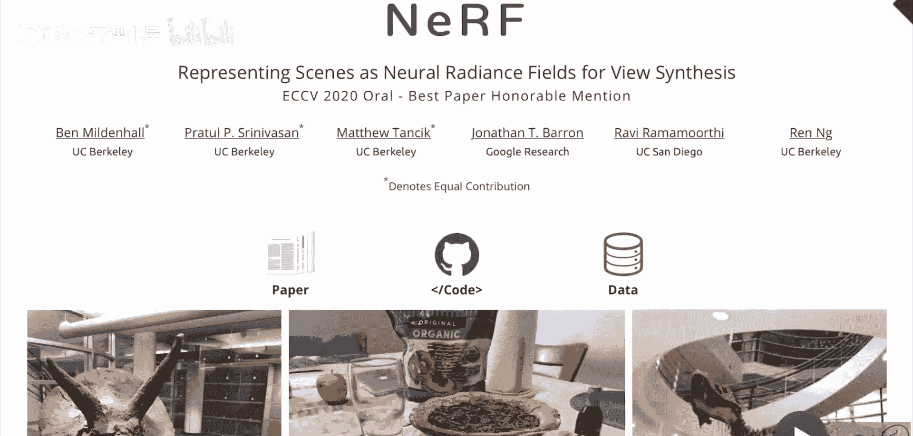
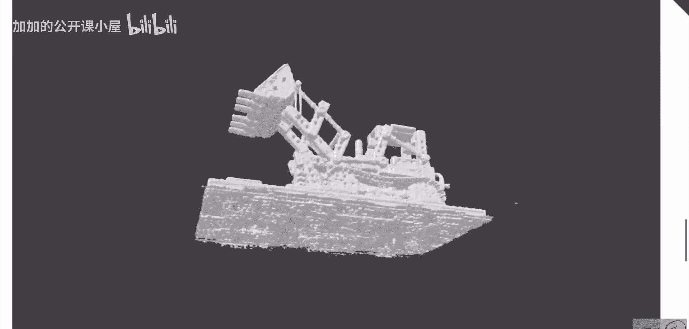
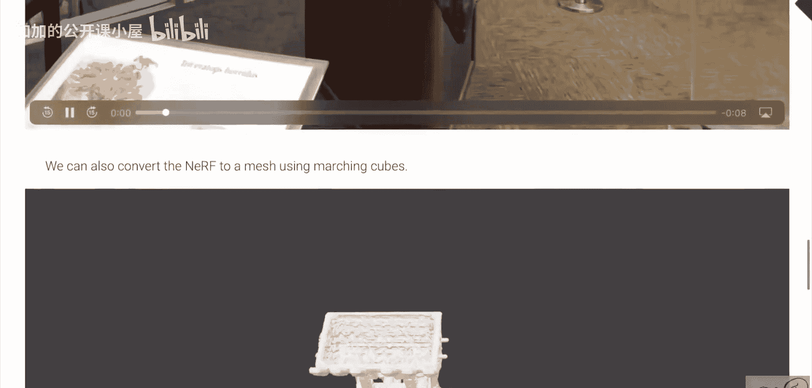
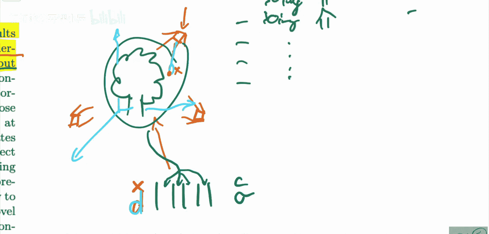

# YannicKilcher【中英⚡AI经典论文领读(全203篇)(下)｜Papers Explained】 p30 P130 NeRF：将场景表示为神经辐射场以进行视图合成（机器学习研究论文详解） [BV1j8x5zJEvx_p30]

Hello there。 Look at these objects right here。 What if I told you that I'm going to give you a bunch of pictures of these objects from different sides。

 And what you have to do is you have to come up with a system that generates me the picture as if the object was viewed from any direction。

 So something like this， right， any direction， you can get me a picture of that object from just a few input pictures。

 This is a pretty daunting task。 specifically look at the ship， for example， right here。

 you can see in the water， there's specities that only appear if you view it from a very particular angle。

 right， also the drum kit， you see that the microphone on the left。

 it has very specific structure to it。 So this is not at all like a trivial task。

There， there is very， there is very。Very intricate things here。 And this not only with toy data。

 but here you can see real world scenes。 So this isn't some kind of abstract thing。

 You can actually use this in the real world。Now， don't look at these things too long。

 They tend to make me dizzy。But that's ultimately the goal。

 In a few pictures and then being able to synthesize any kind of view。

 So the paper we're going to look at， it's a bit of an older paper， but I think it's pretty cool。

 And it's relevant。 And there is a bunch of follow up work to this。 This is very popular right now。

 This is the paper introducing Nerf。 representing scenes as neuro radiance fields for view synthesis And it's by sorry Ben Mildenha。

 Pratul P。 Srinivason， Matthew Tunchk， Jonathan T。 Barron， Ravi Ramaory and Re Unng。😊。

This as you can see， the task is called view synthesis and what you can do with view synthesis or with this paper specifically is you can it can also it takes into account your viewing direction。

 which gives a much more realistic impression we've already seen this with kind of the lighting here。

 but in order to really show you this on the left， you're going to see this novel view that is rendered and on the right。

 it's sort of like a fake thing that you couldn do in reality。

 but what we're going to do is we're going to keep the camera at the same position but we're going to tell the scene that the camera is at like switching around。

 and that makes you able to see just how different a like a room can look like if viewed from different directions。

 So the right one is really kind of physically impossible it's just meant to show you how different things look different。

Differently， if they think they are viewed from a different direction， Right， So the same thing here。

And it just looks amazing。What you get automatically out of the systems are depth maps。

 these are notoriously hard to get， especially for complex scenes such as this one。

 also this one right here。It's， it's very complex， and it handles it fairly well， sorry。

You can even do something like AR right here since you now have a representation that tells you how far everything is away and you have it from different views。

 you can see yeah， and you can even get meshes， so I should be able to move that around here。

 this is now a mesh， it's not only view synthesis， but you can actually fill out the voxels。

Which is a slightly different task。 And if you have pictures from all around。

 you can synthesize kind of any view in between， as you can see right here。

 So we're going to switch away from the fancy videos to the paper。 Now。

 the special thing about this paper。 And this is， it's in the spirit of something like sirens。😊。

So sirens， we I've made a video about it。 And the special thing right here is it uses deep learning in a little bit of a different way than we would normally use it。

 So first of all， what does the abstract say we present a novel。 sorry。

 a method where it is novel that achieves state of the art results for synthesizing novel views of complex scenes by optimizing an underlying continuous volumetric scene function using a sparse set of input views。

 So the task description is the view synthesis， synthesisthesizing novel views。 also。

 you're given a sparse set of input views。 So you're given you have a scene。

 Let's say you have a tree or something like this。 So here is a tree。😊，I know beautiful。

 And you're given a bunch of images。 So maybe someone， you know， stood here and took a picture。

 So the picture kind of views in， in this direction。 It depict depicts the tree。

 and someone stood here， and took a picture of that same tree。 maybe the same person。

 someone flew up here， took a picture of that tree。 So you get a bunch of those。

 maybe you get 20 or something around the tree， maybe more， maybe less。 So from these pictures。

 you w to build a thing that can generate any view from anywhere。

 And the way they do it is by optimizing。😊，An underlying， continuous volumetric scene function。

This is a cryptic way。But it goes along the direction of the sirens and kind of a bigger trend in。

 I think in the AI in these in these neural rendering papers and so on。

 which is that we want to overfit a neural network to a single data point。

 This is really different from classic deep learning if， you know， if you ask someone。

 how would you go about this problem with deep learning。 What they would tell you is， okay。

 I need a data set I need a data set of these， you know， different scenes and the input。

Now I have my X and my Y。 So the input X is going to be always like， you know。

30 images of a scene and y is going to be the scene itself or whatnot。

 like the tree or the mesh of the tree or something like this。 And I need this many， many times。

 So I need a data set with 30 images of I don't know。 a。

 a house and the the the y is the house and so on。 So that's my training data set。

 Then I might test data set。 It can be。Something else， right？

 So it can be things that are now want to test。 However， in this particular case。

 this is not the case here。The it， it is one neural network that is fit to one scene。

 So what we have is a neural network that。Has a bunch of layers。

And all the neural network cares about is this particular scene， right。

 If we want to render a new scene， we take a new neural network。 That's what I mean。

 we overfit a single neural network to this particular scene。

 We use the 30 images or so we got to train to completely overfit this neural network。

 and the goal is going to be that the tree itself， like the scene itself is going to be in the weights of this neural network。

 So the weights of the neural network now represent the scene。 and this has various advantages。

 right， if we already saw this with the sirens that very often this is a much。

 much better representation， more compact representation of the entire mesh than any other way。

 like if you store it in voxels or something。But I hope this is a bit clear。 Now， of course。

 the question is， what's the input and what's the output of this neural network。

 So the input is the following。 Imagine you have a coordinate system here。 So you get。

 you get a coordinate system， X， Y and Z。Okay， and the neural network gets two things as an input。

 It gets as an input， a position in that coordinate system， which wed call。We call x。And X is a。

 actually X， Y， Z is a three dimensional vector。 right， For example， right here， this is our x nowob。

And also， we get an D， which is a viewing direction。Okay， so the， for example。

 if my camera is the top camera right here， the viewing direction would be this ray here。 Well。

 everything's orange。 And I make that blue。 So the viewing direction。D would be that。 Okay。

 so the the angle here， we care about the angle。 it's actually two angles。

 you need to describe this viewing direction。 So a position and the viewing direction and the output of the neural network。

 What does it output。The output of the neural network is going to be a color C。

 like what color is at that particular location and the density is there even something at that particular location。

 right， So the density tells you whether there is something or not。 And if there is something。

 the color tells you what color it is， alright。This is a really different way。 I want to stress that。

 again， of using neural networks。 there is no longer images going in and you。

